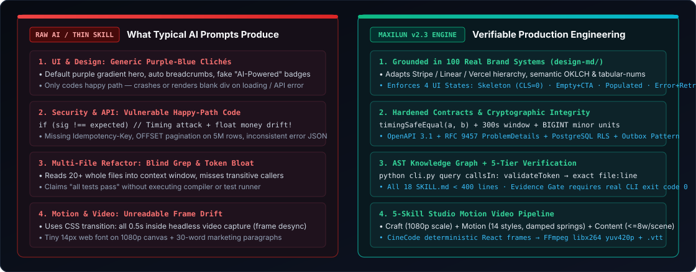
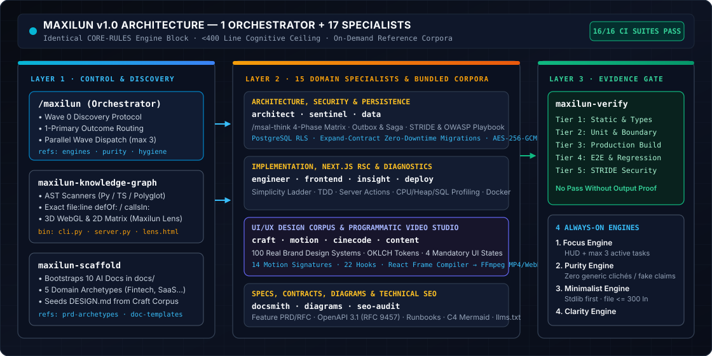
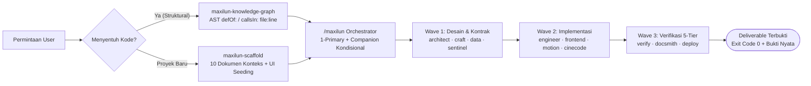
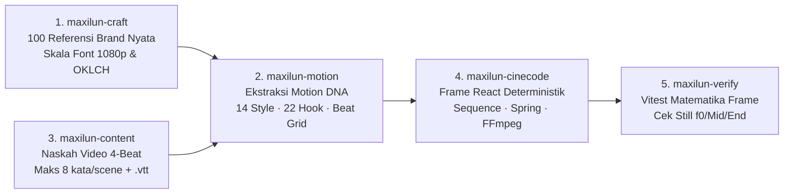

# Maxilun

<div align="center">


<br/>

[](https://github.com/giriedu/maxilun/actions/workflows/validate-skills.yml)
[](CHANGELOG.md)
[](docs/SKILLS.md)
[](LICENSE)
[](#dukungan-platform-ai)
[](https://skills.sh/giriedu/maxilun)

<br/>

[English](README.md) · **Bahasa Indonesia**

</div>

---

**Maxilun** adalah ekosistem 18 skill AI untuk tim rekayasa perangkat lunak: satu orchestrator dan 17 spesialis. Setiap skill membawa blok **Core Rules** yang sama, sehingga empat engine kualitas ikut terpasang bersama skill, bukan tertinggal di folder terpisah. Orchestrator menambahkan routing berbasis hasil, protokol discovery untuk brief kabur, koordinasi wave, dan gate delivery berbasis bukti. Materi mendalam (detail engine, katalog purity, higienitas kode, discovery, dan corpus referensi) ada di `references/` dalam masing-masing skill dan hanya dimuat saat dibutuhkan.

## Instalasi Cepat

```bash
npx skills add giriedu/maxilun
```

> Pantau dan jelajahi 18 skill Maxilun di [skills.sh/giriedu/maxilun](https://skills.sh/giriedu/maxilun).  
> **Mode Non-interaktif (semua skill)**: `npx skills add giriedu/maxilun -y` (tambahkan `-g` untuk instalasi global).  
> **Catatan Windows**: Jika symlink dibatasi hak akses Windows, tambahkan opsi `--copy` (`npx skills add giriedu/maxilun --copy -y`) atau jalankan script PowerShell di [docs/INSTALL.md](docs/INSTALL.md).

---

## Mengapa Engineer Memilih Maxilun (Bukti Nyata, Bukan Klaim Kosong)

Banyak repositori skill AI hanya berisi prompt tipis (*"tulis kode bersih, buat tampilan modern"*). Maxilun dibangun sebagai **infrastruktur rekayasa yang dapat diverifikasi** — lihat perbandingan kode & UI berdampingan di [**docs/BENCHMARKS.md**](docs/BENCHMARKS.md):

<p align="center">
  
</p>

| Masalah Umum Output AI Mentah (Raw LLM) | Artefak Nyata di Dalam Repositori Maxilun |
|---|---|
| **UI Template AI Generik** (gradien ungu-biru, radius seragam, breadcrumb otomatis, tanpa state loading/error) | **100 Analisis Design System Brand Nyata** di [`skills/maxilun-craft/references/design-md/`](skills/maxilun-craft/references/design-md/index.md) (Stripe, Linear, Vercel, GitHub, Wise, Apple, dll.) + kewajiban **Matriks 4 State UI** (Skeleton, Empty+CTA, Populated `tabular-nums`, Error+Recovery) |
| **Edit Lintas-File Buta** (membaca puluhan file penuh ke context window dan merusak pemanggil fungsi) | **Executable AST Knowledge Graph & 3D WebGL Lens** di [`skills/maxilun-knowledge-graph/`](skills/maxilun-knowledge-graph/SKILL.md) (`cli.py` + AST scanner Python/TS/Polyglot yang mengembalikan `file:line` `defOf:` / `callsIn:` presisi dalam `< 1 detik`) |
| **Celah Keamanan & Kontrak API Rapuh** (timing attack `!==`, uang memakai `float`, format error acak) | **Playbook Kriptografi & Kontrak OpenAPI 3.1** di [`maxilun-sentinel`](skills/maxilun-sentinel/references/security-playbook.md) & [`maxilun-docsmith`](skills/maxilun-docsmith/references/openapi-contracts.md) (`timingSafeEqual`, Argon2id, `BIGINT` satuan terkecil, RFC 9457 `application/problem+json`) |
| **Video Programatik Kaku & Tak Terbaca** (drift CSS transition, font kecil 14px, teks paragraf panjang) | **Pipeline Studio Video 5-Spesialis** di [`maxilun-cinecode`](skills/maxilun-cinecode/references/video-production-pipeline.md) + [`maxilun-motion`](skills/maxilun-motion/references/choreography-styles.md) (kompilator frame React, pegas teredam analitik, 14 style signature, 22 hook, FFmpeg `yuv420p`) |
| **Context Window Bengkak** (prompt ribuan baris yang menurunkan akurasi penalaran model) | **Batas Keras `< 400 Baris`** di seluruh 18 `SKILL.md` dengan `references/` on-demand — diverifikasi otomatis oleh [`scripts/test-suite.py`](scripts/test-suite.py) (16 suite pengujian CI) |

---

## Arsitektur Sistem & Orkestrasi Multi-Wave

<p align="center">
  
</p>

### Alur Routing & Koordinasi Tugas Rekayasa Kompleks



### Pipeline Studio 5-Spesialis untuk Programmatic Motion Video

Saat membuat video peluncuran produk, demo UI, atau laporan data MP4/WebM, Maxilun menghubungkan 5 spesialis secara deterministik:



---

## 18 Skill: 1 Orchestrator + 17 Spesialis

Disusun berdasarkan siklus rekayasa perangkat lunak dari fondasi arsitektur hingga eksekusi produksi:

| # | Skill | Fungsi Rekayasa | Pemicu Utama |
|:--:|---|---|---|
| 1 | `maxilun` | Orchestrator — routing berbasis hasil, protokol discovery, koordinasi wave, gate bukti | `/maxilun`, `mode maxilun` |
| 2 | `maxilun-knowledge-graph` | Fondasi Penemuan Kode — AST parser mendalam & WebGL visualizer (Lens) | `/maxilun-graph`, `/msal-trace` |
| 3 | `maxilun-scaffold` | Project Context Scaffolder — 10 dokumen konteks siap-baca AI di `docs/` dengan archetype domain & referensi UI | `/maxilun-scaffold`, `/msal-init` |
| 4 | `maxilun-architect` | Arsitektur Sistem — C4 model, Event Storming, ADRs, penalaran `/maxilun-think` | `/maxilun-think`, `/maxilun-architect` |
| 5 | `maxilun-sentinel` | Keamanan Defensif — OWASP Top 10, STRIDE threat modeling, kriptografi, secrets | `/maxilun-sentinel`, `/msal-security` |
| 6 | `maxilun-engineer` | Implementasi Kode — TDD, pemecahan bug 5-WHY, refaktoring modular | `/maxilun-engineer` |
| 7 | `maxilun-data` | Lapisan Database — desain skema, migrasi zero-downtime, optimasi query, RLS | `/maxilun-data` |
| 8 | `maxilun-frontend` | Rekayasa Frontend — React Server Components, Next.js App Router, Server Actions | `/maxilun-frontend` |
| 9 | `maxilun-verify` | Jaminan Kualitas — E2E (Playwright), visual regression, a11y, contract testing | `/maxilun-verify`, `/msal-test` |
| 10 | `maxilun-insight` | Diagnostik Performa — profiling CPU/memori/database, distributed tracing | `/maxilun-insight`, `/msal-audit` |
| 11 | `maxilun-deploy` | Operasi & Cloud — pipeline CI/CD, Docker multi-stage, rollout zero-downtime | `/maxilun-deploy` |
| 12 | `maxilun-docsmith` | Spesifikasi & Dokumentasi Teknis — Feature PRD/RFC, OpenAPI 3.1/AsyncAPI, ADR, runbook, `llms.txt` | `/maxilun-docsmith`, `/msal-docs` |
| 13 | `maxilun-craft` | Desain Sistem & UI/UX — palet warna OKLCH, kepatuhan WCAG AAA, grid 4px, 100 referensi brand | `/maxilun-craft`, `/msal-ui` |
| 14 | `maxilun-motion` | Desain Motion — animasi browser interaktif, aset Lottie/SVG, kinetic typography, koreografi | `/maxilun-motion` |
| 15 | `maxilun-cinecode` | Video Programatik — MP4/WebM/GIF berbasis kode, kompilator frame React, pipeline batch | `/maxilun-cinecode` |
| 16 | `maxilun-diagrams` | Visualisasi Sistem — diagram alur, sequence, C4 diagram via Mermaid/SVG | `/maxilun-diagram`, `/maxilun-diagrams` |
| 17 | `maxilun-content` | Copywriting Pengguna — landing page, microcopy UI, naskah video pendek, brand voice, lokalisasi | `/maxilun-content`, `/msal-copy` |
| 18 | `maxilun-seo-audit` | Audit SEO Teknis — Core Web Vitals, JSON-LD structured data, crawler readiness | `/maxilun-seo`, `/maxilun-seo-audit` |

---

## Empat Engine Kualitas yang Selalu Aktif

Digunakan di seluruh 18 skill sebagai blok `CORE-RULES` identik yang diverifikasi oleh CI:

| Mesin | Fungsi Utama |
|---|---|
| **Focus Engine** | Executive HUD, dekomposisi tugas hierarkis, pelacakan subtask persisten (maks 3 aktif) |
| **Purity Engine** | Meninjau output generik, klaim tanpa bukti, dan placeholder kosong |
| **Minimalist Engineering** | Tangga kesederhanaan, perbaikan akar masalah, hapus sebelum menambah |
| **Clarity Engine** | Penandaan kepastian teknis eksplisit: `[CONFIRMED]`, `[INFERRED]`, `[UNCERTAIN]`, `[UNVERIFIED]` |

Tiga protokol pendukung:

| Protokol | Panduan |
|---|---|
| **Dependency Decision Framework** | Evaluasi stdlib, ukuran bundle, dan pemeliharaan sebelum menambah dependency |
| **Cognitive Load Reduction** | Naming sebagai dokumentasi, panduan ukuran file dan nesting, explicit over implicit |
| **Proactive Communication** | Laporkan blocker, hindari silent failure, nyatakan asumsi dan perubahan scope |

---

## Fondasi Knowledge Graph

Gunakan `maxilun-knowledge-graph` untuk perubahan kode struktural atau lintas-file ketika tool graf tersedia. Perubahan teks kecil dan terisolasi boleh memakai jalur cepat; jika tool graf tidak tersedia, gunakan pencarian repo langsung dan nyatakan fallback tersebut:

- **Python AST Scanner** — pemetaan sintaksis tingkat tinggi berbasis pohon sintaks nyata (bukan regex rapuh)
- **TypeScript Scanner** — atribusi dependensi pemanggilan baris-ke-baris (*line-accurate CALLS*)
- **Generic Polyglot Scanner** — mendukung Go, Rust, Java, C#, Ruby, PHP, Swift, C/C++
- **Maxilun Lens** — visualizer visual interaktif WebGL 3D & 2D Matrix dengan pelacakan jalur BFS (*Path Trace*)

```bash
# Jalankan langsung dari dalam sesi AI Anda:
/maxilun-graph
```

---

## Dukungan Platform AI

| Platform AI | Status Dukungan | Catatan |
|---|---|---|
| Claude Code | ✅ Dukungan Penuh | `.claude/skills/` |
| Antigravity IDE / CLI | ✅ Dukungan Penuh | `.agents/skills/` |
| Cursor | ✅ Dukungan Penuh | `.cursor/skills/` |
| OpenCode / Codex | ✅ Dukungan Penuh | `.config/opencode/` & `.codex/` |
| Zed Editor | ✅ Dukungan Penuh | `.agents/skills/` (`npx skills add -a zed`) |
| Termul (`termul.dev`) | ✅ Dukungan Penuh | Workspace terminal manager untuk agen AI |

---

## Dokumentasi Teknis

| Berkas Panduan | Cakupan Informasi |
|---|---|
| [docs/INSTALL.md](docs/INSTALL.md) | Panduan instalasi multi-platform lengkap & integrasi CLI |
| [docs/SKILLS.md](docs/SKILLS.md) | Detail mendalam, peran teknis, dan pemicu 18 spesialis |
| [docs/ENGINES.md](docs/ENGINES.md) | Empat engine kualitas dan tiga protokol operasi |
| [docs/EXAMPLES.md](docs/EXAMPLES.md) | Contoh skenario rekayasa nyata & orkestrasi Wave Pattern |
| [docs/SKILL-CONTRACTS.md](docs/SKILL-CONTRACTS.md) | Ownership, mode standalone, input, output, dan handoff setiap skill |
| [docs/BENCHMARKS.md](docs/BENCHMARKS.md) | Bukti perbandingan berdampingan Raw LLM vs Maxilun (UI, Keamanan API, Graf Kode, Video) |
| [docs/ROUTING-MATRIX.md](docs/ROUTING-MATRIX.md) | Routing primary owner dan batas trigger yang bertabrakan |
| [docs/PURITY-GATE.md](docs/PURITY-GATE.md) | Standar Purity Gate dan aturan pengiriman berbasis bukti |
| [docs/RELEASE.md](docs/RELEASE.md) | Alur rilis GitHub Release otomatis & pembaruan metadata |
| [CHANGELOG.md](CHANGELOG.md) | Riwayat pembaruan versi ekosistem |
| [CONTRIBUTING.md](CONTRIBUTING.md) | Standar kontribusi & pengujian test-suite |

---

## Lisensi

Didistribusikan di bawah **Maxilun Free-to-Use License** — gratis dan bebas digunakan untuk kebutuhan personal maupun komersial. Dilarang memodifikasi, mengadaptasi, atau mendistribusikan ulang versi modifikasi. Lihat detail lengkap di [LICENSE](LICENSE).
