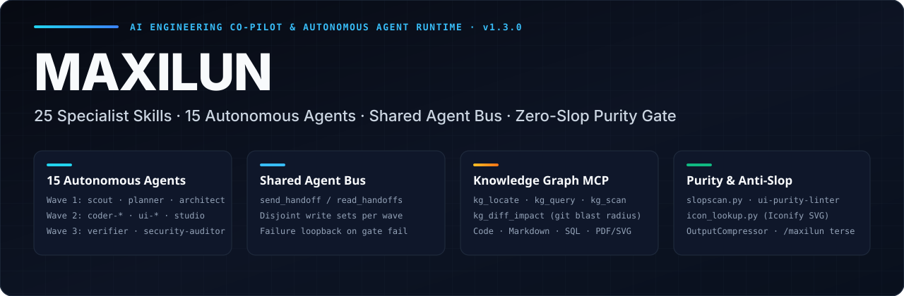
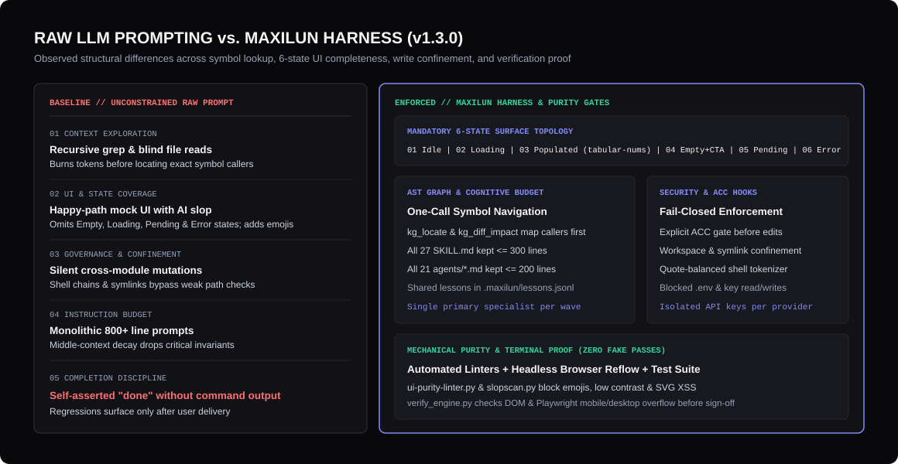
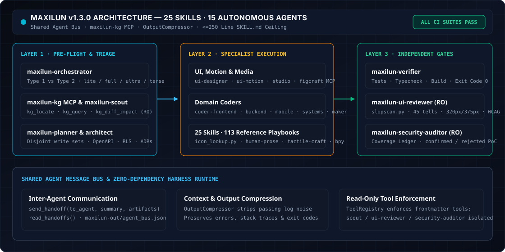
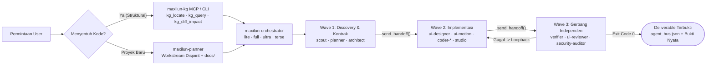
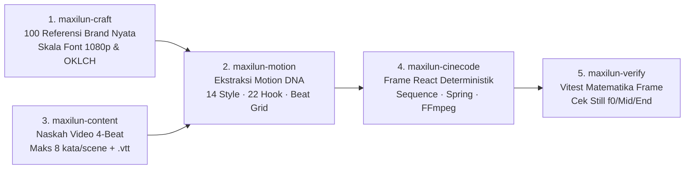

# Maxilun

<div align="center">



<br/>

[](https://github.com/giriedu/maxilun/actions/workflows/validate-skills.yml)
[](CHANGELOG.md)
[](docs/SKILLS.md)
[](docs/AGENTS.md)
[](LICENSE)
[](https://github.com/sponsors/giriedu)
[](#dukungan-platform-ai)
[](https://skills.sh/giriedu/maxilun)

<br/>

[English](README.md) · **Bahasa Indonesia**

</div>

---

**Maxilun** adalah ekosistem 25 skill AI untuk tim rekayasa perangkat lunak: satu orchestrator dan 24 spesialis. Setiap skill membawa blok **Core Rules** yang sama, sehingga empat engine kualitas ikut terpasang bersama skill, bukan tertinggal di folder terpisah. Orchestrator menegakkan triase keputusan berbasis reversibilitas (eksekusi dari bukti repositori lebih dulu; tanyakan hanya keputusan yang mahal dibalik), kohesi satu pemilik per permukaan kerja, koordinasi wave saat benar-benar lintas-domain, dan bukti verifikasi nyata tanpa banner HUD seremonial. Materi mendalam (detail engine, katalog purity, higienitas kode, disiplin rekayasa bedah, discovery, dan corpus referensi) ada di `references/` dalam masing-masing skill dan hanya dimuat saat dibutuhkan.

## Dua Cara Menggunakan Maxilun

### Opsi A: Runtime Agen Otonom (Mandiri "Rumah Sendiri")
Jalankan Maxilun langsung sebagai agen terminal otonom dengan tool bawaan, middleware Purity Gate aktif, dan Knowledge Graph in-process — tanpa wajib install dependensi pip:
```bash
# 1. Mulai sesi chat agen terminal interaktif:
python harness/cli.py chat

# 2. Eksekusi tugas rekayasa otonom:
python harness/cli.py run "Baca package.json dan verifikasi skrip build"

# 3. Buka Dashboard Visual Interaktif di browser:
python harness/cli.py dashboard --open

# 4. Hubungkan ke provider model apa pun (Ollama lokal gratis, DeepSeek, OpenAI, OpenRouter):
python harness/cli.py chat --provider ollama      # 100% Gratis & Lokal offline
python harness/cli.py chat --provider deepseek    # DeepSeek API
python harness/cli.py chat --provider openai      # GPT-4o
python harness/cli.py chat --provider openrouter  # Claude 3.5 Sonnet
```

### Opsi B: Pasang sebagai Skill Pack di Editor AI Anda
Pasang seluruh 25 skill ke Claude Code, Cursor, Codex, OpenCode, Zed, atau Antigravity:
```bash
npx skills add giriedu/maxilun
```
> Pantau dan jelajahi seluruh 25 skill di [skills.sh/giriedu/maxilun](https://skills.sh/giriedu/maxilun).  
> **Mode Non-interaktif**: `npx skills add giriedu/maxilun -y` (tambahkan `-g` untuk instalasi global).  
> **Installer Bawaan**: Gunakan `./scripts/install.sh` (Linux/macOS) atau `.\scripts\install.ps1` (Windows) — lihat [docs/INSTALL.md](docs/INSTALL.md).

---

## Mengapa Engineer Memilih Maxilun (Bukti Nyata, Bukan Klaim Kosong)

Banyak repositori skill AI hanya berisi prompt tipis (*"tulis kode bersih, buat tampilan modern"*). Maxilun dibangun sebagai **infrastruktur rekayasa yang dapat diverifikasi** — lihat perbandingan kode & UI berdampingan di [**docs/BENCHMARKS.md**](docs/BENCHMARKS.md):

<p align="center">
  
</p>

| Masalah Umum Output AI Mentah (Raw LLM) | Artefak Nyata di Dalam Repositori Maxilun |
|---|---|
| **UI Template AI Generik** (gradien ungu-biru, radius seragam, breadcrumb otomatis, tanpa state loading/error) | **100 Analisis Design System Brand Nyata** di [`skills/maxilun-craft/references/design-md/`](skills/maxilun-craft/references/design-md/index.md) (Stripe, Linear, Vercel, GitHub, Wise, Apple, dll.) + kewajiban **Matriks 4 State UI** (Skeleton, Empty+CTA, Populated `tabular-nums`, Error+Recovery) |
| **Edit Lintas-File Buta** (membaca puluhan file penuh ke context window dan merusak pemanggil fungsi) | **Executable AST Knowledge Graph & 3D WebGL Lens** di [`skills/maxilun-knowledge-graph/`](skills/maxilun-knowledge-graph/SKILL.md) (`cli.py` + AST scanner Python/TS/Polyglot yang mengembalikan `file:line` `defOf:` / `callsIn:` presisi dalam `< 1 detik`) |
| **Celah Keamanan & Kontrak API Rapuh** (timing attack `!==`, uang memakai `float`, format error acak) | **Playbook Kriptografi & Kontrak OpenAPI 3.1** di [`maxilun-sentinel`](skills/maxilun-sentinel/references/security-playbook.md) & [`maxilun-docsmith`](skills/maxilun-docsmith/references/openapi-contracts.md) (`timingSafeEqual`, Argon2id, `BIGINT` satuan terkecil, RFC 9457 `application/problem+json`) |
| **Video Programatik Kaku & Tak Terbaca** (drift CSS transition, font kecil 14px, teks paragraf panjang) | **Pipeline Studio Video 5-Spesialis** di [`maxilun-cinecode`](skills/maxilun-cinecode/references/video-production-pipeline.md) + [`maxilun-motion`](skills/maxilun-motion/references/choreography-styles.md) (kompilator frame React, pegas teredam analitik, 14 style signature, 22 hook, FFmpeg `yuv420p`) |
| **Context Window Bengkak & Seremoni Prompt** (prompt ribuan baris, banner emoji kaku, dan klon tampilan SaaS seragam) | **Batas Ramping `≤ 250 Baris`** di seluruh 25 `SKILL.md`, mode ultra-ringkas `/maxilun terse`, `OutputCompressor`, dan nol checklist centang-sendiri — diverifikasi otomatis oleh [`scripts/test-suite.py`](scripts/test-suite.py) |

---

## Arsitektur Sistem & Orkestrasi Multi-Wave

<p align="center">
  
</p>

### Alur Routing & Koordinasi Tugas Rekayasa Kompleks



### Pipeline Studio 5-Spesialis untuk Programmatic Motion Video

Saat membuat video peluncuran produk, demo UI, atau laporan data MP4/WebM, Maxilun menghubungkan 5 spesialis secara deterministik:



---

## 25 Skill: 1 Orchestrator + 24 Spesialis

Disusun berdasarkan siklus rekayasa perangkat lunak dari fondasi arsitektur hingga eksekusi produksi:

| # | Skill | Fungsi Rekayasa | Pemicu Utama |
|:--:|---|---|---|
| 1 | `maxilun` | Orchestrator — routing berbasis hasil, protokol discovery, koordinasi wave, gate bukti | `/maxilun`, `mode maxilun` |
| 2 | `maxilun-knowledge-graph` | Fondasi Penemuan Kode — AST parser mendalam & WebGL visualizer (Lens) | `/maxilun-graph`, `/msal-trace` |
| 3 | `maxilun-scaffold` | Project Context Scaffolder — 10 dokumen konteks siap-baca AI di `docs/` dengan archetype domain & referensi UI | `/maxilun-scaffold`, `/msal-init` |
| 4 | `maxilun-architect` | Arsitektur Sistem — C4 model, Event Storming, ADRs, penalaran `/maxilun-think` | `/maxilun-think`, `/maxilun-architect` |
| 5 | `maxilun-sentinel` | Keamanan Defensif — OWASP Top 10, STRIDE threat modeling, kriptografi, secrets | `/maxilun-sentinel`, `/msal-security` |
| 6 | `maxilun-engineer` | Implementasi Kode — TDD, pemecahan bug 5-WHY, refaktoring modular | `/maxilun-engineer` |
| 7 | `maxilun-data` | Lapisan Database — desain skema, migrasi zero-downtime, optimasi query, RLS | `/maxilun-data` |
| 8 | `maxilun-frontend` | Rekayasa Frontend — React Server Components, Next.js App Router, Server Actions | `/maxilun-frontend` |
| 9 | `maxilun-verify` | Jaminan Kualitas — E2E (Playwright), visual regression, a11y, contract testing | `/maxilun-verify`, `/msal-test` |
| 10 | `maxilun-insight` | Diagnostik Performa — profiling CPU/memori/database, distributed tracing | `/maxilun-insight`, `/msal-audit` |
| 11 | `maxilun-deploy` | Operasi & Cloud — pipeline CI/CD, Docker multi-stage, rollout zero-downtime | `/maxilun-deploy` |
| 12 | `maxilun-docsmith` | Spesifikasi & Dokumentasi Teknis — Feature PRD/RFC, OpenAPI 3.1/AsyncAPI, ADR, runbook, `llms.txt` | `/maxilun-docsmith`, `/msal-docs` |
| 13 | `maxilun-craft` | Desain Sistem & UI/UX — palet warna OKLCH, kepatuhan WCAG AAA, grid 4px, 100 referensi brand | `/maxilun-craft`, `/msal-ui` |
| 14 | `maxilun-motion` | Desain Motion — animasi browser interaktif, scene 3D/WebGL penuh, arah visual berbasis referensi, storyboard motion, review preview, dan fallback aksesibel | `/maxilun-motion`, `scene 3D`, `immersive website`, `Three.js`, `WebGL`, `motion-led website` |
| 15 | `maxilun-cinecode` | Video Programatik — MP4/WebM/GIF berbasis kode, kompilator frame React, pipeline batch | `/maxilun-cinecode` |
| 16 | `maxilun-diagrams` | Visualisasi Sistem — diagram alur, sequence, C4 diagram via Mermaid/SVG | `/maxilun-diagram`, `/maxilun-diagrams` |
| 17 | `maxilun-content` | Copywriting Pengguna — landing page, microcopy UI, naskah video pendek, brand voice, lokalisasi | `/maxilun-content`, `/msal-copy` |
| 18 | `maxilun-seo-audit` | Audit SEO Teknis — Core Web Vitals, JSON-LD structured data, crawler readiness | `/maxilun-seo`, `/maxilun-seo-audit` |
| 19 | `maxilun-desktop` | Rekayasa Desktop & Enterprise — Windows (Win32, WPF), macOS (AppKit), C++ Qt, dan PowerBuilder (DataWindow, PowerScript, SQLCA) | `/maxilun-desktop` |
| 20 | `maxilun-mobile` | Rekayasa Mobile Native & Lintas Platform — Android (Kotlin/Compose), iOS (Swift/SwiftUI), Flutter, React Native, KMP | `/maxilun-mobile` |
| 21 | `maxilun-iot` | Sistem Embedded & IoT — mikrokontroler (ESP32, STM32, Arduino, Pico), FreeRTOS, driver bus (I2C/SPI), MQTT, Modbus, OTA | `/maxilun-iot` |
| 22 | `maxilun-network` | Infrastruktur Jaringan — MikroTik RouterOS (v6/v7), Linux networking, stateful firewall, QoS/PCQ, WireGuard, routing | `/maxilun-network` |
| 23 | `maxilun-ai` | Rekayasa Aplikasi AI & LLM — hybrid retrieval RAG (dense vector + BM25), chunking semantik, evaluasi regresi prompt, context caching | `/maxilun-ai`, `/msal-ai` |
| 24 | `maxilun-game` | Rekayasa Game Studio & Multi-Engine — arsitektur engine (Godot, Unreal, Unity), sinkronisasi fisika, authoritative netcode, GDD | `/maxilun-game`, `/maxilun-gamestudio` |
| 25 | `maxilun-hunt` | Audit Kerentanan Ofensif — skenario serangan nyata, IDOR/BOLA, SSRF, triase bukti 7-Question Gate, paket bukti reproducible | `/maxilun-hunt`, `/msal-hunt` |

---

## Empat Engine Kualitas yang Selalu Aktif

Digunakan di seluruh 25 skill sebagai blok `CORE-RULES` identik yang diverifikasi oleh CI:

| Mesin | Fungsi Utama |
|---|---|
| **Focus & Agency Engine** | Eksekusi berbasis bukti repo, klarifikasi berbasis reversibilitas (maks 1 giliran untuk keputusan mahal), maks 3 fokus kerja, bebas teater HUD |
| **Purity Engine** | Kemurnian dua arah: menolak klise mentah AI (buzzword, gradien ungu, angka palsu) sekaligus menolak monokultur satu template SaaS |
| **Minimalist Engineering** | Tangga kesederhanaan, perbaikan di titik konvergensi pemanggil, pembersihan sisa perubahan tanpa *drive-by refactoring* |
| **Clarity & Proof Engine** | Kesimpulan di awal, pelestarian `file:line` & error verbatim, label kepastian proporsional (`[CONFIRMED]`, `[INFERRED]`, `[UNCERTAIN]`, `[UNVERIFIED]`) |

Tiga protokol pendukung:

| Protokol | Panduan |
|---|---|
| **Dependency Decision Framework** | Evaluasi stdlib, ukuran bundle, dan pemeliharaan sebelum menambah dependency |
| **Cognitive Load Reduction** | Naming sebagai dokumentasi, panduan ukuran file dan nesting, explicit over implicit |
| **Proactive Communication** | Laporkan blocker, hindari silent failure, nyatakan asumsi dan perubahan scope |

---

## Fondasi Knowledge Graph

Gunakan `maxilun-knowledge-graph` untuk perubahan kode struktural atau lintas-file ketika tool graf tersedia. Perubahan teks kecil dan terisolasi boleh memakai jalur cepat; jika tool graf tidak tersedia, gunakan pencarian repo langsung dan nyatakan fallback tersebut:

- **Python AST Scanner** — pemetaan sintaksis tingkat tinggi berbasis pohon sintaks nyata (bukan regex rapuh)
- **TypeScript Scanner** — atribusi dependensi pemanggilan baris-ke-baris (*line-accurate CALLS*)
- **Generic Polyglot Scanner** — mendukung Go, Rust, Java, C#, Ruby, PHP, Swift, C/C++
- **Maxilun Lens** — visualizer visual interaktif WebGL 3D & 2D Matrix dengan pelacakan jalur BFS (*Path Trace*)

```bash
# Jalankan langsung dari dalam sesi AI Anda:
/maxilun-graph
```

---

## Maxilun Engineering Harness

Maxilun dilengkapi dengan runtime agen otonom bawaan, inspektor keamanan AST, dan runner benchmark empiris di folder `harness/` (100% zero-dependency Python stdlib):

```bash
# Inspeksi 25 skill ekosistem (1 orchestrator + 24 spesialis), kepatuhan batas baris (<=300), dan pemicunya:
python harness/cli.py skills

# Jalankan benchmark komparatif empiris (+55% peningkatan atas Raw AI):
python harness/cli.py bench --view

# Verifikasi kode dengan inspeksi AST & sandbox in-memory SQLite:
python harness/cli.py verify-code src/db/migration.sql

# Pasang Git pre-commit hook otomatis untuk memblokir AI slop:
python harness/cli.py install-hook
```

Arsitektur runtime lengkap, konfigurasi provider, dan skema tool didokumentasikan di [**docs/HARNESS.md**](docs/HARNESS.md).

---

## Rapat Agen

Mode council menjalankan rapat antar agen spesialis. Orchestrator memimpin dari sesi utama dan memanggil agen satu per satu lewat tool subagent milik host. Setiap giliran berisi lima baris: `POSITION`, `AGREE`, `OBJECT`, `PROPOSE`, `ASK`. Rapat bersifat read-only: tidak ada agen yang mengubah file. Rapat berhenti setelah satu ronde tanpa keberatan, atau setelah 3 ronde, dan notulen ditampilkan kepada Anda sebelum pekerjaan dimulai.

Dari terminal:

```bash
python -m harness.cli meeting "<agenda>" --with architect,coder-backend
```

Di OMP/Termul, agen terpasang ke `~/.omp/agent/agents`.

---

## Dukungan Platform AI

| Platform AI | Status Dukungan | Catatan |
|---|---|---|
| Claude Code | ✅ Dukungan Penuh | `.claude/skills/` |
| Antigravity IDE / CLI | ✅ Dukungan Penuh | `.agents/skills/` |
| Cursor | ✅ Dukungan Penuh | `.cursor/skills/` |
| OpenCode / Codex | ✅ Dukungan Penuh | `.config/opencode/` & `.codex/` |
| Zed Editor | ✅ Dukungan Penuh | `.agents/skills/` (`npx skills add -a zed`) |
| Termul (`termul.dev`) | ✅ Dukungan Penuh | Workspace terminal manager untuk agen AI |

---

## Dokumentasi Teknis

| Berkas Panduan | Cakupan Informasi |
|---|---|
| [docs/INSTALL.md](docs/INSTALL.md) | Panduan instalasi multi-platform lengkap & integrasi CLI |
| [docs/SKILLS.md](docs/SKILLS.md) | Detail mendalam, peran teknis, dan pemicu seluruh 25 skill |
| [docs/AGENTS.md](docs/AGENTS.md) | 15 agen otonom (1 orchestrator + 14 spesialis), hak akses tool & protokol subagent |
| [docs/ENGINES.md](docs/ENGINES.md) | Empat engine kualitas dan tiga protokol operasi |
| [docs/EXAMPLES.md](docs/EXAMPLES.md) | Contoh skenario rekayasa nyata & orkestrasi Wave Pattern |
| [docs/SKILL-CONTRACTS.md](docs/SKILL-CONTRACTS.md) | Ownership, mode standalone, input, output, dan handoff setiap skill |
| [docs/BENCHMARKS.md](docs/BENCHMARKS.md) | Bukti perbandingan berdampingan Raw LLM vs Maxilun (UI, Keamanan API, Graf Kode, Video) |
| [docs/HARNESS.md](docs/HARNESS.md) | Harness evaluasi otomatis, verifikasi Purity Gate, dan CLI benchmark deterministik |
| [docs/ROUTING-MATRIX.md](docs/ROUTING-MATRIX.md) | Routing primary owner dan batas trigger yang bertabrakan |
| [docs/PURITY-GATE.md](docs/PURITY-GATE.md) | Standar Purity Gate dan aturan pengiriman berbasis bukti |
| [docs/RELEASE.md](docs/RELEASE.md) | Alur rilis GitHub Release otomatis & pembaruan metadata |
| [CHANGELOG.md](CHANGELOG.md) | Riwayat pembaruan versi ekosistem |
| [CONTRIBUTING.md](CONTRIBUTING.md) | Standar kontribusi & pengujian test-suite |

---

## Tentang Rilis

Maxilun mengikuti [Semantic Versioning](https://semver.org/) dan [Keep a Changelog](https://keepachangelog.com/en/1.1.0/). Setiap rilis diverifikasi terhadap seluruh 25 skill, 15 agen otonom, scanner Knowledge Graph, UI Purity Linter, dan uji integrasi harness melalui `python scripts/test-suite.py`.

- **Versi Stabil Terbaru**: `v1.3.0` — lihat [CHANGELOG.md](CHANGELOG.md) untuk catatan rilis lengkap dan pembaruan `[Unreleased]` (`15` agen, Shared Agent Bus, `maxilun-kg` MCP, `OutputCompressor`, `/maxilun terse`, `icon_lookup.py`, serta playbook anti-slop tulisan & UI taktil).
- **Alur Rilis**: Lihat [docs/RELEASE.md](docs/RELEASE.md) dan [GitHub Releases](https://github.com/giriedu/maxilun/releases).

---

## Sponsor & Dukungan

Maxilun dibangun sebagai infrastruktur rekayasa tanpa dependensi eksternal. Jika Maxilun membantu tim Anda menghemat waktu review, mencegah UI slop, atau menangkap regresi keamanan sebelum produksi, Anda dapat mendukung pengembangan berlanjut melalui:

- **GitHub Sponsors**: [github.com/sponsors/giriedu](https://github.com/sponsors/giriedu)
- **Star & Bagikan**: Beri bintang [`giriedu/maxilun`](https://github.com/giriedu/maxilun) atau pasang lewat `npx skills add giriedu/maxilun`

---

## Lisensi

Didistribusikan di bawah **Maxilun Free-to-Use License** — gratis dan bebas digunakan untuk kebutuhan personal maupun komersial. Dilarang memodifikasi, mengadaptasi, atau mendistribusikan ulang versi modifikasi. Lihat detail lengkap di [LICENSE](LICENSE).
