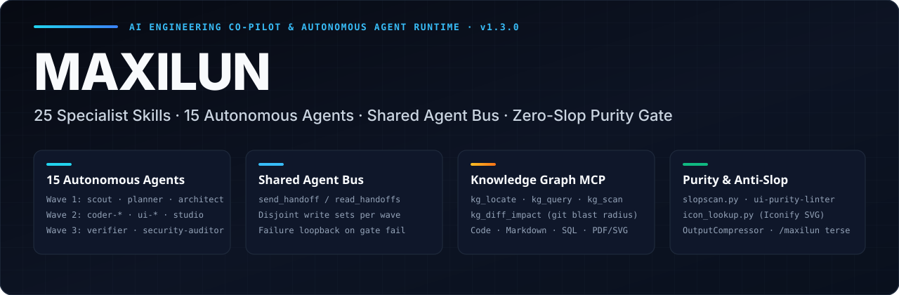
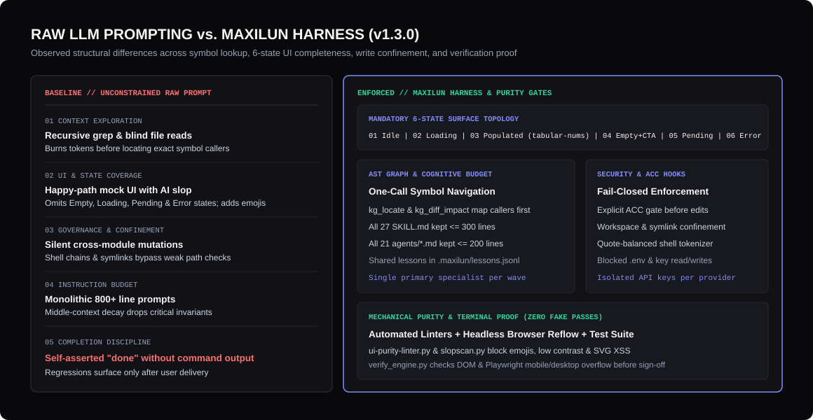
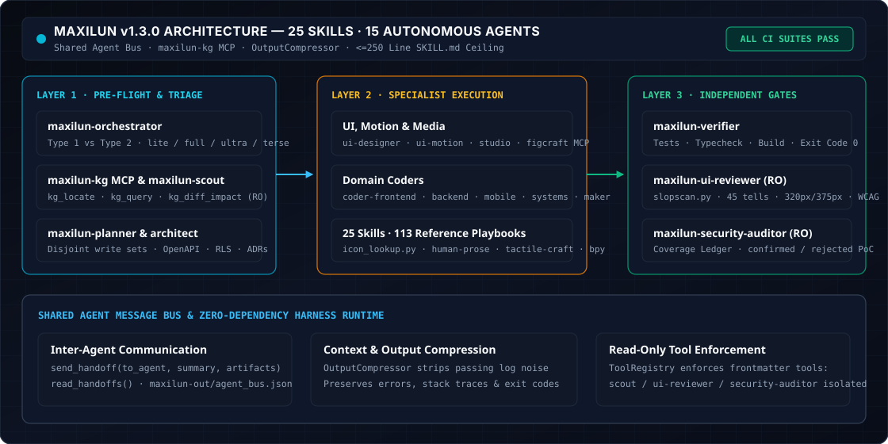
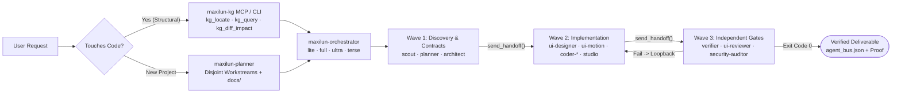
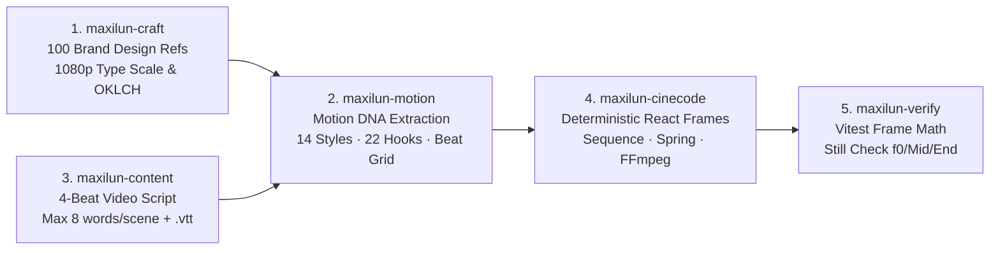

# Maxilun

<div align="center">



<br/>

[](https://github.com/giriedu/maxilun/actions/workflows/validate-skills.yml)
[](CHANGELOG.md)
[](docs/SKILLS.md)
[](docs/AGENTS.md)
[](LICENSE)
[](https://github.com/sponsors/giriedu)
[](#platform-support)
[](https://skills.sh/giriedu/maxilun)

<br/>

**English** · [Bahasa Indonesia](README.id.md)

</div>

---

**Maxilun** is an ecosystem of 25 AI skills for software engineering teams: one orchestrator and 24 specialists. Every skill carries the same **Core Rules** block, so the four quality engines travel with the skill instead of living in a separate folder. The orchestrator enforces reversibility-gated decision triage (act from repository evidence first; clarify only irreversible decisions), single-owner routing cohesion, wave coordination when genuinely multi-domain, and real execution proof without ceremonial HUD banners. Deeper material (engine detail, purity catalog, code hygiene, surgical engineering discipline, discovery, and reference corpora) lives in `references/` inside each skill and is loaded only when needed.

## Two Ways to Use Maxilun

### Option A: Autonomous Agent Runtime (Standalone "Rumah Sendiri")
Run Maxilun directly as an autonomous terminal agent with native tools, active Purity Gate middleware, and in-process Knowledge Graph — zero pip dependencies required:
```bash
# 1. Start an interactive terminal agent session:
python harness/cli.py chat

# 2. Execute an autonomous engineering task:
python harness/cli.py run "Inspect package.json and verify build scripts"

# 3. Open the Interactive Visual Dashboard in browser:
python harness/cli.py dashboard --open

# 4. Run with any model provider (free local Ollama, DeepSeek, OpenAI, OpenRouter):
python harness/cli.py chat --provider ollama      # 100% Free & Local offline
python harness/cli.py chat --provider deepseek    # DeepSeek API
python harness/cli.py chat --provider openai      # GPT-4o
python harness/cli.py chat --provider openrouter  # Claude 3.5 Sonnet
```

### Option B: Install as Skill Pack into your AI Editor
Install all 27 skills into Claude Code, Cursor, Codex, OpenCode, Zed, or Antigravity:
```bash
npx skills add giriedu/maxilun
```
> Track and explore all 27 skills on [skills.sh/giriedu/maxilun](https://skills.sh/giriedu/maxilun).  
> **Non-interactive**: `npx skills add giriedu/maxilun -y` (add `-g` for global availability across projects).  
> **Native Installers**: Use `./scripts/install.sh` (Linux/macOS) or `.\scripts\install.ps1` (Windows) — see [docs/INSTALL.md](docs/INSTALL.md).

---

## Why Engineers Choose Maxilun (Proof, Not Promises)

Most AI skill repositories are thin text wrappers that repeat generic advice (*"write clean code, make it modern"*). Maxilun is built as **verifiable engineering infrastructure** — see full side-by-side code and UI comparisons in [**docs/BENCHMARKS.md**](docs/BENCHMARKS.md):

<p align="center">
  
</p>

| What Usually Goes Wrong with Raw AI | What Maxilun Ships inside the Repo to Fix It |
|---|---|
| **Generic AI Template UI** (purple-blue gradients, uniform border-radius, automatic breadcrumbs, missing empty/error states) | **100 Real Brand Design Systems** in [`skills/maxilun-craft/references/design-md/`](skills/maxilun-craft/references/design-md/index.md) (Stripe, Linear, Vercel, GitHub, Wise, Apple, etc.) + mandatory **4-State UI Matrix** (Skeleton, Empty+CTA, Populated `tabular-nums`, Error+Recovery) |
| **Blind Multi-File Edits** (reading 20 whole files into context and breaking callers) | **Executable AST Knowledge Graph & 3D WebGL Lens** in [`skills/maxilun-knowledge-graph/`](skills/maxilun-knowledge-graph/SKILL.md) (`cli.py` + Python/TS/Polyglot AST scanners returning exact `file:line` `defOf:` / `callsIn:` in `< 1s`) |
| **Vulnerable Auth & Webhooks** (`!==` timing leaks, float currency drift, ad-hoc error JSON) | **Cryptographic & API Contract Playbooks** in [`maxilun-sentinel`](skills/maxilun-sentinel/references/security-playbook.md) & [`maxilun-docsmith`](skills/maxilun-docsmith/references/openapi-contracts.md) (`timingSafeEqual`, Argon2id, `BIGINT` minor units, OpenAPI 3.1 + RFC 9457 `application/problem+json`) |
| **Stiff, Unreadable AI Videos** (CSS transition drift, tiny 14px fonts, 30-word paragraphs) | **5-Skill Programmatic Video Studio** in [`maxilun-cinecode`](skills/maxilun-cinecode/references/video-production-pipeline.md) + [`maxilun-motion`](skills/maxilun-motion/references/choreography-styles.md) (React frame compiler, analytical damped springs, 14 style signatures, 22 hooks, FFmpeg `yuv420p`) |
| **Context Window Bloat & Prompt Ceremony** (2,000-line prompt files, emoji status banners, and single-template SaaS clones) | **Strict `≤ 250 Line` Cognitive Ceiling** across all 25 `SKILL.md` files, `/maxilun terse` ultra-compact mode, `OutputCompressor`, and zero self-checked HUD theater — verified on every commit by [`scripts/test-suite.py`](scripts/test-suite.py) |

---

## System Architecture & Multi-Wave Orchestration

<p align="center">
  
</p>

### How Maxilun Routes & Coordinates Complex Engineering Tasks



### 5-Specialist Studio Pipeline for Programmatic Motion Video

When building product launch videos, UI demos, or data-driven MP4/WebM reports, Maxilun chains five specialists so visuals, physics, and frame encoding never drift:



---

## 25 Skills: 1 Orchestrator + 24 Specialists

Structured by real-world software engineering lifecycle — from foundational architecture to production delivery:

| # | Skill | Engineering Domain | Primary Trigger |
|:--:|---|---|---|
| 1 | `maxilun` | Orchestrator — outcome-based routing, discovery protocol, wave coordination, evidence gates | `/maxilun`, `mode maxilun` |
| 2 | `maxilun-knowledge-graph` | Code Discovery — graph-based symbol and dependency mapping with WebGL visualizer (Lens) | `/maxilun-graph`, `/msal-trace` |
| 3 | `maxilun-scaffold` | Project Context Scaffolder — generates 10 AI-readable docs in `docs/` with domain archetypes & UI references | `/maxilun-scaffold`, `/msal-init` |
| 4 | `maxilun-architect` | System Architecture — C4 Model, Event Storming, ADRs, deep `/maxilun-think` reasoning | `/maxilun-think`, `/maxilun-architect` |
| 5 | `maxilun-sentinel` | Defensive Security — OWASP Top 10, STRIDE threat modeling, crypto, supply chain audit | `/maxilun-sentinel`, `/msal-security` |
| 6 | `maxilun-engineer` | Code Implementation — Test-Driven Development (TDD), 5-WHY debugging, clean refactoring | `/maxilun-engineer` |
| 7 | `maxilun-data` | Data & Persistence — schema design, zero-downtime migrations, query optimization, RLS | `/maxilun-data` |
| 8 | `maxilun-frontend` | Modern Frontend — React Server Components (RSC), Next.js App Router, Server Actions | `/maxilun-frontend` |
| 9 | `maxilun-verify` | Quality Assurance — Playwright E2E, visual regression, accessibility (a11y), contract tests | `/maxilun-verify`, `/msal-test` |
| 10 | `maxilun-insight` | Performance Diagnostics — CPU/memory/DB profiling, distributed tracing, leak detection | `/maxilun-insight`, `/msal-audit` |
| 11 | `maxilun-deploy` | Cloud & Operations — CI/CD pipelines, multi-stage Docker, zero-downtime rollouts | `/maxilun-deploy` |
| 12 | `maxilun-docsmith` | Technical Specs & Documentation — Feature PRDs/RFCs, OpenAPI 3.1/AsyncAPI contracts, ADRs, runbooks, `llms.txt` | `/maxilun-docsmith`, `/msal-docs` |
| 13 | `maxilun-craft` | UI/UX Craft & Brand Identity — directional tuning vocabulary (`bolder`, `quieter`, `typeset`, `polish`, `harden`, `shape`), 50 Hallmark aesthetic themes, Hue OKLCH brand token model, 220+ component ecosystem vault, `slopscan.py` proof gate, OKLCH ramps, WCAG contrast, 100 design references, SVG logo suite | `/maxilun-craft`, `/msal-ui`, `bolder`, `quieter`, `typeset`, `polish`, `harden`, `shape`, `hallmark`, `hue` |
| 14 | `maxilun-motion` | Motion Design — interactive browser animation, complete WebGL 3D scenes, camera choreography, reference-led art direction, motion storyboards, preview review, and accessible fallbacks | `/maxilun-motion`, `3D scene`, `immersive website`, `Three.js`, `WebGL`, `motion-led website` |
| 15 | `maxilun-cinecode` | Programmatic Video — code-driven MP4/WebM/GIF, React frame compiler, data-driven batch pipelines | `/maxilun-cinecode` |
| 16 | `maxilun-diagrams` | System Visualization — C4, sequence, Event Storming, data-flow diagrams via Mermaid | `/maxilun-diagram`, `/maxilun-diagrams` |
| 17 | `maxilun-content` | User-Facing Copywriting — landing pages, UI microcopy, video script beats, error states, brand voice | `/maxilun-content`, `/msal-copy` |
| 18 | `maxilun-seo-audit` | Technical SEO — Core Web Vitals, JSON-LD structured data, crawler readiness | `/maxilun-seo`, `/maxilun-seo-audit` |
| 19 | `maxilun-desktop` | Native Desktop & Enterprise — Windows (Win32, WPF), macOS (AppKit), C++ Qt, and PowerBuilder (DataWindow, PowerScript, SQLCA) | `/maxilun-desktop` |
| 20 | `maxilun-mobile` | Native & Cross-Platform Mobile — Android (Kotlin/Compose), iOS (Swift/SwiftUI), Flutter, React Native, KMP | `/maxilun-mobile` |
| 21 | `maxilun-iot` | IoT & Embedded Systems — microcontrollers (ESP32, STM32, Arduino, Pico), FreeRTOS, hardware buses (I2C/SPI), MQTT, Modbus, OTA | `/maxilun-iot` |
| 22 | `maxilun-network` | Network Infrastructure — MikroTik RouterOS (v6/v7), Linux networking, stateful firewalls, QoS/PCQ, WireGuard, routing | `/maxilun-network` |
| 23 | `maxilun-ai` | AI & LLM Application Engineering — hybrid RAG retrieval (dense vector + BM25), semantic chunking, prompt regression evals, context caching | `/maxilun-ai`, `/msal-ai` |
| 24 | `maxilun-game` | Game Studio & Multi-Engine Engineering — engine architecture (Godot, Unreal, Unity), physics sync, authoritative netcode, GDD | `/maxilun-game`, `/maxilun-gamestudio` |
| 25 | `maxilun-hunt` | Offensive Vulnerability Audit — adversarial attack scenarios, IDOR/BOLA, SSRF, 7-Question Gate proof triage, reproducible PoC bundles | `/maxilun-hunt`, `/msal-hunt` |

---

## Four Always-On Quality Engines

Embedded in all 27 skills as an identical `CORE-RULES` block, verified by CI:
| Engine | Core Responsibility |
|---|---|
| **Focus & Agency Engine** | Repo-first execution, reversibility-gated clarification (max 1 batched turn for irreversible choices), max 3 active workstreams, zero HUD/checkbox theater |
| **Purity Engine** | Two-way purity: rejects raw AI buzzwords/gradients/fake stats AND rejects single-template SaaS monoculture |
| **Minimalist Engineering** | Simplicity ladder, convergence-point root-cause fixes, cutover cleanup without drive-by refactoring |
| **Clarity & Proof Engine** | Conclusion-first reporting, exact `file:line` & verbatim error preservation, proportional certainty tags (`[CONFIRMED]`, `[INFERRED]`, `[UNCERTAIN]`, `[UNVERIFIED]`) |

Three operating protocols support these engines:

| Protocol | Guidance |
|---|---|
| **Dependency Decision Framework** | Stdlib-first evaluation, bundle size, maintenance viability before adding a dependency |
| **Cognitive Load Reduction** | Naming as documentation, file size and nesting guidance, explicit over implicit |
| **Proactive Communication** | Report blockers, avoid silent failures, state assumptions, notify about scope changes |

---

## Knowledge Graph Code Discovery

Use `maxilun-knowledge-graph` for structural or multi-file code changes when its tooling is available. When the location of the code is unknown, `python skills/maxilun-knowledge-graph/cli.py locate "<question or stack trace>"` returns ranked `file:start-end` ranges with verbatim excerpts, so the agent reads those ranges instead of opening files one by one. Trivial isolated edits can use the fast path; if graph tooling is unavailable, use direct repository search and state that fallback:

- **Python AST Scanner** — semantic AST parsing for classes, methods, and relative imports (not brittle regex)
- **TypeScript Scanner** — line-accurate CALLS and IMPORT relationship attribution
- **Generic Polyglot Scanner** — AST and structural scanner for Go, Rust, Java, C#, Ruby, PHP, Swift, and C/C++
- **Maxilun Lens** — Interactive 3D WebGL Galaxy & 2D Force-Directed Matrix visualizer with BFS Path Trace and fuzzy search

```bash
# Launch visualizer or run dependency scan directly within your AI session:
/maxilun-graph
```

---

## Maxilun Engineering Harness

Maxilun ships with a complete built-in autonomous agent runtime, AST security inspector, and empirical benchmark suite in `harness/` (100% zero-dependency Python stdlib):

```bash
# Inspect all 27 ecosystem skills (1 orchestrator + 26 specialists) and 21 autonomous agents:
python harness/cli.py skills
# Run empirical benchmark suite (+55% quality improvement over Raw AI):
python harness/cli.py bench --view

# Verify code with AST inspection & in-memory SQLite sandbox:
python harness/cli.py verify-code src/db/migration.sql

# Install Git pre-commit hook to automatically block AI slop before commit:
python harness/cli.py install-hook
```

Full runtime architecture, provider configurations, and tool schemas are documented in [**docs/HARNESS.md**](docs/HARNESS.md).

---

## Agent Meetings

Council mode runs a meeting between specialist agents. The orchestrator chairs from the main session and dispatches agents one at a time through the host's subagent tool. Every turn is five lines: `POSITION`, `AGREE`, `OBJECT`, `PROPOSE`, `ASK`. Meetings are read-only: no agent edits files. The meeting stops after a round with no objections, or after 3 rounds, and the minutes are shown to you before any work starts.

From the terminal:

```bash
python -m harness.cli meeting "<agenda>" --with architect,coder-backend
```

On OMP/Termul, the agents install to `~/.omp/agent/agents`.

---

## Platform Support

| AI Coding Platform | Support Status | Note |
|---|---|---|
| Claude Code | ✅ Full Native Support | `.claude/skills/` |
| Antigravity IDE & CLI | ✅ Full Native Support | `.agents/skills/` |
| Cursor | ✅ Full Native Support | `.cursor/skills/` |
| OpenCode / Codex | ✅ Full Native Support | `.config/opencode/` & `.codex/` |
| Zed Editor | ✅ Full Native Support | `.agents/skills/` (`npx skills add -a zed`) |
| Termul (`termul.dev`) | ✅ Full Native Support | Workspace terminal manager for AI agents |

---

## Documentation

| Guide | Description |
|---|---|
| [docs/INSTALL.md](docs/INSTALL.md) | Comprehensive installation guides, one-line scripts & verification |
| [docs/SKILLS.md](docs/SKILLS.md) | Triggers, capabilities, and parameters for all 27 skills |
| [docs/AGENTS.md](docs/AGENTS.md) | 21 autonomous agents (1 orchestrator + 20 specialists), tool permissions & subagent protocols |
| [docs/ENGINES.md](docs/ENGINES.md) | Four Always-On Engines and three Operating Protocols |
| [docs/EXAMPLES.md](docs/EXAMPLES.md) | Real-world engineering scenarios & multi-specialist Wave Patterns |
| [docs/SKILL-CONTRACTS.md](docs/SKILL-CONTRACTS.md) | Ownership, standalone behavior, inputs, outputs, and handoffs for every skill |
| [docs/BENCHMARKS.md](docs/BENCHMARKS.md) | Side-by-side Raw LLM vs. Maxilun code/UI/video proofs & token efficiency metrics |
| [docs/HARNESS.md](docs/HARNESS.md) | Automated evaluation, Purity Gate verification, and benchmark CLI harness |
| [docs/ROUTING-MATRIX.md](docs/ROUTING-MATRIX.md) | Primary-owner routing and trigger collision boundaries |
| [docs/PURITY-GATE.md](docs/PURITY-GATE.md) | Distribution-safe Purity Gate and evidence delivery rules |
| [docs/RELEASE.md](docs/RELEASE.md) | Automated GitHub Releases, tag dispatch, and versioning protocols |
| [CREDITS.md](CREDITS.md) | Open source design attributions & MIT compatibility receipts |
| [CHANGELOG.md](CHANGELOG.md) | Semantic version release history |
| [CONTRIBUTING.md](CONTRIBUTING.md) | Contribution standards, test-suite validation, and code hygiene |

---

## About Releases

Maxilun follows [Semantic Versioning](https://semver.org/) and [Keep a Changelog](https://keepachangelog.com/en/1.1.0/). Every release is validated against all 27 skills, 21 autonomous agents, Knowledge Graph scanners, UI Purity Linter, and harness integration tests via `python scripts/test-suite.py`.

- **Latest Stable**: `v1.3.0` — see [CHANGELOG.md](CHANGELOG.md) for full release notes and `[Unreleased]` additions (`16` agents, Shared Agent Bus, `maxilun-kg` MCP, `OutputCompressor`, `/maxilun terse`, `icon_lookup.py`, 5-in-1 design engine, and component ecosystem vault).
- **Release Pipeline**: See [docs/RELEASE.md](docs/RELEASE.md) and [GitHub Releases](https://github.com/giriedu/maxilun/releases).

---

## Sponsor & Support

Maxilun is built as open-access, zero-dependency engineering infrastructure. If Maxilun saves your team hours of review, prevents UI slop, or catches security regressions before production, you can support ongoing development:

- **GitHub Sponsors**: [github.com/sponsors/giriedu](https://github.com/sponsors/giriedu)
- **Star & Share**: Star [`giriedu/maxilun`](https://github.com/giriedu/maxilun) or install via `npx skills add giriedu/maxilun`

---

## License

Distributed under the **Maxilun Free-to-Use License** — free to use and deploy for personal and commercial projects. Modification, reverse engineering, and redistribution of modified versions are strictly prohibited. See [LICENSE](LICENSE) for full legal text.
