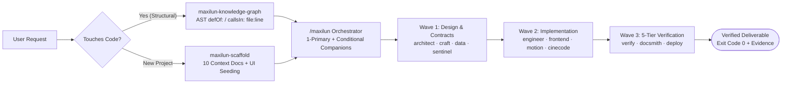
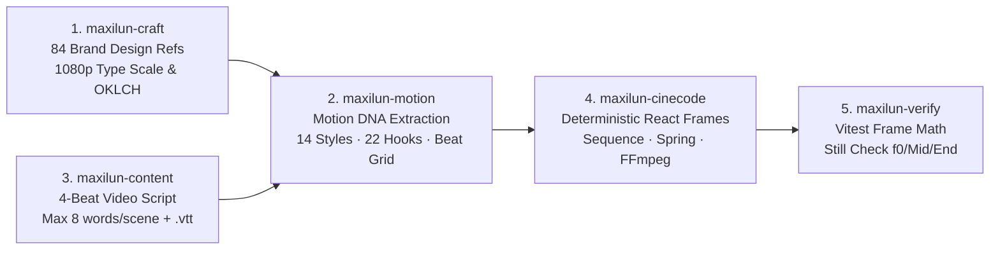

# Maxilun

<div align="center">


<br/>

[](https://github.com/giriedu/maxilun/actions/workflows/validate-skills.yml)
[](CHANGELOG.md)
[](docs/SKILLS.md)
[](LICENSE)
[](#platform-support)
[](https://skills.sh/giriedu/maxilun)

<br/>

**English** · [Bahasa Indonesia](README.id.md)

</div>

---

**Maxilun** is an ecosystem of 18 AI skills for software engineering teams: one orchestrator and 17 specialists. Every skill carries the same **Core Rules** block, so the four quality engines travel with the skill instead of living in a separate folder. The orchestrator adds outcome-based routing, a discovery protocol for unclear briefs, wave coordination, and evidence-based delivery gates. Deeper material (engine detail, anti-slop catalog, code hygiene, discovery) lives in `references/` inside each skill and is loaded only when needed.

## Quick Install

```bash
npx skills add giriedu/maxilun
```

> Track and explore all 18 skills on [skills.sh/giriedu/maxilun](https://skills.sh/giriedu/maxilun).  
> **Non-interactive (all skills)**: `npx skills add giriedu/maxilun -y` (add `-g` for global availability across projects).  
> **Windows Note**: If symlink creation is restricted, add `--copy` flag (`npx skills add giriedu/maxilun --copy -y`) or use the PowerShell installer in [docs/INSTALL.md](docs/INSTALL.md).

---

## Why Engineers Choose Maxilun (Proof, Not Promises)

Most AI skill repositories are thin text wrappers that repeat generic advice (*"write clean code, make it modern"*). Maxilun is built as **verifiable engineering infrastructure** — see full side-by-side code and UI comparisons in [**docs/BENCHMARKS.md**](docs/BENCHMARKS.md):

<p align="center">
  
</p>

| What Usually Goes Wrong with Raw AI | What Maxilun Ships inside the Repo to Fix It |
|---|---|
| **Generic "AI Slop" UI** (purple-blue gradients, uniform border-radius, jittery numbers, missing empty/error states) | **84 Real Brand Design Systems** in [`skills/maxilun-craft/references/design-md/`](skills/maxilun-craft/references/design-md/index.md) (Stripe, Linear, Vercel, Wise, Apple, etc.) + mandatory **4-State UI Matrix** (Skeleton, Empty+CTA, Populated `tabular-nums`, Error+Recovery) |
| **Blind Multi-File Edits** (reading 20 whole files into context and breaking callers) | **Executable AST Knowledge Graph & 3D WebGL Lens** in [`skills/maxilun-knowledge-graph/`](skills/maxilun-knowledge-graph/SKILL.md) (`cli.py` + Python/TS/Polyglot AST scanners returning exact `file:line` `defOf:` / `callsIn:` in `< 1s`) |
| **Vulnerable Auth & Webhooks** (`!==` timing leaks, float currency drift, ad-hoc error JSON) | **Cryptographic & API Contract Playbooks** in [`maxilun-sentinel`](skills/maxilun-sentinel/references/security-playbook.md) & [`maxilun-docsmith`](skills/maxilun-docsmith/references/openapi-contracts.md) (`timingSafeEqual`, Argon2id, `BIGINT` minor units, OpenAPI 3.1 + RFC 9457 `application/problem+json`) |
| **Stiff, Unreadable AI Videos** (CSS transition drift, tiny 14px fonts, 30-word paragraphs) | **5-Skill Programmatic Video Studio** in [`maxilun-cinecode`](skills/maxilun-cinecode/references/video-production-pipeline.md) + [`maxilun-motion`](skills/maxilun-motion/references/choreography-styles.md) (React frame compiler, analytical damped springs, 14 style signatures, 22 hooks, FFmpeg `yuv420p`) |
| **Context Window Bloat** (2,000-line prompt files that degrade LLM reasoning) | **Strict `< 400 Line` Cognitive Ceiling** on all 18 `SKILL.md` files with on-demand `references/` — verified on every commit by [`scripts/test-suite.py`](scripts/test-suite.py) (16 automated validation suites) |

---

## System Architecture & Multi-Wave Orchestration

<p align="center">
  
</p>

### How Maxilun Routes & Coordinates Complex Engineering Tasks



### 5-Specialist Studio Pipeline for Programmatic Motion Video

When building product launch videos, UI demos, or data-driven MP4/WebM reports, Maxilun chains five specialists so visuals, physics, and frame encoding never drift:



---

## 18 Skills: 1 Orchestrator + 17 Specialists

Structured by real-world software engineering lifecycle — from foundational architecture to production delivery:

| # | Skill | Engineering Domain | Primary Trigger |
|:--:|---|---|---|
| 1 | `maxilun` | Orchestrator — outcome-based routing, discovery protocol, wave coordination, evidence gates | `/maxilun`, `mode maxilun` |
| 2 | `maxilun-knowledge-graph` | Code Discovery — graph-based symbol and dependency mapping with WebGL visualizer (Lens) | `/maxilun-graph`, `/msal-trace` |
| 3 | `maxilun-scaffold` | Project Context Scaffolder — generates 10 AI-readable docs in `docs/` with domain archetypes & UI references | `/maxilun-scaffold`, `/msal-init` |
| 4 | `maxilun-architect` | System Architecture — C4 Model, Event Storming, ADRs, deep `/maxilun-think` reasoning | `/maxilun-think`, `/maxilun-architect` |
| 5 | `maxilun-sentinel` | Defensive Security — OWASP Top 10, STRIDE threat modeling, crypto, supply chain audit | `/maxilun-sentinel`, `/msal-security` |
| 6 | `maxilun-engineer` | Code Implementation — Test-Driven Development (TDD), 5-WHY debugging, clean refactoring | `/maxilun-engineer` |
| 7 | `maxilun-data` | Data & Persistence — schema design, zero-downtime migrations, query optimization, RLS | `/maxilun-data` |
| 8 | `maxilun-frontend` | Modern Frontend — React Server Components (RSC), Next.js App Router, Server Actions | `/maxilun-frontend` |
| 9 | `maxilun-verify` | Quality Assurance — Playwright E2E, visual regression, accessibility (a11y), contract tests | `/maxilun-verify`, `/msal-test` |
| 10 | `maxilun-insight` | Performance Diagnostics — CPU/memory/DB profiling, distributed tracing, leak detection | `/maxilun-insight`, `/msal-audit` |
| 11 | `maxilun-deploy` | Cloud & Operations — CI/CD pipelines, multi-stage Docker, zero-downtime rollouts | `/maxilun-deploy` |
| 12 | `maxilun-docsmith` | Technical Specs & Documentation — Feature PRDs/RFCs, OpenAPI 3.1/AsyncAPI contracts, ADRs, runbooks, `llms.txt` | `/maxilun-docsmith`, `/msal-docs` |
| 13 | `maxilun-craft` | Design Systems & UI/UX — OKLCH color palettes, WCAG AAA accessibility, 4px grid, 84 brand references | `/maxilun-craft`, `/msal-ui` |
| 14 | `maxilun-motion` | Motion Design — interactive browser animation, Lottie/SVG assets, kinetic typography, choreography | `/maxilun-motion` |
| 15 | `maxilun-cinecode` | Programmatic Video — code-driven MP4/WebM/GIF, React frame compiler, data-driven batch pipelines | `/maxilun-cinecode` |
| 16 | `maxilun-diagrams` | System Visualization — C4, sequence, Event Storming, data-flow diagrams via Mermaid | `/maxilun-diagram`, `/maxilun-diagrams` |
| 17 | `maxilun-content` | User-Facing Copywriting — landing pages, UI microcopy, video script beats, error states, brand voice | `/maxilun-content`, `/msal-copy` |
| 18 | `maxilun-seo-audit` | Technical SEO — Core Web Vitals, JSON-LD structured data, crawler readiness | `/maxilun-seo`, `/maxilun-seo-audit` |

---

## Four Always-On Quality Engines

Embedded in all 18 skills as an identical `CORE-RULES` block, verified by CI:

| Engine | Core Responsibility |
|---|---|
| **Focus Engine** | Executive HUD, task decomposition, persistent subtask tracking (max 3 concurrent) |
| **Purity Engine** | Review for generic output, unsupported claims, and empty placeholders |
| **Minimalist Engineering** | Simplicity ladder, root-cause fixes, deletion over addition |
| **Clarity Engine** | Explicit technical signaling: `[CONFIRMED]`, `[INFERRED]`, `[UNCERTAIN]`, `[UNVERIFIED]` |

Three operating protocols support these engines:

| Protocol | Guidance |
|---|---|
| **Dependency Decision Framework** | Stdlib-first evaluation, bundle size, maintenance viability before adding a dependency |
| **Cognitive Load Reduction** | Naming as documentation, file size and nesting guidance, explicit over implicit |
| **Proactive Communication** | Report blockers, avoid silent failures, state assumptions, notify about scope changes |

---

## Knowledge Graph Code Discovery

Use `maxilun-knowledge-graph` for structural or multi-file code changes when its tooling is available. Trivial isolated edits can use the fast path; if graph tooling is unavailable, use direct repository search and state that fallback:

- **Python AST Scanner** — semantic AST parsing for classes, methods, and relative imports (not brittle regex)
- **TypeScript Scanner** — line-accurate CALLS and IMPORT relationship attribution
- **Generic Polyglot Scanner** — AST and structural scanner for Go, Rust, Java, C#, Ruby, PHP, Swift, and C/C++
- **Maxilun Lens** — Interactive 3D WebGL Galaxy & 2D Force-Directed Matrix visualizer with BFS Path Trace and fuzzy search

```bash
# Launch visualizer or run dependency scan directly within your AI session:
/maxilun-graph
```

---

## Platform Support

| AI Coding Platform | Support Status | Note |
|---|---|---|
| Claude Code | ✅ Full Native Support | `.claude/skills/` |
| Antigravity IDE & CLI | ✅ Full Native Support | `.agents/skills/` |
| Cursor | ✅ Full Native Support | `.cursor/skills/` |
| OpenCode / Codex | ✅ Full Native Support | `.config/opencode/` & `.codex/` |
| Zed Editor | ✅ Full Native Support | `.agents/skills/` (`npx skills add -a zed`) |
| Termul (`termul.dev`) | ✅ Full Native Support | Workspace terminal manager for AI agents |

---

## Documentation

| Guide | Description |
|---|---|
| [docs/INSTALL.md](docs/INSTALL.md) | Comprehensive installation guides, one-line scripts & verification |
| [docs/SKILLS.md](docs/SKILLS.md) | Triggers, capabilities, and parameters for all 18 skills |
| [docs/ENGINES.md](docs/ENGINES.md) | Four Always-On Engines and three Operating Protocols |
| [docs/EXAMPLES.md](docs/EXAMPLES.md) | Real-world engineering scenarios & multi-specialist Wave Patterns |
| [docs/SKILL-CONTRACTS.md](docs/SKILL-CONTRACTS.md) | Ownership, standalone behavior, inputs, outputs, and handoffs for every skill |
| [docs/BENCHMARKS.md](docs/BENCHMARKS.md) | Side-by-side Raw LLM vs. Maxilun code/UI/video proofs & token efficiency metrics |
| [docs/ROUTING-MATRIX.md](docs/ROUTING-MATRIX.md) | Primary-owner routing and trigger collision boundaries |
| [docs/ANTI-SLOP.md](docs/ANTI-SLOP.md) | Distribution-safe anti-slop and evidence gate |
| [docs/RELEASE.md](docs/RELEASE.md) | Automated GitHub Releases, tag dispatch, and versioning protocols |
| [CHANGELOG.md](CHANGELOG.md) | Semantic version release history |
| [CONTRIBUTING.md](CONTRIBUTING.md) | Contribution standards, test-suite validation, and code hygiene |

---

## License

Distributed under the **Maxilun Source Available License v2.0 (MSAL-2.0)** — free to use, modify, and deploy for personal, educational, and internal commercial projects. Redistribution as a competing managed service or product requires prior written authorization. See [LICENSE](LICENSE) for full legal text.
