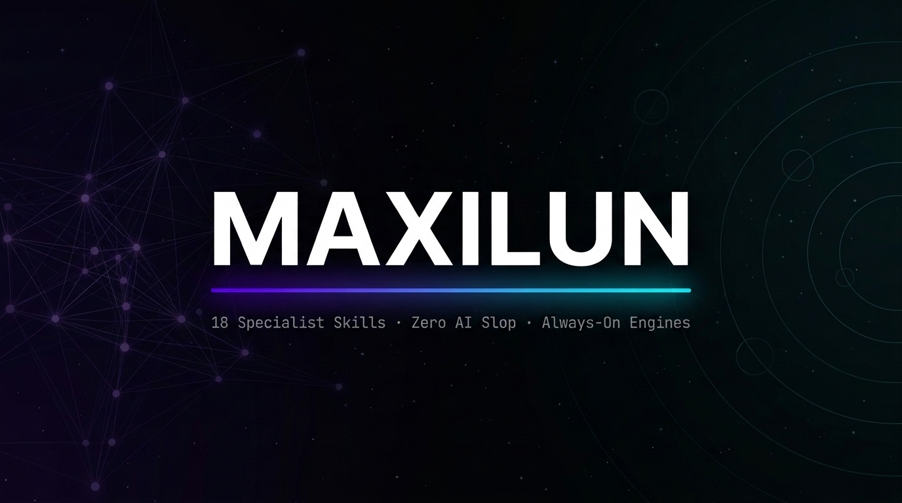

# Maxilun

<div align="center">



<br/>

[](https://github.com/giriedu/maxilun/actions/workflows/validate-skills.yml)
[](CHANGELOG.md)
[](docs/SKILLS.md)
[](LICENSE)
[](#platform-support)
[](https://skills.sh/giriedu/maxilun)

<br/>

**English** · [Bahasa Indonesia](README.id.md)

</div>

---

**Maxilun** is a production-grade ecosystem of 18 specialist AI skills designed for high-performing engineering teams. Rather than a loose bundle of prompts, Maxilun provides an integrated engineering co-pilot built on a mandatory **Knowledge Graph** foundation, **7 Always-On Quality Engines**, **anti-slop intelligence with self-correction and companion-skill enforcement**, and **zero tolerance for AI slop**.

## Quick Install

```bash
npx skills add giriedu/maxilun
```

> Track and explore all 18 skills on [skills.sh/giriedu/maxilun](https://skills.sh/giriedu/maxilun).  
> **Non-interactive (all skills)**: `npx skills add giriedu/maxilun -y` (add `-g` for global availability across projects).  
> **Windows Note**: If symlink creation is restricted, add `--copy` flag (`npx skills add giriedu/maxilun --copy -y`) or use the PowerShell installer in [docs/INSTALL.md](docs/INSTALL.md).

---

## 18 Specialist Skills

Structured by real-world software engineering lifecycle — from foundational architecture to production delivery:

| # | Skill | Engineering Domain | Primary Trigger |
|:--:|---|---|---|
| 1 | `maxilun` | Master Orchestrator — anti-slop brain, companion-skill enforcement, self-correction, wave coordination | `/maxilun`, `/msal` |
| 2 | `msal-knowledge-graph` | Mandatory Code Discovery — high-precision AST parser & WebGL 3D/2D visualizer (Lens) | `/msal-graph`, `/msal-trace` |
| 3 | `msal-scaffold` | Project Context Scaffolder — generates 10 AI-readable architecture docs in `docs/` | `/msal-scaffold`, `/msal-init` |
| 4 | `msal-architect` | System Architecture — C4 Model, Event Storming, ADRs, deep `/msal-think` reasoning | `/msal-think`, `/msal-architect` |
| 5 | `msal-sentinel` | Defensive Security — OWASP Top 10, STRIDE threat modeling, crypto, supply chain audit | `/msal-sentinel`, `/msal-security` |
| 6 | `msal-engineer` | Code Implementation — Test-Driven Development (TDD), 5-WHY debugging, clean refactoring | `/msal-engineer` |
| 7 | `msal-data` | Data & Persistence — schema design, zero-downtime migrations, query optimization, RLS | `/msal-data` |
| 8 | `msal-frontend` | Modern Frontend — React Server Components (RSC), Next.js App Router, Server Actions | `/msal-frontend` |
| 9 | `msal-verify` | Quality Assurance — Playwright E2E, visual regression, accessibility (a11y), contract tests | `/msal-verify`, `/msal-test` |
| 10 | `msal-insight` | Performance Diagnostics — CPU/memory/DB profiling, distributed tracing, leak detection | `/msal-insight`, `/msal-audit` |
| 11 | `msal-deploy` | Cloud & Operations — CI/CD pipelines, multi-stage Docker, zero-downtime rollouts | `/msal-deploy` |
| 12 | `msal-docsmith` | Technical Documentation — OpenAPI/AsyncAPI contracts, architecture ADRs, runbooks | `/msal-docsmith`, `/msal-docs` |
| 13 | `msal-craft` | Design Systems & UI/UX — OKLCH color palettes, WCAG AAA accessibility, 4px grid | `/msal-craft`, `/msal-ui` |
| 14 | `msal-motion` | Web Motion Design — physics-based animations, Lottie/SVG, kinetic typography | `/msal-motion` |
| 15 | `msal-cinecode` | Programmatic Video — React components as frames, batch headless MP4/WebM render | `/msal-cinecode` |
| 16 | `msal-diagrams` | System Visualization — C4, sequence, Event Storming, data-flow diagrams via Mermaid | `/msal-diagram`, `/msal-diagrams` |
| 17 | `msal-content` | User-Facing Copywriting — landing pages, UI microcopy, error states, brand voice | `/msal-content`, `/msal-copy` |
| 18 | `msal-seo-audit` | Technical SEO — Core Web Vitals, JSON-LD structured data, crawler readiness | `/msal-seo`, `/msal-seo-audit` |

---

## 7 Always-On Quality Engines

Enforced automatically across all 18 skills, non-overridable:

| Engine | Core Responsibility |
|---|---|
| **Focus Engine** | Executive HUD, task decomposition, persistent subtask tracking (max 3 concurrent) |
| **Purity Engine** | Zero AI slop — automatically purges buzzwords, fabricated claims, and empty placeholders |
| **Minimalist Engineering** | Dependency Decision Framework, cognitive load reduction, simplicity ladder |
| **Clarity Engine** | Explicit technical signaling: `[CONFIRMED]`, `[INFERRED]`, `[UNCERTAIN]`, `[UNVERIFIED]` |
| **Dependency Decision Framework** | Stdlib-first evaluation, bundle size gating, maintenance viability check before adding any dependency |
| **Cognitive Load Reduction** | Naming as documentation, file size ceiling, nesting depth limit, explicit over implicit |
| **Proactive Communication** | Blocker reporting, no silent failures, explicit assumptions, scope change notification |

---

## Mandatory Knowledge Graph Foundation

`msal-knowledge-graph` runs as the mandatory first phase before any code modifications:

- **Python AST Scanner** — semantic AST parsing for classes, methods, and relative imports (not brittle regex)
- **TypeScript Scanner** — line-accurate CALLS and IMPORT relationship attribution
- **Generic Polyglot Scanner** — AST and structural scanner for Go, Rust, Java, C#, Ruby, PHP, Swift, and C/C++
- **Maxilun Lens** — Interactive 3D WebGL Galaxy & 2D Force-Directed Matrix visualizer with BFS Path Trace and fuzzy search

```bash
# Launch visualizer or run dependency scan directly within your AI session:
/msal-graph
```

---

## Platform Support

| AI Coding Platform | Support Status | Note |
|---|---|---|
| Claude Code | ✅ Full Native Support | `.claude/skills/` |
| Antigravity IDE & CLI | ✅ Full Native Support | `.agents/skills/` |
| Cursor | ✅ Full Native Support | `.cursor/skills/` |
| OpenCode / Codex | ✅ Full Native Support | `.config/opencode/` & `.codex/` |
| Zed Editor | ✅ Full Native Support | `.agents/skills/` (`npx skills add -a zed`) |
| Termul (`termul.dev`) | ✅ Full Native Support | Workspace terminal manager for AI agents |

---

## Documentation

| Guide | Description |
|---|---|
| [docs/INSTALL.md](docs/INSTALL.md) | Comprehensive installation guides, one-line scripts & verification |
| [docs/SKILLS.md](docs/SKILLS.md) | Exhaustive triggers, capabilities, and parameters for all 18 skills |
| [docs/ENGINES.md](docs/ENGINES.md) | Architectural specification of the 7 Always-On Engines |
| [docs/EXAMPLES.md](docs/EXAMPLES.md) | Real-world engineering scenarios & multi-specialist Wave Patterns |
| [docs/RELEASE.md](docs/RELEASE.md) | Automated GitHub Releases, tag dispatch, and versioning protocols |
| [CHANGELOG.md](CHANGELOG.md) | Semantic version release history |
| [CONTRIBUTING.md](CONTRIBUTING.md) | Contribution standards, test-suite validation, and code hygiene |

---

## License

Distributed under the **Maxilun Source Available License v2.0 (MSAL-2.0)** — free to use, modify, and deploy for personal, educational, and internal commercial projects. Redistribution as a competing managed service or product requires prior written authorization. See [LICENSE](LICENSE) for full legal text.
