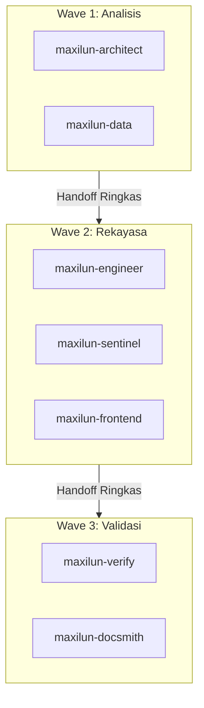
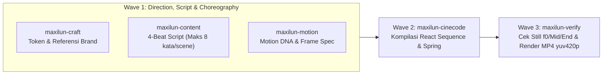

# Panduan & Contoh Nyata Penggunaan Maxilun

Dokumen ini berisi kumpulan contoh prompt praktis, alur koordinasi antar spesialis (Wave Pattern), dan ekspektasi hasil nyata untuk memaksimalkan ekosistem Maxilun.

---

## 1. Alur Kerja Terkoordinasi: Wave Pattern

Ketika menghadapi tugas berskala fitur atau refactor multi-lapisan, panggil orkestrator utama (`/maxilun`). Orkestrator akan memecah eksekusi ke dalam gelombang (waves) terstruktur:

### Skenario: "Membangun Endpoint Checkout & Langganan SaaS"

#### Alur Eksekusi:
1. **Wave 1 (Perencanaan & Data Layer)**:
   - `maxilun-architect`: Menentukan batas modul pembayaran, state machine invoice, dan penanganan webhook idempotency.
   - `maxilun-data`: Merancang migrasi PostgreSQL zero-downtime untuk tabel `subscriptions` dan policy Row-Level Security (RLS).
2. **Handoff Wave 1 → Wave 2**:
   - Menghasilkan ringkasan skema tabel, state machine enum, dan contract interface.
3. **Wave 2 (Implementasi & Pertahanan)**:
   - `maxilun-engineer`: Menulis implementasi handler checkout menggunakan Prisma/Drizzle.
   - `maxilun-sentinel`: Memvalidasi tanda tangan webhook Stripe, membatasi rate limit percobaan kartu, dan mitigasi timing attacks.
   - `maxilun-frontend`: Membuat formulir React Server Component dengan Server Actions dan penanganan status optimis.
4. **Handoff Wave 2 → Wave 3**:
   - Menyerahkan file implementasi yang telah selesai dikompilasi.
5. **Wave 3 (Validasi & Dokumentasi)**:
   - `maxilun-verify`: Menulis uji integrasi Playwright dan suite unit test untuk seluruh cabang error.
   - `maxilun-docsmith`: Menulis spesifikasi OpenAPI 3.1 dan memperbarui `docs/api.md` serta `llms.txt`.

### Skenario 2: "Membuat Motion Video Peluncuran Produk Kelas Studio (12 Detik, 1080p)"

1. **Wave 1 (Arah Visual, Naskah & Koreografi Paralel)**:
   - `maxilun-craft`: Memilih referensi `vercel.md` / `linear.app.md` dari `references/design-md/`, menetapkan skala tipografi kanvas 1080p (Headline `72px`, angka `tabular-nums`, safe margin `96px/80px`).
   - `maxilun-content`: Menyusun 4 beat naskah (`<= 8 kata per layar`): Hook masalah (`0–3s`), mekanisme solusi (`3–8s`), bukti metrik (`8–11.5s`), dan perintah CLI CTA (`11.5–14s`).
   - `maxilun-motion`: Menurunkan *Motion DNA* (`stiffness: 170, damping: 19`), memilih hook *Grid Construct + Type Scramble*, dan menyusun tabel koreografi per frame.
2. **Wave 2 (Kompilasi Frame Deterministik)**:
   - `maxilun-cinecode`: Membangun komponen React murni berbasis `useCurrentFrame()` (tanpa drift CSS `transition`), menyelaraskan potongan scene ke beat audio, dan menyertakan track `.vtt`.
3. **Wave 3 (Verifikasi Frame & Encoding)**:
   - `maxilun-verify` + `maxilun-cinecode`: Menguji unit matematika frame dengan Vitest, memeriksa tangkapan gambar pada `frame 0` (thumbnail), dan merender MP4 (`libx264`, `yuv420p`).

---
## 2. Contoh Prompt Spesifik per Spesialis

### 1. maxilun (Master Orchestrator)
- `"Rancang dan implementasikan sistem autentikasi email passwordless menggunakan magic link dan passkeys."`
- `"Audit performa dan keamanan seluruh alur checkout di src/features/checkout."`

### 2. maxilun-knowledge-graph
- `"/maxilun-graph petakan seluruh dependensi pemanggil fungsi calculateTax() di dalam repositori."`
- `"/maxilun-trace temukan jalur eksekusi dari rute HTTP /orders sampai ke fungsi query database."`

### 3. maxilun-scaffold
- `"/maxilun-scaffold inisialisasi dokumen konteks project ke docs/ sebelum mulai coding."`
- `"Scaffold 10 dokumen konteks lengkap (PRD, TECHSTACK, DESIGN, SECURITY, TASK, ARCHITECTURE, dll.) untuk project SaaS baru ini."`
- `"/maxilun-init --quick buat template dokumentasi project dengan estimasi stack dari package.json."`

### 4. maxilun-architect
- `"/maxilun-think evaluasi trade-off antara arsitektur Event-Driven vs Polling berkala untuk sinkronisasi inventaris multi-gudang."`
- `"Analisis dampak dependensi jika kita mengubah return signature dari method AuthService.validateSession()."`

### 5. maxilun-sentinel
- `"Audit endpoint /api/v1/user/upload-avatar terhadap potensi Unrestricted File Upload dan SSRF."`
- `"Implementasikan konfigurasi security headers ketat dan proteksi CSRF double-submit cookie pada Express/Fastify API."`

### 6. maxilun-engineer
- `"Refactor fungsi processPayment di src/services/payment.ts agar memisahkan dependensi gateway pihak ketiga ke adapter terisolasi."`
- `"Perbaiki memory leak pada background worker pemrosesan gambar di worker.ts."`

### 7. maxilun-data
- `"Desain skema PostgreSQL untuk sistem reservasi tiket bioskop dengan proteksi race condition double-booking."`
- `"Optimasi query riwayat transaksi di bawah ini yang memicu sequential scan pada tabel 5 juta baris."`

### 8. maxilun-frontend
- `"Konversi form pendaftaran multi-langkah ini ke React Server Component dengan validasi Server Action dan field error feedback."`
- `"Optimasi layout shift (CLS) dan Largest Contentful Paint (LCP) pada komponen Hero di app/page.tsx."`

### 9. maxilun-verify
- `"Buat test suite E2E menggunakan Playwright untuk memvalidasi alur reset password dari pengiriman email hingga login ulang."`
- `"Tulis unit test berbasis property testing untuk parser format nomor telepon internasional."`

### 10. maxilun-insight
- `"Deteksi akar masalah penyebab p99 latensi API melonjak dari 120ms ke 2.4s setiap pukul 09:00 WIB."`
- `"Analisis heap snapshot terlampir untuk melacak objek yang tidak ter-garbage-collect di Node.js service."`

### 11. maxilun-deploy
- `"Tulis Dockerfile multi-stage build berukuran minimal untuk Next.js standalone output dengan non-root user."`
- `"Rancang pipeline GitHub Actions untuk deployment preview otomatis per pull request dengan zero-downtime rollback."`

### 12. maxilun-docsmith
- `"Buat PRD & Engineering RFC untuk fitur Pembayaran QRIS Dinamis lengkap dengan kriteria Gherkin, matriks 4 state UI (merujuk maxilun-craft), dan kontrak OpenAPI 3.1 + RFC 9457."`
- `"Tulis panduan migrasi komprehensif dari v1 ke v2 untuk SDK publik ini dengan format Keep a Changelog."`
- `"Buat file llms.txt dan llms-full.txt yang memetakan dokumentasi teknis repositori ini untuk agen AI."`

### 13. maxilun-craft
- `"Buat sistem token warna berbasis OKLCH dengan kontras rasio minimal WCAG AAA untuk mode terang dan mode gelap."`
- `"Rancang komponen data table responsif yang otomatis berubah menjadi kartu hierarkis pada layar mobile tanpa JavaScript berat."`

### 14. maxilun-motion
- `"Buat komponen transisi antar halaman halus menggunakan Framer Motion dengan dukungan reduced-motion bagi pengguna sensitif."`
- `"Rancang mikro-interaksi untuk tombol 'Salin ke Clipboard' dengan indikator umpan balik visual 200ms."`

### 15. maxilun-cinecode
- `"/maxilun-cinecode buat template video rangkuman performa mingguan 15 detik (30fps) dengan grafik batang teranimasi dan scene outro."`
- `"Render batch 10 video varian produk personalisasi dalam format MP4 1080p berdasarkan data products.json menggunakan render pipeline headless."`

### 16. maxilun-diagrams
- `"/maxilun-diagram buat sequence diagram alur autentikasi OAuth2 Authorization Code dengan PKCE menggunakan format Mermaid."`
- `"Gambarkan diagram arsitektur microservices yang memperlihatkan pemisahan sinkron (REST) dan asinkron (Kafka/RabbitMQ)."`

### 17. maxilun-content
- `"Tulis teks instruksi kosong (empty state) untuk dashboard analitik ketika pengguna belum memiliki data riwayat."`
- `"Buat pesan kesalahan teknis yang mudah dipahami manusia tanpa membuka detail internal sistem untuk kegagalan koneksi bank."`

### 18. maxilun-seo-audit
- `"/maxilun-seo audit struktur tag semantik, JSON-LD schema, dan canonical URL pada halaman produk e-commerce ini."`
- `"Identifikasi dan perbaiki masalah Core Web Vitals pada halaman landing."`

