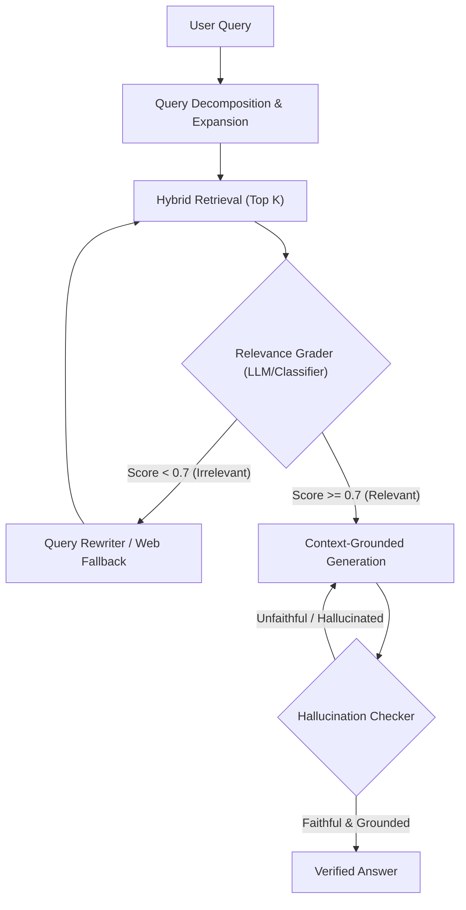

# Agentic RAG & Multi-Agent Topologies

Advanced retrieval-augmented generation and autonomous agent orchestration architectures. Synthesized from real-world production implementations (Shubham Saboo's Awesome LLM Apps).

---

## 1. Hybrid Retrieval Matrix

Pure vector search fails on exact keyword matching (SKUs, IDs, method names, phone numbers). Production RAG requires a hybrid retrieval pipeline:

```text
User Query
   ├──> Dense Embedding Model ──> Vector Index (Cosine / HNSW) ──> Top K Dense (e.g. 50)
   └──> Sparse Tokenizer (BM25) ──> Inverted Index ───────────────> Top K Sparse (e.g. 50)
                                                                           │
                                                                 Reciprocal Rank Fusion (RRF)
                                                                           │
                                                                 Cross-Encoder Reranker
                                                                           │
                                                                   Top N Chunks (e.g. 5)
```

### Reciprocal Rank Fusion (RRF) Formula
$$RRF(d) = \sum_{m \in M} \frac{1}{k + r_m(d)}$$
- $M$: set of rankers (Dense vector + BM25 sparse).
- $r_m(d)$: rank of document $d$ in system $m$.
- $k$: smoothing constant (standard default: $60$).

### Cross-Encoder Reranking
Bi-encoder vectors encode queries and documents separately, losing token-to-token attention. A Cross-Encoder (e.g., BGE-Reranker-Large, Cohere Rerank) scores $(query, document)$ jointly, boosting Top-3 precision by $20-35\%$.

---

## 2. Contextual & Semantic Chunking

Chunking blindly by character count breaks sentences and dilutes context. Follow these three rules:
1. **Header-Aware Hierarchical Chunking**:
   - Split along Markdown headings (`#`, `##`, `###`) or code AST boundaries (classes, functions).
   - Prepend document metadata (document title, breadcrumb trail, file path) to every chunk:
     ```text
     [Document: Billing Policy] [Section: Refund Window]
     Refund requests must be filed within 14 days of invoice date...
     ```
2. **Semantic Overlap**:
   - Use a sliding window with $15-20\%$ token overlap to preserve cross-chunk context.
3. **Context Window Hygiene**:
   - Ensure retrieved context uses $< 40\%$ of the active context window to avoid "needle in a haystack" recall degradation and attention decay.

---

## 3. Self-Correcting Agentic Retrieval Loop

Static retrieve-then-generate pipelines hallucinate when retrieval fails. The Self-Correcting Agentic Loop introduces validation gates:



1. **Relevance Grading**: Evaluates whether retrieved chunks actually contain the answer to the query.
2. **Dynamic Query Rewriting**: If relevance score is low, rephrases query synonyms or queries knowledge graphs.
3. **Hallucination Verification**: Checks generated assertions against source chunks before output.

---

## 4. Streaming Generative UI & Structured Tool Execution

- **Strict Schema Adherence**: Use Pydantic / Zod with JSON Schema for deterministic tool payloads.
- **Client Island Streaming**: Stream conversational text while emitting structured tool payloads as distinct Flight serialization packets to render live interactive widgets (data tables, charts, forms) without waiting for LLM generation to finish.
