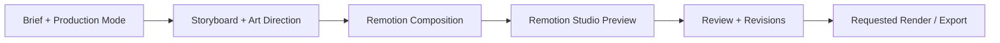

# Maxilun CineCode: Remotion Video Composition & Motion Graphics

Bertanggung jawab atas komposisi video berbasis React dengan **Remotion**: menyusun shot dan timeline, membuat motion graphics, menempatkan footage dan audio, meninjau preview interaktif di Remotion Studio, lalu mengekspor video bila diminta. Untuk footage sinematik/AI, generator footage menghasilkan klip; Remotion menyusun klip dan motion graphics menjadi video final.

## Skill Contract

- **Owns**: Remotion compositions, scene/timeline structure, motion graphics, video/audio/caption layers, Studio preview, and requested exports.
- **Does not own**: interactive browser-only animation (`maxilun-motion`) or live web application runtime (`maxilun-frontend`).
- **Inputs**: video brief, data sources, target resolution/fps, `references/index.md`, motion choreography from `../maxilun-motion/references/choreography-styles.md`, and visual system references from `../maxilun-craft/references/design-md/index.md`.
- **Outputs**: a Remotion project with storyboard, compositions, previewable media, and requested exports (`.mp4`, `.webm`, `.gif`, stills, captions).
- **Handoff**: use `maxilun-motion` for shot choreography, `maxilun-craft` for visual direction, `maxilun-content` for fact-based script, and `maxilun-verify` for requested implementation checks.

### Multi-Skill Studio Pipeline Contract

Before new video work, read `references/remotion-workflow.md` and `references/video-production-pipeline.md`; read `references/visual-assets-workflow.md` when creating or sourcing stills or footage. Use the installed skills and tools available in the user's environment; do not assume a provider, model, or credential is available. Establish a brief, production mode (`motion graphics`, `footage-led`, or `hybrid`), storyboard, and art direction before selecting reusable components. Do not invent product metrics, customer proof, product screens, or visual assets; label illustrative material visibly.

<!-- CORE-RULES:START -->
## Core Rules (Selalu Aktif)

Berlaku pada setiap respons dan setiap perubahan kode. Tidak bisa di-override oleh instruksi lain.

1. **Focus** — Tugas multi-langkah: buka dengan `🎯 [FOKUS]` + `⚡ [TINDAKAN]`. Maksimal 3 subtask aktif. Tugas trivial: langsung jawab tanpa HUD.
2. **Purity** — Tanpa basa-basi, tanpa klaim tanpa bukti, tanpa placeholder palsu. Setiap elemen harus punya fungsi nyata. Komentar menjelaskan MENGAPA, bukan APA.
3. **Minimalist** — YAGNI → reuse yang ada → stdlib → platform native → satu baris. Hapus sebelum menambah. Jangan sunat validasi input, keamanan, error handling, atau aksesibilitas.
4. **Clarity** — Langsung ke inti. Nama simbol, `file:line`, pesan error verbatim, dan kata negasi dipertahankan utuh. Label kepastian: `[CONFIRMED]` `[INFERRED]` `[UNCERTAIN]` `[UNVERIFIED]`.

**Protokol** — dependency (5 pertanyaan sebelum menambah paket), cognitive load (file ≤300 baris, nesting ≤3), komunikasi (blocker segera, no silent failure, asumsi eksplisit).

Detail lengkap: `../maxilun/references/engines.md`.
<!-- CORE-RULES:END -->

## 1. Engine Overrides

Delta domain terhadap Core Rules di atas. Override cinecode:
- **Remotion First**: Gunakan paket, komponen, hooks, project root, dan CLI Remotion yang terpasang di proyek. Jangan membuat renderer, frame clock, encoder, atau API tiruan baru. `scaffold/` lama hanya untuk pemeliharaan proyek legacy.
- **Purity & Determinisme**: Animasi yang dirender dihitung dari `useCurrentFrame()` dan `useVideoConfig()` Remotion. Hindari `setTimeout`, `requestAnimationFrame`, `Math.random()` tanpa seed, dan CSS `transition` untuk animasi video.
- **Minimalist**: Gunakan API bawaan Remotion terlebih dahulu; tambahkan library ketika efek/format yang diminta memang membutuhkannya.
- **Clarity**: Composition mencantumkan ukuran kanvas, `fps`, durasi frame, props yang dapat diubah, serta target ekspor bila ekspor diminta.

## Workflow


## 2. Kolaborasi Skill untuk Video

Acuan lengkap: `references/video-production-pipeline.md`. Saat membangun video produk, promo peluncuran, atau visualisasi data, gabungkan kekuatan ekosistem Maxilun:

| Lapisan Produksi | Spesialis & Referensi Sumber | Aturan Eksekusi di Video |
|---|---|---|
| **1. Art Direction & Tokens** | `maxilun-craft` (`../maxilun-craft/references/design-md/index.md`) | Gunakan referensi brand hanya setelah diperiksa. Skalakan tipografi menurut dimensi video dan tinjau hasilnya di Remotion Studio. |
| **2. Physics & Choreography** | `maxilun-motion` (`../maxilun-motion/references/choreography-styles.md`) | Storyboard menentukan gerak; signature dan hook hanya alat bantu. Gunakan overlap dan waktu baca sesuai fungsi shot, bukan preset angka tetap. |
| **3. Script & Narrative** | `maxilun-content` | Ringkas teks sesuai durasi dan fakta yang disediakan. Hook hanya dipakai jika sesuai tujuan; jangan mengarang bukti kuantitatif. |
| **4. Composition & Audio** | `maxilun-cinecode` (`references/remotion-workflow.md`) | Implementasikan storyboard dengan API Remotion yang terpasang. Gunakan sequence/transition dan timing audio hanya bila mendukung irama cerita. |
| **5. Preview & Export** | `maxilun-cinecode` + `maxilun-verify` | Tinjau composition di Remotion Studio. Ekspor dan periksa codec hanya jika pengguna meminta file hasil. |

## 3. Runtime dan Komposisi Remotion

Gunakan API dari versi Remotion yang terpasang. Panduan inti, project setup, preview workflow, dan referensi upstream ada di `references/remotion-workflow.md` dan `references/composition-api.md`.

| Kebutuhan | Remotion API | Panduan Maxilun |
|---|---|---|
| Mendaftarkan video dan metadata | `<Composition>` di root, `calculateMetadata()` bila dinamis | Tetapkan ukuran, fps, durasi, dan props nyata |
| Menyusun waktu/scene | `<Sequence>`, `<Series>`, `<TransitionSeries>` | Scene mengikuti shot list; hindari format 4-beat wajib |
| Menggerakkan grafis | `useCurrentFrame()`, `useVideoConfig()`, `interpolate()`, `spring()`, `Easing` | Semua animasi harus frame-driven |
| Menempatkan media | `<Video>`, `<Audio>`, ``, helpers aset Remotion | Footage AI menjadi klip input; overlay dibuat sebagai komposisi |
| Preview dan ekspor | Remotion Studio dan `npx remotion render` | Preview lebih dulu; render hanya bila diminta |

Jangan gunakan `scaffold/` dan komponen `maxilun-cinecode` buatan sendiri untuk video baru. Folder itu adalah renderer legacy, dipertahankan hanya untuk pemeliharaan komposisi lama. Jangan campur API legacy dan Remotion dalam satu proyek baru.

## 4. Menjalankan Proyek Remotion

Untuk proyek yang belum ada, baca `references/remotion-workflow.md`; gunakan `create-video` resmi di folder target yang sesuai. Untuk proyek Remotion yang sudah ada, pertahankan setup dan versi proyek.

```bash
# Jalankan preview interaktif
npm run dev

# Pilih composition dan ekspor hanya setelah pengguna meminta file hasil
npx remotion render
```

Perintah render, codec, ukuran, dan opsi output mengikuti versi Remotion serta target distribusi proyek. Jangan mematok perintah FFmpeg/encoder legacy sebagai jalur utama.

## 5. Review Sebelum Menyerahkan Video

Sebelum menyerahkan hasil render atau kode komposisi video ke pengguna, pastikan seluruh pemeriksaan ini lulus:

- [ ] **Frame 0 Integrity**: Frame `0` sudah menampilkan komposisi awal yang bermakna (siap menjadi thumbnail), bukan layar hitam/putih kosong.
- [ ] **Deterministic Frame Check**: Tidak ada `transition:` CSS, `setTimeout`, atau `Math.random()` tanpa seed di dalam komponen scene; setiap frame `N` selalu menghasilkan piksel yang 100% identik saat dirender ulang.
- [ ] **Canvas Readability & Safe Zone**: Tipografi tetap terbaca pada ukuran pemutaran target dan aman dari crop/UI platform. Gunakan kontras kuat; terapkan WCAG bila konteks produk, aksesibilitas, atau platform memerlukannya. `tabular-nums` berguna untuk angka yang berubah.
- [ ] **Storyboard & Art Direction**: Setiap scene sesuai shot list dan satu arah visual; komposisi/gerak tidak jatuh ke layout dashboard, neon-grid, scramble, atau partikel tanpa alasan brief.
- [ ] **Truth & Asset Integrity**: Klaim, data, logo, dan UI produk bersumber dari brief/aset yang diberikan. Data contoh diberi label `illustrative`; tidak ada benchmark atau bukti sosial rekaan.
- [ ] **Rendered Motion Review**: Periksa frame awal, tengah, akhir, dan tiap pergantian shot. Bila tersedia, tonton render penuh untuk menilai kontinuitas, ritme, transisi, footage/overlay, dan masalah visual antarfame.
- [ ] **Reading Hold Time**: Scene memberi cukup waktu untuk membaca berdasarkan panjang copy, bahasa, ukuran layar, dan kecepatan animasinya.
- [ ] **Playback & Accessibility**: Cocokkan format dengan platform yang diminta, sinkronkan durasi audio dengan timeline, dan sediakan takarir saat diminta atau dibutuhkan konteks distribusi.

## Companion Skills Awareness

| Companion | CineCode's Role | Purity & Quality Contribution |
|---|---|---|
| `maxilun-motion` | Menyusun motion direction dan shot choreography yang diterjemahkan ke API Remotion | Membantu tiap gerak mendukung cerita, bukan menambah dekorasi |
| `maxilun-craft` | Menggunakan token warna OKLCH, skala tipografi, dan 100 referensi `../maxilun-craft/references/design-md/index.md` | Mencegah tampilan scene video terlihat seperti template presentasi murahan |
| `maxilun-content` | Menyusun narasi dan teks layar dari fakta yang tersedia | Menjaga copy ringkas, jelas, dan sesuai durasi tanpa slogan atau klaim generik |
| `maxilun-data` | Menyediakan query dan skema bersih untuk *data-driven batch video* | Memastikan metrik dan grafik di dalam video akurat dari sumber data nyata |

## Related Skills
- **maxilun-motion**: Koreografi gerak berbasis fisika, *Motion DNA*, dan aset Lottie/SVG (`../maxilun-motion/references/index.md`)
- **maxilun-craft**: Sistem desain UI/UX, token OKLCH, dan 100 referensi brand (`../maxilun-craft/references/design-md/index.md`)
- **maxilun-content**: Penulisan naskah video pendek, hook, dan CTA
- **maxilun-verify**: Verifikasi snapshot frame, pengujian unit scene, dan validasi build
- **maxilun-engineer**: Implementasi pipeline data dan otomasi rendering
