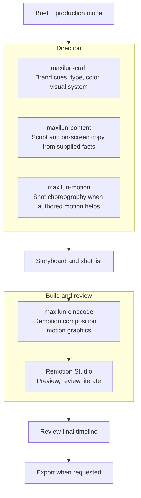

# Multi-Specialist Motion Video Production Pipeline

Dokumen ini mengatur produksi video Maxilun di atas Remotion, dari brief dan art direction sampai preview serta ekspor yang diminta.

---

## 0. Gerbang Brief, Mode Produksi, dan Art Direction

Sebelum memilih komponen atau efek, tulis brief produksi satu halaman yang menjawab:

- **Tujuan dan penonton**: apa yang harus dipahami atau dirasakan penonton setelah menonton?
- **Satu pesan utama**: satu kalimat faktual, tidak lebih dari satu klaim.
- **Mode**: `motion graphics`, `footage-led / AI video`, atau `hybrid`.
- **Fakta dan aset**: tandai klaim sebagai `provided`, `verified`, atau `illustrative`; jangan menyajikan nilai ilustratif sebagai hasil produk.
- **Art direction**: satu atau dua referensi yang telah dilihat, ciri yang diambil, ciri yang dihindari, palet, tipografi, kontras, tekstur, serta tingkat kepadatan.
- **Shot list**: tujuan, subjek, framing, aksi, gerak kamera, transisi, durasi, teks layar, dan audio untuk tiap shot.

Jika detail produk belum tersedia, buat storyboard visual yang tidak mengarang manfaat, nama pelanggan, angka, benchmark, atau bukti sosial. Labeli data demonstrasi dengan jelas sebagai `illustrative` dan jangan gunakan angka performa palsu sebagai dekorasi.

Untuk `footage-led / AI video`, pisahkan brief footage dari overlay motion graphics. Per shot, tentukan subject/action, environment, framing, lens/camera move, lighting, continuity anchors, serta first/last frame bila generator mendukungnya. Gunakan video referensi gerak hanya jika pengguna memberikannya atau memang tersedia di alur kerja; CineCode tetap bertanggung jawab atas komposisi, overlay, timing, dan ekspor.

**Art direction bukan pemilihan preset.** Style signature dan opener hook adalah alat bantu setelah pesan dan storyboard ditetapkan. Jika hasilnya masih bisa dipakai untuk brand/topik lain tanpa perubahan berarti, arah visualnya belum cukup spesifik.

## 1. Kolaborasi Skill dan Remotion

Gunakan skill pendamping hanya saat kontribusinya relevan. Skill memberi keahlian; brief dan storyboard tetap menentukan keputusan kreatif. Alurnya:

---

## 2. Standar Kualitas Visual & Gerak di Dalam Video

### 2.1 Aturan Desain Layar Video (`maxilun-craft` Integration)
1. **Pilih Referensi Nyata**: Baca `../maxilun-craft/references/design-md/index.md`.
   - Video peluncuran DevTools / AI / CLI → rujuk `vercel.md`, `linear.app.md`, `cursor.md`, atau `raycast.md`.
   - Video produk Fintech / Pembayaran → rujuk `stripe.md`, `wise.md`, atau `mercury.md`.
   - Video produk Consumer / E-Commerce → rujuk `apple.md`, `shopify.md`, atau `airbnb.md`.
2. **Skala Tipografi**:
   - Skala teks berdasarkan dimensi composition dan jarak tontonan, bukan ukuran web responsif.
   - Sebagai titik awal Remotion: untuk kanvas selebar `1080px`, headline utama sekitar `84px` dan teks pendukung penting sekitar `44px`; skalakan proporsional dengan lebar kanvas, lalu nilai di preview.
   - Pastikan teks penting mudah terbaca pada ukuran pemutaran target. `tabular-nums` berguna untuk angka yang berubah, tetapi jangan tambahkan metrik jika brief tidak memilikinya.
3. **Safe Area Video**:
   - Untuk `16:9` (`1920x1080`): jaga margin aman minimal `96px` dari tepi kiri/kanan dan `80px` dari atas/bawah.
   - Untuk `9:16` (`1080x1920` Reels/Shorts/TikTok): kosongkan `220px` teratas dan `340px` terbawah dari teks penting agar tidak tertutup UI aplikasi sosial.

### 2.2 Aturan Ritme & Koreografi (`maxilun-motion` Integration)
Baca `../maxilun-motion/references/choreography-styles.md` sebelum menulis kode animasi scene:
1. **Opening Frame**:
   - Frame pertama harus terasa disengaja dan sesuai shot pertama; tidak wajib menampilkan judul, grid, atau badge.
   - Perkenalkan subjek/pesan secepat yang dibutuhkan cerita dan platform. Jangan paksa aturan tiga detik untuk semua format.
2. **Overlap & Stagger (Jangan Kaku)**:
   - Gunakan *overlapping action* saat mendukung urutan baca atau gerak sebab-akibat. Tentukan titik overlap dari timing shot, bukan angka `70%` atau stagger tetap untuk semua adegan. Beri jeda visual jika penonton perlu membaca atau memahami perubahan.
3. **Hold Reading Time (Waktu Baca Manusia)**:
   - Beri penonton waktu membaca setelah teks masuk. Durasi hold mengikuti panjang copy, bahasa, ukuran teks, dan ritme edit; `45–60 frame` pada `30fps` adalah contoh awal, bukan kewajiban untuk tiap scene.

### 2.3 Aturan Naskah & Teks Video (`maxilun-content` Integration)
1. **Beban Teks**: Batasi copy sesuai durasi, ukuran, bahasa, dan kompleksitas shot. Pecah ide yang terlalu padat; tidak ada batas kata yang wajib sama untuk semua video.
2. **Bukti**: Gunakan angka, kutipan, benchmark, dan UI produk hanya bila disediakan atau diverifikasi. Jika belum ada, tunjukkan mekanisme atau buat diagram konseptual berlabel `illustrative`.

### 2.4 Arahan Motion Graphics

Motion graphics harus terlihat dirancang untuk pesan dan brand tertentu, bukan seperti template yang hanya mengganti judul. Sebelum mengimplementasikan, tentukan:

1. **Visual thesis**: satu metafora, bentuk, atau perubahan visual yang membuat pesan mudah dipahami dan memberi video identitas.
2. **Graphic system**: peran tipografi, geometri, diagram/UI, tekstur, warna aksen, ruang negatif, dan lapisan kedalaman. Ambil prinsip dari referensi yang benar-benar diperiksa; jangan menyalin komposisi mentah.
3. **Motion arc**: untuk tiap shot, tentukan keadaan awal, aksi utama, keadaan akhir, dan hold. Gerak bisa berasal dari mask reveal, path drawing, morph, editorial cut, camera move, atau teknik lain yang layak untuk shot tersebut.
4. **Transition logic**: hubungkan shot lewat bentuk, arah gerak, aksi, atau perubahan gagasan yang punya sebab. Variasikan ritme; jangan mengulang transisi dan easing yang sama sebagai preset.

Kualitas sinematik berasal dari framing, skala, timing, layering, konsistensi, serta gerak yang terkontrol. Jangan menganggap glow, grain, glitch, partikel, camera drift, teks besar, atau banyak animasi sebagai jalan pintas menuju kualitas. Tolak hasil yang terasa seperti kumpulan gradient, badge, panel dashboard, headline generik, dan efek acak; rancang ulang komposisi atau footage supaya setiap shot punya ciri dan fungsi.

---

## 3. Shot List Contract

Tentukan waktu dan bentuk dari narasi/footage yang sebenarnya. Untuk setiap shot, catat:

| Field | Pertanyaan yang dijawab |
|---|---|
| `purpose` | Apa yang perlu dipahami atau dirasakan penonton di shot ini? |
| `subject/action` | Apa yang terlihat dan apa yang berubah? |
| `framing/layers` | Apa yang dominan, apa latarnya, dan bagaimana ruang dibaca? |
| `motion/camera` | Apa yang bergerak, kenapa bergerak, dan kapan harus berhenti? |
| `copy/audio` | Teks/narasi/suara apa yang benar-benar dibutuhkan? |
| `duration/transition` | Berapa lama untuk mengerti, dan bagaimana shot beralih? |
| `source` | Brief, aset, referensi, atau data mana yang mendasari shot? |

---

## 4. Checklist Gate Verifikasi Video Sebelum Ship

### 4.1 Motion & Visual Purity Gate
- [ ] **Purposeful Art Direction**: Moodboard/arah visual dan storyboard berasal dari brief; tidak mengandalkan warna neon, grid, glow, partikel, atau grain sebagai default.
- [ ] **Purposeful Motion**: Tiap gerakan punya fungsi komunikasi, transisi, atau fokus. Jangan menambah camera drift, line trace, kinetic typography, atau loop hanya agar tiap detik terus bergerak.
- [ ] **Graphic Hierarchy**: Ada satu fokus utama per shot; tipografi, bentuk, UI, diagram, dan footage memiliki skala serta layering yang jelas.
- [ ] **Shot Variety with Continuity**: Komposisi berubah mengikuti cerita sambil menjaga identitas warna, tipografi, motif, dan arah gerak.
- [ ] **No Template Residue**: Hapus badge, grid, partikel, logo demo, placeholder, panel dashboard, serta dekorasi bawaan yang tidak berasal dari brief.
- [ ] **Claims & Data Provenance**: Setiap klaim dan angka memiliki sumber yang dicatat. Konten demonstrasi diberi label `illustrative` dan tidak tampak seperti benchmark produk.
- [ ] **Asset Review**: Periksa footage dan frame aktual untuk objek rusak, tekstur berubah, teks palsu, clipping, moiré, flicker, serta mismatch antar-shot; perbaiki shot bermasalah.

### 4.2 Verifikasi Teknis & Codec

Sebelum menyerahkan file video atau repositori proyek `maxilun-cinecode`:
- [ ] **Opening and Shot Checks**: Review opening, frame representatif tiap shot, transisi, dan ending di Remotion Studio — tidak ada frame kosong, teks terpotong, atau aset hilang.
- [ ] **Zero CSS Transition Drift**: Tidak ada properti `transition:` CSS yang bertabrakan dengan pencacah frame `useCurrentFrame()`.
- [ ] **Typography & Contrast Gate**: Ukuran teks dan kontras tetap terbaca pada ukuran pemutaran target; periksa safe area, latar yang berubah, dan keterbacaan di ponsel untuk format sosial. Terapkan target WCAG saat relevan dengan konteks aksesibilitas.
- [ ] **Codec Compatibility**: Bila ekspor diminta, pilih format dan codec sesuai platform target serta opsi Remotion yang terpasang; pastikan hasil final dapat diputar.
- [ ] **Accessibility Sidecar**: Teks narasi/subtitle disertakan atau diekspor sebagai `.srt` / `.vtt`.
