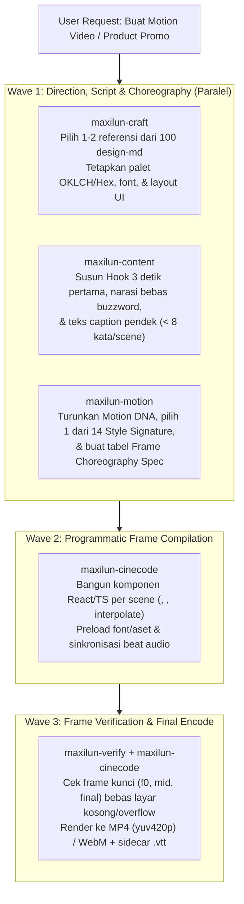

# Multi-Specialist Motion Video Production Pipeline

Dokumen ini adalah blueprint standar Maxilun untuk menghasilkan **Motion Video kelas studio** (product launch video, UI demo, data storytelling, atau architectural explainer) dengan mengoordinasikan 5 spesialis Maxilun secara sinergis.

---

## 1. Orkestrasi 5 Spesialis untuk Motion Video Maksimal

Jangan pernah merender video dengan warna asal-asalan, teks brosur yang membosankan, atau gerakan linear yang kaku. Gunakan alur lintas-skill berikut:

---

## 2. Standar Kualitas Visual & Gerak di Dalam Video

### 2.1 Aturan Desain Layar Video (`maxilun-craft` Integration)
1. **Pilih Referensi Nyata**: Baca `../maxilun-craft/references/design-md/index.md`.
   - Video peluncuran DevTools / AI / CLI → rujuk `vercel.md`, `linear.app.md`, `cursor.md`, atau `raycast.md`.
   - Video produk Fintech / Pembayaran → rujuk `stripe.md`, `wise.md`, atau `mercury.md`.
   - Video produk Consumer / E-Commerce → rujuk `apple.md`, `shopify.md`, atau `airbnb.md`.
2. **Skala Tipografi Khusus Video (1080p Canvas)**:
   - Jangan gunakan ukuran font web mentah (`12px` tidak terbaca setelah kompresi video).
   - Ukuran minimum di kanvas `1920x1080`:
     - **Display / Headline Scene**: `64px - 96px` (`font-weight: 600-700`, `letter-spacing: -0.03em`)
     - **Subheadline / Caption**: `32px - 44px` (`line-height: 1.3`)
     - **Label UI / Kode di dalam Mockup**: minimal `22px - 28px`
     - **Angka Metrik**: wajib `font-variant-numeric: tabular-nums` agar angka yang berputar (*counter*) tidak bergetar secara horizontal.
3. **Safe Area Video**:
   - Untuk `16:9` (`1920x1080`): jaga margin aman minimal `96px` dari tepi kiri/kanan dan `80px` dari atas/bawah.
   - Untuk `9:16` (`1080x1920` Reels/Shorts/TikTok): kosongkan `220px` teratas dan `340px` terbawah dari teks penting agar tidak tertutup UI aplikasi sosial.

### 2.2 Aturan Ritme & Koreografi (`maxilun-motion` Integration)
Baca `../maxilun-motion/references/choreography-styles.md` sebelum menulis kode animasi scene:
1. **3-Second Hook Rule (Frame `0..90` @ 30fps)**:
   - Frame `0` **TIDAK BOLEH** layar hitam/putih kosong. Frame `0` harus sudah menampilkan struktur awal (grid hairline, badge produk, atau frame pertama judul) sehingga sekaligus berfungsi sebagai thumbnail alami.
   - Dalam 45 frame pertama (`1.5 detik`), subjek utama harus sudah terbaca jelas.
2. **Overlap & Stagger (Jangan Kaku)**:
   - Jangan menunggu elemen A berhenti 100% baru elemen B mulai bergerak. Gunakan *overlapping action*: saat headline mencapai `70%` progres spring-nya (misal `frame 12`), subheadline atau kartu UI sudah mulai masuk (`stagger: 4 - 6 frames`).
3. **Hold Reading Time (Waktu Baca Manusia)**:
   - Setelah teks atau grafik selesai beranimasi masuk, **tahan posisi stabil minimal `45 - 60 frame` (`1.5 - 2.0 detik`)** agar penonton sempat membaca isinya sebelum transisi ke scene berikutnya.

### 2.3 Aturan Naskah & Teks Video (`maxilun-content` Integration)
1. **Maksimal 8 Kata per Layar**: Penonton video tidak membaca paragraf. Pecah klaim panjang menjadi:
   - *Scene 1 (Masalah)*: `"Build CI lambat: 18 menit per PR."`
   - *Scene 2 (Solusi)*: `"Cache graf pintar: turun jadi 42 detik."`
2. **Buktikan dengan Angka / Visualisasi Kode**: Lebih baik menampilkan perbandingan bar chart tumbuh (`42s vs 18m`) atau snippet terminal nyata daripada kata sifat seperti *"Sangat Cepat & Efisien"*.

---

## 3. Blueprint Struktur Scene Video Produksi (12–15 Detik @ 30fps = 360–450 Frames)

| Urutan Scene | Rentang Frame (`30fps`) | Durasi | Tujuan Komunikasi | Pola Visual & Motion (`maxilun-motion`) |
|---|---|---|---|---|
| **1. The Hook** | `0 .. 90` | `3.0s` | Menangkap perhatian & menyatakan masalah/nilai inti | `Grid Construct` + `Scramble` atau `Spring` headline besar + aksen warna brand |
| **2. The Mechanism (UI/Code Demo)** | `90 .. 240` | `5.0s` | Menunjukkan produk bekerja (bukan sekadar klaim) | Mockup komponen tajam (`maxilun-craft`), kursor terarah atau `Code-to-UI Live Compile` |
| **3. The Proof (Metrics / DataViz)** | `240 .. 345` | `3.5s` | Membuktikan dampak dengan angka terukur | Grafik tumbuh dengan `Spring` + counter `tabular-nums` + badge peningkatan faktual |
| **4. The Call-to-Action (Outro)** | `345 .. 420` | `2.5s` | Memberikan 1 langkah konkret berikutnya | Perintah CLI / URL jelas + tombol CTA fokus kontras tinggi + transisi akhir bersih |

---

## 4. Checklist Gate Verifikasi Video Sebelum Ship

Sebelum menyerahkan file video atau repositori proyek `maxilun-cinecode`:
- [ ] **Frame 0 Thumbnail Check**: Frame `0` dan frame tengah tiap scene dirender/diperiksa — tidak ada frame kosong, teks terpotong, atau gambar 404.
- [ ] **Zero CSS Transition Drift**: Tidak ada properti `transition:` CSS yang bertabrakan dengan pencacah frame `useCurrentFrame()`.
- [ ] **Typography & Contrast Gate**: Ukuran teks terkecil `>= 22px` pada kanvas 1080p; rasio kontras teks `>= 4.5:1`; angka metrik memakai `tabular-nums`.
- [ ] **Codec Compatibility**: MP4 di-encode dengan `-c:v libx264 -pix_fmt yuv420p` agar dapat diputar di semua browser, macOS/iOS QuickTime, Windows, dan platform sosial.
- [ ] **Accessibility Sidecar**: Teks narasi/subtitle disertakan atau diekspor sebagai `.srt` / `.vtt`.
