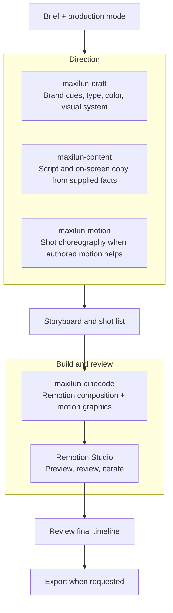

# Multi-Specialist Motion Video Production Pipeline

This document governs Maxilun video production on top of Remotion, from the brief and art direction through preview and the requested export.

---

## 0. Brief, Production Mode, and Art Direction Gate

Before choosing components or effects, write a one-page production brief that answers:

- **Goal and audience**: what should the viewer understand or feel after watching?
- **One main message**: one factual sentence, no more than one claim.
- **Mode**: `motion graphics`, `footage-led / AI video`, or `hybrid`.
- **Facts and assets**: mark each claim as `provided`, `verified`, or `illustrative`; never present an illustrative value as a product result.
- **Art direction**: one or two references that were actually viewed, the traits to adopt, the traits to avoid, palette, typography, contrast, texture, and density level.
- **Shot list**: purpose, subject, framing, action, camera move, transition, duration, on-screen text, and audio for each shot.

When product details are not yet available, build a visual storyboard that does not invent benefits, customer names, numbers, benchmarks, or social proof. Label demonstration data clearly as `illustrative`, and do not use fake performance numbers as decoration.

For `footage-led / AI video`, keep the footage brief separate from the motion graphics overlay. Per shot, define subject/action, environment, framing, lens/camera move, lighting, continuity anchors, and the first/last frame when the generator supports it. Use a motion reference video only when the user supplies one or it already exists in the workflow. CineCode stays responsible for composition, overlays, timing, and export.

**Art direction is not preset selection.** Style signatures and opener hooks are aids to use after the message and storyboard are set. If the result could serve another brand/topic without meaningful change, the visual direction is not specific enough.

## 1. Skill and Remotion Collaboration

Use a companion skill only when its contribution is relevant. Skills supply expertise; the brief and storyboard still decide the creative choices. The flow:

---

## 2. Visual & Motion Quality Standards Inside the Video

### 2.1 Video Screen Design Rules (`maxilun-craft` Integration)
1. **Pick real references**: Read `../maxilun-craft/references/design-md/index.md`.
   - DevTools / AI / CLI launch video → refer to `vercel.md`, `linear.app.md`, `cursor.md`, or `raycast.md`.
   - Fintech / Payments product video → refer to `stripe.md`, `wise.md`, or `mercury.md`.
   - Consumer / E-Commerce product video → refer to `apple.md`, `shopify.md`, or `airbnb.md`.
2. **Type scale**:
   - Scale text from the composition dimensions and the viewing distance, not from responsive web sizes.
   - As a Remotion starting point: on a `1080px`-wide canvas, set the main headline around `84px` and important supporting text around `44px`. Scale in proportion to the canvas width, then judge the result in the preview.
   - Keep important text easy to read at the target playback size. `tabular-nums` helps with changing numbers, but do not add a metric the brief does not contain.
3. **Video safe area**:
   - For `16:9` (`1920x1080`): keep a safe margin of at least `96px` from the left/right edges and `80px` from the top/bottom.
   - For `9:16` (`1080x1920` Reels/Shorts/TikTok): keep important text out of the top `220px` and the bottom `340px` so the social app UI does not cover it.

### 2.2 Rhythm & Choreography Rules (`maxilun-motion` Integration)
Read `../maxilun-motion/references/choreography-styles.md` before writing scene animation code:
1. **Opening frame**:
   - The first frame must look intentional and fit the first shot; it does not have to show a title, grid, or badge.
   - Introduce the subject/message as fast as the story and platform require. Do not force a three-second rule onto every format.
2. **Overlap & stagger (stay flexible)**:
   - Use *overlapping action* when it supports reading order or cause-and-effect motion. Set the overlap point from the shot timing, not from a `70%` figure or a fixed stagger for every scene. Add a visual pause when the viewer needs to read or absorb a change.
3. **Hold reading time (human reading time)**:
   - Give the viewer time to read after text enters. Hold duration follows copy length, language, text size, and edit rhythm; `45–60 frames` at `30fps` is a starting example, not a requirement for every scene.

### 2.3 Script & Video Text Rules (`maxilun-content` Integration)
1. **Text load**: Limit copy to fit the shot's duration, size, language, and complexity. Split ideas that are too dense; no single word limit applies to every video.
2. **Evidence**: Use numbers, quotes, benchmarks, and product UI only when they are supplied or verified. When they are not available, show the mechanism or build a conceptual diagram labeled `illustrative`.

### 2.4 Motion Graphics Direction

Motion graphics must look designed for a specific message and brand, not like a template with a swapped title. Before implementing, define:

1. **Visual thesis**: one metaphor, shape, or visual change that makes the message easy to grasp and gives the video an identity.
2. **Graphic system**: the roles of typography, geometry, diagrams/UI, texture, accent color, negative space, and depth layers. Take principles from references that were actually inspected; do not copy a composition outright.
3. **Motion arc**: for each shot, define the start state, main action, end state, and hold. Motion can come from a mask reveal, path drawing, morph, editorial cut, camera move, or any other technique that suits the shot.
4. **Transition logic**: connect shots through shape, motion direction, action, or a change of idea that has a cause. Vary the rhythm; do not repeat the same transition and easing as a preset.

Cinematic quality comes from framing, scale, timing, layering, consistency, and controlled motion. Do not treat glow, grain, glitch, particles, camera drift, large text, or a high animation count as a shortcut to quality. Reject a result that reads as a collection of gradients, badges, dashboard panels, generic headlines, and random effects; redesign the composition or footage so every shot has a distinct character and function.

---

## 3. Shot List Contract

Set timing and form from the actual narration/footage. For each shot, record:

| Field | Question it answers |
|---|---|
| `purpose` | What must the viewer understand or feel in this shot? |
| `subject/action` | What is visible and what changes? |
| `framing/layers` | What dominates, what is the background, and how is the space read? |
| `motion/camera` | What moves, why does it move, and when must it stop? |
| `copy/audio` | Which text/narration/sound is actually needed? |
| `duration/transition` | How long does understanding take, and how does the shot hand over? |
| `source` | Which brief, asset, reference, or data underlies the shot? |

---

## 4. Video Verification Gate Checklist Before Ship

### 4.1 Motion & Visual Purity Gate
- **Purposeful Art Direction**: The moodboard/visual direction and storyboard come from the brief; they do not rely on neon color, grids, glow, particles, or grain as defaults.
- **Purposeful Motion**: Every movement has a communication, transition, or focus function. Do not add camera drift, line trace, kinetic typography, or loops only to keep every second moving.
- **Graphic Hierarchy**: Each shot has one primary focus; typography, shapes, UI, diagrams, and footage have clear scale and layering.
- **Shot Variety with Continuity**: Composition changes with the story while keeping the identity of color, typography, motifs, and motion direction.
- **No Template Residue**: Remove badges, grids, particles, demo logos, placeholders, dashboard panels, and default decoration that did not come from the brief.
- **Claims & Data Provenance**: Every claim and number has a recorded source. Demonstration content is labeled `illustrative` and does not look like a product benchmark.
- **Asset Review**: Inspect the actual footage and frames for broken objects, shifting textures, fake text, clipping, moiré, flicker, and shot-to-shot mismatch; fix the affected shots.

### 4.2 Technical & Codec Verification

Before handing over a video file or a `maxilun-cinecode` project repository:
- **Opening and Shot Checks**: Review the opening, a representative frame of each shot, the transitions, and the ending in Remotion Studio — no blank frames, clipped text, or missing assets.
- **Zero CSS Transition Drift**: No CSS `transition:` property conflicts with the `useCurrentFrame()` frame counter.
- **Typography & Contrast Gate**: Text size and contrast stay readable at the target playback size; check the safe area, changing backgrounds, and phone legibility for social formats. Apply WCAG targets when the accessibility context calls for them.
- **Codec Compatibility**: When an export is requested, choose the format and codec for the target platform and the installed Remotion options; confirm the final file plays.
- **Accessibility Sidecar**: Narration/subtitle text is included or exported as `.srt` / `.vtt`.
