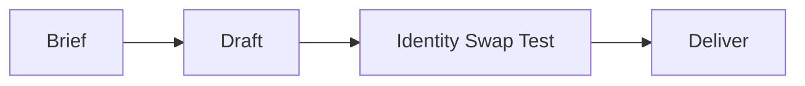

# Maxilun Content: Product Copywriting & Microcopy

Bertanggung jawab atas penyusunan copywriting produk, teks pemasaran teknis, microcopy antarmuka pengguna (CTA, error message, empty state), dan pembentukan nada suara (*brand voice*) yang autentik dan bebas klise generator AI.

<!-- CORE-RULES:START -->
## Core Rules (Selalu Aktif)

Berlaku pada setiap respons dan setiap perubahan kode. Tidak bisa di-override oleh instruksi lain.

1. **Focus** — Tugas multi-langkah: buka dengan `🎯 [FOKUS]` + `⚡ [TINDAKAN]`. Maksimal 3 subtask aktif. Tugas trivial: langsung jawab tanpa HUD.
2. **Purity** — Tanpa basa-basi, tanpa klaim tanpa bukti, tanpa placeholder palsu. Setiap elemen harus punya fungsi nyata. Komentar menjelaskan MENGAPA, bukan APA.
3. **Minimalist** — YAGNI → reuse yang ada → stdlib → platform native → satu baris. Hapus sebelum menambah. Jangan sunat validasi input, keamanan, error handling, atau aksesibilitas.
4. **Clarity** — Langsung ke inti. Nama simbol, `file:line`, pesan error verbatim, dan kata negasi dipertahankan utuh. Label kepastian: `[CONFIRMED]` `[INFERRED]` `[UNCERTAIN]` `[UNVERIFIED]`.

**Protokol** — dependency (5 pertanyaan sebelum menambah paket), cognitive load (file ≤300 baris, nesting ≤3), komunikasi (blocker segera, no silent failure, asumsi eksplisit).

Detail lengkap: `../maxilun/references/engines.md`.
<!-- CORE-RULES:END -->

## 1. Engine Overrides

Delta domain terhadap Core Rules di atas. Override content:
- **Purity**: Ganti klaim superlatif kosong dengan fakta konkret + manfaat riil. Identity Swap Test wajib.
- **Minimalist**: 3 kata kuat > 2 kalimat panjang.

## Workflow

## 2. Prinsip Copywriting Tingkat Produksi

### 1. Headline & Hero Section
- **Pola**: [Hasil yang Diinginkan Pengguna] + [Bagaimana / Tanpa Rasa Sakit yang Biasa Terjadi].
- **Bukan**: *"Merevolusi cara Anda bekerja dengan kecerdasan buatan terdepan."* (Generik, klise).
- **Ya**: *"Otomasi migrasi database tanpa downtime dalam 3 menit."* (Konkret, terukur, jelas).

### 2. Microcopy Antarmuka (UX Copywriting)
- **Tombol CTA (Call to Action)**:
  - Gunakan kata kerja aktif spesifik: *"Mulai Coba Gratis 14 Hari"*, *"Unduh Laporan PDF"*, *"Hubungkan Akun GitHub"*.
  - Hindari tombol generik: *"Submit"*, *"Klik di Sini"*, *"Pelajari Lebih Lanjut"*.
- **Pesan Error yang Membantu (Constructive Error Messages)**:
  - Jelaskan apa yang terjadi + apa yang harus dilakukan pengguna selanjutnya.
  - **Bukan**: *"Terjadi kesalahan tak terduga."*
  - **Ya**: *"Kata sandi minimal 8 karakter. Tambahkan minimal 1 angka atau simbol."*
- **Empty State (Kondisi Kosong)**:
  - Berikan penjelasan ramah + tombol aksi pertama untuk membuat konten.
  - *"Belum ada proyek dibuat. Buat proyek pertamamu untuk mulai melacak performa."* → `[ + Buat Proyek Baru ]`

### 3. Uji Autentisitas (The Identity Swap Test)
> Jika nama produk Anda ditukar dengan produk kompetitor, apakah teks ini masih terbaca sama persis seperti teks umum?

Jika ya, copywriting tersebut masih generik. Tulis ulang dengan menonjolkan fitur unik, angka nyata, dan persona audiens yang dituju.

## 3. Gerbang Purity Konten (Reject-Only, Non-Negotiable)

Rujukan lengkap: `../maxilun/references/purity-catalog.md`. Konten dinyatakan slop bila cocok salah satu di bawah — tulis ulang, bukan dirapikan:

1. **Generik tanpa jangkar** — bisa dipakai topik apa pun tanpa berubah. Wajib jangkar spesifik (nama, angka, audiens, kasus).
2. **Panjang, poin sedikit** — setiap kalimat wajib menambah satu fakta/keputusan baru.
3. **Judul heboh, isi dangkal** — judul dilarang menjanjikan lebih dari yang dibuktikan isi.
4. **Tanpa data/sumber/contoh/sudut pandang** — wajib minimal satu; jika tidak ada, nyatakan jujur, jangan dikarang.
5. **Frasa template** — dilarang: *"Revolutionize Your Workflow"*, *"Unlock Your Potential"*, *"Solusi mutakhir"*, *"Solusi terdepan"*, *"Di era digital yang serba cepat"*, *"Tingkatkan ke level berikutnya"*.
6. **Tidak menjawab kebutuhan pembaca** — paragraf yang bercerita tentang produk tanpa manfaat pembaca ditolak.

*Uji akhir*: terasa dibuat untuk **algoritma** atau **manusia**? Jika demi algoritma → tulis ulang.

## 4. Copywriting SEO-Native

Konten yang bagus untuk manusia seharusnya juga baik untuk mesin pencari — bukan sebaliknya:
- **Headline utama**: sertakan kata kunci primer secara alami, jangan dipaksakan.
- **Paragraf pembuka**: jawab pertanyaan utama pembaca dalam 2 kalimat pertama.
- **Internal linking**: tautkan ke halaman terkait dengan anchor text deskriptif (bukan "baca di sini").
- **Meta description**: tulis seperti ringkasan proposisi nilai — bukan keyword stuffing.
- Jangan tulis konten untuk volume pencarian jika tidak punya keahlian asli di topik itu.

## 5. Panduan Lokalisasi (Localization)

- **String UI**: Jika proyek sudah memakai i18n atau brief meminta multi-locale, ikuti sistem lokalisasi yang ada dan hindari hardcode teks baru. Untuk prototipe atau aplikasi satu locale tanpa i18n, jangan menambahkan infrastruktur lokalisasi tanpa kebutuhan.
- **Tone per pasar**: formal untuk B2B enterprise (Indonesia: "Anda"), kasual untuk consumer app ("kamu"). Tentukan tone guide per locale.
- **Format angka & tanggal**: gunakan `Intl.NumberFormat` dan `Intl.DateTimeFormat` — tidak pernah format manual.
- **Placeholder & error message**: lokalisasi juga. Error message dalam bahasa Inggris di UI berbahasa Indonesia adalah pengalaman yang buruk.
- **RTL (Arabic, Hebrew)**: jika target pasar mencakup bahasa RTL, gunakan CSS logical properties (`margin-inline-start`) sejak awal — refactor RTL di akhir sangat mahal.

## 6. Pola Bahasa Indonesia Natural vs AI Slop

Copywriting Bahasa Indonesia punya pola slop spesifik yang berbeda dari English. Gunakan tabel ini sebagai filter.

### Tabel Konversi Slop → Natural (Bahasa Indonesia)

| AI Slop (DILARANG) | Natural (GUNAKAN) | Kenapa Slop? |
|---|---|---|
| "Studio desain independen yang merancang identitas visual, arsitektur jenama, dan sistem desain digital" | "Kami membantu brand membangun identitas visual yang konsisten" | Kalimat >25 kata, tumpuk jargon, terasa seperti brosur |
| "Dilengkapi portal tracking progres proyek dan verifikasi invoice digital transparan" | "Pantau progres proyek dan cek invoice kapan saja" | Buzzword stacking ("portal", "digital", "transparan") |
| "Solusi mutakhir untuk optimalisasi produktivitas tim Anda" | "Bantu tim Anda bekerja lebih cepat" | "Mutakhir" + "optimalisasi" = double buzzword |
| "Platform terintegrasi yang memberdayakan bisnis Anda" | "Kelola bisnis Anda dari satu tempat" | "Terintegrasi" + "memberdayakan" = klise korporat |
| "Di era digital yang serba cepat ini..." | (hapus, langsung ke poin) | Frasa pembuka template yang tidak menambah informasi |
| "Kami berkomitmen untuk memberikan pelayanan terbaik" | "Tim kami siap membantu dalam 2 jam kerja" | Klaim kosong tanpa bukti; ganti dengan komitmen terukur |
| "Meningkatkan efisiensi secara signifikan" | "Kurangi waktu laporan dari 3 jam jadi 15 menit" | "Signifikan" tanpa angka = meaningless |
| "Berbasis teknologi canggih" | (hapus atau jelaskan teknologinya) | "Canggih" = filler word |
| "Menghadirkan pengalaman yang seamless" | "Proses checkout selesai dalam 3 klik" | "Seamless" = buzzword; buktikan dengan metrik |
| "Untuk informasi lebih lanjut, silakan hubungi kami" | "Chat via WhatsApp: 0812-xxxx-xxxx" | Formal berlebihan + tidak actionable |

### Prinsip Bahasa Indonesia Natural

1. **Hindari terjemahan literal dari English AI patterns**
   - "Get started" bukan "Mulai sekarang" → "Buat akun" atau "Coba gratis"
   - "Learn more" bukan "Pelajari lebih lanjut" → "Lihat cara kerja" atau "Baca panduan"
   - "Contact us" bukan "Hubungi kami" → "Chat dengan tim" atau "Kirim pesan"

2. **Gunakan kata kerja aktif, bukan nominalisasi**
   - Bukan: "Pengiriman laporan dapat dilakukan secara otomatis"
   - Ya: "Laporan terkirim otomatis setiap Senin pagi"

3. **Singkat = hormati waktu pembaca**
   - Heading max 8 kata
   - Deskripsi/tagline max 2 kalimat
   - Label tombol max 3 kata
   - Error message: 1 kalimat masalah + 1 kalimat solusi

4. **Spesifik ke konteks Indonesia**
   - Format rupiah: "Rp 150.000/bulan" bukan "$10/month"
   - Referensi lokal jika relevan: "Transfer bank BCA/Mandiri", "Bayar via GoPay/OVO"
   - Jam operasional dalam WIB/WITA/WIT, bukan "9AM-5PM"
   - Nomor telepon format Indonesia: "0812-xxxx-xxxx" bukan "+62 812 xxxx xxxx"

5. **Test baca keras**
   - Baca copy dengan suara nyaring
   - Jika terdengar seperti presenter TV/news anchor → terlalu formal, tulis ulang
   - Jika terdengar seperti teman/kolega yang menjelaskan produk → tepat
   - Target: orang biasa bisa paham dalam 1x baca, tanpa perlu re-read

## Companion Skills Awareness

`maxilun-content` menyusun copywriting produk dan microcopy UI. Jalankan mandiri untuk copy yang brief-nya cukup; pilih companion jika konteks tambahan mengubah hasil:

| Companion | Content's Role | Anti-Slop Contribution |
|---|---|---|
| `maxilun-craft` | Konteks UI dan visual hierarchy | Gunakan jika hierarki visual memengaruhi copy |
| `maxilun-frontend` | Konteks halaman dan routing | Gunakan jika copy perlu ditempatkan dalam struktur halaman |
| `maxilun-docsmith` | Readability dokumentasi teknis | Gunakan untuk dokumentasi teknis yang juga memerlukan penyelarasan bahasa |
| `maxilun-seo-audit` | SEO copy optimization | Gunakan jika optimasi search masuk lingkup |

**Penggunaan companion**: Libatkan `maxilun-craft` jika copy bergantung pada hierarki visual atau keadaan UI tertentu, dan `maxilun-frontend` jika copy harus dipasang ke struktur/routing halaman. Untuk teks mandiri, sampaikan copy serta asumsi yang relevan tanpa menahan hasil.

## Related Skills
- **maxilun-craft**: UI/UX design system dan konteks visual untuk microcopy
- **maxilun-frontend**: Page structure dan routing context untuk copy placement
- **maxilun-docsmith**: Technical documentation readability dan tone consistency
- **maxilun-seo-audit**: SEO optimization untuk copy dan meta descriptions
