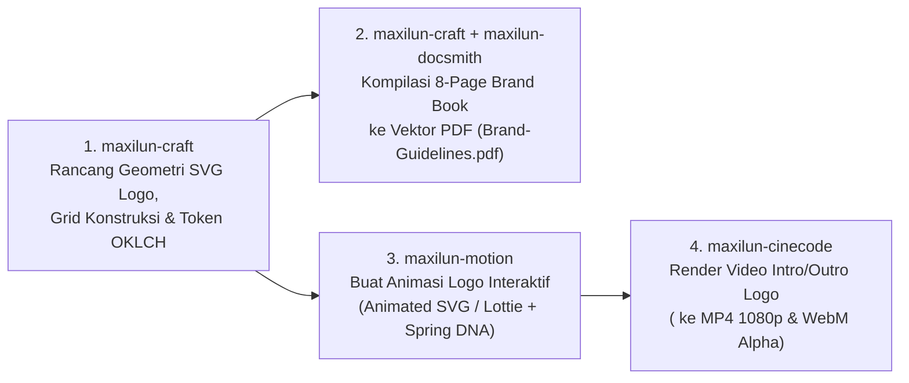

# Brand Identity, Mathematical SVG Logo Construction & Brand Book PDF Reference

Gunakan referensi ini bersama `maxilun-craft` saat pengguna meminta pembuatan **Logo**, **Brand Identity / Visual System**, **Brand Guidelines (PDF)**, serta koordinasi **Motion Logo Reveal** bersama `maxilun-motion` dan `maxilun-cinecode`.

---

## 1. Prinsip Purity Pembuatan Logo (Bukan Klise Generator AI)

Logo yang kuat bersifat **geometris, sederhana, dan tahan uji skala** (tetap tajam dari ukuran favicon `16x16px` hingga billboard).

| DILARANG pada Desain Logo (Klise AI) | WAJIB DITERAPKAN (Standar Studio Brand) |
|---|---|
| Ikon generik (bola lampu, otak bercahaya, roket, perisai centang, jabat tangan, jaringan titik-titik) | Geometri abstrak bermakna, monogram huruf presisi, atau simbol yang diturunkan dari mekanisme unik produk |
| Gradien warna pelangi atau 4+ warna bertumpuk di dalam simbol | **1-Bit / Monochrome Test wajib lulus dulu**: logo harus bekerja 100% dalam hitam-putih murni (`#000000` & `#ffffff`) sebelum diberi 1 warna aksen OKLCH |
| Detail garis tipis `< 1.5px` yang hilang saat diperkecil ke `16x16px` | Ketebalan stroke terkalibrasi (`stroke-width >= 2px` pada `viewBox="0 0 32 32"`) dan ruang negatif (*negative space*) yang lega |
| Sudut koordinat SVG acak hasil tebakan (`d="M12.37 41.89..."`) | Konstruksi **Mathematical Grid** (koordinat kelipatan `4` atau `8` pada kanvas `64x64` / `128x128`, sudut `45°`/`60°`/`90°`, dan rasio busur lingkaran konsisten) |

---

## 2. Arsitektur 6 Varian Logo Wajib (`SVG` Presisi)

Setiap kali menghasilkan identitas logo untuk sebuah brand, hasilkan file SVG bersih yang mencakup varian berikut:

1. **`logo-mark.svg` (Logomark / Simbol Ikonik)**: Kanvas persegi (`viewBox="0 0 64 64"`), terpusat secara optik, dirancang untuk app icon, avatar, dan spinner.
2. **`logo-horizontal.svg` (Primary Lockup)**: Simbol + Wordmark tipografi dengan aturan jarak aman (*clearspace* = minimal `0.5x` tinggi simbol di seluruh sisi).
3. **`logo-wordmark.svg` (Typographic Logotype)**: Nama brand dengan penyesuaian *kerning/letter-spacing* ketat (`-0.03em` s/d `-0.05em`) dan ciri khas optik pada salah satu huruf.
4. **`logo-mono-light.svg` & `logo-mono-dark.svg`**: Versi satu warna solid (`currentColor` / hitam pekat / putih bersih) untuk cap dokumen, watermark, dan kontras ekstrem.
5. **`favicon.svg`**: Versi disederhanakan untuk ukuran `16x16px` dan `32x32px` dengan `<style>@media (prefers-color-scheme: dark) { ... }</style>` adaptif.

### Contoh Konstruksi SVG Logo Berbasis Grid Matematis (`64x64` Grid)
Every path node harus diberi `id` atau `class` semantik (`mark-outer`, `mark-core`, `mark-accent`) agar langsung dapat dianimasikan oleh `maxilun-motion` dan `maxilun-cinecode`:

```xml
<svg xmlns="http://www.w3.org/2000/svg" viewBox="0 0 240 64" fill="none" role="img" aria-label="Brand Primary Lockup">
  <!-- Construction Grid: 64x64 symbol module, 8px base unit, 24px clearspace to wordmark -->
  <g id="logo-mark" transform="translate(0, 0)">
    <!-- Outer architectural frame (stroke-dasharray ready for motion trace) -->
    <path id="mark-outer" d="M12 12 H44 L52 20 V52 H20 L12 44 Z" stroke="#0f172a" stroke-width="4" stroke-linejoin="round"/>
    <!-- Inner geometric core -->
    <path id="mark-core" d="M24 24 H40 V40 H24 Z" fill="#2563eb"/>
    <!-- Precision negative-space cut -->
    <circle id="mark-node" cx="32" cy="32" r="4" fill="#ffffff"/>
  </g>
  <!-- Wordmark locked to 8px baseline alignment -->
  <text id="logo-wordmark" x="80" y="42" fill="#0f172a" font-family="'Plus Jakarta Sans', 'Inter', system-ui, sans-serif" font-size="28" font-weight="700" letter-spacing="-0.8">
    VECTRA
  </text>
</svg>
```

---

## 3. Pembuatan Dokumen **Brand Guidelines & Visual System (PDF)**

Ketika pengguna meminta output berupa **PDF Konsep Logo & Sistem Visual (`Brand-Guidelines.pdf`)**, bangun dokumen HTML/CSS multi-halaman berstandar cetak (`@page` CSS Paged Media) lalu render menjadi PDF vektor tajam menggunakan headless Chromium (Puppeteer / Playwright `page.pdf({ printBackground: true })` yang sudah tersedia di ekosistem Maxilun):

### 3.1 Struktur 8 Halaman Standar *Brand Book / Visual Identity PDF*
| Halaman | Judul Halaman | Isi Wajib di Dalam PDF |
|---|---|---|
| **Halaman 1** | **Cover & Brand Manifesto** | Lockup logo utama ukuran besar, nama brand, tagline (`<= 8 kata`), versi dokumen, dan tanggal rilis |
| **Halaman 2** | **Logo Concept & Rationale** | Filosofi bentuk (mengapa geometri ini dipilih berdasarkan masalah bisnis & audiens), tanpa cerita klise mengada-ada |
| **Halaman 3** | **Construction Grid & Clearspace** | Diagram blueprint SVG yang memperlihatkan rasio grid (`8px`/`1x`), sudut kemiringan, zona bebas (*exclusion zone*), dan ukuran minimum (`24px` tinggi) |
| **Halaman 4** | **Logo Variants & Misuse Rules** | Lockup horizontal, logomark, monochrome light/dark, serta 6 kotak **"Do Not"** (jangan distorsi proporsi, jangan beri drop-shadow murahan, jangan ubah kontras) |
| **Halaman 5** | **Color System (OKLCH, Hex & RGB)** | Swatch warna permukaan, teks, aksen brand, dan status semantik lengkap dengan nilai `OKLCH`, `HEX`, `RGB`, dan rasio kontras **WCAG AA/AAA** terukur |
| **Halaman 6** | **Typography & Numeric System** | Hirarki Display, Heading, Body, dan Monospace, aturan `line-height`, batas lebar baca `65ch`, dan kewajiban `tabular-nums` |
| **Halaman 7** | **UI Component & Layout System** | Penerapan identitas pada komponen nyata (tombol, input, tabel padat, badge faktual, dan aturan 4 state UI tanpa breadcrumb) |
| **Halaman 8** | **Motion Logo & Sonic/Kinetic DNA** | Storyboard 4 frame bagaimana logo bergerak (kurva pegas `stiffness/damping`, durasi `ms`/`frames`, dan aturan `prefers-reduced-motion`) |

### 3.2 CSS Print-to-PDF Presisi (`A4 Landscape` atau `16:9 Presentation Deck`)
```css
@page {
  size: 297mm 210mm; /* A4 Landscape — ideal untuk Brand Guidelines Deck */
  margin: 0;
}
@media print {
  body {
    -webkit-print-color-adjust: exact;
    print-color-adjust: exact;
  }
  .brand-page {
    width: 297mm;
    height: 210mm;
    page-break-after: always;
    break-after: page;
    position: relative;
    overflow: hidden;
    padding: 20mm 24mm;
    box-sizing: border-box;
  }
}
```

### 3.3 Script Generator PDF Vektor (`Puppeteer` / `Chromium`)
Simpan dokumen sebagai `brand-guidelines.html`, lalu jalankan konversi ke `Brand-Guidelines.pdf` (semua logo SVG dan teks akan tersimpan sebagai **vektor asli di dalam PDF**, bukan gambar pecah):
```javascript
// Render HTML Brand Book menjadi PDF vektor tajam
const browser = await puppeteer.launch({ headless: 'new' });
const page = await browser.newPage();
await page.goto(pathToFileURL(path.resolve('brand-guidelines.html')).href, { waitUntil: 'networkidle0' });
await page.pdf({
  path: 'Brand-Guidelines.pdf',
  width: '297mm',
  height: '210mm',
  printBackground: true,
  preferCSSPageSize: true,
});
await browser.close();
```

---

## 4. Pipeline Terpadu: Dari Konsep Logo → PDF Brand Book → Motion Logo Video

Ketika pengguna meminta paket lengkap (**Logo + Sistem Visual PDF + Motion Logo**), jalankan alur 4 spesialis berikut:



1. **Output 1 — Aset Vektor Logo (`assets/brand/*.svg`)**: `logo-mark.svg`, `logo-horizontal.svg`, `logo-mono.svg`, `favicon.svg`.
2. **Output 2 — Dokumen PDF Sistem Visual (`docs/Brand-Guidelines.pdf`)**: 8 halaman lengkap dengan blueprint grid konstruksi logo, swatch OKLCH/Hex, tipografi, dan aturan UI.
3. **Output 3 — Motion Logo Interaktif Web (`assets/brand/logo-animated.svg` / `.html`)**: Animasi `stroke-dashoffset` trace + spring assembly dengan fallback `prefers-reduced-motion`.
4. **Output 4 — Video Motion Logo (`out/logo-reveal.mp4` & `out/logo-stinger-alpha.webm`)**: Video intro/outro deterministik yang siap ditempelkan ke video produk menggunakan komponen `<LogoReveal>` di `maxilun-cinecode`.
