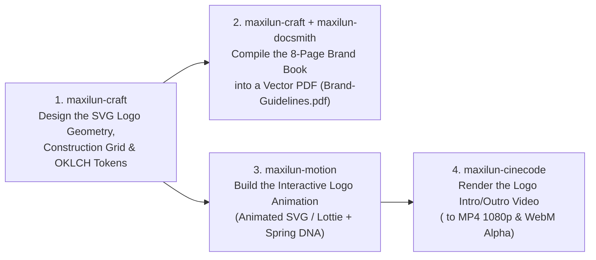

# Brand Identity, Mathematical SVG Logo Construction & Brand Book PDF Reference

Use this reference with `maxilun-craft` when the user asks for a **Logo**, a **Brand Identity / Visual System**, or **Brand Guidelines (PDF)**, and when coordinating a **Motion Logo Reveal** with `maxilun-motion` and `maxilun-cinecode`.

---

## 1. Logo Purity Principles (Not AI-Generator Clichés)

A strong logo is **geometric, simple, and scale-proof**: it stays sharp from a `16x16px` favicon to a billboard.

| FORBIDDEN in Logo Design (AI Clichés) | REQUIRED (Brand Studio Standard) |
|---|---|
| Generic icons (light bulb, glowing brain, rocket, shield with checkmark, handshake, dot network) | Meaningful abstract geometry, a precise letter monogram, or a symbol derived from the product's unique mechanism |
| Rainbow gradients or 4+ stacked colors inside the symbol | **Pass the 1-Bit / Monochrome Test first**: the logo must work 100% in pure black and white (`#000000` & `#ffffff`) before it receives 1 OKLCH accent color |
| Thin line details `< 1.5px` that disappear when scaled down to `16x16px` | Calibrated stroke weight (`stroke-width >= 2px` on `viewBox="0 0 32 32"`) and generous negative space |
| Random, guessed SVG coordinates (`d="M12.37 41.89..."`) | **Mathematical Grid** construction (coordinates in multiples of `4` or `8` on a `64x64` / `128x128` canvas, angles of `45°`/`60°`/`90°`, and consistent arc ratios) |

---

## 2. Architecture of the 6 Required Logo Variants (Precise `SVG`)

Each time you produce a logo identity for a brand, output clean SVG files covering these variants:

1. **`logo-mark.svg` (Logomark / Iconic Symbol)**: Square canvas (`viewBox="0 0 64 64"`), optically centered, designed for app icons, avatars, and spinners.
2. **`logo-horizontal.svg` (Primary Lockup)**: Symbol + typographic wordmark with a clearspace rule (clearspace = at least `0.5x` the symbol height on every side).
3. **`logo-wordmark.svg` (Typographic Logotype)**: Brand name with tight kerning/letter-spacing (`-0.03em` to `-0.05em`) and one optical signature on a single letter.
4. **`logo-mono-light.svg`**: Solid monochrome version for dark backgrounds (`fill="#ffffff"` or `currentColor`).
5. **`logo-mono-dark.svg`**: Solid monochrome version for light backgrounds (`fill="#000000"` or `currentColor`).
6. **`favicon.svg`**: Simplified version for `16x16px` and `32x32px` with an adaptive `<style>@media (prefers-color-scheme: dark) { ... }</style>`.

### Example: SVG Logo Built on a Mathematical Grid (`64x64` Grid)
Give every path node a semantic `id` or `class` (`mark-outer`, `mark-core`, `mark-accent`) so `maxilun-motion` and `maxilun-cinecode` can animate it directly:

```xml
<svg xmlns="http://www.w3.org/2000/svg" viewBox="0 0 240 64" fill="none" role="img" aria-label="Brand Primary Lockup">
  <!-- Construction Grid: 64x64 symbol module, 8px base unit, 24px clearspace to wordmark -->
  <g id="logo-mark" transform="translate(0, 0)">
    <!-- Outer architectural frame (stroke-dasharray ready for motion trace) -->
    <path id="mark-outer" d="M12 12 H44 L52 20 V52 H20 L12 44 Z" stroke="#0f172a" stroke-width="4" stroke-linejoin="round"/>
    <!-- Inner geometric core -->
    <path id="mark-core" d="M24 24 H40 V40 H24 Z" fill="#2563eb"/>
    <!-- Precision negative-space cut -->
    <circle id="mark-node" cx="32" cy="32" r="4" fill="#ffffff"/>
  </g>
  <!-- Wordmark locked to 8px baseline alignment -->
  <text id="logo-wordmark" x="80" y="42" fill="#0f172a" font-family="'Bricolage Grotesque', 'Hanken Grotesk', system-ui, sans-serif" font-size="28" font-weight="700" letter-spacing="-0.8">
    VECTRA
  </text>
</svg>
```

---

## 3. Producing the **Brand Guidelines & Visual System (PDF)** Document

When the user asks for a **Logo Concept & Visual System PDF (`Brand-Guidelines.pdf`)**, build a multi-page, print-standard HTML/CSS document (`@page` CSS Paged Media). Then render it to a sharp vector PDF with headless Chromium (Puppeteer / Playwright `page.pdf({ printBackground: true })`, already available in the Maxilun ecosystem):

### 3.1 Standard 8-Page Structure of the *Brand Book / Visual Identity PDF*
| Page | Page Title | Required Content in the PDF |
|---|---|---|
| **Page 1** | **Cover & Brand Manifesto** | Large primary logo lockup, brand name, tagline (`<= 8 words`), document version, and release date |
| **Page 2** | **Logo Concept & Rationale** | Form philosophy: why this geometry was chosen, based on the business problem and the audience. No invented, clichéd backstory |
| **Page 3** | **Construction Grid & Clearspace** | SVG blueprint diagram showing the grid ratio (`8px`/`1x`), slant angles, exclusion zone, and minimum size (`24px` height) |
| **Page 4** | **Logo Variants & Misuse Rules** | Horizontal lockup, logomark, monochrome light/dark, plus 6 **"Do Not"** boxes (do not distort proportions, do not add a cheap drop shadow, do not change the contrast) |
| **Page 5** | **Color System (OKLCH, Hex & RGB)** | Swatches for surface, text, brand accent, and semantic status colors, each with `OKLCH`, `HEX`, and `RGB` values and a measured **WCAG AA/AAA** contrast ratio |
| **Page 6** | **Typography & Numeric System** | Display, Heading, Body, and Monospace hierarchy, `line-height` rules, the `65ch` reading-width limit, and the `tabular-nums` requirement |
| **Page 7** | **UI Component & Layout System** | The identity applied to real components (buttons, inputs, dense tables, factual badges, and the 4-UI-state rule without breadcrumbs) |
| **Page 8** | **Motion Logo & Sonic/Kinetic DNA** | 4-frame storyboard of how the logo moves (spring curve `stiffness/damping`, duration in `ms`/`frames`, and the `prefers-reduced-motion` rule) |

### 3.2 Precise Print-to-PDF CSS (`A4 Landscape` or `16:9 Presentation Deck`)
```css
@page {
  size: 297mm 210mm; /* A4 Landscape — ideal for a Brand Guidelines deck */
  margin: 0;
}
@media print {
  body {
    -webkit-print-color-adjust: exact;
    print-color-adjust: exact;
  }
  .brand-page {
    width: 297mm;
    height: 210mm;
    page-break-after: always;
    break-after: page;
    position: relative;
    overflow: hidden;
    padding: 20mm 24mm;
    box-sizing: border-box;
  }
}
```

### 3.3 Vector PDF Generator Script (`Puppeteer` / `Chromium`)
Save the document as `brand-guidelines.html`, then convert it to `Brand-Guidelines.pdf`. All SVG logos and text are stored as **true vectors inside the PDF**, not as pixelated images:
```javascript
import puppeteer from 'puppeteer';
import path from 'node:path';
import { pathToFileURL } from 'node:url';

// Requires `puppeteer` installed, or use Chrome CLI fallback:
// chrome --headless --disable-gpu --print-to-pdf="Brand-Guidelines.pdf" brand-guidelines.html
const browser = await puppeteer.launch({ headless: 'new' });
const page = await browser.newPage();
await page.goto(pathToFileURL(path.resolve('brand-guidelines.html')).href, { waitUntil: 'networkidle0' });
await page.pdf({
  path: 'Brand-Guidelines.pdf',
  width: '297mm',
  height: '210mm',
  printBackground: true,
  preferCSSPageSize: true,
});
await browser.close();
```

---

## 4. Unified Pipeline: Logo Concept → Brand Book PDF → Motion Logo Video

When the user asks for the full package (**Logo + Visual System PDF + Motion Logo**), run this 4-specialist flow:



1. **Output 1 — Logo Vector Assets (`assets/brand/*.svg`)**: `logo-mark.svg`, `logo-horizontal.svg`, `logo-wordmark.svg`, `logo-mono-light.svg`, `logo-mono-dark.svg`, `favicon.svg`.
2. **Output 2 — Visual System PDF Document (`docs/Brand-Guidelines.pdf`)**: 8 pages with the logo construction grid blueprint, OKLCH/Hex swatches, typography, and UI rules.
3. **Output 3 — Interactive Web Motion Logo (`assets/brand/logo-animated.svg` / `.html`)**: `stroke-dashoffset` trace animation + spring assembly with a `prefers-reduced-motion` fallback.
4. **Output 4 — Motion Logo Video (`out/logo-reveal.mp4` & `out/logo-stinger-alpha.webm`)**: Deterministic intro/outro video, ready to attach to product videos through the `<LogoReveal>` component in `maxilun-cinecode`.

---

## 5. SVG Banners, README Mastheads & Social/OG Cards

Use three target profiles so standalone `.svg` banners never lose legibility, accessibility, or contrast across renderers:

| Profile | Target | Structure & Typography | Guardrails |
|---|---|---|---|
| **A: Inline Web Banner** | Marketing page / app hero | **2-layer**: non-interactive `<svg>` visual layer (`aria-hidden="true"` or `role="img"` + `<title>`) under semantic HTML headline & CTA over a solid surface/scrim | Dual-theme OKLCH tokens, `tokens.md` Origin font, `prefers-reduced-motion: reduce`, `:focus-visible`, `44x44px` hit target |
| **B: Static `` / README / Email** | GitHub README, wikis, email | Plain `.svg` (`<text>` with `system-ui, -apple-system, "Segoe UI", "Helvetica Neue", Arial, sans-serif` + `+25%` width reserve, `<tspan>` wrap); `<path>` only for `logo-mark` | No `<script>`, `on*`, `<foreignObject>`, external font/CSS URLs, or `prefers-color-scheme` (prevents `CLR-009`); include `<title>`, `<desc>`, `role="img"`, slug-prefixed IDs, and host `alt` |
| **C: Social / `og:image` Raster** | OG `1200x630`, GitHub `1280x640`, LinkedIn `1584x396`, X `1500x500` | Fixed-ratio canvas with `tokens.md` Origin fonts, compiled to PNG/WebP via `python scripts/render.py <file> --preset <name>` | Keep text inside uniform safe-zone margins; never rely on platform `.svg` support |

- **Visual rules**: allow subtle tonal neutral shifts (`maxilun-craft`), keep text on solid surfaces/scrims (`>= 4.5:1` / `>= 3:1` via `slopscan.py --contrast`), ban `CLR-001` multi-hue gradients, `TYPO-008` gradient text, `CMP-016` blur blobs, `LAY-017` symmetrical 4-card strips, and `800-900` weights.
- **Mechanical check**: run `python scripts/slopscan.py <banner.svg>` and `python scripts/render.py <banner.svg> --preset banner`.
