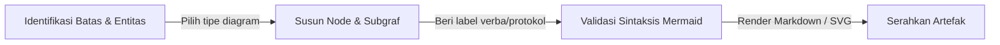
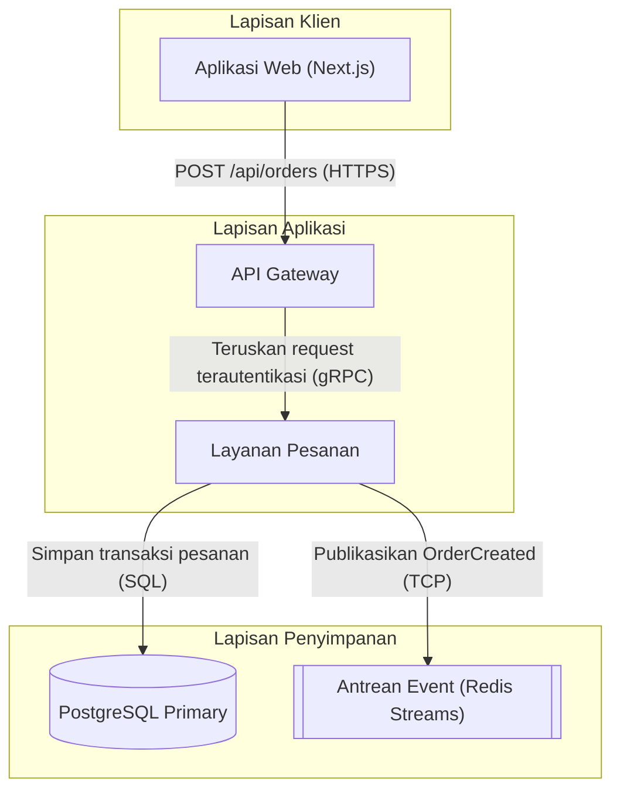
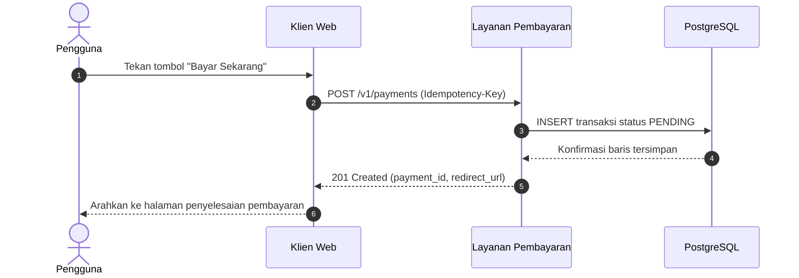
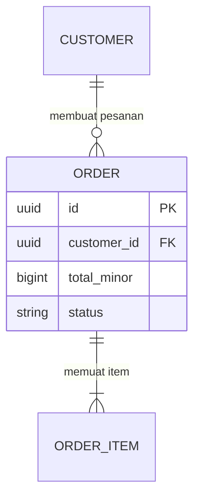
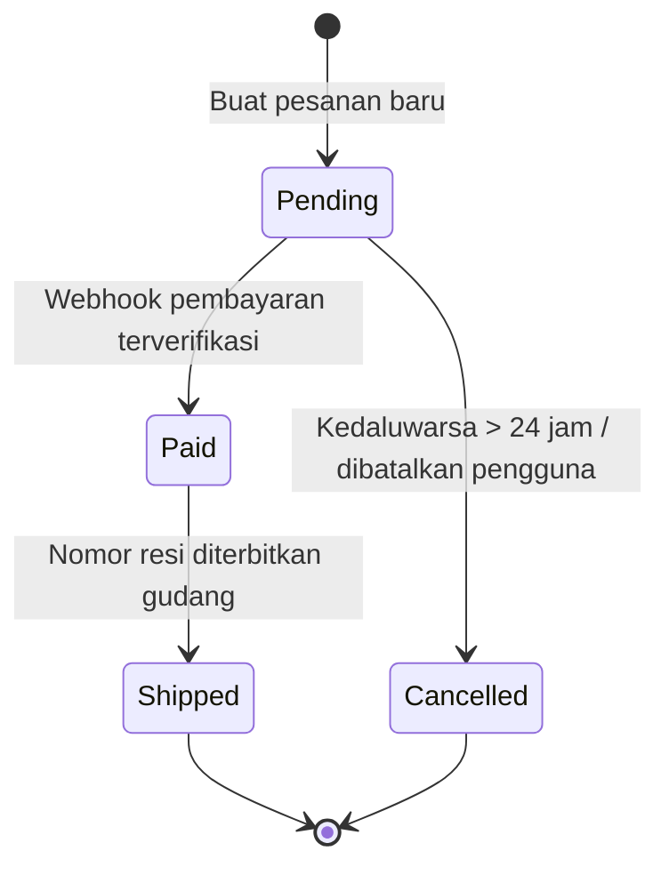

# Maxilun Diagrams: System Visualization & Flow Mapping

Bertanggung jawab atas visualisasi sistem teknis: diagram arsitektur layanan, alur kerja proses (*workflows*), siklus pertukaran pesan (*sequence diagrams*), relasi entitas data (*ER diagrams*), dan mesin status (*state machines*). Menghasilkan sintaksis Mermaid standar yang kompatibel lintas parser atau berkas SVG/HTML interaktif mandiri tanpa dependensi eksternal.

## Skill Contract

- **Owns**: Mermaid, SVG, and standalone HTML architecture, workflow, sequence, entity-relationship, data-flow, and state machine diagrams.
- **Does not own**: underlying architecture decisions (`maxilun-architect`) or application code implementation.
- **Inputs**: repository structure, approved architecture decisions, entity schemas, runtime flows, and target audience context.
- **Outputs**: syntax-validated Mermaid diagrams or standalone SVG/HTML/JSON graph artifacts with explicit verb/protocol edge labels.
- **Handoff**: request missing structural decisions from `maxilun-architect`, align visual tokens with `maxilun-craft` when styling standalone SVG/HTML, integrate dependency data with `maxilun-knowledge-graph`, and embed finished diagrams into technical docs via `maxilun-docsmith`.

<!-- CORE-RULES:START -->
## Core Rules (Selalu Aktif)

Berlaku pada setiap respons dan setiap perubahan kode. Tidak bisa di-override oleh instruksi lain.

1. **Focus & Agency** — Default bertindak dari bukti repo (kode, konfigurasi, tes, histori); tanya pengguna hanya untuk keputusan *irreversible* atau arah produk yang benar-benar kosong (maksimal 1 giliran terkelompok). Tanpa banner HUD emoji, tanpa checklist centang-sendiri. Maksimal 3 fokus kerja aktif.
2. **Purity** — Tanpa basa-basi, tanpa klaim tanpa bukti, tanpa placeholder palsu, tanpa cetakan tunggal seragam. Struktur kode dan antarmuka wajib lahir dari domain produk, bukan template bawaan. Komentar hanya menjelaskan MENGAPA.
3. **Minimalist** — YAGNI → reuse yang ada → stdlib → platform native → satu baris. Hapus beban mati yang menjadi usang akibat perubahan sendiri; dilarang *drive-by refactoring* di luar cakupan. Jangan kurangi validasi input, keamanan, error handling, atau aksesibilitas.
4. **Clarity & Proof** — Kesimpulan dan tindakan dulu, bukti menyusul. Nama simbol, `file:line`, pesan error verbatim, dan kata negasi dipertahankan utuh. Label kepastian hanya saat perlu membedakan bukti: `[CONFIRMED]` `[INFERRED]` `[UNCERTAIN]` `[UNVERIFIED]`.

**Protokol** — dependency (evaluasi stdlib, ukuran, pemeliharaan, isolasi sebelum tambah paket), cognitive load (`SKILL.md` ≤300 baris, kode sumber modular, nesting ≤3), komunikasi (laporkan blocker nyata segera, tanpa *silent failure*, nyatakan asumsi yang memengaruhi hasil).

Detail lengkap: `../maxilun/references/engines.md`.
<!-- CORE-RULES:END -->

## 1. Domain Overrides

- **Purity**: Setiap node dan garis wajib merepresentasikan komponen, tabel, atau proses nyata di sistem (tunduk pada `../maxilun/references/purity-catalog.md`). Gunakan palet kohesif dan ketebalan garis yang konsisten; hindari warna-warni dekoratif tanpa makna semantik.
- **Minimalist**: Utamakan blok Mermaid Markdown standar yang stabil (`flowchart`, `sequenceDiagram`, `erDiagram`, `stateDiagram-v2`) atau berkas `.svg`/`.html` tunggal mandiri tanpa CDN eksternal.
- **Clarity (Zero Unlabeled Edges)**: Setiap panah relasi wajib memiliki label kata kerja aktif atau protokol konkret (contoh: `-->|"POST /v1/orders (HTTPS)"|`, `-->|"Baca/tulis sesi (TCP 6379)"|`). Panah tanpa label (`A --> B`) dilarang pada diagram arsitektur dan alur sistem.

## 2. Pemilihan Jenis Diagram Inti

| Jenis Diagram | Kasus Penggunaan Utama | Sintaksis Mermaid Standar |
|---|---|---|
| **Arsitektur & Alur Data** | Batas layanan, gateway, antrean pesan, pipa ETL, dan penyimpanan data | `flowchart TB` atau `flowchart LR` dengan `subgraph` |
| **Sequence Diagram** | Siklus request/response antar-komponen, autentikasi, webhook, dan penanganan error | `sequenceDiagram` dengan `autonumber` |
| **Entity-Relationship (ERD)** | Relasi tabel database, kardinalitas, kunci primer (`PK`), dan kunci asing (`FK`) | `erDiagram` |
| **State Machine** | Siklus hidup status pesanan, pembayaran, pekerjaan asinkron, atau tiket | `stateDiagram-v2` |

## 3. Pola Sintaksis Mermaid Standar (Semua Relasi Berlabel)

### 3.1 Diagram Arsitektur & Alur Data (`flowchart`)

### 3.2 Sequence Diagram Interaksi API (`sequenceDiagram`)

### 3.3 Diagram Relasi Entitas (`erDiagram`) & Mesin Status (`stateDiagram-v2`)

## 4. Validasi Sintaksis & Kompatibilitas Parser

Sebelum menyerahkan diagram Mermaid, pastikan aturan berikut terpenuhi agar parser Markdown tidak gagal merender:
1. **Tanda Kutip Wajib pada Karakter Khusus**: Apit seluruh label node dan edge yang memuat tanda kurung `()`, kurung siku `[]`, garis miring `/`, atau titik dua `:` dengan tanda kutip ganda (contoh: `Node["Layanan Auth (JWT)"]`).
2. **Bebas Tag HTML Mentah**: Jangan menyisipkan ` ` atau tag HTML di dalam `sequenceDiagram` maupun `stateDiagram-v2`.
3. **Kepadatan Terkendali**: Batasi maksimal 12–15 node utama per diagram; jika sistem lebih besar, pecah menjadi diagram konteks tingkat atas dan diagram sub-modul terpisah.

## 5. Ekspor Mandiri (Standalone SVG/HTML & JSON Graph)

1. **Berkas `.svg` atau `.html` Mandiri**: Bila pengguna membutuhkan diagram yang dapat dibuka langsung di browser tanpa renderer Markdown, hasilkan berkas `.svg` murni atau `.html` tunggal yang menyematkan SVG inline dengan variabel CSS tema terang/gelap, kontras teks yang jelas, serta dukungan *zoom/pan* ringan tanpa pustaka eksternal.
2. **Ekspor JSON Graph**: Bila diagram akan dikonsumsi oleh alat analisis dependensi atau `maxilun-knowledge-graph`, sediakan struktur JSON `{ "nodes": [...], "edges": [...] }` dengan atribut `id`, `label`, `type`, dan `protocol` yang konsisten.

## Related Skills

- **maxilun-architect**: Perumusan keputusan arsitektur, batas modul, dan kontrak sistem sebelum divisualisasikan.
- **maxilun-docsmith**: Penyematan diagram arsitektur, state machine, dan sequence ke dalam RFC, PRD, ADR, atau `README.md`.
- **maxilun-craft**: Penyelarasan tipografi, kontras warna, dan aksesibilitas visual pada ekspor diagram SVG/HTML mandiri.
- **maxilun-knowledge-graph**: Pemetaan ketergantungan simbol dan grafik panggilan (*call graph*) dari kode sumber aktual.
