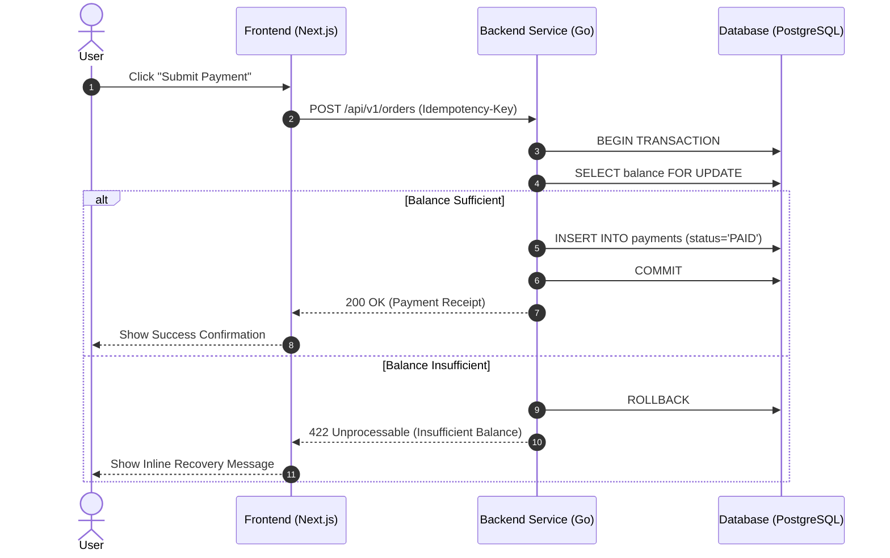
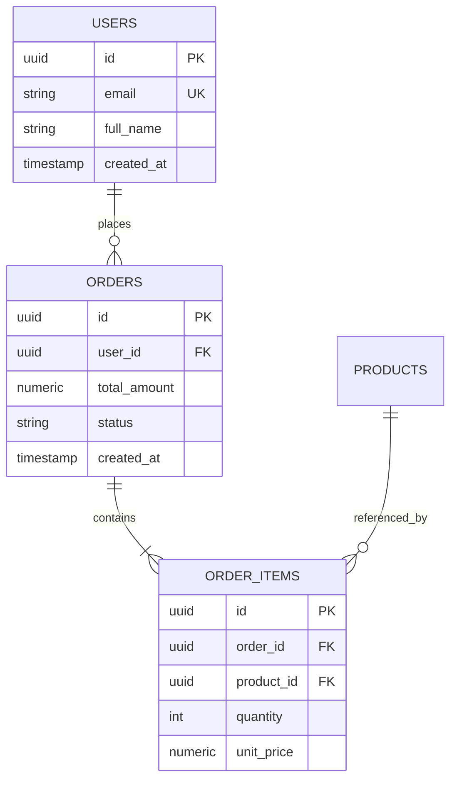
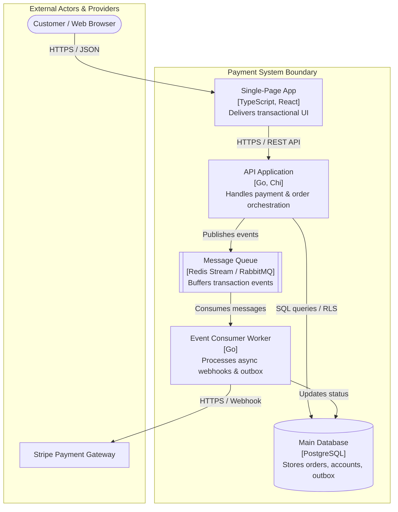
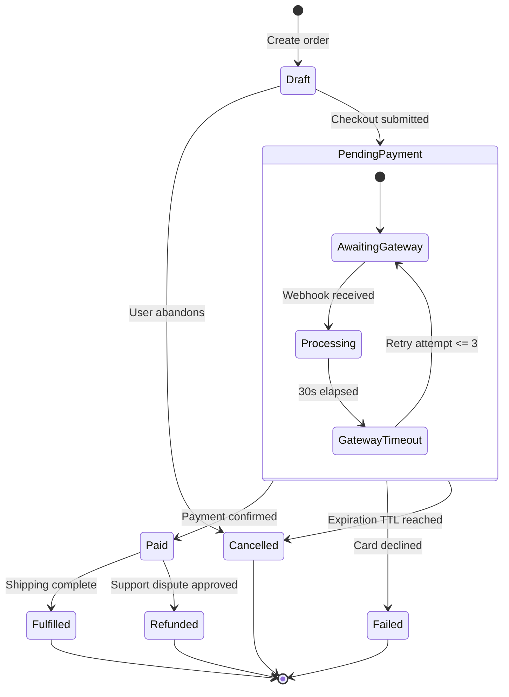

# Architecture & Sequence Diagramming Patterns

<!-- metadata:
  version: "1.3.0"
  sync_target: "skills/maxilun-diagrams/SKILL.md"
  origin: "Maxilun Diagrams Engine"
-->

A guide to building software architecture diagrams, transactional sequence diagrams, and data relationship visualizations in pure Mermaid syntax.

---

## 1. Transactional Sequence Diagram

Use a sequence diagram to map the call flow between services or a client-server interaction, with automatic numbering:

---

## 2. Entity-Relationship Diagram (ER Diagram)

Use an ER diagram to map table schemas, key types (PK, FK), and relationship cardinality:

---

## 3. C4 Container Diagram

Use a C4 Container diagram to map software systems, external dependencies, and transport protocols:

---

## 4. State Machine Diagram

Use `stateDiagram-v2` to model lifecycle states, valid transitions, and guard conditions:

---

## 5. Diagram Readability Invariants

1. **Consistent Flow Direction**: Use the `TD` (Top-Down) or `LR` (Left-Right) orientation consistently within one diagram.
2. **No Excess Decoration**: Avoid arbitrary color with no semantic meaning; use color only to distinguish internal from external system boundaries.
