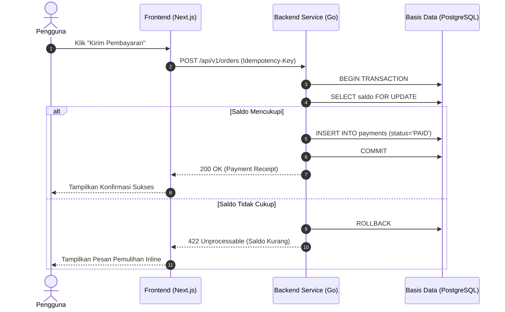
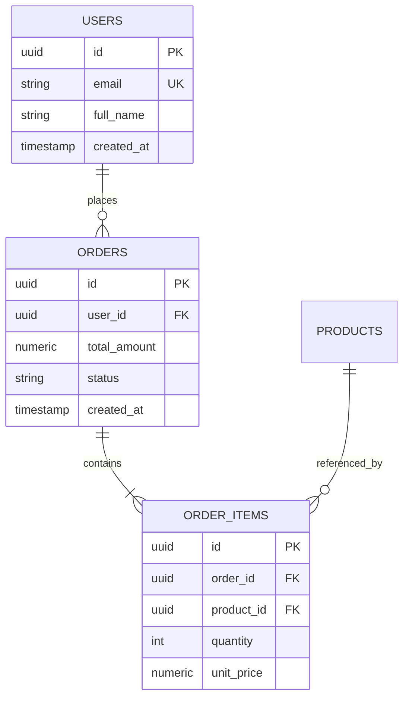

# Architecture & Sequence Diagramming Patterns

<!-- metadata:
  version: "1.0.0"
  sync_target: "skills/maxilun-diagrams/SKILL.md"
  origin: "Maxilun Diagrams Engine"
-->

Panduan penyusunan diagram arsitektur perangkat lunak, diagram sekuens transaksional, dan visualisasi relasi data menggunakan sintaks Mermaid murni.

---

## 1. Diagram Sekuens Transaksional (Sequence Diagram)

Gunakan diagram sekuens untuk memetakan alur panggilan antar-layanan atau interaksi klien-server dengan penomoran otomatis:

---

## 2. Diagram Relasi Entitas (ER Diagram)

Gunakan diagram ER untuk memetakan skema tabel, tipe kunci (PK, FK), dan kardinalitas relasi:

---

## 3. Invarian Keterbacaan Diagram

1. **Arah Aliran Konsisten**: Gunakan orientasi `TD` (Top-Down) atau `LR` (Left-Right) secara konsisten di satu diagram.
2. **Tanpa Dekorasi Berlebih**: Hindari warna-warni sembarang tanpa makna semantik; gunakan warna hanya untuk membedakan batasan sistem internal vs eksternal.
