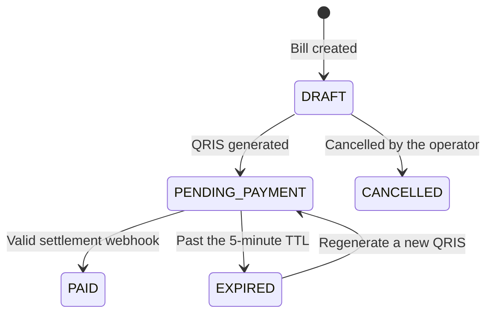

# Feature PRD, Engineering RFC & Technical Specification Reference

Use this reference when writing a product- or feature-level **PRD (Product Requirements Document)**, an **Engineering RFC (Request for Comments)**, or a **Technical Design Document (TDD)**. The document must bind three layers precisely: **Business/User Requirements**, **UI/UX & State Specification (`maxilun-craft`)**, and the **Technical/API Contract (`maxilun-architect` / `maxilun-data`)**.

---

## 1. Purity Principles for PRDs & RFCs

| NOT ALLOWED (Generic PRD/RFC) | REPLACE WITH (Production Precision) |
|---|---|
| "Improve the user experience and operational efficiency" | A measured metric: "Reduce invoice reconciliation time from an average of 14 minutes to <90 seconds per transaction" |
| Generic user story: "As a user, I want to log in so I can get in" | Deterministic acceptance criteria (Given/When/Then) with input limits, rate limit, and error codes |
| UI section that only says "Clean and modern look" | The Required 6-State Matrix (Idle, Loading Skeleton, Populated, Empty+CTA, Pending, Error+Recovery) + a reference to `../maxilun-craft/references/design-md/index.md` |
| "Uses a scalable and secure architecture" | Concrete numbers: peak throughput (for example `250 RPS`), target latency (`p95 < 180ms`), payload limit (`max 5MB`), and the data isolation mechanism (`Row-Level Security` / `tenant_id`) |
| No Out-of-Scope / Non-Goals | An explicit list of features **deliberately not built** in this phase, with the reason for each |

---

## 2. Standard Structure for a Feature PRD & Engineering Spec (`PRD.md` / `RFC-*.md`)

```markdown
# PRD / Spec: [Specific Feature or Product Name]

> **Doc ID**: PRD-2026-001  
> **Status**: [Draft | In Review | Approved | Implemented]  
> **Last Updated**: YYYY-MM-DD  
> **Owner**: [Role / Team]  
> **Target Release**: [Milestone / Version]

## 1. Executive Summary & Problem Evidence
- **What**: [1-2 sentences of concrete functional description, no buzzwords]
- **Who**: [Specific persona + their working context when using this feature]
- **Problem & Evidence**: [Facts about the current problem: how often it happens, time lost, or actual error rate. Mark `[CONFIRMED]` when it comes from data/code, `[ASSUMED]` when it is a hypothesis]

## 2. Goals & Non-Goals (Out of Scope)

### Goals & Success Metrics
| Metric | Current Baseline | Target | Measurement Method / Query |
|---|---|---|---|
| Completion time for task X | 8 minutes (manual CSV) | < 45 seconds | Telemetry event `checkout.completed - checkout.started` |
| Form validation failures | 18% drop-off | < 4% | Ratio of HTTP 422 to total submits |

### Non-Goals (Deliberately Not Built in This Phase)
- **[Non-Goal 1]**: [Example: Multi-currency settlement — deferred to Phase 2 because the domestic gateway contract supports IDR only].
- **[Non-Goal 2]**: [Example: Custom role builder — this phase uses 3 static roles: `owner`, `finance`, `viewer`].

## 3. User Stories & Deterministic Acceptance Criteria

### US-01: [Concrete User Action Title]
- **Actor**: [Specific role, for example: Clinic Cashier Staff]
- **Preconditions**: [System state before the action, for example: Active session with role `cashier`, cashier shift in status `OPEN`]
- **Acceptance Criteria (Gherkin / Invariants)**:
  - **GIVEN** a patient bill in status `UNPAID` with a total of `Rp 450.000`
  - **WHEN** the cashier selects the `QRIS` method and presses the `"Create QRIS Code"` button
  - **THEN** the system calls `POST /api/v1/payments/qris` with an `Idempotency-Key` header, displays the QR in `< 800ms`, and locks changes to the bill items.
- **Edge Cases & Boundary Conditions**:
  - Double click on the submit button → held on the client (button disabled while inflight) + made safe on the server via `Idempotency-Key` (TTL 24 hours).
  - Payment webhook arrives after the cashier closes the tab → the bill status still changes to `PAID` in the background worker; when the tab reopens, the status updates automatically via SSE/polling.

## 4. UI/UX & Interaction Specification (Integrated with `maxilun-craft`)

> **Design Reference Note**:
> - **References**: `../maxilun-craft/references/design-md/stripe.md`, `../maxilun-craft/references/design-md/linear.app.md`
> - **Applied**: Tabular numerals (`font-variant-numeric: tabular-nums`) for every monetary amount column; high-contrast hairline borders (`1px solid`) as dense table separators; keyboard shortcut `Cmd/Ctrl + Enter` for quick confirmation.
> - **Rejected**: Decorative mesh gradient at the top of the page (not relevant to an operational cashier screen that stays open 8 hours/day).
> - **Reason**: A high-frequency financial transaction screen needs instantly readable numbers and minimal visual fatigue.

### 4.1 Required 6 UI State Matrix
Every component/page in this specification must handle all 6 surface states (`Idle`, `Loading`, `Populated`, `Empty+CTA`, `Pending/Mutating`, `Error+Recovery`):

| Component / Screen | 1. Loading State (Skeleton) | 2. Empty State (+ First Action) | 3. Populated / Idle State | 4. Pending & Error Recovery |
|---|---|---|---|---|
| **Bill History Table** | 6 skeleton rows with proportional column widths (`120px`, `1fr`, `140px`, `96px`), CLS = 0 | Text: *"No bills yet today."* Button: `"Create New Bill"` | Initial/Idle prompt or dense table with `tabular-nums`, status badges (`PAID`, `PENDING`, `EXPIRED`), instant filter | *Pending*: non-blocking row opacity/disabled trigger; *Error*: *"Failed to load bill list (504)."* + `"Reload"` button keeping URL filter |
| **QRIS Payment Form** | Initial skeleton preserving QR container dimensions | N/A (the form is always filled from the bill context) | Sharp SVG QR code + countdown timer `04:59` + `"Check Payment Status"` button | *Pending*: button spinner + `"Creating QR..."` + `aria-busy="true"`; *Error*: *"Payment gateway unresponsive."* + `"Retry"` / `"Switch to Cash"` |

### 4.2 Specific Accessibility & Responsiveness
- Minimum mobile touch target `44x44px`; minimum input font size `16px`.
- Keyboard navigation: focus moves automatically to the amount input when the modal opens, `Escape` closes the modal (except while a payment is processing).

## 5. System Architecture & Data Contract

### 5.1 State Machine / Status Flow


### 5.2 Data Schema Changes (Summary)
- Table `payment_intents`:
  - `id` (`UUID`, PK)
  - `invoice_id` (`UUID`, FK to `invoices.id`, indexed)
  - `idempotency_key` (`VARCHAR(64)`, UNIQUE per `tenant_id`)
  - `amount_idr` (`BIGINT`, `CHECK (amount_idr > 0)` — never use `FLOAT` for money)
  - `status` (`VARCHAR(24)`: `PENDING`, `PAID`, `EXPIRED`, `FAILED`)
  - `expires_at` (`TIMESTAMPTZ`, NOT NULL)

### 5.3 Endpoint Contract (Summary)
- `POST /api/v1/invoices/{invoiceId}/qris`
  - **Auth**: `HttpOnly` session cookie + RBAC permission `invoice:collect`
  - **Rate Limit**: `20 req / minute / user`
  - **Responses**: `201 Created`, `400 Bad Request`, `403 Forbidden`, `409 Conflict` (when the invoice is already `PAID`), `422 Unprocessable Entity`

## 6. Security, Privacy & Failure Modes
- **Trust Boundary**: Verify the webhook payload with `HMAC-SHA256` (`crypto.timingSafeEqual`) against the raw request body before parsing JSON.
- **PII Handling**: Mask patient phone numbers and names in application logs (`0812****890`).
- **Rollout & Feature Flag**: Controlled by the env/flag `FEATURE_QRIS_DYNAMIC=true`; when it is off, fall back to manual payment recording.

## 7. Open Questions & Decisions Log
- `[CONFIRMED]` QRIS expiry is set to 5 minutes, matching the acquirer limit.
- `[TBD: awaiting confirmation from the Finance team]` Are partial refunds allowed directly from the cashier, or must they go through supervisor approval?
```

---

## 3. Archetype Mapping: Product → PRD Focus & `maxilun-craft` UI/UX References

When writing a PRD or Technical Spec that involves an interface, pick an archetype below so the specification starts from the right invariants:

| Product Category | Required Invariants in the PRD | UI/UX References (`../maxilun-craft/references/design-md/`) |
|---|---|---|
| **Fintech / Payment / Accounting** | Precise integer/decimal data types (`BIGINT`/`NUMERIC`), idempotency key, immutable audit trail, webhook reconciliation, tabular numerals | `stripe.md`, `wise.md`, `mercury.md`, `revolut.md` |
| **B2B SaaS / Project & Issue Tracker** | Multi-tenancy (`tenant_id` / RLS), RBAC matrix per role, keyboard-first navigation, optimistic UI update, bulk action | `linear.app.md`, `notion.md`, `airtable.md`, `cal.md` |
| **Developer Tools / Observability / AI Platform** | API key lifecycle (prefix, hash storage, scoped permissions), streaming response / SSE, log retention, CLI + Web parity, dark-first high contrast | `vercel.md`, `sentry.md`, `posthog.md`, `supabase.md`, `cursor.md` |
| **E-Commerce / Marketplace / Booking** | Inventory reservation lock (prevents overselling), cart-to-order state machine, guest vs authenticated checkout, SEO structured data | `shopify.md`, `airbnb.md`, `nike.md` |
| **Media / Publishing / Documentation** | Long-form reading typography (`60ch-75ch`), strict heading hierarchy, static load speed (CWV LCP < 2.5s), `llms.txt` index | `wired.md`, `theverge.md`, `mintlify.md`, `sanity.md` |
