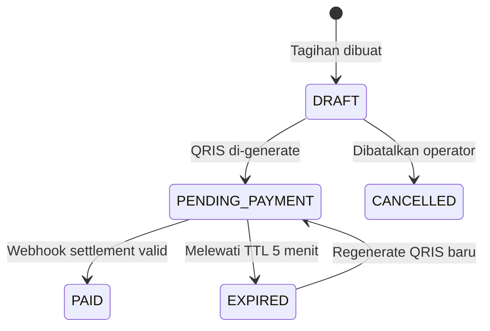

# Feature PRD, Engineering RFC & Technical Specification Reference

Gunakan referensi ini saat menulis **PRD (Product Requirements Document)** tingkat produk/fitur, **Engineering RFC (Request for Comments)**, atau **Technical Design Document (TDD)**. Dokumen wajib mengikat tiga lapisan secara presisi: **Kebutuhan Bisnis/Pengguna**, **Spesifikasi UI/UX & State (`maxilun-craft`)**, dan **Kontrak Teknis/API (`maxilun-architect` / `maxilun-data`)**.

---

## 1. Prinsip Anti-Slop untuk PRD & RFC

| DILARANG (Slop PRD/RFC) | WAJIB DIGANTI DENGAN (Presisi Produksi) |
|---|---|
| "Meningkatkan pengalaman pengguna dan efisiensi operasional" | Metrik terukur: "Menurunkan waktu rekonsiliasi invoice dari rata-rata 14 menit menjadi <90 detik per transaksi" |
| User story generik: "Sebagai user, saya ingin login agar bisa masuk" | Kriteria penerimaan deterministik (Given/When/Then) beserta batas input, rate limit, dan kode error |
| Bagian UI hanya berisi "Tampilan bersih dan modern" | Tabel 4 State Wajib (Loading Skeleton, Empty State + CTA, Populated State, Error State + Recovery) + rujukan `../maxilun-craft/references/design-md/index.md` |
| "Menggunakan arsitektur yang scalable dan aman" | Angka konkret: Throughput puncak (misal `250 RPS`), latensi target (`p95 < 180ms`), batas payload (`max 5MB`), dan mekanisme isolasi data (`Row-Level Security` / `tenant_id`) |
| Tanpa Out-of-Scope / Non-Goals | Daftar eksplisit fitur yang **sengaja tidak dibangun** pada fase ini beserta alasannya |

---

## 2. Struktur Standar Feature PRD & Engineering Spec (`PRD.md` / `RFC-*.md`)

```markdown
# PRD / Spec: [Nama Fitur atau Produk secara Spesifik]

> **Doc ID**: PRD-2026-001  
> **Status**: [Draft | In Review | Approved | Implemented]  
> **Last Updated**: YYYY-MM-DD  
> **Owner**: [Role / Tim]  
> **Target Release**: [Milestone / Versi]

## 1. Executive Summary & Problem Evidence
- **What**: [1-2 kalimat deskripsi fungsional konkret tanpa buzzword]
- **Who**: [Persona spesifik + konteks kerja mereka saat menggunakan fitur ini]
- **Problem & Evidence**: [Fakta masalah saat ini: frekuensi kejadian, waktu yang terbuang, atau error rate aktual. Tandai `[CONFIRMED]` jika dari data/kode, `[ASSUMED]` jika hipotesis]

## 2. Goals & Non-Goals (Out of Scope)

### Goals & Success Metrics
| Metrik | Baseline Saat Ini | Target | Metode Pengukuran / Query |
|---|---|---|---|
| Waktu penyelesaian tugas X | 8 menit (manual CSV) | < 45 detik | Event telemetry `checkout.completed - checkout.started` |
| Kegagalan validasi form | 18% drop-off | < 4% | Rasio HTTP 422 terhadap total submit |

### Non-Goals (Sengaja Tidak Dibangun di Fase Ini)
- **[Non-Goal 1]**: [Contoh: Multi-currency settlement — ditunda ke Phase 2 karena kontrak gateway domestik hanya mendukung IDR].
- **[Non-Goal 2]**: [Contoh: Custom role builder — fase ini menggunakan 3 role statis: `owner`, `finance`, `viewer`].

## 3. User Stories & Deterministic Acceptance Criteria

### US-01: [Judul Aksi Konkret Pengguna]
- **Actor**: [Role spesifik, misal: Staf Kasir Klinik]
- **Preconditions**: [State sistem sebelum aksi, misal: Sesi aktif dengan role `cashier`, shift kasir berstatus `OPEN`]
- **Acceptance Criteria (Gherkin / Invariants)**:
  - **GIVEN** tagihan pasien berstatus `UNPAID` dengan total `Rp 450.000`
  - **WHEN** kasir memilih metode `QRIS` dan menekan tombol `"Buat Kode QRIS"`
  - **THEN** sistem memanggil `POST /api/v1/payments/qris` dengan header `Idempotency-Key`, menampilkan QR dalam `< 800ms`, dan mengunci perubahan item tagihan.
- **Edge Cases & Boundary Conditions**:
  - Klik ganda pada tombol submit → ditahan di client (button disabled selama inflight) + dijamin aman di server via `Idempotency-Key` (TTL 24 jam).
  - Webhook pembayaran masuk saat kasir menutup tab → status tagihan tetap berubah ke `PAID` di background worker; saat tab dibuka kembali, status ter-update otomatis via SSE/polling.

## 4. UI/UX & Interaction Specification (Terintegrasi `maxilun-craft`)

> **Design Reference Note**:
> - **References**: `../maxilun-craft/references/design-md/stripe.md`, `../maxilun-craft/references/design-md/linear.app.md`
> - **Applied**: Tabular numerals (`font-variant-numeric: tabular-nums`) untuk seluruh kolom nominal uang; high-contrast hairline borders (`1px solid`) untuk pemisah tabel padat; keyboard shortcut `Cmd/Ctrl + Enter` untuk konfirmasi cepat.
> - **Rejected**: Decorative mesh gradient di bagian atas halaman (tidak relevan untuk layar operasional kasir yang dibuka 8 jam/hari).
> - **Reason**: Layar transaksi finansial berfrekuensi tinggi membutuhkan keterbacaan angka instan dan kelelahan visual minimal.

### 4.1 Matriks 4 State UI Wajib
Setiap komponen/halaman pada spesifikasi ini wajib mengimplementasikan 4 state berikut:

| Komponen / Layar | 1. Loading State (Skeleton) | 2. Empty State (+ First Action) | 3. Populated / Active State | 4. Error State (Pesan + Recovery) |
|---|---|---|---|---|
| **Tabel Riwayat Tagihan** | 6 baris skeleton dengan lebar kolom proporsional (`120px`, `1fr`, `140px`, `96px`), CLS = 0 | Teks: *"Belum ada tagihan hari ini."* Tombol: `"Buat Tagihan Baru"` | Tabel padat dengan `tabular-nums`, badge status faktual (`PAID`, `PENDING`, `EXPIRED`), filter instan | Pesan: *"Gagal memuat daftar tagihan (Timeout 504)."* Aksi: Tombol `"Muat Ulang"` + simpan filter di URL |
| **Form Pembayaran QRIS** | Tombol submit menampilkan spinner inline + teks `"Membuat QR..."` + `aria-busy="true"` | N/A (form selalu terisi dari konteks tagihan) | QR Code SVG tajam + countdown timer `04:59` + tombol `"Cek Status Pembayaran"` | Pesan: *"Gateway pembayaran tidak merespons."* Aksi: `"Coba Buat Ulang QR"` atau `"Ubah ke Tunai"` |

### 4.2 Aksesibilitas & Responsivitas Spesifik
- Target sentuh mobile minimal `44x44px`; ukuran font input minimal `16px`.
- Navigasi keyboard: fokus otomatis ke input nominal saat modal terbuka, `Escape` menutup modal (kecuali pembayaran sedang diproses).

## 5. System Architecture & Data Contract

### 5.1 State Machine / Alur Status


### 5.2 Perubahan Skema Data (Ringkasan)
- Tabel `payment_intents`:
  - `id` (`UUID`, PK)
  - `invoice_id` (`UUID`, FK ke `invoices.id`, indexed)
  - `idempotency_key` (`VARCHAR(64)`, UNIQUE per `tenant_id`)
  - `amount_idr` (`BIGINT`, `CHECK (amount_idr > 0)` — jangan pernah gunakan `FLOAT` untuk uang)
  - `status` (`VARCHAR(24)`: `PENDING`, `PAID`, `EXPIRED`, `FAILED`)
  - `expires_at` (`TIMESTAMPTZ`, NOT NULL)

### 5.3 Kontrak Endpoint (Ringkasan)
- `POST /api/v1/invoices/{invoiceId}/qris`
  - **Auth**: Cookie session `HttpOnly` + RBAC permission `invoice:collect`
  - **Rate Limit**: `20 req / menit / user`
  - **Responses**: `201 Created`, `400 Bad Request`, `403 Forbidden`, `409 Conflict` (jika invoice sudah `PAID`), `422 Unprocessable Entity`

## 6. Security, Privacy & Failure Modes
- **Trust Boundary**: Payload webhook wajib diverifikasi menggunakan `HMAC-SHA256` (`crypto.timingSafeEqual`) terhadap raw request body sebelum parsing JSON.
- **PII Handling**: Nomor telepon dan nama pasien di-mask pada log aplikasi (`0812****890`).
- **Rollout & Feature Flag**: Dikendalikan via env/flag `FEATURE_QRIS_DYNAMIC=true`; jika dimatikan, fallback ke pencatatan pembayaran manual.

## 7. Open Questions & Decisions Log
- `[CONFIRMED]` Batas kedaluwarsa QRIS ditetapkan 5 menit sesuai batas acquirer.
- `[TBD: menunggu konfirmasi tim Finance]` Apakah refund parsial diizinkan langsung dari kasir atau harus melalui approval supervisor?
```

---

## 3. Archetype Mapping: Produk → Fokus PRD & Referensi UI/UX `maxilun-craft`

Saat menyusun PRD atau Technical Spec yang melibatkan antarmuka, pilih archetype di bawah ini agar spesifikasi otomatis tajam:

| Kategori Produk | Invarian Wajib di PRD | Referensi UI/UX (`../maxilun-craft/references/design-md/`) |
|---|---|---|
| **Fintech / Payment / Accounting** | Tipe data integer/decimal presisi (`BIGINT`/`NUMERIC`), idempotency key, audit trail immutable, rekonsiliasi webhook, tabular numerals | `stripe.md`, `wise.md`, `mercury.md`, `revolut.md` |
| **B2B SaaS / Project & Issue Tracker** | Multi-tenancy (`tenant_id` / RLS), RBAC matriks per role, keyboard-first navigation, optimistic UI update, bulk action | `linear.app.md`, `notion.md`, `airtable.md`, `cal.md` |
| **Developer Tools / Observability / AI Platform** | API key lifecycle (prefix, hash storage, scoped permissions), streaming response / SSE, log retention, CLI + Web parity, dark-first high contrast | `vercel.md`, `sentry.md`, `posthog.md`, `supabase.md`, `cursor.md` |
| **E-Commerce / Marketplace / Booking** | Inventory reservation lock (mencegah overselling), cart-to-order state machine, guest vs authenticated checkout, SEO structured data | `shopify.md`, `airbnb.md`, `nike.md` |
| **Media / Publishing / Documentation** | Tipografi baca panjang (`60ch-75ch`), hierarki heading ketat, kecepatan muat statis (CWV LCP < 2.5s), indeks `llms.txt` | `wired.md`, `theverge.md`, `mintlify.md`, `sanity.md` |
