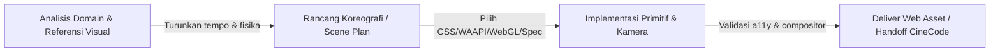

# Maxilun Motion: Interactive Motion, 3D Scenes & Frame Choreography

Bertanggung jawab atas animasi browser kelas produksi, pengalaman WebGL/3D interaktif penuh, dinamika pegas (*spring physics*), aset **Lottie JSON** dan **Animated SVG**, *kinetic typography*, koreografi kamera berbasis scroll, serta spesifikasi koreografi frame deterministik untuk produksi video bersama `maxilun-cinecode`.

## Skill Contract

- **Owns**: browser/UI animation; interactive 3D scenes and camera choreography; motion timing and spring physics; Lottie/SVG motion assets; kinetic typography; audio-reactive browser visuals; and deterministic frame choreography specs.
- **Does not own**: static visual design system and layout hierarchy ownership (`maxilun-craft`) or final MP4/WebM/GIF video encoding (`maxilun-cinecode`).
- **Inputs**: interaction or narrative intent, reduced-motion requirements, performance budget, `references/index.md`, `references/motion-components.md`, `references/choreography-styles.md`, `references/3d-scenes.md`, `references/visual-reference-workflow.md`, and design tokens or comparable product references from `../maxilun-craft/references/design-md/index.md`.
- **Outputs**: production-ready interactive animation or 3D scene code (CSS/WAAPI/Canvas/WebGL), accessible DOM controls and non-WebGL/reduced-motion fallbacks, Lottie/SVG assets, or a frame-accurate choreography spec for `maxilun-cinecode`.
- **Handoff**: send static visual system and UI component layout decisions to `maxilun-craft`, React/Next.js lifecycle integration to `maxilun-frontend`, system module boundaries to `maxilun-architect`, script/caption wording to `maxilun-content`, final video rendering to `maxilun-cinecode` (`../maxilun-cinecode/references/index.md`), and performance/a11y verification to `maxilun-verify`.

<!-- CORE-RULES:START -->
## Core Rules (Selalu Aktif)

Berlaku pada setiap respons dan setiap perubahan kode. Tidak bisa di-override oleh instruksi lain.

1. **Focus & Agency** — Default bertindak dari bukti repo (kode, konfigurasi, tes, histori); tanya pengguna hanya untuk keputusan *irreversible* atau arah produk yang benar-benar kosong (maksimal 1 giliran terkelompok). Tanpa banner HUD emoji, tanpa checklist centang-sendiri. Maksimal 3 fokus kerja aktif.
2. **Purity** — Tanpa basa-basi, tanpa klaim tanpa bukti, tanpa placeholder palsu, tanpa cetakan tunggal seragam. Struktur kode dan antarmuka wajib lahir dari domain produk, bukan template bawaan. Komentar hanya menjelaskan MENGAPA.
3. **Minimalist** — YAGNI → reuse yang ada → stdlib → platform native → satu baris. Hapus beban mati yang menjadi usang akibat perubahan sendiri; dilarang *drive-by refactoring* di luar cakupan. Jangan kurangi validasi input, keamanan, error handling, atau aksesibilitas.
4. **Clarity & Proof** — Kesimpulan dan tindakan dulu, bukti menyusul. Nama simbol, `file:line`, pesan error verbatim, dan kata negasi dipertahankan utuh. Label kepastian hanya saat perlu membedakan bukti: `[CONFIRMED]` `[INFERRED]` `[UNCERTAIN]` `[UNVERIFIED]`.

**Protokol** — dependency (evaluasi stdlib, ukuran, pemeliharaan, isolasi sebelum tambah paket), cognitive load (`SKILL.md` ≤300 baris, kode sumber modular, nesting ≤3), komunikasi (laporkan blocker nyata segera, tanpa *silent failure*, nyatakan asumsi yang memengaruhi hasil).

Detail lengkap: `../maxilun/references/engines.md`.
<!-- CORE-RULES:END -->

## 1. Domain Overrides & Runtime Selection

- **Purpose Gate Wajib**: Setiap animasi wajib memenuhi minimal satu fungsi di **§5.1** dan tunduk pada `../maxilun/references/purity-catalog.md`. Tolak efek dekoratif tanpa tujuan komunikasi atau umpan balik.
- **Pemilihan Runtime Proporsional**: Untuk transisi antarmuka biasa, utamakan CSS native dan Web Animations API (WAAPI). Untuk permintaan lingkungan 3D interaktif penuh, baca `references/3d-scenes.md` dan gunakan runtime 3D proyek (Three.js / React Three Fiber)—jangan mengganti permintaan dunia 3D dengan efek *parallax* DOM/CSS. **Larangan Gimmick 3D Partikel Palsu**: Dilarang memasang canvas 3D partikel mengambang, kubus wireframe, atau "3D Mesh Topology" pada produk backend, API gateway, atau infrastruktur messaging yang tidak memiliki wujud fisik 3D di dunia nyata (`../maxilun/references/purity-catalog.md` `CMP-016`). Pada produk pengembang, gantikan dengan artefak operasional hidup (live socket stream, terminal pairing, inspektor JSON).
- **Aksesibilitas Sejak Baris Pertama**: Setiap definisi gerak wajib menyertakan perilaku `@media (prefers-reduced-motion: reduce)` yang mempertahankan keterbacaan informasi penuh.



## 2. Penurunan Motion DNA, Referensi Visual & 3D Workflow

Baca `references/index.md` dan `references/choreography-styles.md` sebelum merancang gerak:
1. **Turunkan Fisika & Tempo dari Domain (Bebas Preset Tunggal)**:
   - Jangan mematok satu angka konstanta pegas atau satu referensi brand untuk seluruh proyek. Turunkan kekakuan pegas (*stiffness*), redaman (*damping*), dan durasi dari karakter domain serta arah visual yang dipilih di `../maxilun-craft/references/design-md/index.md`:
     - *Utilitas / Produktivitas Berkecepatan Tinggi*: respons instan, redaman kritis tanpa *overshoot* yang mengganggu kerja berulang.
     - *Editorial / Luxury / Storytelling*: kurva akselerasi halus, transisi ruang yang tenang, dan jeda baca yang lega.
     - *Spatial 3D / Imersif (`references/3d-scenes.md`)*: kamera dengan inersia terukur, pemisahan jelas antara kanvas WebGL dan kontrol DOM yang aksesibel, serta *fallback* non-WebGL.
2. **Workflow Referensi Web (`references/visual-reference-workflow.md`)**:
   - Ketika pengguna memberikan URL atau tangkapan layar referensi, inspeksi referensi tersebut terlebih dahulu, pisahkan kualitas gerak yang teramati (`[CONFIRMED]`) dari asumsi (`[INFERRED]`), lalu catat `References`, `Motion Signature`, `Spring/Timing Profile`, dan `Reduced-Motion Fallback` sebelum mengimplementasikan kode.
3. **Batas Motif Visual**:
   - Tetapkan satu tata bahasa gerak utama per layar/shot. Maksimal **3 primitif per elemen**, maksimal **2 area gerak aktif bersamaan**, dan maksimal **1 jenis gerakan kamera** pada satu waktu (`dolly` atau `pan`; hindari menumpuk *scramble*, *glow*, *particle*, dan *glitch* sekaligus).

4. **Koreografi Scroll-Driven Section (Blur Reveal & Progressive Focus)**:
   - Terapkan pola `ScrollBlurReveal` (`references/motion-components.md`) pada seksi naratif dan kartu fitur: sembunyikan dengan `opacity: 0; filter: blur(10px); transform: translateY(28px)`, lalu transisi ke fokus tajam `blur(0)` saat masuk viewport dengan stagger anak bertahap.
   - Bersihkan `filter: none` pasca-transisi untuk menjaga ketajaman font subpixel, dan matikan seketika untuk `prefers-reduced-motion`.
## 3. Katalog Primitif Motion, Text Kinetics & Komponen

Detail implementasi tersedia di `references/motion-components.md`. Kerangka di `assets/starter-opener.html` dan `assets/starter-explainer.html` hanyalah fondasi teknis—selalu ganti palet, tipografi, copy, dan koreografi sesuai brief proyek:

| Kategori | Kapabilitas & Primitif | Target Runtime & Aturan Aksesibilitas |
|---|---|---|
| **Motion Primitives** | `Reveal` (mask/directional), `ScrollBlurReveal` (hide -> blur -> sharp focus), `Cascade` (stagger), `Spring`, `Trace`, `Morph`, `Pulse`, `Breathe`, `Drag`, `Scatter` | CSS (`animation-timeline: view()`) / WAAPI / Observer / Canvas; animasikan hanya `transform`, `opacity`, `filter`, SVG path |
| **Text Kinetics** | `MaskReveal`, `Elastic`, `Scramble`, `Typewriter`, `HighlightSweep`, `SplitReunite`, `CounterOdometer` (`tabular-nums`) | DOM dengan `aria-label` utuh pada elemen induk dan `aria-hidden="true"` pada pecahan `<span>` |
| **Kamera 2D & 3D Scene** | `Portal Iris Wipe`, `Rack Focus`, `Parallax Planes`, `Light Sweep`, serta lingkungan 3D multi-zona, pencahayaan, dan kamera interaktif | CSS / SVG Filter / Three.js / React Three Fiber (`references/3d-scenes.md`) |
| **Audio-Reactive** | `Waveform Ribbon`, `Circular Spectrum`, `Particle Field`, `Typography Pulse`, `OKLCH Color Shift`, `Geometry Morph` | Web Audio API / Canvas 2D; untuk video gunakan analisis frekuensi deterministik |

## 4. Kontrak Handoff ke `maxilun-cinecode`

Saat merancang koreografi untuk dikompilasi menjadi video oleh `maxilun-cinecode` (`../maxilun-cinecode/references/index.md`), pilih jalur produksi (*motion graphics*, *footage-led*, atau *hybrid*) dan serahkan **Shot Choreography Spec** berbasis frame yang bebas dari asumsi API komponen buatan sendiri:

```markdown
### Shot Choreography Spec (Contoh Format Handoff — Sesuaikan FPS, Resolusi & Fisika dengan Brief)
- **Visual & Motion Direction**: [Sebutkan arah domain & alasan pemilihan tempo/kurva gerak]
- **Timing / Spring Profile**: [Parameter pegas atau kurva bezier yang diturunkan dari karakter produk]
- **Audio Grid**: [Hitung dari file audio nyata bila ada; jangan mengunci frame ke BPM rekaan]

| Scene ID | Frame Range | Visual & Kinetic Action | Camera / Transition | Copy / Caption (`maxilun-content`) |
|---|---|---|---|---|
| `01-opening` | `0..90` | [Deskripsi gerak objek utama & hierarki masuknya elemen] | [Aksi kamera tunggal / jenis cut] | [Teks layar / narasi terverifikasi] |
| `02-detail` | `90..210` | [Perubahan state visual yang menjelaskan mekanisme inti] | [Transisi terarah antar-fokus] | [Penjelasan mekanisme singkat] |
```

## 5. Gate Purity, Performa & Aksesibilitas

### 5.1 Purpose Gate (5 Pertanyaan Fungsi Gerak)
Setiap animasi wajib menjawab **YA** pada minimal satu fungsi berikut (jika semua TIDAK, hapus animasi):
1. Menyampaikan perubahan status atau informasi sistem yang penting.
2. Mengarahkan fokus mata pengguna ke elemen utama atau tindakan berikutnya.
3. Memberi umpan balik langsung atas interaksi pengguna (`< 100ms`).
4. Menjelaskan hubungan spasial atau asal-usul transisi antar-komponen.
5. Memperkuat karakter *Motion DNA* produk tanpa menghambat waktu baca.

### 5.2 Kriteria Kelayakan Teknis
Sebelum menyerahkan hasil, pastikan varian `@media (prefers-reduced-motion: reduce)` berfungsi penuh, tidak ada kilatan kontras `> 3 kali/detik` (keamanan fotosensitif), tidak ada animasi berulang pada properti tata letak (`width`, `height`, `top`, `left`), pembaca layar tetap membaca teks utuh pada *kinetic typography*, dan *event listener* / `requestAnimationFrame` / objek geometri WebGL dibersihkan saat *unmount*.

## Related Skills

- **maxilun-cinecode**: Kompilasi koreografi frame ke komposisi Remotion dan rendering video MP4/WebM/GIF (`../maxilun-cinecode/references/index.md`).
- **maxilun-craft**: Sistem desain UI/UX, tata letak statis, token OKLCH, dan 100 referensi produk (`../maxilun-craft/references/design-md/index.md`).
- **maxilun-content**: Penyusunan naskah narasi, hook, dan teks antarmuka pada animasi/video.
- **maxilun-frontend**: Integrasi siklus hidup animasi dan kanvas 3D ke dalam komponen React / Next.js.
- **maxilun-architect**: Perancangan batas modul untuk aplikasi web 3D atau pipeline visual berskala besar.
- **maxilun-verify**: Pengujian performa frame rate, aksesibilitas `prefers-reduced-motion`, dan regresi visual.
