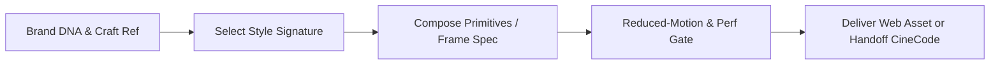
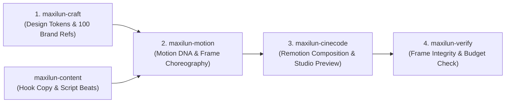

# Maxilun Motion: Interactive Motion, 3D Scenes & Frame Choreography

Bertanggung jawab atas animasi browser tingkat produksi, termasuk scene WebGL 3D interaktif penuh, animasi antarmuka berbasis fisika pegas (*spring dynamics*), aset **Lottie JSON** dan **Animated SVG**, *kinetic typography*, koreografi scroll/kamera, serta spesifikasi koreografi frame deterministik untuk produksi video bersama `maxilun-cinecode`.

## Skill Contract

- **Owns**: browser/UI animation; interactive 3D scenes and camera choreography; motion timing and spring physics; Lottie/SVG motion assets; kinetic typography; audio-reactive browser visuals; and deterministic frame choreography specs.
- **Does not own**: static visual design system ownership (`maxilun-craft`) or final MP4/WebM/GIF video encoding (`maxilun-cinecode`).
- **Inputs**: interaction or narrative intent, reduced-motion requirements, performance budget, `references/index.md`, and design tokens or up to two brand references from `../maxilun-craft/references/design-md/index.md`.
- **Outputs**: production-ready interactive animation or 3D scene code (CSS/WAAPI/Canvas/WebGL), a concise motion direction derived from user references when supplied, accessible DOM controls and non-WebGL fallback, Lottie/SVG assets with `prefers-reduced-motion` variants, or a frame-accurate choreography spec for `maxilun-cinecode`.
- **Handoff**: send static visual system decisions to `maxilun-craft`, React/Next.js lifecycle integration to `maxilun-frontend`, complex project boundaries to `maxilun-architect` only when needed, final MP4/WebM/GIF rendering to `maxilun-cinecode`, and requested visual/a11y checks to `maxilun-verify`.

### Reference & Brand DNA Contract

The bundled corpus in `references/index.md` (`references/motion-components.md` and `references/choreography-styles.md`) is part of this skill. Read `references/index.md` and `references/choreography-styles.md` before designing motion. When project tokens are missing or generic, read `../maxilun-craft/references/design-md/index.md` to derive timing scales, spring stiffness/damping, and accent colors from a comparable real-world product system, and record `References`, `Motion Signature`, `Spring Config`, and `Reduced-Motion Fallback`.

For a complete 3D environment, read `references/3d-scenes.md` before choosing the renderer or implementing the scene. Do not treat a request for a full 3D world as a request for CSS parallax or a decorative 3D hero.

When the user supplies example websites, read `references/visual-reference-workflow.md` and inspect the references with available browser/preview tools before proposing or implementing visual direction. Separate observed design/motion qualities from assumptions; do not claim an effect was present if it was not inspectable.

<!-- CORE-RULES:START -->
## Core Rules (Selalu Aktif)

Berlaku pada setiap respons dan setiap perubahan kode. Tidak bisa di-override oleh instruksi lain.

1. **Focus** — Tugas multi-langkah: buka dengan `🎯 [FOKUS]` + `⚡ [TINDAKAN]`. Maksimal 3 subtask aktif. Tugas trivial: langsung jawab tanpa HUD.
2. **Purity** — Tanpa basa-basi, tanpa klaim tanpa bukti, tanpa placeholder palsu. Setiap elemen harus punya fungsi nyata. Komentar menjelaskan MENGAPA, bukan APA.
3. **Minimalist** — YAGNI → reuse yang ada → stdlib → platform native → satu baris. Hapus sebelum menambah. Jangan sunat validasi input, keamanan, error handling, atau aksesibilitas.
4. **Clarity** — Langsung ke inti. Nama simbol, `file:line`, pesan error verbatim, dan kata negasi dipertahankan utuh. Label kepastian: `[CONFIRMED]` `[INFERRED]` `[UNCERTAIN]` `[UNVERIFIED]`.

**Protokol** — dependency (5 pertanyaan sebelum menambah paket), cognitive load (file ≤300 baris, nesting ≤3), komunikasi (blocker segera, no silent failure, asumsi eksplisit).

Detail lengkap: `../maxilun/references/engines.md`.
<!-- CORE-RULES:END -->

## 1. Engine Overrides

Delta domain terhadap Core Rules di atas. Override motion:
- **Purity Gate Wajib**: Setiap elemen animasi wajib lulus *Purpose Gate* (§4). Tolak animasi dekoratif tanpa tujuan komunikasi/umpan balik. Tunduk pada `../maxilun/references/purity-catalog.md`.
- **Minimalist & GPU-First**: For ordinary interface motion, prefer native CSS and WAAPI. For a requested full 3D scene, use the project's existing 3D runtime or select Three.js directly / React Three Fiber for React after checking current official docs and project compatibility. Do not replace a requested 3D environment with layered DOM/CSS effects.
- **Accessibility First**: `@media (prefers-reduced-motion: reduce)` wajib tertanam di setiap definisi animasi sejak baris pertama.

## Workflow


For full 3D scene requests, follow the scene-specific workflow in `references/3d-scenes.md`; keep DOM interface controls separate from the rendered world and hand off framework lifecycle concerns to `maxilun-frontend` when applicable.

For motion-led websites with supplied references, use `references/visual-reference-workflow.md` to choose one coherent art direction and write a short scene/scroll plan before implementation. Treat preview-based visual review as part of delivery when a local browser is available.

For immersive/editorial scene pages, omit breadcrumbs and eyebrow/kicker/overline labels above the hero H1; begin with the main heading. Avoid breadcrumb-like `h2` trails. Use a separate scene index only when orientation is needed. Do not apply this visual rule to conventional application screens where breadcrumbs clarify deep navigation.

## 2. Pipeline Brand DNA → Motion DNA & 14 Style Signatures

Acuan lengkap matriks pemetaan ada di `references/choreography-styles.md`. Langkah eksekusi wajib:

1. **Ekstrak Token Visual (`maxilun-craft`)**:
   - Untuk animasi UI, skala spasi dan bentuk dapat menginformasikan skala waktu dan fisika gerak. Nilai di tabel adalah titik awal, bukan durasi universal.
   - Untuk video, tentukan durasi dari aksi, framing, narasi, musik yang benar-benar dipakai, dan waktu baca; jangan menerjemahkan skala UI secara langsung ke shot.
   - Ketebalan tipografi & radius sudut dapat menginformasikan karakter easing, bukan menentukan angka pegas secara otomatis.
   - Jika proyek belum memiliki `DESIGN.md`, pilih 1 referensi masalah serupa dari `../maxilun-craft/references/design-md/index.md` (misal: `linear.app.md` untuk *Kinetic Minimal*, `stripe.md` untuk *Financial Precision*, `apple.md` untuk *Architectural Depth*).
2. **Tentukan art direction sebelum signature**:
   Catat subjek, pesan utama, audiens, medium, dan satu referensi visual yang benar-benar sudah diperiksa. Tuliskan ciri yang dipinjam (mis. framing, kontras, ritme potongan) dan ciri yang sengaja tidak ditiru. Referensi adalah bukti arah, bukan alasan untuk menyalin layout.
3. **Rancang storyboard, lalu tentukan motion grammar**:
   Buat urutan shot dengan tujuan komunikasi, perubahan visual, gerak utama, transisi, dan durasi. Signature opsional: pilih satu pengaruh dominan bila membantu konsistensi; gabungkan elemen yang kompatibel atau gunakan bahasa gerak orisinal jika lebih sesuai. Pilih opener dari katalog hanya jika ia menyampaikan brief, bukan sekadar karena efeknya tersedia.
4. **Batasi motif visual**:
   Tetapkan satu palet, satu sistem tipografi, satu motif grafis, dan satu gerak kamera dominan untuk tiap shot. Efek seperti scramble, glow, grain, grid, partikel, glitch, dan parallax harus punya alasan spesifik; jangan menumpuknya sebagai tanda “cinematic”.

### Jalur Produksi Motion Video

Pilih salah satu jalur sebelum membuat frame choreography:

- **Motion graphics**: komposisi tipografi, bentuk, diagram, grafik, dan UI yang dirancang serta dianimasikan langsung. Setiap elemen menjelaskan pesan atau mengarahkan perhatian.
- **Footage-led / AI video**: footage menjadi konten utama. Rancang shot dan gerak kamera per klip; gunakan alat generasi video atau footage yang tersedia untuk membuat/menyediakan klip. CineCode mengompilasi shot tersebut dan menambahkan tipografi, diagram, label, atau transisi grafis sebagai lapisan terpisah.
- **Hybrid**: gabungkan keduanya dengan fungsi yang jelas per shot. Jangan menyamarkan batas antara artefak grafis dan footage.

`maxilun-motion` tidak menghasilkan footage sinematik atau transfer gerak. Bila pengguna menginginkan hasil seperti video generatif dengan gerak subjek/kamera yang realistis, nyatakan kebutuhan footage dan siapkan shot list serta arahan kamera untuk generator yang tersedia. Jangan klaim komposisi CSS/React meniru kemampuan tersebut.

## 3. Katalog Komponen Motion, Efek Visual & Text Kinetics

Primitif dan contoh kode UI ada di `references/motion-components.md`; katalog lain adalah kosakata desain dan koreografi. Untuk video, terjemahkan spesifikasi gerak ke API Remotion yang benar-benar tersedia di proyek. Nama primitif Maxilun bukan komponen Remotion dan bukan jaminan API. Kanvas di `assets/starter-opener.html` dan `assets/starter-explainer.html` hanya kerangka teknis: selalu ganti arah visual, warna, tipografi, copy, dan motif sesuai brief. Jangan menyalin tampilannya menjadi default untuk proyek baru:

| Kategori | Primitif & Efek yang Tersedia | Target Runtime |
|---|---|---|
| **12 Motion Primitives** | `Reveal` (directional/mask), `Cascade` (staggered), `Spring` (analytical oscillator), `Trace` (SVG `stroke-dashoffset`), `Morph` (SVG `d`), `Scramble`, `Orbit`, `Pulse`, `Breathe`, `Wave`, `Drag`, `Scatter` | CSS / WAAPI / SVG / Canvas; video: authored Remotion layers |
| **10 Efek Text Kinetics** | `Scramble` (decode monospace), `Elastic` (spring words), `MaskReveal` (line slide), `Typewriter`, `HighlightSweep`, `Wave`, `SplitReunite`, `GradientFlow`, `GlitchClean`, `CounterOdometer` (`tabular-nums`) | DOM (`aria-label` utuh); video: authored Remotion layers |
| **6 Efek Kamera & Kompositor 2D** | `Portal Iris Wipe` (`clip-path: circle`), `Rack Focus Blur` (depth-of-field), `Parallax Depth Planes` (multi-layer stage), `Light Sweep / Sheen`, `Film Grain Overlay` (SVG `feTurbulence`), `Chromatic Impact` | CSS / SVG Filter; video: authored Remotion layers dengan API yang terpasang |
| **Full 3D Scene** | Lingkungan multi-zona, scene graph, model/geometry, material & lighting, kamera, hotspot interaktif, state loading/error, serta WebGL fallback | Three.js / React Three Fiber / renderer yang sudah dipakai proyek; detail workflow di `references/3d-scenes.md` |
| **Reference-Led Web Experience** | Pemetaan visual dan motion dari URL/screenshot ke art direction dan storyboard orisinal, diikuti preview review | Browser/preview + workflow di `references/visual-reference-workflow.md` |
| **8 Mode Audio-Reactive** | `Waveform Ribbon`, `Circular Spectrum`, `Particle Field`, `Typography Pulse`, `Color Shift` (OKLCH), `Geometry Morph`, `Grid Distortion`, `Spotlight Transient` | Web Audio API / Canvas 2D; video: data analisis audio yang deterministic + Remotion |

**Aturan Komposisi Ketat**:
- Maksimal **3 primitif per elemen** dan maksimal **2 area gerak aktif bersamaan** dalam satu layar.
- Untuk **Text Kinetics**, jaga teks asli tetap utuh bagi pembaca layar (`aria-label` pada elemen induk dan `aria-hidden="true"` pada pecahan karakter `<span>`).
- Untuk **Kamera Virtual**, batasi maksimal 1 jenis gerakan kamera pada satu waktu (`dolly` atau `pan`; jangan mencampur `orbit + tilt + shake`).
## 4. Sinergi Lintas-Skill untuk Produksi Motion Video Maksimal

Ketika pengguna meminta **Motion Video** berkualitas tinggi (promo produk, peluncuran fitur, data storytelling, atau demo UI), `maxilun-motion` bekerja dalam pipeline terpadu bersama spesialis Maxilun lainnya:



### Kontrak Handoff `maxilun-motion` → `maxilun-cinecode`
Saat menyerahkan rancangan ke `maxilun-cinecode` (`../maxilun-cinecode/references/index.md`), berikan tabel **Shot Choreography Spec** yang dapat diterapkan ke timeline Remotion. Frame range adalah spesifikasi editorial; jangan mengasumsikan API komponen milik Maxilun.

```markdown
### Motion-to-CineCode Shot Choreography Spec (`30 FPS`, `1920x1080`)
- **Brand & Style Reference**: `../maxilun-craft/references/design-md/vercel.md` (`Kinetic Minimal`)
- **Spring Profile**: `{ stiffness: 170, damping: 19, mass: 1 }`
- **Audio Grid**: opsional; hitung dari musik yang benar-benar dipakai. Bila belum ada audio, jangan mengunci frame ke BPM rekaan.

| Scene ID | Frame Range | Visual & Kinetic Action | Camera / Transition | Copy / Caption (`maxilun-content`) |
|---|---|---|---|---|
| `01-hook` | `0..90` (`3.0s`) | Satu titik bercabang menjadi tiga jalur grafis; headline masuk sesudah arah cabang terbaca | Lock awal → dolly halus bila mendukung fokus | *"Satu event. Tiga jalur."* |
| `02-mechanism` | `90..270` (`6.0s`) | Jalur aktif satu per satu; node diberi label `Masuk`, `Rute`, `Respons` | Cut mengikuti perubahan alur, tanpa grid dekoratif | *"Masuk. Rute. Respons."* |
| `03-close` | `270..360` (`3.0s`) | Jalur menyatu ke komposisi akhir; copy menutup ide tanpa metrik produk | Match cut dari node akhir ke judul | *"Buat alurnya terlihat."* |

Contoh di atas adalah diagram konseptual (`illustrative`), bukan klaim atau demonstrasi kemampuan produk.
```

## 5. Gate Performa, Aksesibilitas & Purity (Wajib Sebelum Ship)

### 5.1 Purpose Gate (5 Pertanyaan Purity)
Setiap animasi wajib menjawab **YA** pada minimal satu pertanyaan berikut; jika semua TIDAK, hapus animasi tersebut:
1. Apakah gerakan ini menyampaikan perubahan status atau informasi penting?
2. Apakah gerakan ini mengarahkan mata pengguna ke fokus utama / CTA?
3. Apakah gerakan ini memberi umpan balik langsung atas aksi pengguna (`< 100ms`)?
4. Apakah gerakan ini menjelaskan hubungan spasial/asal-usul komponen (misal modal dari tombol pemicu)?
5. Apakah gerakan ini memperkuat identitas terukur dari *Motion DNA* tanpa mengganggu keterbacaan?

### 5.2 Delivery Gate Checklist
- [ ] **Reduced-Motion Verified**: Varian `@media (prefers-reduced-motion: reduce)` terimplementasi dan tetap menyampaikan seluruh informasi tanpa kehilangan konteks.
- [ ] **Photosensitive Safety**: Tidak ada kilatan atau perubahan kontras ekstrem `> 3 kali per detik`.
- [ ] **Compositor Clean**: Tidak ada animasi loop pada properti layout (`width`, `height`, `top`, `left`); hanya `transform`, `opacity`, SVG path, atau Canvas/WebGL.
- [ ] **Screen Reader Intact**: Animasi teks (`Scramble`/`Split`) tidak merusak pembacaan kata utuh pada screen reader.
- [ ] **Export Clean**: Hanya menghasilkan format yang diminta pengguna (HTML interaktif, Lottie JSON + fallback statis, Animated SVG, atau Choreography Spec untuk `maxilun-cinecode`).

## Companion Skills Awareness

| Companion | Peran dalam Pekerjaan Ini | Kontribusi Kualitas |
|---|---|---|
| `maxilun-cinecode` | Mengompilasi spesifikasi koreografi Motion menjadi file video MP4/WebM/GIF | Memastikan koreografi fisika dirender secara deterministik frame-demi-frame |
| `maxilun-craft` | Menyediakan design tokens OKLCH dan 100 referensi `../maxilun-craft/references/design-md/index.md` | Menjamin warna, tipografi, dan kepadatan visual sekelas produk nyata |
| `maxilun-content` | Menyusun naskah hook, narasi scene, dan teks CTA singkat | Mencegah teks di dalam animasi/video terdengar seperti slogan AI generik |
| `maxilun-frontend` | Integrasi animasi ke siklus hidup komponen React / Next.js App Router | Mencegah hydration mismatch dan memory leak pada event listener/animasi |

## Related Skills
- **maxilun-cinecode**: Pembuatan dan rendering video final (MP4/WebM/GIF) berbasis kode (`../maxilun-cinecode/references/index.md`)
- **maxilun-craft**: Sistem desain UI/UX, token OKLCH, dan 100 referensi brand (`../maxilun-craft/references/design-md/index.md`)
- **maxilun-content**: Penulisan naskah narasi, hook, dan microcopy
- **maxilun-frontend**: Integrasi komponen interaktif di React/Next.js
- **maxilun-verify**: Pengujian performa frame, aksesibilitas, dan regresi visual
