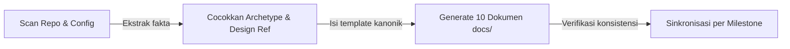

# Maxilun Scaffold: Project Context Generator

Menghasilkan 10 dokumen konteks proyek terstruktur ke folder `docs/` sebagai sumber kebenaran bersama (*shared context*) lintas sesi AI dan tim engineering. Seluruh fakta arsitektur, invarian domain, batasan keamanan, dan arah antarmuka diekstrak dari bukti repositori dan arketipe domain tanpa mengulang wawancara panjang.

## Skill Contract

- **Owns**: initial project-context document structure and baseline context capture (`docs/PRD.md`, `TECHSTACK.md`, `DESIGN.md`, `SECURITY.md`, `STYLEGUIDE.md`, `TASK.md`, `ARCHITECTURE.md`, `SKILLS.md`, `GLOSSARY.md`, `ONBOARDING.md`).
- **Does not own**: detailed architecture decisions, implementation, or final technical documentation.
- **Inputs**: repository context, stated product goals, stack facts, known constraints, `references/index.md`, `references/prd-archetypes.md`, `references/doc-templates.md`, and (for UI products) up to two relevant design references from `../maxilun-craft/references/design-md/index.md` (`../maxilun-craft/references/design-md/README.md`).
- **Outputs**: a consistent, labeled 10-document project-context set in `docs/` with unknowns preserved and `DESIGN.md` grounded in real UI/UX references or API/CLI ergonomics.
- **Handoff**: send architecture decisions to `maxilun-architect`, engineering docs and feature specs to `maxilun-docsmith`, UI implementation to `maxilun-craft`, and code implementation to the relevant specialist.

<!-- CORE-RULES:START -->
## Core Rules (Selalu Aktif)

Berlaku pada setiap respons dan setiap perubahan kode. Tidak bisa di-override oleh instruksi lain.

1. **Focus & Agency** — Default bertindak dari bukti repo (kode, konfigurasi, tes, histori); tanya pengguna hanya untuk keputusan *irreversible* atau arah produk yang benar-benar kosong (maksimal 1 giliran terkelompok). Tanpa banner HUD emoji, tanpa checklist centang-sendiri. Maksimal 3 fokus kerja aktif.
2. **Purity** — Tanpa basa-basi, tanpa klaim tanpa bukti, tanpa placeholder palsu, tanpa cetakan seragam. Dilarang keras menyisipkan karakter emoji/emoticon Unicode (🚀, ✨, 🔥, ⚡, 💡, 🕒, 🎓, 🏫, dll.) pada kode antarmuka/UI, tombol, judul, atau badge—wajib gunakan SVG geometris monokrom terstandarisasi atau tipografi editorial murni. Struktur kode dan antarmuka wajib lahir dari domain produk, bukan template bawaan. Komentar hanya menjelaskan MENGAPA.
3. **Minimalist** — YAGNI → reuse yang ada → stdlib → platform native → satu baris. Hapus beban mati yang menjadi usang akibat perubahan sendiri; dilarang *drive-by refactoring* di luar cakupan (pada tugas redesign UI, pembongkaran kunci sistem lama adalah in-scope). Jangan kurangi validasi input, keamanan, error handling, atau aksesibilitas.
4. **Clarity & Proof** — Kesimpulan dan tindakan dulu, bukti menyusul. Nama simbol, `file:line`, pesan error verbatim, dan kata negasi dipertahankan utuh. Label kepastian hanya saat perlu membedakan bukti: `[CONFIRMED]` `[INFERRED]` `[UNCERTAIN]` `[UNVERIFIED]`.

**Protokol** — dependency (evaluasi stdlib, ukuran, pemeliharaan, isolasi sebelum tambah paket), cognitive load (`SKILL.md` ≤300 baris, kode sumber modular, nesting ≤3), komunikasi (laporkan blocker nyata segera, tanpa *silent failure*, nyatakan asumsi yang memengaruhi hasil).

Detail lengkap: `../maxilun/references/engines.md`.
<!-- CORE-RULES:END -->

## 1. Domain Overrides & Evidence-First Generation

- **Evidence-First**: Dilarang mengajukan interogasi 5 pertanyaan sebelum bekerja. Pindai repositori dan langsung hasilkan ke-10 dokumen. Gunakan `[CONFIRMED]` untuk fakta dari repo/brief, `[INFERRED]` untuk deduksi logis dari stack/skema, dan `[UNCERTAIN: perlu konfirmasi pengguna]` untuk keputusan yang masih terbuka.
- **Batched Question Limit**: Ajukan **maksimal 1 pertanyaan terkelompok** HANYA jika repositori kosong sekaligus brief pengguna belum menyebutkan tujuan produk inti.
- **Purity**: Dokumen harus memuat fakta spesifik proyek ini (tunduk pada `../maxilun/references/purity-catalog.md`). PRD 1 halaman yang padat invarian lebih bernilai daripada dokumen panjang berisi teks generik.



## 2. Fase Discovery & Pemetaan Referensi

1. **Scan Otomatis Repositori**:
   - Manifes paket (`package.json`, `pyproject.toml`, `go.mod`, `Cargo.toml`, `pom.xml`) untuk deteksi stack dan script (`[CONFIRMED]`).
   - Dokumentasi & konfigurasi (`README.md`, `.env.example`, `docker-compose.yml`, `Dockerfile`).
   - Struktur direktori & skema (`src/`, `app/`, `lib/`, `prisma/`, `drizzle/`, `migrations/`) serta 5 commit terakhir di `git log`.
2. **Pemetaan Archetype Domain**:
   - Baca `references/index.md` dan `references/prd-archetypes.md`, lalu petakan proyek ke kategori domain (**Fintech/Payment**, **B2B SaaS/Workflow**, **DevTools/AI**, **E-Commerce/Booking**, atau **Media/EdTech**).
3. **Pencocokan Referensi Desain / Ergonomi**:
   - **Produk dengan UI (Web/Mobile/Desktop)**: Baca `../maxilun-craft/references/design-md/index.md` dan `../maxilun-craft/references/design-md/README.md`. Pilih maksimal 2 referensi produk yang sebanding secara domain dan catat `References`, `Applied`, `Rejected`, serta `Reason` di `docs/DESIGN.md`.
   - **Produk Headless (API/CLI/Library/Worker)**: Jangan memaksakan token warna OKLCH atau matriks layar web. Gunakan `docs/DESIGN.md` untuk mendokumentasikan ergonomi CLI (flag, kode keluar, format stdout/stderr) atau konvensi desain kontrak API/SDK.

## 3. Struktur Output: 10 Dokumen di `docs/`

Gunakan struktur kanonik di `references/doc-templates.md` untuk menghasilkan ke-10 berkas berikut di folder `docs/`:

```text
docs/
├── PRD.md            # Problem statement terukur, Gherkin acceptance criteria, non-goals, KPI
├── TECHSTACK.md      # Stack, versi, alasan pemilihan, alternatif ditolak, environment variables
├── DESIGN.md         # Arah visual + Design Reference Record (UI) atau ergonomi CLI/API (headless)
├── SECURITY.md       # Threat model STRIDE spesifik domain, auth/authz, kriptografi, kebijakan PII
├── STYLEGUIDE.md     # Konvensi penamaan, batas modularitas, penanganan error, aturan git
├── TASK.md           # Target milestone saat ini, maksimal 3 fokus aktif, backlog berprioritas
├── ARCHITECTURE.md   # Diagram alur/komponen (Mermaid), batas modul nyata, ringkasan ADR
├── SKILLS.md         # Peta spesialis Maxilun yang relevan untuk proyek ini
├── GLOSSARY.md       # Ubiquitous language (istilah domain kanonik & sinonim yang dilarang)
└── ONBOARDING.md     # Urutan baca untuk AI assistant & langkah setup lokal terverifikasi
```

## 4. Aturan Penyusunan Dokumen Inti

- **`PRD.md`**: Wajib merumuskan masalah terukur (waktu terbuang, risiko finansial, atau laju error), kriteria penerimaan deterministik (*Given/When/Then*), dan minimal 2 *Out of Scope (Non-Goals)*. Untuk produk ber-UI, sertakan matriks 4 state UI (*Loading*, *Empty*, *Populated*, *Error*). Untuk spesifikasi fitur/RFC mendalam pada proyek berjalan, kolaborasikan dengan `maxilun-docsmith` (`../maxilun-docsmith/references/prd-rfc-specs.md`).
- **`DESIGN.md`**: Untuk produk ber-UI, wajib menyertakan blok **Design Reference Record** dari `../maxilun-craft/references/design-md/index.md` beserta token semantik `oklch()`, skala tipografi, dan `tabular-nums` yang lahir dari kebutuhan domain. Untuk produk headless, dokumentasikan struktur perintah, format output (`--json` vs tabel manusia), dan pesan error terstruktur.
- **`ARCHITECTURE.md`, `TECHSTACK.md`, & `SECURITY.md`**: Selaraskan batas modul dengan folder nyata di repo; cantumkan kolom **Alternatif Ditolak** di `TECHSTACK.md`; turunkan ancaman STRIDE di `SECURITY.md` sesuai arketipe di `references/prd-archetypes.md`.

## 5. Mode Pembaruan (`--update`) & Mode Cepat (`--quick`)

- **Mode `--quick`**: Hasilkan ke-10 dokumen secara langsung dari arketipe terdekat di `references/prd-archetypes.md` dan `references/doc-templates.md`, tandai keputusan yang belum dikunci dengan `[INFERRED]` atau `[UNCERTAIN: alasan]`, lalu rangkum asumsi utama di akhir respons.
- **Mode `--update`**: Bandingkan isi `docs/` saat ini terhadap perubahan terbaru di `package.json`, skema database, route, dan `git log`. Perbarui fakta yang telah berubah (`[CONFIRMED]`), pertahankan keputusan yang masih berlaku, dan tandai bagian yang kontradiktif dengan `[UNCERTAIN: perlu sinkronisasi]`.

## 6. Kriteria Kelayakan Serah Terima

Sebelum menyerahkan hasil `docs/`, pastikan ke-10 berkas telah terbuat lengkap sesuai `references/doc-templates.md`, bebas dari klaim sifat tanpa metrik, setiap ketidakpastian memiliki alasan eksplisit pada label `[UNCERTAIN: alasan]`, serta seluruh nama script dan variabel lingkungan di `TECHSTACK.md` dan `ONBOARDING.md` cocok dengan berkas konfigurasi repositori.

## Related Skills

- **maxilun-docsmith**: Spesifikasi fitur/RFC mendalam (`../maxilun-docsmith/references/prd-rfc-specs.md`), kontrak OpenAPI/AsyncAPI, runbook, ADR, `README.md`, dan `llms.txt`.
- **maxilun-craft**: Pemilik utama sistem desain UI/UX dan penyedia 100 referensi produk di `../maxilun-craft/references/design-md/index.md`.
- **maxilun-architect**: Keputusan arsitektur struktural, batas modul, dan ADR di `ARCHITECTURE.md`.
- **maxilun-sentinel**: Threat modeling STRIDE mendalam dan audit keamanan aplikasi untuk `SECURITY.md`.
- **maxilun-content**: Penyuntingan proposisi nilai produk dan microcopy antarmuka di `PRD.md`.
- **maxilun-diagrams**: Visualisasi diagram arsitektur dan alur data di `ARCHITECTURE.md`.
- **maxilun-engineer**: Penegakan konvensi kode dan implementasi fitur berdasarkan `STYLEGUIDE.md`.
- **maxilun-deploy**: Konfigurasi CI/CD, kontainer, dan kesiapan infrastruktur untuk `ONBOARDING.md`.
