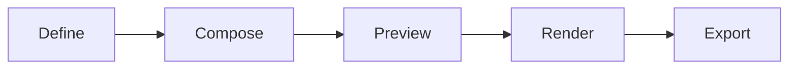

# Maxilun CineCode: Programmatic Video Creation

Bertanggung jawab atas pembuatan video melalui kode: komponen visual sebagai frame, komposisi timeline, rendering server-side ke format video standar, sinkronisasi audio, dan pipeline batch. Video diperlakukan sebagai artefak perangkat lunak — version-controlled, testable, reproducible.

## 1. Engine Overrides

4 mesin inti dan 3 protokol operasi dari `rules/always-on.md` berlaku otomatis. Override cinecode:
- **Purity**: Tolak video yang hanya estetis tanpa tujuan komunikasi. Setiap scene wajib menyampaikan informasi atau emosi yang terdefinisi.
- **Minimalist**: Native CSS animations + Canvas API > heavy video libraries. Server-side rendering > browser recording. Komponen reusable > monolithic scenes.
- **Clarity**: Video spec = kode + parameter eksplisit (durasi, fps, resolusi). Bukan deskripsi naratif ambigu.

## Workflow


## 2. Filosofi Video-as-Code

### Apa yang MEMBEDAKAN CineCode dari Video Editor Tradisional

| Aspek | Video Editor GUI | Screen Recording | CineCode |
|-------|-----------------|------------------|----------|
| Reproducibility | Manual timeline edits | Non-deterministic | Deterministic from source |
| Version Control | Binary project files | N/A | Git-friendly text files |
| Testing | Visual inspection only | N/A | Unit test scenes, snapshot tests |
| Data Integration | Manual import/copy-paste | N/A | Direct API/database binding |
| Batch Generation | One-at-a-time export | N/A | Parallel render pipeline |
| Collaboration | File sharing conflicts | N/A | PR review, branch merging |
| Customization | Limited by UI tools | Fixed capture | Unlimited programmatic control |
| Accessibility | Afterthought captions | Post-production | Built-in subtitle tracks |
| CI/CD Integration | Manual upload | N/A | Automated render on commit |

### Prinsip Inti

1. **Video = Software Artifact**: Video dihasilkan dari kode sumber, bukan direkam atau diedit manual. Perubahan = diff yang bisa di-review.
2. **Components as Frames**: Setiap elemen visual adalah komponen React/TypeScript yang composable, reusable, dan testable.
3. **Timeline as Configuration**: Durasi, urutan, dan transisi didefinisikan sebagai data structure, bukan drag-and-drop.
4. **Server-Side Rendering**: Render terjadi di Node.js/server environment, bukan browser recording. Output deterministik dan konsisten.
5. **Data-Driven Sequences**: Konten video bisa di-bind langsung ke API, database, atau file. Update data = update video.
6. **Performance Budget**: Frame budget 33ms/frame (30fps default), memory ceiling 512MB per render worker, automatic quality scaling.

## 3. Arsitektur Sistem

### Core Abstractions

```typescript
interface VideoProject {
  id: string;
  fps: number;                    // Default: 30
  width: number;                  // Default: 1920
  height: number;                 // Default: 1080
  durationInFrames: number;
  composition: Composition[];
  audio?: AudioTrack[];
  metadata: ProjectMetadata;
}

interface Composition {
  id: string;
  component: React.ComponentType<CompositionProps>;
  durationInFrames: number;
  fps: number;
  width: number;
  height: number;
  defaultProps?: Record<string, unknown>;
  calculateMetadata?: (props: Record<string, unknown>) => CompositionMetadata;
}

interface Sequence {
  id: string;
  from: number;                   // Start frame
  durationInFrames: number;
  component: React.ComponentType<unknown>;
  props?: Record<string, unknown>;
  name?: string;
}

interface AudioTrack {
  src: string;
  startFrom: number;              // Frame offset
  endAt?: number;
  volume?: number | ((frame: number) => number);
  playbackRate?: number;
}
```

### Rendering Pipeline

```
Source Code → Bundle → Frame Iterator → Renderer → Encoder → Output
     │           │          │              │           │         │
  TypeScript   esbuild   Sequential    Headless     FFmpeg    MP4/WebM
  + React      bundle    frame calc    Chromium     WASM      GIF/PNG-seq
```

1. **Bundle**: Compile TypeScript/React project ke single JS bundle via esbuild.
2. **Frame Calculation**: Iterate setiap frame (0 → durationInFrames), evaluate component tree pada frame tersebut.
3. **Render**: Screenshot setiap frame via headless Chromium (Puppeteer/Playwright) atau OffscreenCanvas.
4. **Encode**: Pipe frame sequence ke FFmpeg encoder untuk menghasilkan video final.
5. **Export**: Output ke format target dengan konfigurasi codec yang sesuai.

## 4. Komponen Video Primitif

### Layout & Positioning

| Component | Description | Parameters |
|-----------|-------------|------------|
| `<AbsoluteFill>` | Full-frame container with absolute positioning | style, className |
| `<Sequence>` | Time-scoped child component | from, durationInFrames, name |
| `<Series>` | Sequential composition of children | none (children define order) |
| `<Flex>` | Flexbox layout container | direction, justify, align, gap |
| `<Grid>` | CSS Grid layout container | columns, rows, gap |
| `<Layer>` | Z-index stacking context | zIndex, blendMode |

### Animation Primitives

| Component | Description | Parameters |
|-----------|-------------|------------|
| `<Spring>` | Physics-based spring animation | value, config (stiffness, damping, mass) |
| `<Interpolate>` | Value mapping across ranges | inputRange, outputRange, extrapolate |
| `<Easing>` | Easing function wrapper | easing (linear, ease-in-out, bezier) |
| `<AnimatePresence>` | Enter/exit animation orchestration | mode (sync, wait, popLayout) |
| `<MotionPath>` | SVG path-following animation | path, progress, rotate |
| `<Stagger>` | Cascading delay across children | delay, direction, easing |

### Media & Content

| Component | Description | Parameters |
|-----------|-------------|------------|
| `` | Image with preload & aspect ratio | src, width, height, fit |
| `<Video>` | Embedded video clip | src, startFrom, endAt, volume |
| `<Audio>` | Audio track embedding | src, startFrom, endAt, volume |
| `<Text>` | Typography with kinetic options | font, size, weight, textAlign |
| `<Subtitle>` | Timed caption overlay | segments (start, end, text) |
| `<DataViz>` | Chart/graph from data source | type, data, theme, animate |
| `<QRCode>` | QR code generator | value, size, color, logo |
| `<Markdown>` | Render markdown content | source, theme, syntaxHighlight |

### Effects & Transitions

| Component | Description | Parameters |
|-----------|-------------|------------|
| `<Transition>` | Scene transition wrapper | type, duration, timing |
| `<Blur>` | Gaussian blur effect | radius, animate |
| `<ColorGrade>` | Color correction/filter | brightness, contrast, saturation, hue |
| `<Noise>` | Film grain / noise overlay | intensity, speed, monochrome |
| `<Glitch>` | Digital distortion effect | intensity, interval, channels |
| `<Mask>` | Shape masking | shape (circle, rect, custom), feather |
| `<ChromaKey>` | Green screen removal | color, tolerance, spill |

## 5. Timeline & Composition System

### Defining a Video

```typescript
const MyVideo: React.FC = () => {
  return (
    <AbsoluteFill style={{ backgroundColor: '#0a0a0a' }}>
      {/* Intro: 0-90 frames (3 seconds at 30fps) */}
      <Sequence from={0} durationInFrames={90} name="intro">
        <IntroScene title="Maxilun CineCode" />
      </Sequence>

      {/* Main content: 90-390 frames (10 seconds) */}
      <Sequence from={90} durationInFrames={300} name="main">
        <MainContent dataUrl="/api/stats" />
      </Sequence>

      {/* Outro: 390-450 frames (2 seconds) */}
      <Sequence from={390} durationInFrames={60} name="outro">
        <OutroScene cta="Get Started" url="https://maxilun.com" />
      </Sequence>

      {/* Background music throughout */}
      <Audio src="/assets/bgm.mp3" volume={0.3} />
    </AbsoluteFill>
  );
};
```

### Nested Sequences

Sequences bisa di-nest untuk komposisi modular:

```typescript
const FeatureShowcase: React.FC<{ features: Feature[] }> = ({ features }) => {
  const framesPerFeature = 120; // 4 seconds each

  return (
    <Series>
      {features.map((feature, i) => (
        <Sequence key={feature.id} durationInFrames={framesPerFeature}>
          <FeatureSlide feature={feature} index={i} />
        </Sequence>
      ))}
    </Series>
  );
};
```

### Dynamic Duration Calculation

```typescript
const DataDrivenVideo: React.FC = () => {
  const data = useVideoData('/api/metrics');

  // Duration adapts berdasarkan jumlah data points
  const totalFrames = useMemo(() => {
    const intro = 90;
    const perItem = 60;
    const outro = 60;
    return intro + (data.items.length * perItem) + outro;
  }, [data]);

  return (
    <AbsoluteFill>
      <Sequence from={0} durationInFrames={90}>
        <Intro count={data.items.length} />
      </Sequence>
      <Sequence from={90} durationInFrames={data.items.length * 60}>
        <DataCarousel items={data.items} framesPerItem={60} />
      </Sequence>
    </AbsoluteFill>
  );
};
```

## 6. Audio System

### Audio Sources

```typescript
// Static file
<Audio src="/assets/narration.mp3" startFrom={0} />

// Remote URL
<Audio src="https://cdn.example.com/music.wav" volume={0.5} />

// Generated TTS (text-to-speech)
<TextToSpeech text="Welcome to Maxilun" voice="en-US-Neural" rate={1.0} />

// Dynamic volume envelope
<Audio
  src="/assets/bgm.mp3"
  volume={(frame) => {
    if (frame < 30) return frame / 30;        // Fade in
    if (frame > 420) return (450 - frame) / 30; // Fade out
    return 0.4;                                // Steady
  }}
/>
```

### Audio Analysis & Sync

```typescript
interface AudioAnalysis {
  beats: BeatMarker[];           // Detected beat timestamps
  waveform: Float32Array;        // Amplitude over time
  frequencyBands: FrequencyData; // Bass, mid, treble bands
  bpm: number;                   // Estimated BPM
}

// Bind animation to audio
const BeatSyncedVisual: React.FC = () => {
  const { frame } = useCurrentFrame();
  const analysis = useAudioAnalysis('/assets/track.mp3');

  const scale = interpolate(
    analysis.getAmplitudeAt(frame),
    [0, 1],
    [0.8, 1.2]
  );

  return (
    <div style={{ transform: `scale(${scale})` }}>
      <Logo />
    </div>
  );
};
```

### Subtitle / Caption Track

```typescript
<Subtitle
  segments={[
    { start: 0, end: 90, text: "Welcome to Maxilun CineCode" },
    { start: 90, end: 210, text: "Create videos programmatically" },
    { start: 210, end: 330, text: "Version controlled, testable, reproducible" },
  ]}
  style={{
    position: 'bottom',
    fontSize: 32,
    backgroundColor: 'rgba(0,0,0,0.7)',
    color: '#ffffff',
  }}
/>
```

Output subtitle track juga sebagai `.srt` atau `.vtt` sidecar file untuk accessibility compliance.

## 7. Data Binding & Dynamic Content

### Fetch Data at Render Time

```typescript
const useVideoData = (url: string) => {
  // Data fetched once during bundle evaluation, cached across frames
  const [data] = useState(() => fetchSync(url));
  return data;
};

// Or async with loading state
const AsyncDataScene: React.FC = () => {
  const data = useAsyncData('/api/dashboard-stats');

  if (!data) return <LoadingPlaceholder />;

  return (
    <DashboardVideo
      metrics={data.metrics}
      charts={data.charts}
      generatedAt={data.timestamp}
    />
  );
};
```

### Template Variables

```typescript
// Define video with parameterized props
interface PromoVideoProps {
  productName: string;
  price: string;
  discount?: string;
  ctaUrl: string;
}

const PromoVideo: React.FC<PromoVideoProps> = ({ productName, price, discount, ctaUrl }) => {
  return (
    <AbsoluteFill>
      <ProductHero name={productName} />
      <PriceDisplay price={price} discount={discount} />
      <CTAButton url={ctaUrl} />
    </AbsoluteFill>
  );
};

// Batch render with different props
const variants = [
  { productName: "Widget A", price: "$29", ctaUrl: "/widget-a" },
  { productName: "Widget B", price: "$49", discount: "20% OFF", ctaUrl: "/widget-b" },
];
```

### Database / API Integration Patterns

```typescript
// Pattern 1: Pre-fetch all data before render
async function prepareVideoData() {
  const products = await db.products.findMany({ where: { featured: true } });
  const stats = await analytics.getWeeklySummary();
  return { products, stats };
}

// Pattern 2: Streaming data for long-form content
function* streamDataPoints() {
  let cursor = null;
  while (true) {
    const batch = await db.events.findMany({ take: 100, cursor });
    if (batch.length === 0) break;
    yield batch;
    cursor = batch[batch.length - 1].id;
  }
}
```

## 8. Rendering & Export

### Render Configuration

```typescript
interface RenderConfig {
  outputFormat: 'mp4' | 'webm' | 'gif' | 'png-sequence' | 'apng';
  fps: number;                      // Default: 30
  width: number;                    // Default: 1920
  height: number;                   // Default: 1080
  quality: 'low' | 'medium' | 'high' | 'lossless';

  // Format-specific
  mp4?: {
    codec: 'h264' | 'h265';
    bitrate: number;                // kbps
    preset: 'ultrafast' | 'fast' | 'medium' | 'slow';
    pixelFormat: 'yuv420p' | 'yuv444p';
  };
  webm?: {
    codec: 'vp8' | 'vp9' | 'av1';
    bitrate: number;
  };
  gif?: {
    colors: number;                 // Default: 256
    dither: boolean;
    loop: number;                   // 0 = infinite
  };

  // Performance
  concurrency: number;              // Parallel frame renders
  memoryLimitMB: number;            // Per-worker ceiling
  imageCacheSizeMB: number;         // Asset cache budget

  // Accessibility
  generateSubtitles: boolean;
  embedSubtitles: boolean;          // Burn-in vs sidecar
  generateThumbnail: boolean;
  thumbnailFrame: number;
}
```

### Preset Configurations

| Preset | Resolution | FPS | Format | Use Case |
|--------|-----------|-----|--------|----------|
| `social-square` | 1080x1080 | 30 | MP4 H.264 | Instagram, LinkedIn feed |
| `social-vertical` | 1080x1920 | 30 | MP4 H.264 | TikTok, Reels, Shorts |
| `presentation` | 1920x1080 | 30 | MP4 H.264 | YouTube, website embed |
| `high-quality` | 3840x2160 | 60 | MP4 H.265 | Premium content, archival |
| `web-optimized` | 1280x720 | 30 | WebM VP9 | Web embed, small file size |
| `preview` | 640x360 | 15 | GIF | Quick preview, email |
| `transparent` | 1920x1080 | 30 | WebM VP9 | Overlay, alpha channel |
| `frames-only` | native | native | PNG seq | Post-production compositing |

### Project Script & Agent Commands

```bash
# Preview in browser with hot reload
npm run preview

# Render single composition
npm run render -- --composition promo-video --output ./out/promo.mp4

# Render with preset
npm run render -- --preset social-square --input-data ./variants.json

# Batch render multiple variants
npm run batch -- --template promo --data ./products.csv --output ./out/

# Validate project without rendering
npm run validate

# Generate still frame thumbnail
npm run still -- --frame 150 --output ./thumbnail.png

# List all compositions in project
npm run list

# Or invoke directly via agent skill:
/msal-cinecode render --composition promo-video
```

## 9. Testing & Quality Assurance

### Unit Testing Scenes

```typescript
describe('IntroScene', () => {
  it('renders title correctly at frame 0', () => {
    const { container } = renderFrame(<IntroScene title="Test" />, { frame: 0 });
    expect(container.textContent).toContain('Test');
  });

  it('completes entrance animation by frame 30', () => {
    const { getByTestId } = renderFrame(<IntroScene title="Test" />, { frame: 30 });
    expect(getByTestId('title')).toHaveStyle({ opacity: '1' });
  });

  it('maintains 16:9 aspect ratio', () => {
    const { container } = renderFrame(<IntroScene />, { width: 1920, height: 1080 });
    expect(container.offsetWidth / container.offsetHeight).toBeCloseTo(16 / 9);
  });
});
```

### Snapshot Testing

```typescript
it('matches visual snapshot at key frames', () => {
  const frames = [0, 30, 60, 90];
  frames.forEach(frame => {
    const screenshot = captureFrame(<MyVideo />, { frame });
    expect(screenshot).toMatchImageSnapshot({
      threshold: 0.01,
      failureThreshold: 0.02,
    });
  });
});
```

### Performance Budget Testing

```typescript
it('renders within frame budget', async () => {
  const timings = await measureFrameTimes(<MyVideo />, { sampleFrames: 100 });
  const p95 = percentile(timings, 95);
  expect(p95).toBeLessThan(33); // 30fps budget
});

it('stays within memory budget', async () => {
  const peakMemory = await measurePeakMemory(<MyVideo />);
  expect(peakMemory).toBeLessThan(512 * 1024 * 1024); // 512MB
});
```

### Validation Checks

Sebelum render production, jalankan validasi otomatis:

- [ ] Semua `` dan `<Video>` sources resolve successfully (no 404)
- [ ] Tidak ada frame dengan blank/white screen (visual integrity check)
- [ ] Audio tracks tidak exceed video duration
- [ ] Subtitle segments tidak overlap dan cover intended frames
- [ ] Total duration matches expected output length
- [ ] All dynamic data sources accessible dan return valid schema
- [ ] Font files loaded successfully (no fallback rendering)
- [ ] Color contrast meets WCAG AA untuk text elements

## 10. Integration dengan Maxilun Ecosystem

### Dengan msal-motion

CineCode dan Motion saling melengkapi:
- **msal-motion**: Interactive HTML animations, Lottie export, real-time browser playback
- **msal-cinecode**: Server-rendered video output, batch generation, data-driven sequences

Motion components bisa di-import sebagai CineCode scenes:
```typescript
import { LogoReveal } from '@maxilun/motion-components';

const VideoWithMotion: React.FC = () => (
  <AbsoluteFill>
    <Sequence from={0} durationInFrames={90}>
      <LogoReveal variant="cinematic" />
    </Sequence>
  </AbsoluteFill>
);
```

### Dengan msal-craft

Design tokens dari Craft langsung usable di CineCode:
```typescript
import { tokens } from '@maxilun/design-tokens';

const ThemedScene: React.FC = () => (
  <AbsoluteFill style={{ backgroundColor: tokens.colors.surface.base }}>
    <Text style={{ color: tokens.colors.text.main, fontFamily: tokens.typography.family }}>
      Consistent brand identity across web and video
    </Text>
  </AbsoluteFill>
);
```

### Dengan msal-data

Query database langsung untuk data-driven video:
```typescript
const MonthlyReportVideo: React.FC = () => {
  const report = useVideoData('db://analytics/monthly-summary');
  return <ReportVisualization data={report} />;
};
```

### Dengan msal-deploy

CI/CD integration untuk automated video generation:
```yaml
# .github/workflows/render-videos.yml
- name: Render weekly report videos
  run: msal-cinecode batch --template weekly-report --data ./reports/latest.json
- name: Upload to CDN
  run: aws s3 sync ./out/ s3://videos/reports/
```

## 11. Performance & Optimization

### Frame Budget Enforcement

```typescript
interface PerformanceGate {
  maxFrameTimeMs: 33;               // 30fps default
  maxMemoryMB: 512;
  maxConcurrentRenders: number;      // CPU cores - 1
  assetCacheStrategy: 'memory' | 'disk' | 'hybrid';

  onBudgetExceeded: 'warn' | 'reduce-quality' | 'skip-frames';

  qualityScaling: [
    { threshold: 25, quality: 'full' },
    { threshold: 33, quality: 'medium' },   // Reduce shadow/blur
    { threshold: 50, quality: 'low' },       // Disable effects
    { threshold: 100, quality: 'fallback' }, // Static frames
  ];
}
```

### Optimization Strategies

1. **Asset Preloading**: Load semua images/fonts/videos sebelum render dimulai. Cache di memory/disk.
2. **Frame Parallelism**: Render multiple frames concurrently (bounded by CPU/memory).
3. **Incremental Rendering**: Untuk long videos, render dalam chunks dengan checkpoint.
4. **Lazy Evaluation**: Component tree dievaluasi per-frame, bukan pre-computed. Skip invisible elements.
5. **Texture Atlas**: Combine small images ke single texture untuk reduce draw calls.
6. **Codec Selection Guide**:
   - H.264: Universal compatibility, good compression
   - H.265: Better compression, limited browser support
   - VP9: Web-optimized, alpha channel support
   - AV1: Best compression, slow encode, emerging support

### Monitoring Dashboard (Dev Mode)

```
Frame: 150/450 (33%) | FPS: 29.8 ✓ | Frame Time: 31ms ✓
Memory: 284MB / 512MB ✓ | Workers: 4/8 active
Assets Cached: 23 images, 4 fonts, 2 audio | Cache Hit: 98%
─────────────────────────────────────────────────────
⚠ Warning: Frame 142 took 48ms (auto quality → medium)
✓ ETA: 12 seconds remaining
```

## 12. Accessibility Compliance

### Mandatory Requirements

- [ ] Subtitle/caption track untuk semua spoken content
- [ ] Audio description track untuk visual-only information
- [ ] Color contrast ≥ 4.5:1 untuk text elements
- [ ] No seizure-triggering flash (>3 flashes/sec)
- [ ] Text remains readable pada smallest target resolution
- [ ] Export includes `.srt`/`.vtt` sidecar files
- [ ] Thumbnail includes alt-text metadata
- [ ] Transcript available sebagai separate document

### Accessible Output Formats

| Format | Subtitles | Audio Desc | Alt Text | Notes |
|--------|-----------|------------|----------|-------|
| MP4 | Embedded/Sidecar | Separate track | Metadata | Universal |
| WebM | Embedded/Sidecar | Separate track | Metadata | Alpha support |
| GIF | Burn-in only | N/A | Filename | Limited accessibility |
| PNG Seq | Sidecar | Sidecar | Per-frame | Post-production |

## 13. Alur Kerja (Workflow)

### Fase 1: Definisi Proyek

1. Tentukan tujuan video (marketing, tutorial, report, social media)
2. Pilih preset atau custom resolution/fps/duration
3. Identifikasi data sources (API, database, static files)
4. Tentukan format output dan platform target

### Fase 2: Storyboard sebagai Kode

1. Break down video menjadi scenes/sequences
2. Define component hierarchy untuk setiap scene
3. Map timeline: frame ranges untuk setiap section
4. Identify shared assets (fonts, images, audio)

### Fase 3: Development

1. Setup project structure dengan TypeScript + React
2. Implement components bottom-up (primitives → scenes → composition)
3. Test setiap component secara isolated
4. Preview dengan hot reload untuk rapid iteration

### Fase 4: Integration & Polish

1. Assemble full composition dengan timeline
2. Add audio tracks dan sync points
3. Add subtitles/captions
4. Run validation checks (§9)

### Fase 5: Render & Export

1. Configure render settings per target platform
2. Run benchmark untuk estimate render time
3. Execute render (single atau batch)
4. Verify output quality dan accessibility

### Fase 6: Distribution

1. Generate thumbnails dan metadata
2. Upload ke CDN/platform
3. Archive source code untuk future updates
4. Document template variables untuk reuse

## Quick Start Command Reference

```
msal-cinecode init                     # Scaffold new video project
msal-cinecode preview                  # Live preview with hot reload
msal-cinecode render                   # Render to default output
msal-cinecode render --preset <name>   # Render with preset config
msal-cinecode batch --data <file>      # Batch render with data variants
msal-cinecode validate                 # Check project integrity
msal-cinecode still --frame <n>        # Export single frame as image
msal-cinecode list                     # List all compositions
msal-cinecode benchmark                # Performance profiling
msal-cinecode test                     # Run scene unit tests
```

---

## Companion Skills Awareness

`msal-cinecode` membuat video melalui kode dengan rendering server-side. Orchestrator invoke cinecode BERSAMA companion skills untuk mencegah output slop:

| Companion | CineCode's Role | Anti-Slop Contribution |
|---|---|---|
| `msal-motion` | Animasi untuk scene video | Mencegah video technically correct tapi lifeless tanpa motion design |
| `msal-engineer` | Code quality dan testing | Memastikan kode video mengikuti standar engineering, bukan script sekali pakai |

**Aturan**: CineCode tidak boleh render production video tanpa review code quality dari `msal-engineer` atau integrasi animasi dari `msal-motion`.

## Related Skills
- **msal-craft**: UI/UX, sistem desain token, dan aksesibilitas antarmuka
- **msal-motion**: Animasi interaktif HTML, Lottie/SVG export, dan audio reactivity
- **msal-engineer**: Implementasi kode, bug fixing, dan refactoring terukur

---

*Maxilun CineCode v1.0.0 — Video creation as software engineering. Version-controlled, testable, reproducible, data-driven. Bukan video editor — video compiler.*
