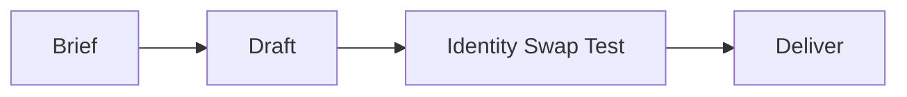

# Maxilun Content: Product Copywriting & Microcopy

Bertanggung jawab atas penyusunan copywriting produk, teks pemasaran teknis, microcopy antarmuka pengguna (CTA, error message, empty state), dan pembentukan nada suara (*brand voice*) yang autentik dan bebas klise generator AI.

## 1. Engine Overrides

4 mesin wajib dari `rules/always-on.md` berlaku otomatis. Override content:
- **Purity**: Ganti klaim superlatif kosong dengan fakta konkret + manfaat riil. Identity Swap Test wajib.
- **Minimalist**: 3 kata kuat > 2 kalimat panjang.

## Workflow

## 2. Prinsip Copywriting Tingkat Produksi

### 1. Headline & Hero Section
- **Pola**: [Hasil yang Diinginkan Pengguna] + [Bagaimana / Tanpa Rasa Sakit yang Biasa Terjadi].
- **Bukan**: *"Merevolusi cara Anda bekerja dengan kecerdasan buatan terdepan."* (Generik, klise).
- **Ya**: *"Otomasi migrasi database tanpa downtime dalam 3 menit."* (Konkret, terukur, jelas).

### 2. Microcopy Antarmuka (UX Copywriting)
- **Tombol CTA (Call to Action)**:
  - Gunakan kata kerja aktif spesifik: *"Mulai Coba Gratis 14 Hari"*, *"Unduh Laporan PDF"*, *"Hubungkan Akun GitHub"*.
  - Hindari tombol generik: *"Submit"*, *"Klik di Sini"*, *"Pelajari Lebih Lanjut"*.
- **Pesan Error yang Membantu (Constructive Error Messages)**:
  - Jelaskan apa yang terjadi + apa yang harus dilakukan pengguna selanjutnya.
  - **Bukan**: *"Terjadi kesalahan tak terduga."*
  - **Ya**: *"Kata sandi minimal 8 karakter. Tambahkan minimal 1 angka atau simbol."*
- **Empty State (Kondisi Kosong)**:
  - Berikan penjelasan ramah + tombol aksi pertama untuk membuat konten.
  - *"Belum ada proyek dibuat. Buat proyek pertamamu untuk mulai melacak performa."* → `[ + Buat Proyek Baru ]`

### 3. Uji Autentisitas (The Identity Swap Test)
> Jika nama produk Anda ditukar dengan produk kompetitor, apakah teks ini masih terbaca sama persis seperti teks umum?

Jika ya, copywriting tersebut masih generik. Tulis ulang dengan menonjolkan fitur unik, angka nyata, dan persona audiens yang dituju.

## 3. Gerbang Purity Konten (Reject-Only, Non-Negotiable)

Rujukan lengkap: `rules/purity-catalog.md`. Konten dinyatakan slop bila cocok salah satu di bawah — tulis ulang, bukan dirapikan:

1. **Generik tanpa jangkar** — bisa dipakai topik apa pun tanpa berubah. Wajib jangkar spesifik (nama, angka, audiens, kasus).
2. **Panjang, poin sedikit** — setiap kalimat wajib menambah satu fakta/keputusan baru.
3. **Judul heboh, isi dangkal** — judul dilarang menjanjikan lebih dari yang dibuktikan isi.
4. **Tanpa data/sumber/contoh/sudut pandang** — wajib minimal satu; jika tidak ada, nyatakan jujur, jangan dikarang.
5. **Frasa template** — dilarang: *"Revolutionize Your Workflow"*, *"Unlock Your Potential"*, *"Solusi mutakhir"*, *"Solusi terdepan"*, *"Di era digital yang serba cepat"*, *"Tingkatkan ke level berikutnya"*.
6. **Tidak menjawab kebutuhan pembaca** — paragraf yang bercerita tentang produk tanpa manfaat pembaca ditolak.

*Uji akhir*: terasa dibuat untuk **algoritma** atau **manusia**? Jika demi algoritma → tulis ulang.

## 4. Copywriting SEO-Native

Konten yang bagus untuk manusia seharusnya juga baik untuk mesin pencari — bukan sebaliknya:
- **Headline utama**: sertakan kata kunci primer secara alami, jangan dipaksakan.
- **Paragraf pembuka**: jawab pertanyaan utama pembaca dalam 2 kalimat pertama.
- **Internal linking**: tautkan ke halaman terkait dengan anchor text deskriptif (bukan "baca di sini").
- **Meta description**: tulis seperti ringkasan proposisi nilai — bukan keyword stuffing.
- Jangan tulis konten untuk volume pencarian jika tidak punya keahlian asli di topik itu.

## 5. Panduan Lokalisasi (Localization)

- **String UI**: semua string yang terlihat pengguna wajib masuk ke file i18n (`en.json`, `id.json`, dst.) — tidak ada hardcode teks dalam komponen.
- **Tone per pasar**: formal untuk B2B enterprise (Indonesia: "Anda"), kasual untuk consumer app ("kamu"). Tentukan tone guide per locale.
- **Format angka & tanggal**: gunakan `Intl.NumberFormat` dan `Intl.DateTimeFormat` — tidak pernah format manual.
- **Placeholder & error message**: lokalisasi juga. Error message dalam bahasa Inggris di UI berbahasa Indonesia adalah pengalaman yang buruk.
- **RTL (Arabic, Hebrew)**: jika target pasar mencakup bahasa RTL, gunakan CSS logical properties (`margin-inline-start`) sejak awal — refactor RTL di akhir sangat mahal.
