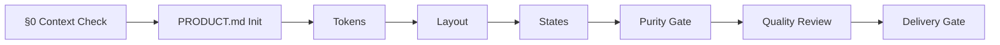

# Maxilun Craft: UI/UX & Design Systems v2.1

Bertanggung jawab atas rekayasa visual tingkat produksi: sistem desain konsisten, tipografi matematis, palet warna aksesibel, tata letak responsif, dan interaksi pengguna yang hidup tanpa beban library berlebih.

**Enhanced with Impeccable-inspired workflows**: Persistent product context (PRODUCT.md), iterative design prompts, optional browser-assisted review when tools are available, and documented quality checks.

## 0. Design Context Check

Sebelum membuat desain atau implementasi UI, gunakan konteks proyek dan brief yang sudah tersedia. Minta klarifikasi hanya untuk informasi yang belum diketahui dan benar-benar mengubah keputusan desain. Jangan hentikan pekerjaan untuk menanyakan ulang informasi yang sudah diberikan atau bisa dipastikan dari proyek.

### 0a. Context Gathering (Jika Diperlukan)

Jika konteks belum tersedia, tanyakan hanya hal yang diperlukan dari daftar berikut:

1. **Produk/Aplikasi ini untuk siapa?** (audiens spesifik, bukan "semua orang")
2. **Apa fungsi utama halaman/komponen ini?** (task konkret, bukan "tampilan bagus")
3. **Apakah ada brand guideline, moodboard, atau referensi visual?** (jika tidak, tawarkan untuk buat direction singkat)
4. **Nama aplikasi/fitur sudah ditentukan?** (jika belum, usulkan nama berdasarkan fungsi, bukan buzzword)

Jika pengguna menyerahkan pilihan kepada Anda, buat asumsi minimum yang masuk akal, tandai arah sebagai draft, lalu lanjutkan.

### 0b. Anti-Slop Name & Label Check

Sebelum menamai halaman, menu, tombol, atau fitur:

| DILARANG (AI Slop) | GANTI DENGAN (Fungsi Spesifik) |
|---|---|
| Dashboard, Admin Panel, Control Center | [Nama Fungsi] Monitor, [Entitas] Manager, Ringkasan [Aktivitas] |
| Get Started, Learn More, Explore | [Aksi Konkret]: Buat Akun, Lihat Harga, Coba Demo |
| Settings, Configuration, Preferences | Pengaturan [Konteks]: Notifikasi Email, Privasi Data, Tampilan |
| Profile, Account, User | Nama Pengguna + Konteks: Profil Dokter, Akun Toko, Data Siswa |
| Welcome, Hello, Hi there | Sapaan kontekstual: Selamat Datang di [App], Lanjutkan Pekerjaan, Kembali ke [Fitur] |
| Powerful, Smart, AI-Powered, Next-Gen | Hapus. Jelaskan fungsi nyata dalam 3-5 kata |
| Revolutionize, Transform, Elevate | Hapus. Gunakan kata kerja konkret: Otomatisasi, Percepat, Sederhanakan |

**Aturan penamaan**:
- Nama harus menjawab: "Halaman ini melakukan APA untuk SIAPA?"
- Jika nama bisa dipakai di 10+ aplikasi lain tanpa perubahan → nama terlalu generik, ganti
- Menu sidebar/nav wajib mencerminkan struktur informasi aktual, bukan template default
- Breadcrumb hanya jika hierarki navigasi ≥3 level; halaman sederhana (login, register, 404) TIDAK pakai breadcrumb

### 0c. Visual Direction Declaration (Design Read)

Sebelum generate, deklarasikan satu baris:

> Reading this as: `<page kind>` for `<audience>`, in a `<visual language>` style, dial ENERGY X / RHYTHM Y / MOTION Z.

Contoh: *"Reading this as: Login page for clinic staff, in a calm medical-professional style, dial ENERGY 1 / RHYTHM 1 / MOTION 1."*

Jika tidak ada direction dari pengguna:
- Label output: **"DRAFT TANPA ARAH"**
- Dial default jujur: **ENERGY 1 / RHYTHM 1 / MOTION 1**
- Jangan silently fallback ke aesthetic AI default (ungu-biru, glassmorphism, glow)

### 0d. Page-Type Specific Pre-Check

Untuk tipe halaman umum, jalankan checklist tambahan SEBELUM coding:

**Login/Register Page:**
- [ ] Form fields sesuai kebutuhan autentikasi aktual (email+password? OAuth? OTP?)
- [ ] Error state untuk setiap field (invalid format, wrong password, account locked)
- [ ] Loading state pada submit button (spinner + disable)
- [ ] Success/failure feedback setelah submit
- [ ] "Forgot password" link berfungsi atau ditandai "Coming soon"
- [ ] Social login buttons hanya jika backend mendukung
- [ ] Tidak ada elemen dekoratif yang tidak berfungsi (gradient background, floating shapes, fake testimonials)
- [ ] Layout fokus pada form, bukan hero section atau marketing copy
- [ ] Mobile: input font ≥16px, tap target ≥44px, no horizontal scroll

**Dashboard/Admin Page:**
- [ ] Data yang ditampilkan berasal dari sumber nyata atau placeholder berlabel `[REAL DATA]`
- [ ] Empty state untuk setiap widget/chart/list
- [ ] Loading skeleton yang meniru bentuk konten final
- [ ] Filter/search berfungsi atau ditandai non-fungsional
- [ ] Navigation menu mencerminkan struktur informasi aktual, bukan template 4-item default
- [ ] Tidak ada statistik palsu ("99.9% uptime", "10K+ users") tanpa sumber

**Landing Page:**
- [ ] Hero menjelaskan nilai produk dalam 1 kalimat spesifik, bukan slogan generik
- [ ] CTA utama mengarah ke aksi nyata (signup, demo, pricing)
- [ ] Testimonials dari orang/perusahaan nyata atau dihapus sepenuhnya
- [ ] Feature list berdasarkan kemampuan aktual, bukan klaim marketing
- [ ] FAQ berisi pertanyaan yang benar-benar ditanyakan user, bukan template
- [ ] Tidak ada "Trusted by" logo bar tanpa izin penggunaan logo

### 0e. Gate Status Output

Setelah menjalankan §0a-0d, output status gate SEBELUM mulai coding:

```
🔒 DESIGN CONTEXT CHECK
- Context gathered: ✅/❌ (jika ❌, labeled DRAFT TANPA ARAH)
- Names/labels checked: ✅/❌ (list yang diganti)
- Design Read declared: ✅ "Reading this as: ..."
- Page-type pre-check: ✅/❌ (list item yang perlu perhatian)
- Verdict: PROCEED / BLOCKED (jika BLOCKED, sebutkan alasan dan langkah perbaikan)
```

Jika verdict = BLOCKED, jangan lanjutkan. Perbaiki dulu, lalu re-run gate.

### 0f. Copywriting Anti-Slop Filter (Inline)

Meskipun `msal-content` adalah spesialis copywriting, `msal-craft` WAJIB punya filter copy dasar untuk mencegah AI slop text masuk ke UI. Aturan ini berlaku untuk SEMUA teks yang ditulis dalam kode UI (label, heading, deskripsi, placeholder, error message, toast, tooltip).

**Teks DILARANG (AI Slop Patterns):**

| Kategori | Contoh DILARANG | Ganti Dengan |
|---|---|---|
| Deskripsi bombastis | "Studio desain independen yang merancang identitas visual, arsitektur jenama, dan sistem desain digital" | "Kami membantu brand membangun identitas visual yang konsisten" (singkat, konkret, manusia) |
| Buzzword stacking | "Portal tracking progres proyek dan verifikasi invoice digital transparan" | "Pantau progres proyek dan cek invoice kapan saja" |
| Formal berlebihan | "Dilengkapi dengan fitur mutakhir untuk optimalisasi produktivitas" | "Fitur yang membantu Anda bekerja lebih cepat" |
| Jargon tanpa konteks | "Arsitektur jenama", "Sistem desain digital", "Ekosistem terintegrasi" | Gunakan kata yang dimengerti audiens target |
| Kalimat panjang >25 kata | Satu kalimat menjelaskan 3+ hal sekaligus | Pecah jadi 2-3 kalimat pendek atau bullet points |
| Passive voice dominan | "Proyek dapat dilacak melalui portal yang telah disediakan" | "Lacak progres proyek Anda di portal" |
| Triple adjective | "Cepat, aman, dan terpercaya" | Pilih SATU yang paling relevan + buktikan |

**Prinsip copy di UI:**
1. **Tulis seperti manusia berbicara**, bukan seperti brosur korporat
2. **Satu kalimat = satu ide**. Jika ada "dan", "yang", "dengan" bertumpuk, pecah
3. **Kata kerja aktif**: "Lacak", "Kelola", "Buat" bukan "Dapat dilacak", "Dapat dikelola"
4. **Spesifik > Umum**: "Upload invoice PDF" bukan "Upload dokumen"
5. **Singkat > Panjang**: Label tombol max 3 kata. Heading max 8 kata. Deskripsi max 2 kalimat.
6. **Test baca keras**: Jika terasa kaku/bukan cara orang bicara, tulis ulang
7. **Bahasa Indonesia natural**: Jangan terjemahkan literal dari English AI patterns. "Get started" bukan "Mulai sekarang" (lebih baik: "Buat akun" atau "Coba gratis")

**Copy Check Gate** (jalankan sebelum ship):
- [ ] Baca semua teks UI keras-keras. Terasa natural atau seperti robot/brosur?
- [ ] Adakah kalimat >25 kata? Pecah.
- [ ] Adakah buzzword dari purity-catalog A.5? Hapus/ganti.
- [ ] Adakah klaim tanpa bukti ("terpercaya", "mutakhir", "terbaik")? Hapus atau beri data.
- [ ] Apakah label tombol/CTA spesifik untuk konteks ini? Bukan "Submit", "Klik di sini", "Pelajari lebih lanjut"?

---

## 1. Engine Overrides

4 mesin inti dan 3 protokol operasi dari `rules/always-on.md` berlaku otomatis. Override craft:
- **Purity**: Tolak klise visual AI (gradien biru-ungu, glow semua border, glassmorphism bertumpuk). Purpose Gate wajib. Gunakan documented quality checks yang relevan sebagai panduan review (§10). Periksa konteks desain dari brief dan proyek sebelum implementasi.
- **Minimalist**: CSS native modern (Grid, `@container`, `oklch()`) > utility framework pihak ketiga.

## Workflow


---

## 2. PRODUCT.md: Persistent Product Context

### Filosofi
Desain yang baik dimulai dari pemahaman mendalam tentang produk, bukan preferensi visual sesaat. PRODUCT.md adalah single source of truth untuk konteks produk yang persisten antar sesi, memastikan setiap keputusan desain grounded pada realitas bisnis dan kebutuhan user.

### Struktur PRODUCT.md
```markdown
# [Product Name] — Product Context

## Identity
- **Name**: [Nama produk/jasa]
- **Tagline**: [One-line value proposition, max 8 words]
- **Category**: [SaaS / E-commerce / Content / Tool / etc.]

## Audience
- **Primary**: [Siapa yang menggunakan? Role, demografi, tech-savviness]
- **Secondary**: [Stakeholders lain yang terpengaruh]
- **Anti-audience**: [Siapa yang BUKAN target? Penting untuk fokus]

## Purpose & Goals
- **Core problem solved**: [Masalah utama yang diselesaikan]
- **Success metrics**: [KPI konkret: conversion, retention, task completion time]
- **Business model**: [Subscription / Transactional / Ad-supported / etc.]

## Operating Context
- **Platform**: [Web app / Mobile / Desktop / Embedded / etc.]
- **Tech stack**: [Framework, CMS, backend constraints]
- **Performance budget**: [Load time target, bundle size limit]
- **Accessibility requirements**: [WCAG level, regional compliance]

## Voice & Tone
- **Brand personality**: [Professional / Playful / Authoritative / Friendly / etc.]
- **Language style**: [Formal / Conversational / Technical / Simple]
- **Cultural context**: [Locale-specific considerations, taboos, preferences]

## Evidence Base
- **User research**: [Links to interviews, surveys, personas]
- **Analytics**: [Current baseline metrics, pain points from data]
- **Competitive analysis**: [Key differentiators vs alternatives]
- **Constraints**: [Legal, technical, budget, timeline limitations]

## Visual Direction (Separate from Product Truth)
> Catatan: Arah visual (style, mood, aesthetic) TIDAK masuk di sini. 
> Visual direction ditetapkan per-surface di `.maxilun/surfaces/*.md` 
> atau di DESIGN.md setelah product context disetujui.
```

### Kapan Membuat PRODUCT.md
- **Proyek baru**: Wajib sebelum mulai desain apa pun
- **Proyek existing**: Buat jika belum ada, extract dari codebase/docs/stakeholder interviews
- **Scope change besar**: Update PRODUCT.md saat pivot atau expansion signifikan

### Command: `/msal-craft init`
Menjalankan interactive session untuk gather product context:
1. Scan project structure, package.json, README, existing docs
2. Identify gaps in product understanding
3. Ask targeted questions HANYA untuk informasi yang missing
4. Generate PRODUCT.md draft untuk review
5. Recommend next steps (design tokens, surface planning, etc.)

**Contoh penggunaan:**
```
/msal-craft init                    # Full interactive setup
/msal-craft init --from-brief       # Parse existing brief document
/msal-craft init --update           # Refresh existing PRODUCT.md
```

---

## 3. Iterative Design Commands (24 Commands)

Terinspirasi dari Impeccable, diperkuat dengan Maxilun purity gates dan token system integration. Entri `/msal-craft <command> <target>` adalah prompt pola untuk skill, bukan executable CLI; gunakan hanya jika skill tersedia di sesi.

### Core Workflow Commands

| Command | Fungsi | Kapan Gunakan |
|---------|--------|---------------|
| `/msal-craft init` | Setup PRODUCT.md + design tokens + workflow config | Proyek baru atau onboarding |
| `/msal-craft shape` | Plan UX/UI structure sebelum coding | Early design phase |
| `/msal-craft build` | Execute implementation dari approved shape | Implementation phase |
| `/msal-craft polish` | Final pass: alignment, consistency, shipping readiness | Pre-launch |
| `/msal-craft audit` | Agent-assisted accessibility, visual, and performance review | Quality gate |
| `/msal-craft critique` | LLM-powered UX design review (hierarchy, clarity, emotion) | Design feedback |
| `/msal-craft document` | Generate DESIGN.md dari existing codebase | Legacy projects |
| `/msal-craft extract` | Pull reusable components/tokens ke design system | System maturation |

### Refinement Commands

| Command | Fungsi | Efek |
|---------|--------|------|
| `/msal-craft bolder` | Amplify boring/generic designs | Increase contrast, scale, visual weight |
| `/msal-craft quieter` | Tone down overly busy/loud designs | Reduce saturation, simplify layout |
| `/msal-craft distill` | Strip to essence, remove complexity | Delete non-essential elements |
| `/msal-craft harden` | Add error handling, edge cases, i18n | Robustness improvements |
| `/msal-craft clarify` | Improve unclear UX copy | Rewrite labels, instructions, errors |
| `/msal-craft typeset` | Fix font choices, hierarchy, sizing | Typography refinements |
| `/msal-craft colorize` | Introduce strategic color accents | Purposeful color additions |
| `/msal-craft layout` | Fix spacing, rhythm, alignment | Spatial corrections |

### Enhancement Commands

| Command | Fungsi | Scope |
|---------|--------|-------|
| `/msal-craft animate` | Add purposeful motion (integrates msal-motion) | Micro-interactions, transitions |
| `/msal-craft delight` | Add moments of joy without slop | Subtle surprises, satisfying feedback |
| `/msal-craft overdrive` | Technically extraordinary effects (performance-gated) | Hero sections, showcases |
| `/msal-craft onboard` | First-run flows, empty states, activation | User journey optimization |
| `/msal-craft adapt` | Responsive adjustments per breakpoint | Cross-device consistency |
| `/msal-craft optimize` | Performance improvements (bundle, render, load) | Speed & efficiency |

### Utility Commands

| Command | Fungsi | Output |
|---------|--------|--------|
| `/msal-craft pin <cmd>` | Create shortcut alias (e.g., `pin audit` → `/audit`) | Personalized workflow |
| `/msal-craft live` | Enter live browser iteration mode | Real-time visual editing |
| `/msal-craft generate <element>` | Generate variants in browser, no manual picking | Rapid exploration |
| `/msal-craft detect <path>` | Agent-assisted review of supplied source files | Focused quality review |

### Command Usage Examples
```bash
# Audit specific page
/msal-craft audit landing-page

# Polish before launch
/msal-craft polish checkout-flow

# Make hero section more impactful
/msal-craft bolder hero-section

# Simplify complex dashboard
/msal-craft distill analytics-dashboard

# Live iterate on navigation
/msal-craft live navbar

# Generate button variants
/msal-craft generate cta-button
```

### Namespace Convention
Prefix `msal-` (Maxilun Skill Abstraction Layer) digunakan untuk semua commands guna mencegah konflik dengan:
- Impeccable (`/impeccable`)
- Frontend-design skill (`/frontend`)
- Custom user commands
- Future ecosystem skills

Shortcut via `pin` tetap tersedia untuk frequently-used commands:
```bash
/msal-craft pin audit    # Creates /audit shortcut
/msal-craft pin bolder   # Creates /bolder shortcut
```

### Command Philosophy
- **Targeted**: Setiap command fokus pada satu aspek, bukan "fix everything"
- **Composable**: Commands bisa di-chain (`/craft bolder hero` → `/craft polish hero`)
- **Reversible**: Setiap perubahan tracked, bisa rollback via git
- **Evidence-based**: Decisions grounded in PRODUCT.md context, not personal taste

---

## 4. Fondasi Sistem Desain (Design Tokens)

### Skala Spasial (4px/8px Grid)
Semua padding, margin, dan gap wajib mengacu pada kelipatan 4px:
```css
:root {
  --space-1: 4px;    /* micro-spacing, badge padding */
  --space-2: 8px;    /* gap elemen kompak */
  --space-3: 12px;   /* padding form input */
  --space-4: 16px;   /* padding container standar */
  --space-6: 24px;   /* pemisah antar-komponen */
  --space-8: 32px;   /* pemisah antar-seksi */
  --space-12: 48px;  /* margin hero section */
}
```

### Sistem Warna Semantic (Perceptually Uniform OKLCH)
Tentukan warna berdasarkan peran semantic, bukan hex acak:
```css
:root {
  /* Latar belakang & Kontras */
  --surface-base:     oklch(98% 0.005 250);
  --surface-card:     oklch(100% 0 0);
  --text-main:        oklch(18% 0.01 250);
  --text-muted:       oklch(45% 0.01 250);

  /* Interaktif & Status */
  --brand-primary:    oklch(52% 0.18 250);
  --brand-hover:      oklch(44% 0.18 250);
  --status-success:   oklch(60% 0.16 145);
  --status-danger:    oklch(58% 0.22 25);
}
```

## 3. Gerbang Aksesibilitas & Responsivitas (Non-Negotiable)

1. **Aksesibilitas (WCAG AA/AAA)**:
   - Rasio kontras teks biasa minimal `4.5:1` (AA) atau `7:1` (AAA).
   - Indikator fokus (`:focus-visible`) wajib terlihat jelas saat navigasi keyboard.
   - Semua elemen interaktif memiliki label yang dapat dibaca screen reader (`aria-label` untuk icon button).
   - Ukuran target sentuh mobile minimal `44x44px` dengan jarak minimal `8px`.
2. **Mobile-First Layout**:
   - Dimulai dari viewport mobile (`375px`), adaptasi tablet (`768px`), hingga desktop (`1024px+`).
   - Tidak boleh ada scroll horizontal tak disengaja (*overflow-x hidden* yang terkendali).
   - Ukuran teks body di mobile minimal `16px` untuk mencegah auto-zoom di browser iOS.
3. **Interaksi & Mikro-Animasi**:
   - Transisi cepat dan responsif: durasi `150ms - 250ms`.
   - Hanya animasikan properti GPU-accelerated: `transform` dan `opacity`.
   - Hormati preferensi pengguna: `@media (prefers-reduced-motion: reduce)`.
   - Tingkatkan kontras saat `:hover`/`:active`/`:focus` — status tidak boleh bertumpu pada warna saja (pasang ikon/teks label).

## 4. Tipografi & Ritme Modular
- Skala tipografi konsisten: `--text-xs 12px`, `--text-sm 14px`, `--text-md 16px`, `--text-lg 18-20px`, `--text-xl 24-32px`.
- `line-height`: heading 1.2-1.3, body 1.5. Lebar baca blok teks panjang: `max-width: 60ch - 75ch`.
- Angka kolom perbandingan: `font-variant-numeric: tabular-nums` agar tidak goyang begitu nilainya berubah.
- Kapital/eyebrow text: `letter-spacing: 0.04em - 0.08em`, selalu uppercase via `text-transform: uppercase`, bukan huruf kapital ditulis manual.

## 5. Dark Mode & Warna Adaptif
- Token terang/gelap didefinisikan dalam satu set token dari awal — bukan fork file CSS terpisah.
- Dark mode wajib pasang `color-scheme: dark` pada root agar kontrol native (scrollbar, `<select>`, checkbox) ikut beradaptasi.
- Semua kombinasi token uji kontras AA pada kedua tema; pasangan brand pada latar gelap biasanya butuh `lightness` lebih tinggi agar lolos.

### Toggle Persistence & System Preference
- Simpan preferensi pengguna di `localStorage` (`theme-preference: 'light' | 'dark' | 'system'`).
- Default ke `'system'` jika belum ada preferensi tersimpan; deteksi via `matchMedia('(prefers-color-scheme: dark)')`.
- Dengarkan event `change` pada media query untuk update real-time saat pengguna mengubah setting OS.
- Prioritas: pilihan eksplisit pengguna > system preference.

### Flash-of-Wrong-Theme Prevention
- Sisipkan script blocking di `<head>` **sebelum** render body:
  ```html
  <script>
    (function(){
      var t = localStorage.getItem('theme-preference');
      var d = document.documentElement;
      if (t === 'dark' || (!t && matchMedia('(prefers-color-scheme:dark)').matches)) {
        d.classList.add('dark');
        d.style.colorScheme = 'dark';
      }
    })();
  </script>
  ```
- Script ini wajib inline dan synchronous — bukan module atau deferred — agar berjalan sebelum paint pertama.
- Pasang juga di SSR/framework hydration untuk mencegah mismatch antara server-rendered HTML dan client state.

### Transisi Antar-Tema
- Gunakan `view-transition-name` dan CSS View Transitions API untuk transisi halus antar tema:
  ```css
  ::view-transition-old(root),
  ::view-transition-new(root) {
    animation-duration: 200ms;
    animation-timing-function: ease-in-out;
  }
  ```
- Fallback untuk browser tanpa dukungan: toggle class `.dark` langsung tanpa animasi.
- Hormati `prefers-reduced-motion`: jika aktif, skip animasi transisi tema sepenuhnya.
- Jangan gunakan `transition: all` pada elemen individual hanya untuk theme switch — ini menyebabkan repaint mahal.

## 6. Gerbang Purity Visual (Reject-Only, Non-Negotiable)

Setiap elemen di bawah dilarang tanpa fungsi nyata. Rujukan lengkap: `rules/purity-catalog.md`. Jika muncul tanpa alasan desain → hapus.

1. **Breadcrumb tak perlu** — jangan render pada halaman sederhana tanpa hierarki navigasi.
2. **Gradien berlebihan** — gradasi hanya menandai makna (status), bukan dekorasi.
3. **Card berlebihan** — teks biasa tidak dibungkus card; card hanya untuk konten yang memang satu unit.
4. **Badge tak penting** — badge hanya untuk status faktual (versi, jumlah), bukan pujian (*"Powerful"*, *"AI-Powered"*, *"New"*).
5. **Emoji sebagai ikon** — ikon wajib dari satu set profesional, bukan emoji.
6. **Rounded corners seragam** — radius mengikuti hirarki: anak ≤ induk.
7. **Hero klise** — satu CTA utama; hero menjelaskan nilai nyata, bukan sensasi.
8. **Statistik palsu** — angka tanpa sumber dihapus.
9. **Animasi berlebihan** — glow, floating, parallax, hover non-fungsional dilarang; animasi hanya mengklarifikasi sebab-akibat.
10. **Layout template** — struktur mengikuti kebutuhan konten, bukan pola default situs AI.
11. **Whitespace tanpa tujuan** — whitespace menandai pengelompokan, bukan mengisi halaman.
12. **Ikon tidak konsisten** — satu set, satu gaya, satu ketebalan garis.
13. **Shadow berlebihan** — bayangan berlapis hanya pada elemen yang memang diangkat dari permukaan.
14. **Teks UI generik** — manfaat konkret, bukan slogan (disusun bersama `msal-content`).
15. **Komponen tanpa fungsi** — tombol/tab/dropdown/pencarian dekoratif tidak dirender.

*Gerbang tunggal*: jangan menambahkan elemen hanya agar terlihat canggih. Setiap komponen wajib punya fungsi + alasan desain + relevansi kebutuhan pengguna.

## 7. Desain Keadaan UI (State Design, Non-Negotiable)
- Setiap tampilan list/detail wajib punya minimal 4 keadaan: data ada, kosong, memuat, gagal.
- **Skeleton meniru bentuk konten final** (blok teks/panel sesuai proporsi asli), bukan spinner abstrak.
- Setiap keadaan gagal membawa dua bagian wajib: pesan konkret apa yang terjadi + cara pemulihannya, disusun bersama `msal-content`.
- Keadaan kosong selalu menyediakan tindakan pertama yang bisa dijalankan pengguna (empty copy disusun bersama `msal-content`).

## 8. Pola Komponen Produksi (Production Component Patterns)

Panduan implementasi komponen UI tingkat produksi. Setiap pola wajib memenuhi gerbang aksesibilitas (§3) dan purity visual (§6).

### Form Validation UX
- **Inline errors**: Tampilkan pesan error langsung di bawah field terkait, bukan banner global. Gunakan `aria-describedby` yang merujuk ke ID elemen error.
- **Field-level timing**: Validasi saat `blur` (bukan `input`) untuk menghindari gangguan saat mengetik. Validasi ulang saat `input` hanya setelah error pertama muncul.
- **Disabled submit**: Tombol submit dinonaktifkan hanya selama request berlangsung, bukan berdasarkan validitas form — izinkan submit untuk memicu validasi server-side.
- **Progressive disclosure**: Field opsional atau lanjutan disembunyikan di balik toggle "Tampilkan opsi lanjutan". Jangan tampilkan semua field sekaligus jika tidak relevan.
- **Struktur HTML**: Gunakan `<form>` native dengan `<label for="...">`, `<fieldset>` + `<legend>` untuk grup logis. Error container: `<div role="alert" id="error-{field}">`.

### Data Tables
- **Sorting**: Header kolom clickable dengan indikator arah sort (`aria-sort="ascending|descending"`). Multi-column sort via Shift+Click.
- **Filtering**: Filter per-kolom inline (dropdown/text input di header). Debounce input teks 300ms. Tampilkan jumlah hasil terfilter.
- **Column resize**: Drag handle di border kanan header. Simpan lebar preferensi di `localStorage`. Min-width wajib agar konten tidak collapse.
- **Row selection**: Checkbox di kolom pertama. Select-all di header dengan state tri-state (none/some/all). `aria-selected` pada setiap `<tr>`.
- **Responsive card collapse**: Pada viewport < 768px, tabel berubah menjadi stack card vertikal. Setiap baris menjadi card dengan label-key dari header kolom. Gunakan CSS Grid `@container` atau breakpoint media query.

### File Upload
- **Drag-drop zone**: Area drop dengan border dashed, ubah style saat `dragover`. Terima file via paste clipboard juga.
- **Progress indicator**: Progress bar per-file dengan persentase. Untuk multi-file, tampilkan progress agregat + individual.
- **Preview**: Thumbnail gambar/video sebelum upload. Nama file + ukuran untuk dokumen. Hapus preview jika tipe tidak didukung.
- **Type/size validation**: Validasi client-side sebelum upload. Tolak dengan pesan spesifik ("File melebihi 5MB", "Format .exe tidak didukung"). Daftar allowed types eksplisit di atribut `accept`.
- **Retry**: Tombol retry per-file yang gagal. Auto-retry maksimal 2x dengan exponential backoff untuk error jaringan.

### Toast / Notification System
- **Positioning**: Fixed position, default bottom-right (LTR). Hindari menutupi konten utama atau CTA. Z-index di atas overlay tapi di bawah modal.
- **Stacking**: Stack vertikal dengan gap `--space-2`. Toast baru muncul di atas/bawah tergantung posisi. Maksimum 3 toast terlihat; sisanya antri.
- **Auto-dismiss**: Default 5 detik untuk info/success, 8 detik untuk warning, manual dismiss untuk error. Timer pause saat hover/focus.
- **Pause-on-hover**: Pause auto-dismiss timer saat pointer masuk atau fokus keyboard ada di toast. Resume saat keluar.
- **Accessibility**: Container toast wajib `aria-live="polite"` (info/success) atau `aria-live="assertive"` (error/warning). Setiap toast punya `role="status"` atau `role="alert"`. Tombol dismiss wajib accessible.

### Modal / Dialog
- **Focus trapping**: Fokus terkunci di dalam modal. Tab/Shift+Tab cycle melalui elemen focusable. Kembalikan fokus ke trigger element saat ditutup.
- **Scroll locking**: Body scroll disabled saat modal terbuka (`overflow: hidden` pada body). Restore saat ditutup. Modal content sendiri tetap scrollable.
- **Nested modals**: Hindari jika memungkinkan. Jika wajib, setiap layer punya backdrop sendiri dan focus trap independen. Tutup dari luar ke dalam (LIFO).
- **Backdrop behavior**: Klik backdrop = tutup (kecuali form belum tersimpan → konfirmasi dulu). Escape key = tutup. Backdrop animasi fade 150ms.
- **Gunakan `<dialog>` native** sebagai dasar. Fallback polyfill hanya untuk browser tanpa dukungan.

### Command Palette / Search
- **Keyboard navigation**: Buka via shortcut global (Ctrl/Cmd+K). Arrow Up/Down navigasi hasil. Enter pilih. Escape tutup. Type-ahead filtering real-time.
- **Fuzzy matching**: Pencarian fuzzy (substring + typo tolerant). Highlight matched characters di hasil. Prioritaskan exact match > prefix > substring.
- **Recent searches**: Simpan 5 pencarian terakhir di `localStorage`. Tampilkan di atas hasil pencarian saat input kosong. Tombol hapus riwayat individual.
- **Kategori hasil**: Kelompokkan hasil berdasarkan tipe (halaman, aksi, dokumentasi). Label kategori sebagai section header non-clickable.

### Multi-Step Wizard
- **Progress indication**: Stepper visual dengan nomor/label per langkah. Langkah aktif highlighted, selesai ditandai checkmark. `aria-current="step"` pada langkah aktif.
- **Step validation**: Validasi per-langkah sebelum izinkan lanjut. Error ditampilkan inline di langkah tersebut, bukan di akhir wizard.
- **Back/forward**: Tombol Back selalu tersedia (kecuali langkah pertama). Forward hanya aktif jika validasi lolos. Browser back button = kembali satu langkah (pushState per langkah).
- **Data persistence**: Simpan data form per-langkah di sessionStorage atau state management. Restore jika pengguna refresh atau navigasi kembali. Draft auto-save opsional.

### Skeleton Loading Patterns
- **Text blocks**: Rectangle dengan tinggi sesuai line-height font target. Width bervariasi (100%, 80%, 60%) untuk meniru paragraf natural. Animasi shimmer/pulse halus.
- **Image grids**: Placeholder dengan aspect ratio identik konten final. Border-radius cocok dengan gambar asli.
- **Data rows**: Replikasi struktur baris tabel/list dengan kolom-kolom skeleton. Tinggi row konsisten dengan konten final.
- **Nav bars**: Skeleton untuk navbar, sidebar, tab bar sesuai layout target. Pastikan CLS = 0 saat skeleton diganti konten asli.
- **Prinsip umum**: Skeleton wajib mencerminkan bentuk konten final (§7). Durasi animasi 1.5-2s loop. Hormati `prefers-reduced-motion`: ganti dengan static placeholder tanpa animasi.

## 9. Pola Interaksi Mobile (Mobile Interaction Patterns)

Pola interaksi khusus perangkat sentuh. Semua pola wajib mematuhi target sentuh minimal 44x44px (§3) dan safe area handling.

### Bottom Sheet / Drawer
- **Swipe gestures**: Swipe down untuk dismiss. Swipe up untuk expand ke full height. Threshold dismiss: 30% tinggi sheet atau velocity > 500px/s.
- **Snap points**: Definisi snap points eksplisit (e.g., 30%, 60%, 100% viewport height). Animasi spring ke snap point terdekat saat gesture berakhir.
- **Backdrop dismiss**: Tap backdrop = dismiss. Backdrop opacity meningkat seiring sheet naik.
- **Keyboard avoidance**: Saat keyboard virtual muncul, sheet menyesuaikan posisi agar input tetap terlihat. Gunakan `visualViewport` API, bukan `window.innerHeight`.
- **Safe area**: Padding bottom wajib `env(safe-area-inset-bottom)` untuk menghindari notch/home indicator. Content tidak tertutup area sistem.

### Mobile Navigation
- **Tab bar**: Fixed bottom, 3-5 item maksimal. Ikon + label singkat. Active state jelas (warna + ikon filled). Height ≥ 56px + safe area bottom.
- **Bottom nav vs top nav**: Bottom nav untuk aplikasi dengan 3-5 destinasi utama. Top nav/hamburger untuk konten hierarkis atau > 5 destinasi.
- **Gesture-based**: Swipe edge kiri/kanan untuk navigasi antar-halaman (opsional, jangan konflik dengan swipe actions list).
- **Persistent vs contextual**: Tab bar persistent untuk navigasi primer. Contextual toolbar muncul hanya di konteks tertentu (e.g., mode edit, selection mode).

### Pull-to-Refresh
- Trigger hanya saat scroll position = 0. Indikator visual (spinner/arrow) mengikuti jarak pull.
- Threshold aktivasi: 60-80px. Refresh berjalan setelah release melewati threshold.
- Disable saat data sedang dimuat. Timeout maksimal 10 detik dengan fallback error state.
- Gunakan CSS `overscroll-behavior-y: contain` untuk mencegah chaining ke parent scroll container.

### Swipe Actions on List Items
- Swipe kiri = aksi sekunder (archive, delete). Swipe kanan = aksi primer (reply, mark read).
- Revealed action buttons dengan warna semantic (merah = destructive, biru = informational).
- Undo toast setelah aksi destructive, durasi 5 detik. Konfirmasi eksplisit untuk aksi irreversible.
- Velocity threshold untuk quick-action: swipe cepat > 500px/s langsung eksekusi tanpa reveal penuh.
- Accessibility: aksi swipe wajib tersedia juga via long-press context menu atau tombol visible alternatif.

### Mobile-Optimized Input
- **Numeric keypads**: `inputmode="numeric"` untuk angka, `inputmode="decimal"` untuk desimal, `inputmode="tel"` untuk nomor telepon. Pattern attribute sebagai fallback.
- **Date pickers**: Gunakan `<input type="date">` native terlebih dahulu. Custom picker hanya jika desain membutuhkan format/range khusus.
- **Autocomplete**: Atribut `autocomplete` semantik (`name`, `email`, `cc-number`, dll.) untuk integrasi password manager dan autofill browser.
- **Font size ≥ 16px** pada semua input mobile untuk mencegah iOS auto-zoom.
- **Label placement**: Label di atas input (bukan floating label yang kompleks) untuk aksesibilitas dan kesederhanaan.

### Safe Area Handling
- Deklarasikan `viewport-fit=cover` di meta viewport tag.
- Gunakan CSS environment variables untuk semua padding/margin yang berbatasan dengan edge layar:
  ```css
  padding-top: env(safe-area-inset-top);
  padding-bottom: env(safe-area-inset-bottom);
  padding-left: env(safe-area-inset-left);
  padding-right: env(safe-area-inset-right);
  ```
- Fixed/sticky elements wajib memperhitungkan safe area. Bottom nav, top header, floating action button semuanya.
- Test di device dengan notch, dynamic island, dan home indicator.

### PWA Considerations
- **Install prompts**: Gunakan event `beforeinstallprompt`. Tampilkan prompt custom hanya setelah pengguna menunjukkan engagement (e.g., kunjungan ke-3, menyelesaikan tugas). Jangan auto-prompt di load pertama.
- **Offline capability**: Service worker dengan strategi cache-first untuk aset statis, network-first untuk API. Offline fallback page yang informatif (bukan blank/error generik).
- **Manifest**: `manifest.json` dengan name, short_name, icons (192px + 512px), theme_color, background_color, display: standalone.
- **Update flow**: Deteksi service worker update. Tampilkan notifikasi "Versi baru tersedia" dengan tombol refresh. Jangan force-update tanpa persetujuan pengguna.

## 10. Quality Review Protocol

Maxilun Craft memakai `purity-catalog.md` sebagai panduan review visual. Repository ini belum menyertakan executable detector, hook otomatis, atau `scripts/audit.js`; jalankan review sebagai alur kerja agent dan jangan mengklaim hasilnya berasal dari pemindaian otomatis.

### Agent-Assisted Review

**Via Skill Request (agent-assisted review):**
```text
/msal-craft audit                    # Review supplied source or an open local project
/msal-craft audit --strict           # Report only actionable WARNING/ERROR findings
/msal-craft audit --fix              # Apply safe, user-requested fixes after review
/msal-craft detect src/components/   # Inspect a supplied local path
```

These are agent prompts, not shell executables. URL review requires an available browser tool and explicit URL access.

No file-save hook or CI workflow is included. Add CI enforcement only after a detector executable and its supported flags exist in the target project.

### Example Configuration Shape

Example configuration shape only; no current tool in this repository reads `.maxilun/config.json`:
```json
{
  "detector": {
    "enabled": true,
    "failOnSeverity": "ERROR",
    "ignoreRules": ["TYPO-003"],
    "ignoreFiles": ["legacy/**", "vendor/**"],
    "designSystem": {
      "enabled": true,
      "tokenPath": ".maxilun/design-tokens.json"
    }
  },
  "hook": {
    "enabled": true,
    "runOnSave": true,
    "runOnStop": false
  }
}
```

Per-developer override di `.maxilun/config.local.json` (gitignored).

### Inline Waivers

Untuk pengecualian yang justified:
```css
/* maxilun-disable CLR-001: brand identity requires gradient */
.hero { background: linear-gradient(...); }

/* maxilun-disable-next-line TYPO-002 */
.caption { color: #888; } /* intentional decorative muted style */
```

Waiver wajib disertai alasan. Unjustified waivers = tech debt.

### Review Findings Format

**Human-readable (stderr):**
```
src/components/Hero.tsx:42
  ERROR CLR-001: Purple-to-blue gradient detected
  → Suggestion: Use semantic color token --brand-primary instead
  
src/styles/buttons.css:18
  WARNING ANI-006: transition: all causes performance issues
  → Suggested fix: Expand the transition to specific properties if the user asks for a fix

Found 2 issues (1 error, 1 warning)
```

**Machine-readable (JSON):**
```json
{
  "findings": [
    {
      "ruleId": "CLR-001",
      "severity": "ERROR",
      "file": "src/components/Hero.tsx",
      "line": 42,
      "message": "Purple-to-blue gradient detected",
      "suggestion": "Use semantic color token --brand-primary instead",
      "autoFixable": false
    }
  ],
  "summary": {
    "errors": 1,
    "warnings": 1,
    "filesScanned": 47,
    "rulesTriggered": 2
  }
}
```

---

## 11. Browser-Assisted Review (Jika Tool Tersedia)

Perintah di bawah adalah prompt pola untuk agen, bukan CLI atau kemampuan bawaan paket. Gunakan hanya jika sesi menyediakan browser yang dapat dioperasikan dan proyek lokal dapat diedit melalui tool yang tersedia. Tanpa tool tersebut, berikan saran atau perubahan kode biasa; jangan mengklaim telah mengubah, menyimpan, atau membuang state browser.

### Meminta Review Browser
```bash
/msal-craft live                     # Enter live mode for current dev server
/msal-craft live navbar              # Focus on specific element
/msal-craft live --port 3000         # Specify dev server port
```

### Review yang Bisa Dibantu Browser

1. **Eksplorasi varian**: Usulkan varian visual; implementasikan hanya melalui kemampuan edit yang benar-benar tersedia.
   ```
   /msal-craft generate cta-button   # Generate 5 button variants in browser
   ```

2. **Penyesuaian token**: Tinjau token dan perubahan visual bila browser/tool edit tersedia.
   - Color adjustments (hue, saturation, lightness)
   - Spacing scale modifications
   - Typography size/weight changes

3. **Pemilihan elemen**: Gunakan inspeksi browser hanya bila tool mendukung pemilihan elemen.
   - Auto-detect component boundaries
   - Show applicable tokens and constraints
   - Suggest improvements based on the documented review checklist

4. **Perbandingan**: Tampilkan before/after hanya bila state kedua versi memang tersedia.
   - Side-by-side view
   - Onion skin overlay
   - Diff highlighting

### Live Mode Safety

- **Local development only**: Never inject into production sites
- **Trusted projects only**: Review `package.json` scripts before use
- **Validasi**: Jalankan pemeriksaan proyek yang tersedia setelah perubahan; jangan mengasumsikan hook khusus Maxilun ada.
- **Penyimpanan**: Simpan atau buang perubahan hanya melalui kontrol/tool yang benar-benar tersedia dan sesuai permintaan pengguna.

### Mengakhiri Review Browser
```bash
/msal-craft live --stop              # Exit live mode
/msal-craft live --save              # Save current state and exit
/msal-craft live --discard           # Discard changes and exit
```

---

## 12. DESIGN.md & Surface Briefs

### DESIGN.md Structure
Generated via `/msal-craft document` dari existing codebase:
```markdown
# [Product] Design System

## Visual Direction
- Style: [Minimal / Bold / Playful / etc.]
- Mood: [Calm / Energetic / Professional / etc.]
- Key characteristics: [3-5 defining traits]

## Token System
[Auto-extracted from CSS variables / Tailwind config / etc.]

## Component Library
[Inventory of existing components with usage patterns]

## Patterns & Conventions
[Documented recurring solutions]

## Known Issues
[Technical debt, inconsistencies, improvement opportunities]
```

### Surface Briefs
Per-route/artifact strategy documents di `.maxilun/surfaces/*.md`:
```markdown
# Surface: Landing Page

## Purpose
[What this surface achieves for user and business]

## Audience Segment
[Specific subset of primary audience]

## Content Strategy
[Key messages, information hierarchy]

## Visual Direction
[Style choices specific to this surface]

## Success Criteria
[Measurable outcomes for this surface]
```

Surface briefs terpisah dari PRODUCT.md karena:
- Product truth stable, visual direction evolves per-surface
- Different surfaces may need different treatments
- Enables A/B testing of visual approaches
- Keeps product context clean and focused

---

## 13. DELIVERY GATE (MANDATORY, SEBELUM SHIP)

Jalankan gate ini SETELAH coding selesai, SEBELUM menyerahkan hasil ke pengguna. Output status PASS/FAIL per item. Jika ada FAIL, perbaiki dulu, re-run, baru ship.

### Block A: Context Verification
- [ ] Konteks yang tersedia sudah digunakan; klarifikasi hanya diminta untuk hal yang belum diketahui dan berdampak pada keputusan?
- [ ] §0b Names/labels dicek terhadap tabel anti-slop?
- [ ] §0c Design Read dideklarasikan sebelum coding?
- [ ] §0d Page-type pre-check dijalankan untuk tipe halaman yang relevan?
- [ ] Asumsi atau batas konteks yang memengaruhi hasil dinyatakan?

### Block B: Purity Catalog Compliance (dari rules/purity-catalog.md)
- [ ] Tidak ada gradient biru-ungu/purple-to-blue sebagai default dekoratif? (CLR-001)
- [ ] Tidak ada breadcrumb pada halaman tanpa hierarki ≥3 level? (CMP-001)
- [ ] Tidak ada badge marketing ("Powerful", "AI-Powered", "New") tanpa basis faktual? (CMP-002)
- [ ] Tidak ada emoji sebagai ikon fungsional? (CMP-003)
- [ ] Tidak ada border-radius seragam di semua elemen? (CMP-004)
- [ ] Tidak ada elemen interaktif non-fungsional? (CMP-005)
- [ ] Tidak ada glassmorphism bertumpuk (>1 layer)? (§6 item 37)
- [ ] Tidak ada shadow berlebihan di setiap komponen? (§6 item 36)
- [ ] Tidak ada animasi tanpa tujuan UX? (§6 item 29)
- [ ] Typography bukan font AI default (Arial, Inter, Roboto) tanpa modifikasi? (TYPO-001)

### Block C: Functional Completeness
- [ ] Setiap form punya validasi inline + error state + loading state + success/failure feedback?
- [ ] Setiap list/data view punya empty state + loading skeleton + error state?
- [ ] Setiap link/button mengarah ke destinasi nyata atau ditandai `// TODO` + label visible?
- [ ] Mobile layout tested: no horizontal overflow, tap targets ≥44px, input font ≥16px?
- [ ] Keyboard navigation berfungsi: Tab order logis, focus visible, Escape closes modals?
- [ ] Dark mode (jika diimplementasikan) berfungsi penuh di kedua mode tanpa break?

### Block D: Anti-Slop Identity Check
- [ ] Jika logo dan nama produk ditukar, apakah desain masih terasa unik dan berkarakter? (Jika tidak → terlalu generik, revisi)
- [ ] Apakah nama menu/halaman/tombol spesifik untuk produk ini, bukan template yang bisa dipakai di 10+ app lain?
- [ ] Apakah layout mengikuti kebutuhan konten aktual, bukan pola Hero+Cards+Testimonials+FAQ+Footer?
- [ ] Apakah warna/font/spacing dipilih dengan alasan tertulis, bukan karena "terlihat bagus" atau "default AI"?
- [ ] Apakah ada minimal satu elemen identitas visual yang unik untuk produk ini (motif, aksen, tipografi khas)?

### Block E: Evidence & Honesty
- [ ] Tidak ada statistik palsu atau klaim tanpa sumber? (R-17, R-36)
- [ ] Tidak ada testimonial fiktif (avatar AI, nama random)? (R-18)
- [ ] Tidak ada fabricated security/compliance claims? (R-36)
- [ ] Placeholder berlabel eksplisit (`[REAL DATA]`, `[LOGO]`, "Coming soon") jika data belum tersedia? (R-23, R-38)
- [ ] Em dash tidak digunakan di teks UI? (R-02)

### Block F: Copywriting Anti-Slop
- [ ] Semua teks UI terbaca natural saat dibaca keras, tidak seperti brosur/robot? (§0f)
- [ ] Tidak ada kalimat >25 kata di label/heading/deskripsi UI? (§0f)
- [ ] Tidak ada buzzword dari purity-catalog A.5 ("mutakhir", "terdepan", "revolusioner", dll.)? (§0f)
- [ ] Tidak ada klaim tanpa bukti ("terpercaya", "terbaik", "profesional")? (§0f)
- [ ] CTA/label tombol spesifik untuk konteks produk, bukan "Submit"/"Klik di sini"/"Pelajari lebih lanjut"? (§0f)
- [ ] Deskripsi/tagline max 2 kalimat, bukan paragraf panjang yang menumpuk jargon? (§0f)
- [ ] Bahasa Indonesia natural, bukan terjemahan literal dari English AI patterns? (§0f)

### Delivery Gate Output Format
```
🔒 DELIVERY GATE STATUS
Block A (Pre-Gen Gate): ✅ PASS / ❌ FAIL (detail)
Block B (Purity Catalog): ✅ PASS / ❌ FAIL (detail)
Block C (Functional): ✅ PASS / ❌ FAIL (detail)
Block D (Identity): ✅ PASS / ❌ FAIL (detail)
Block E (Evidence): ✅ PASS / ❌ FAIL (detail)
Block F (Copywriting): ✅ PASS / ❌ FAIL (detail)
Verdict: SHIP / FIX FIRST (jika FIX FIRST, list item yang harus diperbaiki)
```

**ATURAN KERAS**: Verdict = FIX FIRST → jangan ship. Perbaiki, re-run gate, baru ship. Delivery tanpa clean gate = kegagalan.

---

## 14. INTEGRASI DENGAN ANTISLOP SKILL

`msal-craft` mengadopsi dan memperluas aturan dari `antislop` skill. Berikut mapping rule antislop ke implementasi msal-craft:

| Antislop Rule | msal-craft Implementation | Enforcement Point |
|---|---|---|
| R-01 (Color/Gradients) | §6 Purity Visual item 2, purity-catalog CLR-001 | Pre-gen §0c + Delivery Block B |
| R-02 (Em Dash) | purity-catalog §A.5 Banned Vocabulary | Delivery Block E |
| R-03 (Mobile) | §3 Gerbang Aksesibilitas, §9 Mobile Patterns | Delivery Block C |
| R-04 (Icons) | §6 item 5, purity-catalog CMP-003 | Delivery Block B |
| R-05 (Layout) | §6 item 10, purity-catalog B3 | Pre-gen §0d + Delivery Block D |
| R-09 (Badges) | §6 item 4, purity-catalog CMP-002 | Delivery Block B |
| R-10 (Glassmorphism) | §6 item 3, purity-catalog B6.37 | Delivery Block B |
| R-15 (CTAs) | §0b Anti-Slop Name Table | Pre-gen §0b + Delivery Block D |
| R-16 (Buzzwords) | purity-catalog §A.5-6 Banned Vocabulary | Pre-gen §0b + Delivery Block E |
| R-17/R-18/R-36 (Fake Data) | §6 item 8, purity-catalog B4.25 | Delivery Block E |
| R-23/R-38 (Assets) | §0a Context Gathering | Pre-gen §0a + Delivery Block E |
| R-24 (Nav Links) | §0b Menu naming rules | Pre-gen §0b + Delivery Block C |
| R-25 (Contrast) | §3 WCAG AA/AAA, purity-catalog CLR-002 | Delivery Block B |
| R-26 (Interactive) | §7 State Design, purity-catalog CMP-005 | Delivery Block C |
| R-27 (UI States) | §7 State Design (4 states minimum) | Delivery Block C |
| R-31 (Write Reason) | §0c Design Read declaration | Pre-gen §0c |
| R-35 (Verify) | §13 Delivery Gate + msal-verify integration | Post-code verification |
| R-37 (Direction) | §0a/§0c Context + Design Read | Pre-gen §0a/§0c |

**Catatan**: Jika `antislop` skill terinstall secara terpisah, keduanya berjalan komplementer. `antislop` menyediakan filter broader; `msal-craft` menyediakan enforcement spesifik UI production + Maxilun token system integration. Jangan konflik: jika aturan berbeda, ikuti yang lebih ketat.

---

## Companion Skills Awareness

`msal-craft` adalah spesialis UI/visual. Jalankan mandiri untuk desain yang ruang lingkupnya jelas; pilih companion jika bagian deliverable itu memang diminta:

| Companion | Craft's Role | Anti-Slop Contribution |
|---|---|---|
| `msal-content` | Bangun visual untuk copy yang content tulis | Copy natural + visual non-slop = halaman yang terasa manusia |
| `msal-frontend` | Desain UI untuk framework architecture | Arsitektur benar + visual tidak generik |
| `msal-engineer` | Design spec untuk engineer implement | Spec yang jelas + code yang sesuai visual intent |
| `frontend-design` / `antislop` | Filter visual anti-slop sebelum coding | Mencegah gradient, glow, glassmorphism generik |

**Penggunaan companion**: Libatkan `msal-content` jika pengguna juga meminta copy atau bila copy perlu dikembangkan bersama desain. Libatkan `msal-frontend` atau `msal-engineer` untuk integrasi implementasi. `frontend-design` dan `antislop` opsional jika tersedia dan sesuai kebutuhan; tidak ada companion yang menjadi prasyarat untuk desain atau halaman sederhana.

## Related Skills
- **msal-motion**: Animation, motion design, kinetic typography, and performance-gated motion
- **msal-frontend**: RSC architecture, Server Actions, state management, type safety
- **msal-content**: UX copy, microcopy, error messages, onboarding text (gunakan saat penulisan atau review copy termasuk dalam lingkup)
- **msal-verify**: Test generation and validation for craft outputs (runs §13 delivery gate)
- **msal-engineer**: Code implementation (craft designs, engineer builds)
- **antislop**: Core anti-slop filter (complementary; msal-craft extends with production enforcement)
- **frontend-design**: Visual anti-slop enforcement (companion untuk website/page generation)
