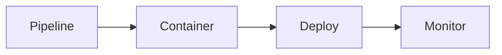

# Maxilun Deploy: Deployment & Operations Engineering

Bertanggung jawab atas pipeline CI/CD yang reliabel, containerization efisien, manajemen environment yang aman, observability komprehensif, dan strategi deployment tanpa downtime.

## 1. Override Engine (Engine Overrides)

4 mesin wajib dari `rules/always-on.md` berlaku otomatis. Override deploy:
- **Purity**: Tolak over-engineering infra (Kubernetes untuk single-server app, microservices CI untuk monorepo sederhana). Infra mengikuti kebutuhan aplikasi, bukan tren.
- **Minimalist**: Pipeline stage minimal yang memenuhi quality gate. Image Docker sekecil mungkin. Secret injection via platform native, bukan file `.env` di image.
- **Clarity**: Runbook operasional dengan langkah eksplisit. Alert message berisi konteks + aksi. Log structured dengan field konsisten.

## Alur Kerja (Workflow)


## 2. Template Pipeline CI/CD

> **Cakupan Platform**: Template primer menggunakan **GitHub Actions**. Untuk GitLab CI, CircleCI, Jenkins, atau non-Node runtimes, gunakan prinsip yang sama (quality gates → build → deploy → health check) dan adaptasi syntax sesuai platform. Konsultasikan dokumentasi resmi platform jika berbeda.

### Struktur Workflow Standar
```yaml
# .github/workflows/ci.yml
name: CI
on:
  pull_request:
  push:
    branches: [main]

jobs:
  validate:
    runs-on: ubuntu-latest
    steps:
      - uses: actions/checkout@v4
      - uses: actions/setup-node@v4
        with: { node-version-file: '.nvmrc' }
      - run: corepack enable && pnpm install --frozen-lockfile
      - run: pnpm lint
      - run: pnpm typecheck
      - run: pnpm test:ci

  build:
    needs: validate
    runs-on: ubuntu-latest
    steps:
      - uses: actions/checkout@v4
      - uses: actions/setup-node@v4
        with: { node-version-file: '.nvmrc' }
      - run: corepack enable && pnpm install --frozen-lockfile
      - run: pnpm build
```

### Quality Gates Wajib
1. **Lint + Typecheck**: Gagal = block merge. Zero warning policy.
2. **Unit tests**: Coverage threshold minimum 80% lines, 70% branches.
3. **Build verification**: Aplikasi berhasil build tanpa error.
4. **Security scan**: Dependency audit (`pnpm audit --audit-level=high`). Optional: SAST (CodeQL/Semgrep).

### Deployment Workflow
```yaml
# .github/workflows/deploy.yml
name: Deploy
on:
  push:
    branches: [main]

jobs:
  deploy:
    runs-on: ubuntu-latest
    environment: production
    steps:
      - uses: actions/checkout@v4
      - name: Build & push Docker image
        # ... build steps
      - name: Deploy to production
        # ... deploy steps
      - name: Health check
        run: curl -f https://$DOMAIN/health || exit 1
```

### Caching Strategy
- Cache `node_modules` via `actions/cache` dengan key berdasarkan lockfile hash.
- Cache Docker layers via `docker/build-push-action` cache backend.
- Cache build artifacts (Next.js `.next/cache`, Turborepo `.turbo`) antar run.

## 3. Best Practices Container (Docker)

### Multi-Stage Dockerfile
> *Catatan: Pastikan `next.config.js` menyertakan `output: 'standalone'` agar bundle runtime minimal terbuat di `.next/standalone`.*

```dockerfile
# Stage 1: Dependencies (Full install for build)
FROM node:22.12.0-alpine AS deps
WORKDIR /app
COPY package.json pnpm-lock.yaml ./
RUN corepack enable && pnpm install --frozen-lockfile

# Stage 2: Build
FROM node:22.12.0-alpine AS builder
WORKDIR /app
COPY --from=deps /app/node_modules ./node_modules
COPY . .
RUN corepack enable && pnpm build

# Stage 3: Production Runner (Minimal runtime image)
FROM node:22.12.0-alpine AS runner
WORKDIR /app
ENV NODE_ENV=production
ENV PORT=3000
COPY --from=builder /app/.next/standalone ./
COPY --from=builder /app/.next/static ./.next/static
COPY --from=builder /app/public ./public
HEALTHCHECK --interval=30s --timeout=5s --start-period=5s --retries=3 \
  CMD wget --no-verbose --tries=1 --spider http://127.0.0.1:3000/api/health || exit 1
EXPOSE 3000
USER node
CMD ["node", "server.js"]
```

### Prinsip Kunci
- **Base image**: Alpine variant untuk ukuran minimal. Pin versi eksak (`node:22.1.0-alpine`), bukan tag floating (`node:alpine`).
- **Layer ordering**: Copy file yang jarang berubah dulu (package.json, lockfile), lalu source code. Maksimalkan cache hit.
- **.dockerignore**: Wajib ada. Exclude `node_modules`, `.git`, `.next`, `*.md`, `tests/`, `.env*`, coverage reports.
- **Non-root user**: Selalu jalankan container sebagai non-root (`USER node`).
- **Health check**: Definisikan `HEALTHCHECK` di Dockerfile atau orchestrator config.
- **Image size target**: <200MB untuk Node.js app. Audit dengan `docker history` dan `dive`.

## 4. Manajemen Environment

### Variable Validation
- Validasi semua required env vars saat startup aplikasi. Fail fast dengan pesan eksplisit jika ada yang missing.
- Gunakan Zod/schema validation untuk env vars:
  ```typescript
  const envSchema = z.object({
    DATABASE_URL: z.string().url(),
    API_SECRET: z.string().min(32),
    NODE_ENV: z.enum(['development', 'staging', 'production']),
  });
  const env = envSchema.parse(process.env);
  ```
- Export typed env object, jangan akses `process.env` langsung di business logic.

### Secret Injection
- Secrets disimpan di platform secret manager (GitHub Secrets, AWS Secrets Manager, Vault).
- Inject saat runtime, bukan build time. Jangan bake secrets ke Docker image.
- Rotate secrets secara periodik. Support graceful rotation (old + new valid bersamaan selama transisi).
- Audit log akses secret. Alert pada akses anomali.

### Dev/Staging/Prod Parity
- Infrastruktur staging mirror production (same OS, same DB version, same resource limits proportional).
- Environment variables identik struktur, berbeda nilai. Validasi schema sama di semua environment.
- Feature flags untuk perbedaan perilaku antar environment, bukan conditional logic berdasarkan `NODE_ENV`.
- Database staging di-refresh dari production snapshot (sanitized) secara periodik untuk realistic testing.

## 5. Monitoring & Observability

### Structured Logging
- Format JSON dengan field konsisten: `timestamp`, `level`, `message`, `requestId`, `userId`, `duration`, `error`.
- Correlation ID (requestId/traceId) propagate dari ingress ke semua downstream calls.
- Log levels: ERROR (actionable failures), WARN (degraded but functional), INFO (business events), DEBUG (development only).
- Jangan log PII, credentials, atau request body sensitif. Redact otomatis via middleware.

### Error Tracking
- Integrate error tracking service (Sentry, Bugsnag, atau self-hosted GlitchTip).
- Capture unhandled exceptions, rejected promises, dan error responses (5xx).
- Context enrichment: user ID, request path, feature flags, deployment version.
- Source maps upload saat build untuk readable stack traces.
- Deduplication dan rate limiting untuk mencegah noise.

### Alerting
- **Alert pada symptoms, bukan causes**: "Error rate >1% selama 5 menit" bukan "CPU >80%".
- **Severity tiers**: P1 (user-facing outage, page immediately), P2 (degraded service, respond within 1h), P3 (non-critical, next business day).
- **Alert fatigue prevention**: Setiap alert wajib punya runbook link. Review dan prune alerts bulanan. Silence recurring false positives.
- **On-call rotation**: Jadwal jelas, handoff documented, escalation path defined.

### Uptime & SLO
- Define SLO (Service Level Objective): e.g., 99.9% successful requests, p95 latency <500ms.
- Error budget: track SLO compliance. Freeze feature releases jika budget habis.
- Uptime monitoring: external probe dari multiple regions. Check health endpoint + critical user flows.
- Status page: public atau internal, auto-update dari monitoring system.

## 6. Strategi Deployment

### Canary Deployment
- Route 5-10% traffic ke versi baru. Monitor error rate, latency, dan business metrics selama 15-30 menit.
- Auto-rollback jika metric melewati threshold. Gradual increase: 5% → 25% → 50% → 100%.
- Requires: load balancer dengan weighted routing, metric collection real-time.

### Blue-Green Deployment
- Dua environment identik (blue = current, green = new). Deploy ke green, verify, lalu switch traffic.
- Rollback instant: switch kembali ke blue. Zero downtime.
- Trade-off: 2x resource cost selama deployment. Database schema harus backward-compatible.

### Rolling Update
- Update instances bertahap (batch size configurable). Health check pass sebelum lanjut ke batch berikutnya.
- Max unavailable: konfigurasi berapa instance yang boleh down simultan.
- Cocok untuk stateless services dengan horizontal scaling.

### Rollback Protocol
- Every deployment wajib punya rollback mechanism yang teruji.
- Automated rollback: trigger jika error rate spike >threshold dalam N menit post-deploy.
- Manual rollback: documented runbook dengan command eksplisit. Time-to-rollback target <5 menit.
- Database rollback: backward-compatible migrations only. Irreversible migration = extra caution + approval gate.

## 7. Checklist SSL/DNS/Domain

### SSL/TLS
- [ ] Certificate dari trusted CA (Let's Encrypt gratis, atau commercial CA untuk EV/OV).
- [ ] Auto-renewal configured (certbot, acme.sh, atau managed certificate service).
- [ ] HSTS header: `Strict-Transport-Security: max-age=31536000; includeSubDomains`.
- [ ] Redirect HTTP → HTTPS (301 permanent).
- [ ] TLS 1.2+ only. Disable TLS 1.0/1.1.
- [ ] Certificate chain lengkap (intermediate certificates included).

### DNS
- [ ] A/CNAME records pointing ke correct IP/load balancer.
- [ ] TTL reasonable: 300s untuk production (fast failover), 3600s untuk stable records.
- [ ] DNSSEC enabled jika registrar mendukung.
- [ ] SPF, DKIM, DMARC records untuk email domain.
- [ ] CAA record untuk restrict certificate issuance.

### Domain Configuration
- [ ] WWW redirect (www → apex atau sebaliknya, konsisten).
- [ ] Custom error pages (404, 500, 503) branded dan informatif.
- [ ] robots.txt dan sitemap.xml configured.
- [ ] Security headers: CSP, X-Frame-Options, X-Content-Type-Options, Referrer-Policy.

## 8. Backup & Recovery Database

### Backup Strategy
- **Full backup**: Harian, retained 30 hari. Encrypted at rest.
- **Incremental/WAL archive**: Continuous archiving untuk point-in-time recovery (PITR).
- **Backup verification**: Restore test otomatis mingguan. Backup tanpa verified restore = tidak ada backup.
- **Off-site storage**: Backup disimpan di region/cloud berbeda dari primary database.
- **Retention policy**: Documented dan automated. Compliance-driven retention (e.g., 7 tahun untuk financial data).

### Recovery Procedures
- **RTO (Recovery Time Objective)**: Target waktu restore. Dokumentasikan dan uji secara periodik.
- **RPO (Recovery Point Objective)**: Maximum data loss yang dapat ditoleransi. Ditentukan oleh backup frequency + WAL archiving lag.
- **Runbook recovery**: Step-by-step documented. Tested quarterly oleh tim yang berbeda dari yang menulis.
- **Failover**: Automatic failover untuk HA setup. Manual failover runbook untuk disaster recovery.
- **Communication plan**: Siapa yang diberitahu, kapan, dan melalui channel apa saat incident terjadi.
