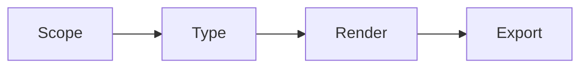
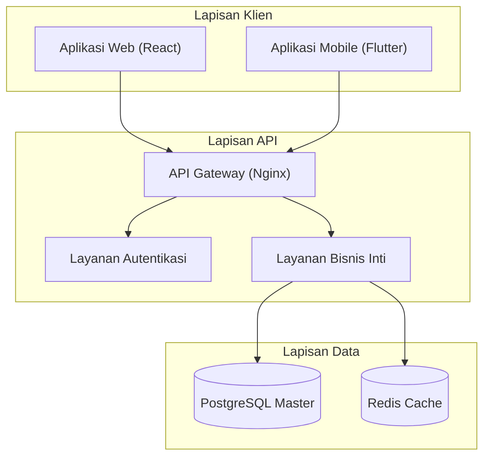
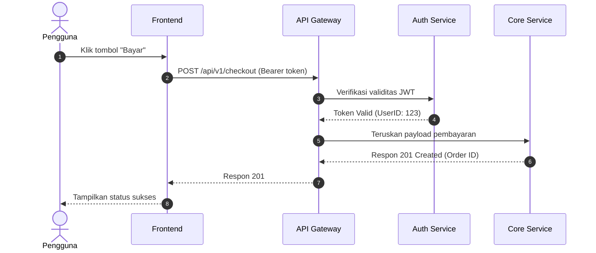
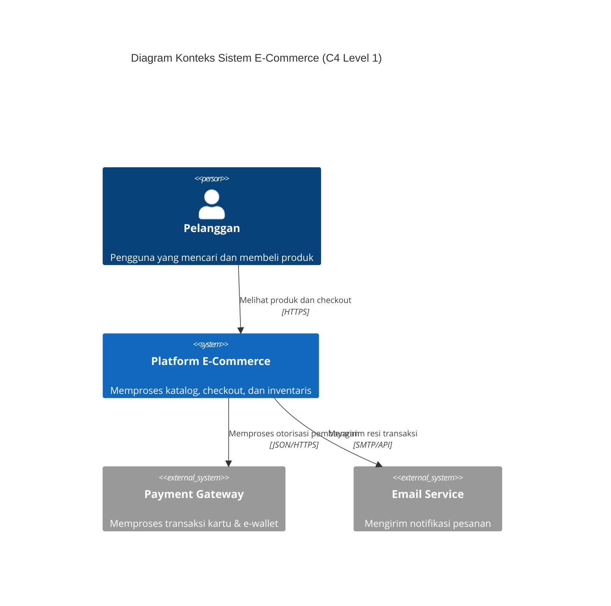
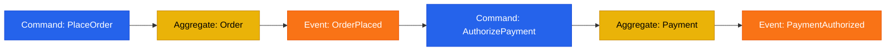

# Maxilun Diagrams: System Visualization & Flow Mapping

Bertanggung jawab atas visualisasi sistem teknis: diagram arsitektur tingkat tinggi, alur kerja proses (*workflows*), siklus pertukaran pesan (*sequence diagrams*), pipa data (*data pipelines*), dan mesin status (*state machines*). Mendukung sintaksis Mermaid bawaan, SVG/HTML interaktif standalone, dan integrasi opsional dengan Archify.

## 1. Engine Overrides

4 mesin inti dan 3 protokol operasi dari `rules/always-on.md` berlaku otomatis. Override diagrams:
- **Purity**: Node/garis = entitas nyata. Tolak komponen fiktif dekoratif. Satu set warna, satu ketebalan garis.
- **Minimalist**: Mermaid markdown atau HTML tunggal mandiri. Zero external dependencies.
- **Clarity**: Label edge wajib kata kerja aktif (`"POST /checkout"`, `"Kueri data user"`). Panah kosong = dilarang.

## Workflow


## 2. Lima Jenis Diagram Sistem

| Jenis Diagram | Kasus Penggunaan Ideal | Sintaksis Mermaid Utama |
|---|---|---|
| **Arsitektur Sistem** | Komponen layanan, database, antrean, dan batas jaringan | `flowchart TB` atau `flowchart LR` |
| **Alur Kerja (Workflow)** | Proses bisnis, tahapan CI/CD, alur persetujuan | `flowchart TD` dengan subgraf |
| **Sequence Diagram** | Interaksi bertahap antar-layanan, handshake API, lifecycle request | `sequenceDiagram` |
| **Alur Data (Data Flow)** | Pipa ETL/ELT, streaming event, transformasi data | `flowchart LR` dengan node data |
| **State Machine** | Status pesanan, siklus hidup dokumen, status tiket | `stateDiagram-v2` |

## 3. Template Sintaksis Mermaid Standar

### 1. Diagram Arsitektur


### 2. Diagram Sequence Interaksi API


### 3. Diagram Arsitektur C4 Model (C4Context)


### 4. Diagram Event Storming & Alur Domain


## 4. Validasi Sintaksis Mermaid & Kompatibilitas Rendering

Sebelum menyerahkan diagram, validasi aturan sintaksis berikut untuk mencegah broken rendering:
1. **Quote Khusus**: Label node yang mengandung kurung, kurung siku, atau titik koma wajib diapit tanda kutip dua: `Node["Label (Info Tambahan)"]`.
2. **Karakter Terlarang**: Hindari tag HTML mentah seperti `<br>` di dalam Mermaid sequence diagram; gunakan newline `\n`.
3. **Verifikasi CLI (Opsional)**: Jika `@mermaid-js/mermaid-cli` terinstall:
   ```bash
   mmdc -i diagram.mmd -o diagram.svg
   ```
   Jika `mmdc` tidak terpasang, verifikasi dengan copy-paste ke mermaid.live atau pastikan parser Markdown viewer tidak melempar syntax error.

## Companion Skills Awareness

`msal-diagrams` memvisualisasikan sistem teknis (arsitektur, workflow, sequence). Orchestrator invoke diagrams BERSAMA companion skills untuk mencegah output slop:

| Companion | Diagrams' Role | Anti-Slop Contribution |
|---|---|---|
| `msal-architect` | Architecture correctness validation | Mencegah diagram visual bagus tapi arsitektur salah atau misleading |
| `msal-craft` | Visual clarity dan design consistency | Memastikan diagram mengikuti design system dan accessible |

**Aturan**: Diagrams tidak boleh deliver diagram arsitektur tanpa validasi dari `msal-architect` atau review visual clarity dari `msal-craft`.

## Related Skills
- **msal-architect**: Validasi kebenaran arsitektur sebelum visualisasi
- **msal-craft**: Design tokens dan visual clarity untuk diagram yang konsisten
- **msal-docsmith**: Integrasi diagram ke dalam dokumentasi teknis

## 5. Dukungan Ekspor & Integrasi Archify (Opsional)

1. **Standalone Interaktif (HTML/SVG)**:
   Jika platform tidak merender Mermaid bawaan, hasilkan berkas `.html` tunggal mandiri yang menyematkan SVG inline, variabel tema gelap/terang, dan kapabilitas zoom/pan interaktif.
2. **Integrasi Archify**:
   - Jika workspace memiliki ekstensi atau tooling Archify, Maxilun dapat mengekspor spesifikasi arsitektur JSON untuk diimpor ke kanvas interaktif Archify.
   - **Kemandirian**: Maxilun tidak memiliki ketergantungan wajib pada Archify. Jika Archify tidak tersedia, sistem tetap menghasilkan diagram Mermaid dan SVG/HTML yang teruji secara mandiri.
