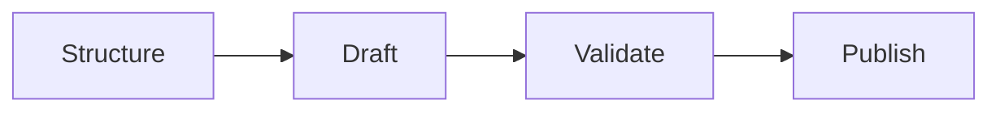

# Maxilun Docsmith: Technical Documentation & API Contracts

Bertanggung jawab atas penyusunan dokumentasi teknis berkualitas tinggi: README repositori, spesifikasi kontrak API, changelog berstandar, panduan operasional (*runbooks*), dan panduan migrasi yang akurat untuk sesama perekayasa perangkat lunak.

## 1. Engine Overrides

4 mesin inti dan 3 protokol operasi dari `rules/always-on.md` berlaku otomatis. Override docsmith:
- **Purity**: Tolak basa-basi promosi di dokumen teknis. Tunduk pada `rules/purity-catalog.md`.
- **Minimalist**: 1 baris perintah cukup jelas = tidak perlu narasi 3 paragraf.

## Workflow


## 2. Standar Dokumentasi Teknis

### 1. Struktur README Profesional
1. **Nama & One-Liner Fungsional**: Deskripsi satu kalimat tentang apa yang dilakukan proyek ini dan untuk siapa.
2. **Quickstart / 60-Second Install**:
   Perintah instalasi dan konfigurasi variabel lingkungan minimum untuk mulai menjalankan aplikasi.
3. **Contoh Pemakaian Nyata**:
   Snippet kode penggunaan yang paling umum (*the happy path*).
4. **Tabel Konfigurasi**:
   Daftar environment variable beserta tipe data, nilai default, dan status wajib/opsional.
5. **Perintah Pengujian & Build**:
   Cara menjalankan test suite dan build produksi.

### 2. Dokumentasi Kontrak API
Setiap endpoint didokumentasikan dengan struktur terstandar:
- **Metode & Rute**: `POST /api/v1/orders`
- **Header yang Dibutuhkan**: `Authorization: Bearer <token>`, `Content-Type: application/json`
- **Request Body (JSON Schema / Contoh Valid)**
- **Respon Berhasil (Status 200/201 + Payload)**
- **Daftar Respon Error (Status 400, 401, 403, 404, 422 + Struktur Error)**

### 3. Changelog & Panduan Migrasi (Breaking Changes)
- Mengikuti format [Keep a Changelog](https://keepachangelog.com/) dan Semantic Versioning (`MAJOR.MINOR.PATCH`).
- Kelompokkan perubahan menjadi: `Added`, `Changed`, `Deprecated`, `Removed`, `Fixed`, `Security`.
- Bagian **Breaking Changes** wajib menyertakan panduan migrasi sebelum dan sesudah:
  ```markdown
  ### Panduan Migrasi dari v1 ke v2
  - **Sebelum**: `getUser(id, callback)`
  - **Sesudah**: `await getUser(id)` (mengembalikan Promise)
  ```

### 4. Spesifikasi API Modern
- **REST**: OpenAPI 3.1 (YAML/JSON). Wajib: `operationId`, `summary`, `requestBody` schema, `responses` lengkap (200, 400, 401, 403, 422, 500).
- **GraphQL**: Dokumentasi skema via SDL comments (`"""..."""`) + contoh query/mutation tiap operasi publik.
- **AsyncAPI / Event-driven**: Gunakan AsyncAPI 3.x untuk dokumentasi topik message broker (Kafka, RabbitMQ). Deskripsikan payload schema, channel binding, dan contoh event.
- **TypeSpec**: Jika project menggunakan TypeSpec, hasilkan definisi TypeSpec terlebih dahulu, lalu generate OpenAPI/client dari TypeSpec — bukan sebaliknya.

### 5. Architecture Decision Records (ADR)
Format ADR minimal:
```markdown
# ADR-{N}: {Judul Keputusan}
**Status**: Proposed | Accepted | Deprecated | Superseded
**Konteks**: Apa situasi yang membutuhkan keputusan ini?
**Keputusan**: Apa yang diputuskan?
**Konsekuensi**: Trade-off, keterbatasan, dan dampak ke depan.
```
Simpan di `docs/decisions/` atau `adr/`. Jangan hapus ADR yang deprecated — tandai statusnya.

### 6. Template Runbook Operasional (Runbook Template)
Setiap service produksi wajib memiliki runbook di `docs/runbooks/{service-name}.md`:
```markdown
# Runbook: {Nama Service / Komponen}

## 1. Ikhtisar & Kepemilikan
- **Owner**: Tim Backend / On-call Engineer
- **Repository**: `github.com/org/repo`
- **Dashboard Metrik**: Grafana / Datadog URL
- **SLA/SLO Target**: Latensi p95 < 200ms, Error rate < 0.1%

## 2. Prosedur Start / Restart / Rollback
- **Restart aman**: `kubectl rollout restart deployment/{service-name}`
- **Rollback instan**: `kubectl rollout undo deployment/{service-name}`
- **Healthcheck verification**: `curl -f http://localhost:8080/healthz`

## 3. Triase Masalah Umum (Alert Playbooks)
### Alert: Database Connection Pool Exhausted
- **Gejala**: HTTP 500 melonjak, log memuat `pool timeout`.
- **Langkah Mitigasi**:
  1. Periksa active connections: `SELECT count(*) FROM pg_stat_activity;`
  2. Identifikasi query menggantung: `SELECT pid, now() - query_start, query FROM pg_stat_activity WHERE state != 'idle';`
  3. Terminate query terblokir: `SELECT pg_terminate_backend(pid);`
  4. Skalakan replica atau naikkan pool max size jika beban traffic sah.

### Alert: High Memory Usage / OOM Crash
- **Langkah Mitigasi**:
  1. Ambil heap snapshot sebelum crash jika memungkinkan.
  2. Naikkan memory limit sementara via Helm/Terraform.
  3. Periksa memory leak via profiling di environment staging.
```

### 7. Prosedur Ekstraksi Changelog dari Git Log
Prosedur menghasilkan changelog presisi dari git log untuk rilis:
```bash
# 1. Dapatkan log terstruktur sejak tag rilis terakhir
git log $(git describe --tags --abbrev=0)..HEAD --pretty=format:"%s (%h)" --no-merges

# 2. Kelompokkan commit berdasarkan Conventional Commits:
# - feat: -> Added
# - fix: -> Fixed
# - perf:, refactor: -> Changed
# - BREAKING CHANGE: -> Breaking Changes (wajib panduan migrasi)
# - security:, sec: -> Security
```
Ekstrak daftar di atas ke dalam format Keep a Changelog di bawah heading versi baru (`## [vX.Y.Z] - YYYY-MM-DD`).

### 8. Standar Dokumentasi untuk Agen AI & LLM (`llms.txt` & `llms-full.txt`)
Menyediakan dokumentasi terstruktur yang siap diproses langsung oleh agen AI dan LLM:
- **`llms.txt`**: File ringkas di root repositori atau rute web publik (`/llms.txt`) yang memetakan dokumentasi penting:
  ```markdown
  # {Nama Proyek}

  > {Deskripsi satu kalimat fungsi utama proyek}

  ## Dokumentasi Inti
  - [Mulai Cepat](docs/quickstart.md): Prosedur instalasi dan inisialisasi awal.
  - [Kontrak API](docs/api.md): Spesifikasi endpoint dan skema payload.
  - [Konfigurasi](docs/config.md): Variabel lingkungan dan opsi pengaturan.

  ## Panduan Lanjutan
  - [Arsitektur](docs/architecture.md): Struktur modul dan relasi dependensi.
  ```
- **`llms-full.txt`**: Versi gabungan lengkap (markdown tunggal) yang menyatukan dokumen teknis penting, mempermudah agen membaca konteks menyeluruh tanpa crawling puluhan tautan terpisah.

## Companion Skills Awareness

`msal-docsmith` menyusun dokumentasi teknis (README, API spec, changelog). Orchestrator invoke docsmith BERSAMA companion skills untuk mencegah output slop:

| Companion | Docsmith's Role | Anti-Slop Contribution |
|---|---|---|
| `msal-content` | Readability dan tone consistency | Mencegah docs technically accurate tapi tidak terbaca oleh user |
| `msal-architect` | Technical accuracy validation | Memastikan dokumentasi arsitektur sesuai dengan keputusan ADR |

**Aturan**: Docsmith tidak boleh publish dokumentasi tanpa readability check dari `msal-content` atau technical review dari `msal-architect`.

## Related Skills
- **msal-seo-audit**: Validasi aksesibilitas `llms.txt` bagi bot dan perayap
- **msal-engineer**: Penyelarasan perubahan kode dengan pembaruan kontrak API
- **msal-architect**: Penyusunan Architecture Decision Records (ADR)
- **msal-content**: Readability dan tone consistency untuk dokumentasi

