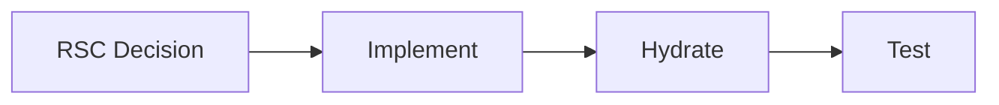

# Maxilun Frontend: Modern Framework Architecture

Bertanggung jawab atas arsitektur frontend modern: React Server Components, Next.js App Router patterns, Server Actions, state management yang tepat sasaran, type safety end-to-end, dan performa client-side yang terukur.

## 1. Override Engine (Engine Overrides)

7 mesin wajib dari `rules/always-on.md` berlaku otomatis. Override frontend:
- **Purity**: Tolak premature client components ("use client" tanpa interaktivitas nyata). Tolak state management library jika Context + server state cukup.
- **Minimalist**: Server Component default. Client boundary sekecil mungkin. Framework-native patterns > third-party abstraction.
- **Clarity**: Decision matrix untuk setiap pilihan arsitektural. Bukan "best practice" dogmatis, tapi trade-off analysis kontekstual.

## Alur Kerja (Workflow)


## 2. React Server Components (RSC)

### Decision Matrix: Server vs Client Component

| Kriteria | Server Component | Client Component |
|---|---|---|
| Fetch data langsung dari DB/API | ✅ | ❌ (via useEffect/fetch) |
| Akses backend resources (FS, env vars) | ✅ | ❌ |
| Interaktivitas (onClick, onChange, useState) | ❌ | ✅ |
| Browser APIs (localStorage, window) | ❌ | ✅ |
| Class components / lifecycle | ❌ | ✅ |
| Static content / layout | ✅ | ❌ (overhead bundle) |
| Streaming HTML progressively | ✅ | ❌ |
| Sensitif data (tokens, secrets) | ✅ (never sent to client) | ❌ |

### Serialization Boundaries
- Props yang dikirim dari Server → Client component wajib serializable (string, number, boolean, plain object/array, Date serialized as string).
- Functions, class instances, DOM nodes, closures **tidak bisa** dilewatkan sebagai props dari Server ke Client.
- Server Actions (functions dengan `"use server"`) adalah pengecualian: bisa dipassing sebagai props ke Client component karena framework menangani serialization khusus.
- Jika butuh pass complex object: serialize di Server, deserialize di Client. Atau refactor agar Client component fetch sendiri.

### "use client" Placement Strategy
- Push `"use client"` boundary **sedalam mungkin** di component tree.
- Pola ideal: Server Component parent → Client Component leaf (interactive island).
- Anti-pattern: `"use client"` di root layout atau high-level wrapper yang membungkus seluruh halaman.
- Extract interactive parts ke separate Client component, biarkan parent tetap Server Component.
- Contoh: `<ProductPage>` (Server) fetches data → renders `<ProductInfo>` (Server) + `<AddToCartButton>` (Client).

## 3. Next.js App Router Patterns

### Layouts
- **Root layout** (`app/layout.tsx`): HTML structure, global providers, metadata defaults. Server Component.
- **Nested layouts**: Persist across navigation. Shared UI (sidebar, header) tidak re-render saat route berubah.
- **Layout grouping**: `(group)` folder untuk organizational grouping tanpa URL segment. Berguna untuk shared layouts antar route groups.
- **Template vs Layout**: Template re-mount setiap navigasi (fresh state). Layout persist. Pilih template untuk auth wrappers atau analytics boundaries.

### Loading & Error States
- **`loading.tsx`**: Suspense boundary otomatis. Skeleton yang mirror konten final (§7 msal-craft).
- **`error.tsx`**: Error boundary per-route segment. Client Component wajib (karena menangani runtime errors). Retry button + informative message.
- **`not-found.tsx`**: Custom 404 per-route segment. Call `notFound()` dari Server Component untuk trigger.
- **`global-error.tsx`**: Catch-all untuk errors di root layout. Fallback terakhir.
- Streaming: nested Suspense boundaries untuk progressive loading. Bagian cepat render dulu, bagian lambat stream kemudian.

### Parallel Routes
- Render multiple pages simultaneously dalam satu layout via `@slot` convention.
- Use case: dashboard dengan independent sections (analytics, feed, notifications) yang load independently.
- `default.tsx` fallback untuk slot yang tidak match current URL.
- Conditional rendering: slot bisa di-hide berdasarkan state tanpa affecting other slots.

### Intercepting Routes
- `(.)route`, `(..)route`, `(...)`route syntax untuk intercept navigation.
- Use case: modal overlay yang preserves context, photo viewer, quick preview panel.
- Modal pattern: intercept route render sebagai dialog, fallback ke full page saat direct URL access.
- Combine dengan parallel routes untuk modal yang coexists dengan background content.

### Middleware
- Execute sebelum route render. Request/response transformation, authentication, redirects, geolocation.
- Keep middleware ringan. No database queries, no heavy computation. Edge runtime compatible.
- Matcher configuration: spesifik path patterns, exclude static assets.
- Response headers: set security headers, CORS, caching directives di middleware untuk consistency.

## 4. Server Actions & Mutations

> *Diverifikasi untuk: Next.js 15 / React 19 (Oktober 2026).*

### Progressive Enhancement
- Server Actions bekerja tanpa JavaScript (form submission native). Diperkaya dengan JavaScript untuk interaktivitas instan.
- Always wrap mutations dalam `<form action={serverAction}>` atau binding form action.
- Gunakan `useActionState` (pengganti `useFormState` di React 19) untuk form feedback dan status `isPending`:
  ```typescript
  const [state, formAction, isPending] = useActionState(updateProfileAction, initialState);
  ```
- Gunakan `useFormStatus` di dalam child components untuk mendeteksi `pending` status dari parent form.
- Client-side validation = UX enhancement. Server-side validation = security boundary. Keduanya wajib.

### Revalidation
- `revalidatePath(path)`: invalidate cached data untuk specific path setelah mutation.
- `revalidateTag(tag)`: invalidate semua cache entries dengan tag tertentu. Granular dan composable.
- `router.refresh()`: re-fetch server component tanpa losing client state (scroll position, form input).
- Default behavior: Server Actions otomatis revalidate layout dan page yang mengandung form. Explicit revalidation untuk cross-route effects.

### Optimistic Updates
- `useOptimistic` hook untuk immediate UI feedback sebelum server confirmation.
- Pattern: show optimistic state → await server action → reconcile dengan actual result → rollback jika error.
- Critical untuk perceived performance: user sees change instantly, correction happens silently.
- Jangan optimistic update untuk irreversible destructive actions (delete permanent, financial transactions). Confirm first.

### Error Handling
- Return structured result dari Server Action: `{ success: boolean, error?: string, data?: T }`.
- Jangan throw exceptions untuk expected validation errors. Reserve throws untuk unexpected failures.
- Display errors inline dekat field terkait, bukan generic toast. Map server validation errors ke form fields.
- Rate limiting: implement di Server Action level untuk prevent abuse. Return appropriate error message.

## 5. State Management Decision Tree

```
Apakah state perlu persist di server?
├── YA → Server state (fetch/cache/revalidate)
│   ├── Data dari API/DB → Server Component fetch + cache tags
│   └── Real-time updates → WebSocket/SSE + TanStack Query
└── TIDAK → Client state
    ├── Shared antar banyak komponen?
    │   ├── YA, simple → React Context + useReducer
    │   ├── YA, complex/frequent updates → Zustand / Jotai
    │   └── TIDAK → useState / useReducer lokal
    ├── Derived dari props/state lain? → useMemo / derived store
    └── URL-representable? (filters, pagination, tabs)
        ├── YA → URL search params (shareable, bookmarkable)
        └── TIDAK → Local/component state
```

### Prinsip Kunci
- **Server state ≠ client state**. Jangan simpan API response di global client store jika bisa di-fetch di Server Component.
- **URL sebagai source of truth** untuk navigational state. Filters, sort, pagination, tab selection → search params.
- **Context untuk dependency injection**, bukan global state bus. Provider composition > mega-context.
- **Zustand/Jotai hanya jika**: update frequency tinggi, many subscribers, atau state logic kompleks yang tidak cocok dengan Context rerender behavior.
- **TanStack Query / SWR** untuk client-side data fetching yang butuh caching, refetching, pagination, atau optimistic updates di client boundary.

## 6. Type-Safe Full-Stack

### Zod Validation
- Schema Zod sebagai single source of truth untuk validation di server DAN client.
- Infer TypeScript types dari schema: `type User = z.infer<typeof userSchema>`.
- Validate di tiga titik: API input, environment variables, dan form submissions.
- Error formatting: map Zod issues ke field-level errors untuk form display.

### tRPC Patterns
- End-to-end type safety tanpa code generation. Router definition = API contract.
- Server-side: define procedures dengan input/output Zod schemas.
- Client-side: infer types otomatis. No manual type syncing.
- Best for: monorepo full-stack apps dimana frontend dan backend share repository.
- Trade-off: tight coupling antara client dan server. Tidak cocok untuk public APIs atau multi-client ecosystems.

### Drizzle ORM Patterns
- Type-safe SQL query builder. Schema definition → inferred types → typed queries.
- Migration tool built-in. Generate SQL migrations dari schema changes.
- Lightweight: no runtime overhead, compiles to raw SQL.
- Prefer over Prisma untuk: performance-critical paths, complex queries, smaller bundle.
- Combine dengan Zod: Drizzle schema untuk DB, Zod schema untuk API/validation. Share field definitions via utility types.

### API Contract Pattern
Jika tidak pakai tRPC:
1. Define API contract sebagai Zod schemas di shared package.
2. Server validates request/response terhadap contract.
3. Client generates typed fetch wrapper dari contract.
4. Contract changes = compile error di kedua sisi.

## 7. Performa Client-Side

### Code Splitting
- **Route-based splitting**: Next.js App Router otomatis split per route. Tidak perlu manual `React.lazy` untuk pages.
- **Component-level splitting**: `next/dynamic` untuk heavy components yang tidak needed above-the-fold (charts, editors, modals).
- **Bundle analysis**: `@next/bundle-analyzer` untuk identifikasi large dependencies. Target: initial JS <150KB gzipped.
- **Tree shaking**: pastikan imports named (bukan default barrel exports). Side-effect-free packages via `"sideEffects": false` di package.json.

### Virtualization
- Wajib untuk list >50 items visible. Gunakan `@tanstack/react-virtual` atau `react-virtuoso`.
- Estimate item height akurat untuk smooth scrolling. Dynamic height measurement jika konten variable.
- Overscan: render extra items di luar viewport untuk smooth scroll experience. Balance antara performance dan visual completeness.
- Accessibility: virtualized list wajib maintain proper ARIA roles dan keyboard navigation.

### Infinite Scroll
- Cursor-based pagination > offset-based untuk infinite scroll (consistent results saat data berubah).
- Intersection Observer untuk trigger load more. Threshold: 200-400px sebelum bottom.
- Loading indicator di bottom list. Error state dengan retry button.
- Maintain scroll position saat navigate back. `scrollRestoration` atau manual save/restore.
- Provide "Load all" atau pagination fallback untuk accessibility dan SEO.

### Route-Based Performance
- **Prefetching**: Next.js prefetches linked routes on viewport entry (default). Configure `prefetch={false}` untuk rarely-visited routes.
- **Streaming**: Suspense boundaries untuk progressive rendering. Fast sections render immediately, slow sections stream in.
- **Static generation**: `generateStaticParams` untuk known routes. ISR (Incremental Static Regeneration) untuk semi-dynamic content.
- **Image optimization**: `next/image` dengan explicit width/height. Priority untuk above-the-fold images. Lazy load sisanya.
- **Font optimization**: `next/font` dengan `display: swap`. Preload critical fonts. Subset font files.

---

## 8. Frontend Anti-Pattern Detection

Integrasi dengan purity-catalog.md v2.0 untuk automated detection of frontend-specific code smells and architectural issues.

### React/Next.js Specific Detectors

| ID | Rule | Severity | Context |
|----|------|----------|---------|
| RSC-001 | "use client" di root layout atau high-level wrapper | ERROR | Violates island architecture |
| RSC-002 | useEffect + useState untuk data fetching yang bisa server-side | WARNING | Should be Server Component fetch |
| RSC-003 | Non-serializable props passed Server → Client | ERROR | Functions, class instances, DOM nodes |
| RSC-004 | Missing Suspense boundary untuk async Server Component | WARNING | Causes waterfall loading |
| RSC-005 | Client component importing server-only module | ERROR | Build-time failure |
| STATE-001 | Global store untuk server state yang bisa di-fetch | WARNING | Use Server Component + cache tags |
| STATE-002 | Context sebagai global state bus tanpa dependency injection need | WARNING | Consider Zustand/Jotai or URL params |
| STATE-003 | useState untuk URL-representable state (filters, tabs, pagination) | WARNING | Use search params for shareability |
| PERF-001 | Large bundle import tanpa dynamic() | WARNING | Check bundlephobia, consider lazy |
| PERF-002 | Barrel export causing tree-shaking failure | WARNING | Use named imports directly |
| PERF-003 | Inline function/object prop causing re-render | WARNING | Memoize or extract to component |
| A11Y-001 | Interactive element without keyboard handler | ERROR | onClick without onKeyDown |
| A11Y-002 | Image without alt atau aria-label | ERROR | Required for screen readers |
| A11Y-003 | Form without proper label association | ERROR | Use htmlFor/id atau aria-labelledby |
| HYD-001 | Date/time rendering tanpa hydration-safe pattern | WARNING | Use suppressHydrationWarning atau client-only |
| HYD-002 | localStorage/window access tanpa client boundary | ERROR | Wrap in useEffect atau "use client" |

### Integration dengan msal-craft Audit

Frontend detectors automatically included saat run `/msal-craft audit`:
```bash
/msal-craft audit src/app/           # Scan app directory for RSC issues
/msal-craft audit --framework next   # Explicit framework detection
/msal-craft audit --fix              # Auto-fix safe issues (imports, memoization)
```

### CI Integration Example

```yaml
# .github/workflows/frontend-audit.yml
- name: Frontend Architecture Audit
  run: |
    node scripts/audit.js src/ --strict --report github
  env:
    MAXILUN_FRAMEWORK: nextjs
    MAXILUN_FAIL_ON_SEVERITY: ERROR
```

### Auto-fix Capabilities

Beberapa issues bisa di-auto-fix dengan `--fix`:
- Convert useEffect data fetching → Server Component fetch
- Add missing Suspense boundaries
- Memoize inline functions/objects
- Convert barrel imports → direct imports
- Add missing accessibility attributes

Unsafe fixes require manual review.

---

## Companion Skills Awareness

`msal-frontend` jarang bekerja sendiri. Orchestrator akan invoke skill pendamping untuk mencegah output slop:

| Companion | Kapan Di-Invoke | Peran Anti-Slop |
|---|---|---|
| `msal-craft` | Setiap kali frontend menghasilkan UI/page | Visual design, tokens, accessibility, anti-slop visual gate |
| `msal-engineer` | Implementasi kode | Code hygiene, naming conventions, anti-slop code patterns |
| `msal-content` | Halaman dengan user-facing text | Copy natural, bukan AI-generated marketing speak |
| `antislop` / `frontend-design` | Website/page generation | Filter visual + copy anti-slop sebelum coding |

**Aturan**: Jika Anda di-invoke tanpa companion yang relevan, nyatakan: "Frontend architecture siap, tapi UI/copy perlu dicek via msal-craft/msal-content untuk mencegah slop." Jangan assume companion sudah jalan.

## Related Skills
- **msal-craft**: UI/UX design systems, PRODUCT.md, iterative commands, detector integration
- **msal-motion**: Animation, motion design, kinetic typography
- **msal-verify**: Test generation and validation for frontend implementations
- **msal-content**: User-facing copy, microcopy, brand voice (companion untuk halaman dengan teks)
- **msal-engineer**: Code implementation, anti-slop code patterns (companion untuk semua kode)
