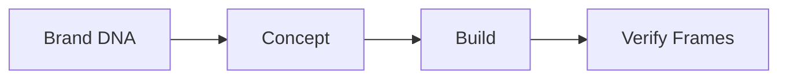

# Maxilun Motion — Motion Design Specialist

## 1. Override Engine (Engine Overrides)

Skill ini beroperasi **delta-only** terhadap `rules/always-on.md`. Semua aturan global Maxilun berlaku penuh. Override spesifik motion:

- **Purity Gate Wajib**: Setiap elemen animasi HARUS lolos Purpose Gate sebelum di-render. Tidak ada decorative-only animation.
- **Performance**: Untuk animasi interaktif, targetkan gerak yang mulus pada perangkat sasaran dan ukur performa bila tooling tersedia. Jangan mengklaim automatic LOD atau batas GPU ditegakkan tanpa implementasi nyata.
- **Accessibility First**: `prefers-reduced-motion` BUKAN afterthought — baked into setiap keyframe definition.
- **Output Scope**: Hasilkan runtime atau format yang diminta saja. HTML interaktif, Lottie, dan SVG adalah target Motion; hasil video akhir berada di lingkup CineCode.
- **Brand Context**: Gunakan design token `msal-craft` jika tersedia. Jika tidak, ikuti brief atau gaya proyek yang ada; jangan membuat token dependency baru tanpa kebutuhan.

Referensi aturan lengkap: baca `rules/always-on.md`, `rules/purity-catalog.md`.

## Alur Kerja (Workflow)


---

## 2. Filosofi Motion Design (Motion Design Philosophy)

### Apa yang MEMBEDAKAN Maxilun Motion dari Slides/PPT/Bang-Motion

| Aspek | Slide/PPT | Bang-Motion | Maxilun Motion |
|-------|-----------|-------------|----------------|
| Output | Static slides | Single HTML | Interactive HTML + Lottie/SVG assets |
| Motion Model | Fade/slide transitions | GSAP easing curves | Physics-based spring dynamics |
| Responsiveness | None | Basic viewport | Per-viewport choreography |
| Accessibility | Manual | Afterthought | Baked-in reduced motion |
| Performance | N/A | Basic viewport | Targeted to interactive runtime and device |
| Audio | Background music | Voice-over sync | Beat detection + waveform reactive |
| Reusability | Copy-paste | Monolithic | Composable motion components |
| Brand Integration | Manual colors | Style brief | Auto-derived from design tokens |
| Narrative | Linear slides | Linear timeline | Multi-scene graph with transitions |
| Export | PPTX/PDF | MP4 via Puppeteer | Lottie / Animated SVG / browser-ready assets |

### Prinsip Inti (Core Principles)

1. **Motion = Communication**: Animasi adalah bahasa, bukan dekorasi. Setiap gerak menyampaikan informasi.
2. **Physics Over Easing**: Spring dynamics, inertia, friction > cubic-bezier curves. Gerak terasa natural, bukan mekanis.
3. **Token-Driven**: Spacing scale → timing scale. Brand color → motion accent. Typography weight → kinetic intensity.
4. **Composable Primitives**: Reveal, morph, orbit, cascade — building blocks yang bisa dikombinasikan seperti LEGO.
5. **Performance is Feature**: Tetapkan target sesuai runtime dan perangkat. Ukur bila tooling tersedia; jangan menjanjikan mekanisme optimasi yang belum ada.
6. **Accessible by Default**: Reduced motion bukan mode terpisah — itu variant dari setiap animasi.

---

## 3. Pipeline Brand DNA → Motion DNA

### Sumber Input (Input Sources)

```
msal-craft design tokens
├── colors.primary      → motion accent hue, particle tint
├── colors.secondary    → secondary motion layer
├── spacing.scale       → timing multiplier (base: 100ms × spacing unit)
├── typography.weight   → kinetic intensity (bold = punchy, light = fluid)
├── typography.family   → text animation style (serif = elegant reveal, sans = snappy)
├── borderRadius        → motion curvature (sharp = linear, rounded = elastic)
└── shadows             → depth layering in 3D scenes
```

### Proses Ekstraksi (Extraction Process)

1. **Parse Tokens**: Baca `design-tokens.json` atau CSS variables dari msal-craft output.
2. **Map to Motion Parameters**:
   - `spacing.sm` (8px) → `timing.fast` (80ms)
   - `spacing.md` (16px) → `timing.normal` (160ms)
   - `spacing.lg` (32px) → `timing.slow` (320ms)
   - `colors.primary.hsl.h` → `accentHue` for particles/glows
   - `typography.weight ≥ 700` → `kineticMode: 'punch'`
   - `borderRadius ≥ 12` → `springConfig: { stiffness: 120, damping: 14 }`
3. **Generate Motion DNA Profile**: JSON object berisi semua derived parameters.
4. **Validate Against Purity Catalog**: Pastikan tidak ada parameter yang melanggar purity rules.

### Output: Profil Motion DNA (Motion DNA Profile)

```json
{
  "brandName": "ClientX",
  "motionPersonality": "confident-fluid",
  "timingScale": { "fast": 80, "normal": 160, "slow": 320, "dramatic": 640 },
  "springDefaults": { "stiffness": 140, "damping": 16, "mass": 1 },
  "accentHue": 220,
  "kineticMode": "punch",
  "particleTint": "hsla(220, 80%, 60%, 0.6)",
  "depthLayers": 3,
  "reducedMotionVariant": "opacity-crossfade"
}
```

---

## 4. Sistem Style — 12+ Arah Style (Style System)

Setiap style memiliki **motion signature** unik (bukan hanya visual aesthetic):

| # | Style | Motion Signature | Best For |
|---|-------|------------------|----------|
| 1 | **Kinetic Minimal** | Snap-to-grid, zero overshoot, monochrome pulse | Tech SaaS, fintech |
| 2 | **Fluid Organic** | Continuous sine waves, liquid morphing, no hard cuts | Wellness, nature brands |
| 3 | **Architectural** | Parallax depth planes, structural reveals, grid-aligned | Real estate, architecture |
| 4 | **Neon Pulse** | Beat-synced glow, chromatic aberration on impact | Gaming, nightlife, music |
| 5 | **Paper Craft** | Fold/unfold physics, shadow-driven depth, tactile stops | Education, children's brands |
| 6 | **Data Flow** | Particle streams along paths, node activation cascades | Analytics, dashboards |
| 7 | **Cinematic Noir** | Slow dolly, film grain overlay, dramatic spotlight reveals | Luxury, fashion, film |
| 8 | **Retro Future** | CRT scan lines, glitch transitions, analog synth timing | Creative agencies, events |
| 9 | **Glass Morphic** | Frosted blur transitions, refraction shifts, floating layers | Modern apps, glass UI |
| 10 | **Brutalist Motion** | Hard cuts, oversized type slams, raw grid exposure | Streetwear, activism |
| 11 | **Celestial** | Orbital mechanics, star field parallax, gravitational lensing | Science, space, education |
| 12 | **Micro Interaction** | Sub-100ms feedback loops, haptic-mapped springs, state morphs | Product UI, component libs |
| 13 | **Narrative Scroll** | Scroll-linked timeline, chapter markers, persistent subject | Long-form storytelling |
| 14 | **Generative Field** | Noise-driven particle fields, emergent patterns, seed-controlled | Art installations, generative branding |

### Alur Pemilihan Style (Style Selection Workflow)

1. Extract Brand DNA (Section 3)
2. Match personality to style signature matrix
3. Present top 3 recommendations dengan motion preview description
4. User approves atau custom hybrid
5. Lock style sebagai constraint untuk seluruh project

---

## 5. Menu Konsep — 20+ Konsep Opener/Promo (Concept Menu)

### Opener (3-5 Detik Pertama)

1. **Logo Assembly** — Parts converge via physics simulation
2. **Type Reveal** — Character-by-character with scramble decode
3. **Portal Wipe** — Circular iris expanding from center point
4. **Depth Charge** — Camera plunges through layered planes
5. **Signal Lock** — Static/noise resolves into clear image
6. **Ink Bloom** — Fluid simulation spreading across canvas
7. **Grid Collapse** — Structured grid breaks into organic flow
8. **Light Trace** — Photon path drawing the first frame
9. **Morph Entry** — Abstract shape transforms into subject
10. **Stagger Cascade** — Sequential element activation wave

### Hook Promo/Explainer (Promo/Explainer Hooks)

11. **Problem Shatter** — Visual metaphor breaking apart
12. **Before/After Split** — Animated dividing line sweep
13. **Stat Explosion** — Numbers scaling with particle burst
14. **Testimonial Orbit** — Quotes rotating around product
15. **Feature Unfold** — Accordion-style spatial expansion
16. **Timeline March** — Progress indicator driving narrative
17. **Comparison Scale** — Balanced weighing animation
18. **Process Chain** — Connected node activation sequence
19. **Emotion Shift** — Color/expression transition mapping feeling
20. **Call-to-Action Pulse** — Rhythmic attention guide to CTA
21. **Social Proof Rain** — Falling/rising endorsement particles
22. **Guarantee Seal** — Stamp animation with satisfying impact

---

## 6. Style Explainer — 8+ Style (Explainer Styles)

Melebihi bang-motion's 6 styles:

1. **Whiteboard Evolved** — Hand-drawn aesthetic tapi dengan physics-based ink, eraser particles, dan smart zoom
2. **Isometric World** — 2.5D scene dengan consistent angle, clickable hotspots, depth-aware shadows
3. **Character Rigged** — Skeletal animation system, expression blendshapes, lip-sync ready
4. **Abstract Metaphor** — Shape language conveying concepts tanpa literal representation
5. **Screen Capture Enhanced** — Real screenshots dengan animated callouts, smooth scroll simulation, cursor guidance
6. **Data Visualization Narrative** — Charts yang animate as story beats, axis labels sebagai narration anchors
7. **Mixed Media Collage** — Photo/video/illustration/3D composite dengan unified motion language
8. **Interactive Branching** — Viewer-choice driven narrative, conditional scene graph, state persistence
9. **Documentary Pan** — Ken Burns effect pada steroids, parallax layers, focus rack transitions

---

## 7. Library Komponen Motion (Motion Component Library)

### Primitif Composable (Composable Primitives)

```typescript
// Contoh API surface — implementasi detail di references/motion-components.md
interface MotionComponent {
  id: string;
  type: 'reveal' | 'morph' | 'orbit' | 'cascade' | 'pulse' | 'scatter' | 'trace' | 'breathe';
  input: Record<string, any>;
  output: AnimationClip;
  compose(other: MotionComponent): CompositeMotion;
}
```

### Komponen Tersedia (Available Components)

| Component | Description | Composable With |
|-----------|-------------|-----------------|
| `Reveal` | Mask-based entrance (wipe, iris, dissolve) | All |
| `Morph` | Shape/path interpolation between states | Reveal, Scatter |
| `Orbit` | Circular/elliptical path following | Cascade, Pulse |
| `Cascade` | Staggered sequential activation | All |
| `Pulse` | Rhythmic scale/opacity oscillation | Orbit, Breathe |
| `Scatter` | Explosion/implosion particle distribution | Reveal, Morph |
| `Trace` | Path-following stroke animation | Reveal, Cascade |
| `Breathe` | Continuous subtle life-like motion | All |
| `Spring` | Physics-based position/scale response | All |
| `Drag` | Inertia-based follow with friction | Spring, Orbit |
| `Wave` | Sine/triangle propagation across elements | Cascade, Pulse |
| `Scramble` | Character shuffle decode effect | Reveal, Wave |

### Aturan Komposisi (Composition Rules)

- Max 3 components per element (prevent motion soup)
- Timing alignment via shared beat grid
- Conflict resolution: later component overrides earlier on same property
- Always test reduced-motion variant of composition

---

## 8. Sistem Timeline & Kamera (Timeline & Camera System)

### Editor Timeline Debug (Debug Timeline Editor)

Tool development bawaan (dihapus di production):

```
[▶ ⏸ ⏮ ⏭] [====●========○=========] [0:04.2 / 0:30.0] [1x | 0.5x | 2x]
─────────────────────────────────────────────────────────────────────
Scene: intro-logo    [████████░░░░░░░░░░░░]
Scene: problem       [░░░░░░░░████████░░░░]
Scene: solution      [░░░░░░░░░░░░░░░░████]
─────────────────────────────────────────────────────────────────────
Keyframes: ▼ LogoAssemble(0.0s) ▼ TypeReveal(2.1s) ▼ CameraPull(4.0s)
Markers:   ▲ Beat1(0.5s) ▲ Beat2(1.0s) ▲ Transition(3.8s)
```

Fitur:
- Scrub dengan real-time preview
- Keyframe markers dengan label
- Scene boundaries visualization
- Speed control (0.25x - 4x)
- Pause/resume tanpa state loss
- Keyboard shortcuts (Space, ←→, Home/End)

### Sistem Kamera (Camera System)

```typescript
interface CameraController {
  // Movement types
  dolly(target: Vec3, duration: number, easing: SpringConfig): void;
  pan(angle: number, duration: number): void;
  tilt(angle: number, duration: number): void;
  orbit(center: Vec3, radius: number, speed: number): void;
  
  // Advanced
  rackFocus(from: Element, to: Element, duration: number): void;
  shake(intensity: number, decay: number): void;
  handheld(drift: number, microJitter: number): void;
  
  // Scene graph integration
  lookAt(target: SceneNode, smooth: boolean): void;
  follow(target: SceneNode, offset: Vec3, lag: number): void;
}
```

### Graf Narasi Multi-Scene (Multi-Scene Narrative Graph)

```
[intro] ──transition:dissolve──→ [problem]
                                  │
                          transition:shatter
                                  │
                              [solution]
                             /          \
                   transition:unfold   transition:orbit
                         /                  \
                   [feature-a]          [feature-b]
                         \                  /
                          transition:merge
                                  │
                              [cta]
```

- Non-linear scene connections supported
- Transition types: dissolve, shatter, unfold, orbit, merge, wipe, morph
- Conditional branching berdasarkan user interaction atau data state
- Persistent subject tracking across scenes (anti-slide check)

---

## 9. Engine Kinetik Teks (Text Kinetics Engine)

### Tingkat Granularitas (Granularity Levels)

- **Per-Character**: Individual letter animation (scramble, bounce, fade, slide)
- **Per-Word**: Word-level emphasis (highlight, scale, color shift, underline draw)
- **Per-Line**: Line-level reveals (typewriter, curtain, wave, stagger)
- **Per-Block**: Paragraph/container level (container grow, border trace, background fill)

### Library Efek (Effects Library)

| Effect | Description | Parameters |
|--------|-------------|------------|
| `Scramble` | Random char shuffle → final text | speed, charset, resolveOrder |
| `Wave` | Sine displacement across chars | amplitude, frequency, phase |
| `Typewriter` | Sequential char appearance | speed, cursor, soundTrigger |
| `Elastic` | Spring-based position settle | stiffness, damping, stagger |
| `Glitch` | Brief corruption → clean | intensity, duration, interval |
| `Highlight` | Background sweep across words | color, direction, speed |
| `Split` | Chars separate then reunite | distance, axis, returnDelay |
| `Gradient` | Animated color flow through text | colors, angle, speed |
| `Morph` | Char shape interpolation | fromChar, toChar, duration |
| `Cascade` | Sequential activation wave | delay, direction, easing |

### Kepatuhan Aksesibilitas (Accessibility Compliance)

- Every text effect MUST have `prefers-reduced-motion` variant
- Reduced motion fallback: opacity crossfade atau instant display
- Never animate text that conveys critical information tanpa static fallback
- Reading order preserved dalam DOM meskipun visual order berbeda

---

## 10. Sistem Reaktif Audio (Audio Reactive System)

### API Deteksi Beat (Beat Detection API)

```typescript
interface AudioReactiveController {
  // Analysis
  detectBeats(audioBuffer: AudioBuffer): BeatMap;
  getFrequencyBands(): { bass: number; mid: number; treble: number };
  getWaveform(resolution: number): Float32Array;
  
  // Binding
  bindToBeat(callback: (beat: BeatEvent) => void): void;
  bindToFrequency(band: 'bass'|'mid'|'treble', callback: (value: number) => void): void;
  bindToAmplitude(callback: (rms: number) => void): void;
  
  // Sync
  syncTimelineToBPM(bpm: number): void;
  quantizeKeyframesToBeat(grid: '1/4'|'1/8'|'1/16'): void;
}
```

### Mode Visualisasi Audio (Audio Visualization Modes)

1. **Waveform Ribbon** — Frequency-mapped flowing ribbon
2. **Circular Spectrum** — Radial frequency bars
3. **Particle Field** — Amplitude-driven particle density/speed
4. **Typography Pulse** — Text scale/weight synced to bass
5. **Color Shift** — Hue/saturation mapped to frequency bands
6. **Geometry Morph** — Shape vertices displaced by waveform
7. **Grid Distortion** — Background grid warped by audio energy
8. **Light Flicker** — Illumination intensity following transients

### Sinkronisasi Voice-Over (Voice-Over Sync)

- Lip-sync ready timestamps
- Word-level timing markers
- Breath/pause detection untuk natural pacing
- Auto-adjust animation duration to VO length

---

## 11. Gate Performa & Aksesibilitas (Performance & Accessibility Gates)

### Panduan Pengukuran Performa

- Tentukan target berdasarkan runtime dan perangkat yang diminta. Untuk animasi real-time pada layar 60Hz, gunakan sekitar 16.7ms per frame sebagai acuan, bukan jaminan.
- Ukur frame time dan penggunaan resource dengan tooling yang benar-benar tersedia.
- Terapkan LOD atau fallback hanya jika mekanismenya ada dan bisa diubah dalam implementasi. Jangan mengklaim monitoring atau auto-scaling yang belum dibuat.
- Tetapkan batas GPU, partikel, dan draw call per proyek setelah mengetahui perangkat dan kompleksitas scene.

Contoh dashboard atau ambang angka bersifat ilustratif; tampilkan metrik hanya jika instrumen pengukurannya tersedia.

### Checklist Aksesibilitas (WAJIB)

- [ ] `prefers-reduced-motion` media query implemented untuk SETIAP animasi
- [ ] Reduced motion variant maintains information conveyance
- [ ] No seizure-triggering flash (>3 flashes/sec)
- [ ] Text remains readable selama animation
- [ ] Focus management correct untuk interactive animations
- [ ] Screen reader announcements synchronized dengan visual changes
- [ ] Color contrast maintained selama color-shifting animations
- [ ] Keyboard navigation works tanpa mouse-dependent motion cues

### Kepatuhan Purity Gate (Purity Gate Compliance)

Setiap motion element harus menjawab **YA** untuk minimal satu:

1. Does this motion convey information?
2. Does this motion guide attention to important content?
3. Does this motion provide feedback on user action?
4. Does this motion establish spatial/temporal relationship?
5. Does this motion reinforce brand personality (per DNA profile)?

Jika semua jawaban **TIDAK** → element DIHAPUS. Tidak ada exception.

---

## 12. Pipeline Export (Export Pipeline)

### Format yang Didukung (Supported Formats)

| Format | Use Case | Quality | Size | Notes |
|--------|----------|---------|------|-------|
| **HTML** | Browser playback, interactive | Full | Medium | Self-contained, responsive |
| **Lottie JSON** | App embedding, React Native | High | Small | Vector only, no 3D |
| **Animated SVG** | Web embedding, email-safe | High | Small | Limited filter support |
| **APNG** | Web, better than GIF | High | Large | Alpha support, limited browser |

### Konfigurasi Export (Export Configuration)

```typescript
interface ExportConfig {
  format: 'html' | 'lottie' | 'svg' | 'apng';
  resolution: { width: number; height: number };
  fps: number;
  quality: 'low' | 'medium' | 'high' | 'lossless';
  
  // Format-specific
  lottie?: { includeAssets: boolean; compress: boolean };
  // Accessibility
  includeReducedMotionVariant: boolean;
  generateStaticFallback: boolean;
}
```

### Export Batch (Batch Export)

Export hanya format yang diminta; jangan hasilkan varian tambahan secara default:

```bash
msal-motion export --formats lottie,svg --preset web-embed
```

Preset tersedia:
- `web-embed`: HTML + Lottie + Animated SVG
- `app-integration`: Lottie + Animated SVG + APNG
- `interactive`: HTML + format aset yang kompatibel dan diminta

---

## 13. Alur Kerja (Workflow)

### Fase 1: Penerimaan Brief (Brief Intake)

1. Kumpulkan kebutuhan animasi (runtime/durasi, pesan, audiens, target surface)
2. Identifikasi design token msal-craft yang ada (jika ada)
3. Tentukan format export utama
4. Tetapkan batasan performa (perangkat target, kondisi jaringan)

### Fase 2: Ekstraksi Brand DNA

1. Parse design token atau ekstrak dari brand assets
2. Hasilkan Profil Motion DNA (Bagian 3)
3. Validasi terhadap purity catalog
4. Presentasikan profil DNA untuk persetujuan

### Fase 3: Persetujuan Konsep (Concept Approval)

1. Rekomendasikan arah style berdasarkan kecocokan DNA (Bagian 4)
2. Usulkan konsep opener + style explainer (Bagian 5-6)
3. Buat brief motion (deskripsi teks + sketsa timing)
4. User menyetujui konsep SEBELUM coding dimulai

### Fase 4: Pembangunan (Build)

1. Setup struktur proyek dengan konfigurasi motion DNA
2. Implementasi scene graph dengan konsep yang disetujui
3. Komposisikan komponen motion (Bagian 7)
4. Integrasikan kinetik teks (Bagian 9)
5. Tambahkan reaktivitas audio jika berlaku (Bagian 10)
6. Konfigurasikan sistem kamera (Bagian 8)
7. Jalankan pengecekan gate performa secara berkelanjutan
8. Verifikasi kepatuhan aksesibilitas

### Fase 5: Verifikasi (Verify)

1. Uji pada viewport target (mobile/tablet/desktop)
2. Validasi perilaku prefers-reduced-motion
3. Cek kepatuhan budget performa
4. Verifikasi kepatuhan purity gate untuk SETIAP elemen
5. Uji pipeline export untuk semua format yang diminta
6. Cross-browser testing (Chrome, Firefox, Safari, Edge)

### Fase 6: Pengiriman (Deliver)

1. Hasilkan hanya format yang diminta dan didukung
2. Buat dokumentasi implementasi
3. Sediakan panduan integrasi untuk embedding Lottie/SVG
4. Sertakan snippet monitoring performa untuk production
5. Arsipkan proyek dengan source lengkap untuk iterasi masa depan

---

## 14. Standar Format Output (Output Format Standards)

### Output HTML

- File self-contained tunggal (inline CSS/JS) ATAU bundle modular
- GSAP + Three.js (untuk 3D) + custom physics engine
- Handling viewport responsif dengan choreography spesifik breakpoint
- Timeline debug bawaan (toggleable via parameter URL `?debug=true`)
- Overlay monitoring performa (mode dev saja)
- Stylesheet `prefers-reduced-motion` disertakan

### Output Lottie

- JSON kompatibel Bodymovin
- Aset ter-embed atau direferensikan (dapat dikonfigurasi)
- Hanya properti yang didukung expression
- Teruji dengan lottie-web, lottie-react-native, lottie-ios
- SVG statis fallback disertakan

### Integrasi ke Video

Motion dapat memberikan konsep gerak, storyboard, atau aset yang kompatibel untuk scene video. Jika deliverable akhirnya MP4/WebM/GIF, `msal-cinecode` menangani komposisi timeline, rendering, dan ekspor.

### Standar Kualitas Kode (Code Quality Standards)

- TypeScript strict mode
- ESLint + Prettier configured
- Unit tests untuk motion components
- Integration tests untuk scene transitions
- Performance regression tests
- Accessibility audit automated

---

## Direktori Referensi (References Directory)

File referensi masa depan akan ditempatkan di `skills/msal-motion/references/`:

- `references/motion-components.md` — Detailed API docs untuk setiap motion component
- `references/style-signatures.md` — Extended style direction specifications dengan code examples
- `references/export-presets.md` — Complete export preset configurations
- `references/audio-reactive-patterns.md` — Audio binding patterns dan visualization recipes
- `references/performance-tuning.md` — Advanced optimization techniques dan troubleshooting
- `references/accessibility-testing.md` — Comprehensive a11y testing procedures
- `references/physics-engine.md` — Spring dynamics configuration dan custom physics setup
- `references/text-kinetics-gallery.md` — Curated text animation examples dengan parameters
- `references/camera-choreography.md` — Camera movement patterns dan scene transition recipes
- `references/brand-dna-examples.md` — Real-world brand → motion DNA mapping case studies

Direktori ini akan diisi seiring kematangan skill. Untuk sekarang, semua pengetahuan terkandung dalam SKILL.md ini.

---

## Prompt Pola untuk Workflow Motion

Perintah berikut adalah contoh prompt untuk agen, bukan executable CLI yang disediakan skill ini. Gunakan workflow atau tool proyek yang benar-benar tersedia sebelum mengklaim proses build, export, verifikasi, atau benchmark telah berjalan.

```
msal-motion init                    # Setup project dengan DNA extraction
msal-motion brief                   # Interactive brief intake
msal-motion dna                     # Generate/refresh Motion DNA Profile
msal-motion concept <style>         # Generate concept proposal
msal-motion build                   # Build animation dari approved concept
msal-motion verify                  # Run all gates (perf, a11y, purity)
msal-motion export --format <html|lottie|svg|apng>   # Export aset interaktif/motion
msal-motion export --preset <name>  # Export menggunakan preset
msal-motion debug                   # Launch timeline editor
msal-motion benchmark               # Performance stress test
```

## Companion Skills Awareness

`msal-motion` menangani rancangan dan implementasi animasi interaktif/aset motion. Tidak ada companion wajib:

| Companion | Motion's Role | Anti-Slop Contribution |
|---|---|---|
| `msal-craft` | UX integration dan design tokens | Gunakan jika animasi merupakan bagian dari UI atau visual tokens/accessibility perlu dirancang. |
| `msal-frontend` | Framework integration (React/Next.js) | Gunakan jika perubahan menyentuh integrasi framework atau component lifecycle. |
| `msal-cinecode` | Rendering video final | Gunakan jika animasi Motion perlu menjadi bagian dari MP4/WebM/GIF yang dirender. |

Pilih companion hanya jika panduannya mengubah deliverable. Motion tidak merender video final; serahkan tahap itu ke CineCode bila diminta.

## Related Skills
- **msal-craft**: UI/UX, sistem desain token, dan aksesibilitas antarmuka
- **msal-cinecode**: Render final MP4/WebM/GIF dan pipeline video berbasis kode/data
- **msal-frontend**: React component integration dan Next.js optimization

---

*Maxilun Motion v1.1.0 — Motion design yang purposeful, performant, dan accessible. Bukan sekadar animasi, tapi komunikasi yang bergerak.*
