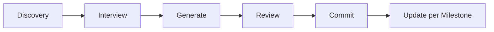
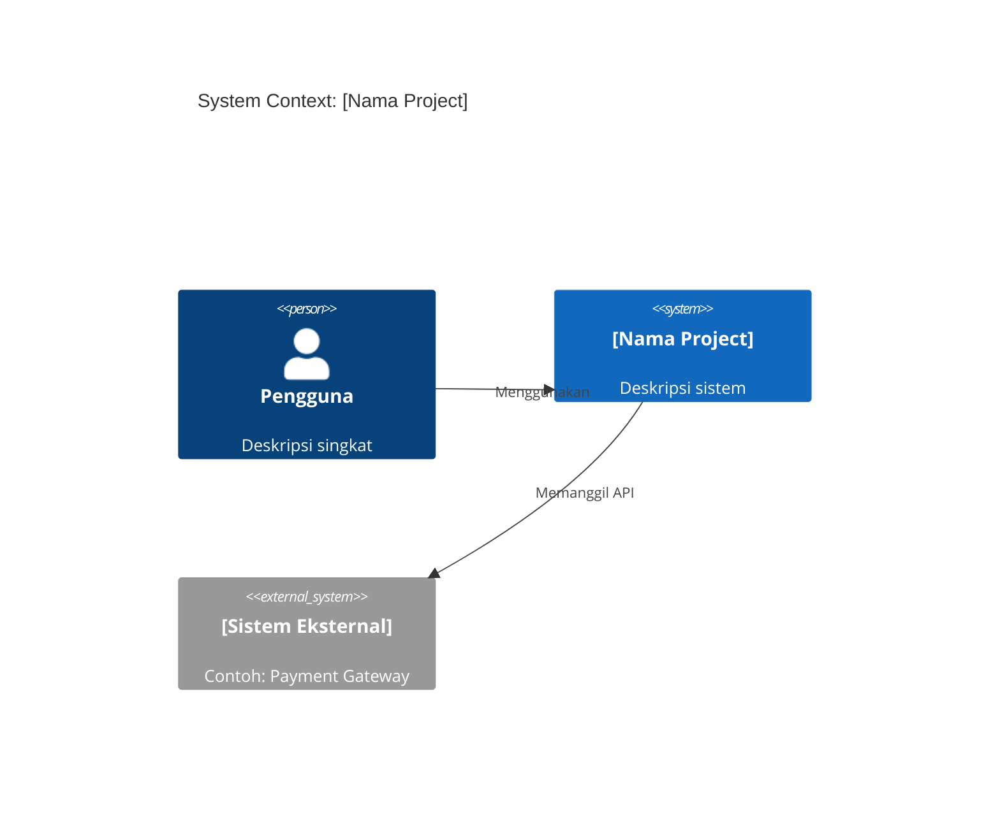
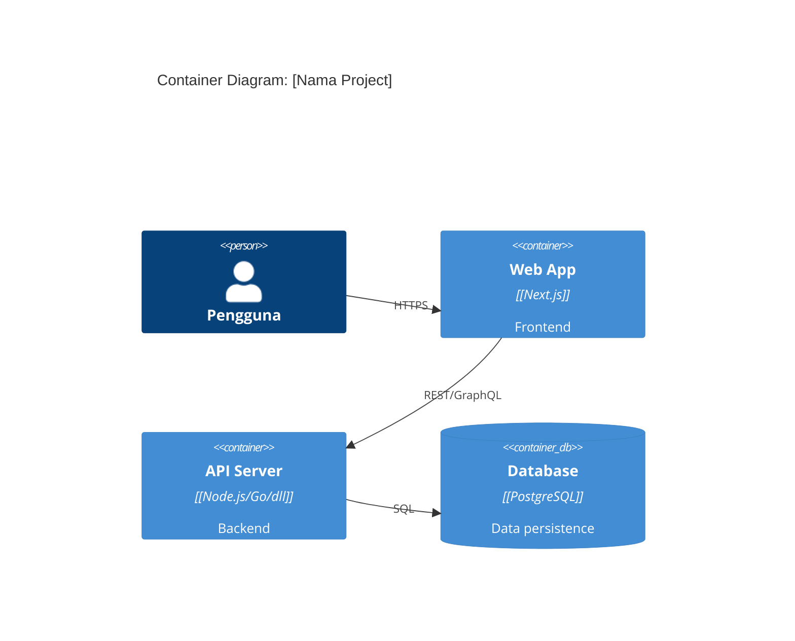

# Maxilun Scaffold: Project Context Generator

Menghasilkan satu set dokumen konteks project yang lengkap ke folder `docs/` sebelum coding dimulai. Dokumen ini menjadi **shared context** yang dibaca semua AI assistant — sehingga tidak perlu menjelaskan ulang stack, aturan, atau tujuan project setiap sesi baru.

## 0. Filosofi

> Kode yang baik dimulai dari konteks yang jelas. AI yang baik dimulai dari dokumen yang tepat.

Tanpa konteks tertulis, setiap AI session dimulai dari nol. Dengan `docs/` yang lengkap:
- AI langsung tahu stack, konvensi, dan batasan — tanpa tanya berulang
- Onboarding developer baru dari hari pertama
- Keputusan teknis terdokumentasi, bukan hilang di chat history
- Semua AI platform (Claude, Antigravity, Codex, Cursor, Grok, dll.) bekerja dari sumber yang sama

## 1. Engine Overrides

4 mesin inti dan 3 protokol operasi dari `rules/always-on.md` berlaku otomatis. Override scaffold:
- **Purity**: Dokumen yang dihasilkan harus berisi fakta konkret project ini — bukan template generik yang copy-paste dari mana saja. Placeholder yang masih terbuka harus memakai `[TBD: alasan]`; dalam mode cepat, gunakan `[TBD: perlu konfirmasi pengguna]` lalu rangkum pertanyaan yang belum terjawab.
- **Minimalist**: Tidak semua dokumen harus panjang. PRD 1 halaman lebih baik dari PRD 10 halaman yang tidak dibaca. Setiap bagian harus justify keberadaannya.
- **Clarity**: Gunakan `[CONFIRMED]` untuk fakta yang sudah dipastikan, `[TBD: alasan]` untuk hal yang belum diputuskan, dan `[ASSUMED]` untuk asumsi yang belum divalidasi.

## Workflow



## 2. Fase Discovery — Sebelum Generate

Sebelum menghasilkan dokumen apapun, scaffold wajib mengumpulkan konteks melalui:

### 2.1 Scan Otomatis (jika project sudah ada)
Baca file-file berikut jika tersedia:
- `package.json`, `pyproject.toml`, `go.mod`, `Cargo.toml`, `pom.xml` → stack detection
- `README.md`, `README*.md` → existing context
- `.env.example`, `docker-compose.yml` → infrastruktur
- `src/`, `app/`, `lib/` → struktur proyek
- Git log (5 commit terakhir) → momentum dan konteks terkini

### 2.2 Interview Adaptif
Hanya tanya informasi yang **tidak bisa disimpulkan** dari scan. Format pertanyaan:

```
📋 Saya akan generate 10 dokumen konteks di docs/. 
   Butuh beberapa info yang tidak bisa saya simpulkan dari codebase.
   
   1. Apa nama dan tujuan utama project ini? (1-2 kalimat)
   2. Siapa pengguna utamanya? (role/persona, bukan nama orang)
   3. Stack yang PASTI dipakai? (yang belum yakin, saya tandai [TBD])
   4. Ada batasan atau constraint khusus? (budget, timeline, compliance)
   5. Skill Maxilun mana yang akan aktif di project ini?
```

Jika sudah ada README yang jelas, lewati pertanyaan yang sudah terjawab.

### 2.3 Mode Cepat (`--quick`)
Jika user menambah flag `--quick` atau `cepat`, lewati interview — generate dokumen dengan placeholder `[TBD: perlu konfirmasi pengguna]` dan rangkum pertanyaan yang belum terjawab.

## 3. Output: 10 Dokumen di `docs/`

Semua dokumen digenerate ke folder `docs/` di root project. Jika folder belum ada, buat otomatis.

```
docs/
├── PRD.md            # Product requirements & user stories
├── TECHSTACK.md      # Stack, versi, rationale
├── DESIGN.md         # Visual direction & design tokens
├── SECURITY.md       # Threat model, auth, secrets policy
├── STYLEGUIDE.md     # Coding conventions & patterns
├── TASK.md           # Sprint tracker & backlog
├── ARCHITECTURE.md   # C4 L1/L2, module boundaries, ADR
├── SKILLS.md         # Maxilun skills aktif & command reference
├── GLOSSARY.md       # Domain terms & definisi bisnis
└── ONBOARDING.md     # Setup steps untuk developer/AI baru
```

---

## 4. Template Tiap Dokumen

### 4.1 PRD.md

```markdown
# PRD — [Nama Project]

> **Status**: [Draft | Active | Frozen]  
> **Last Updated**: YYYY-MM-DD  
> **Owner**: [nama/role]

## Ringkasan Satu Paragraf
[Jelaskan APA yang dibangun, UNTUK SIAPA, dan MENGAPA — max 3 kalimat]

## Problem Statement
[Masalah konkret yang diselesaikan. Bukan "meningkatkan efisiensi" — 
 tapi "pengguna kehilangan X menit per hari karena Y"]

## Target Pengguna
| Persona | Kebutuhan Utama | Pain Point |
|---|---|---|
| [Persona A] | ... | ... |
| [Persona B] | ... | ... |

## Fitur — MVP (Must Have)
- [ ] [Fitur 1]: [deskripsi + acceptance criteria]
- [ ] [Fitur 2]: [deskripsi + acceptance criteria]

## Fitur — Phase 2 (Should Have)
- [ ] [Fitur 3]

## Out of Scope (Tidak Dibangun)
- [X] [Fitur yang sengaja tidak dibangun + alasan]

## Success Metrics
| Metrik | Baseline | Target | Cara Ukur |
|---|---|---|---|
| [KPI 1] | [angka sekarang] | [angka target] | [tool/cara] |

## Constraints
- **Timeline**: [TBD]
- **Budget**: [TBD]
- **Compliance**: [GDPR / PCI-DSS / tidak ada]
- **Platform**: [Web / Mobile / API only]
```

---

### 4.2 TECHSTACK.md

```markdown
# TECHSTACK — [Nama Project]

> **Status**: [Proposed | Confirmed | Locked]  
> **Last Updated**: YYYY-MM-DD

## Stack Keputusan

| Layer | Teknologi | Versi | Alasan Dipilih | Alternatif Ditolak |
|---|---|---|---|---|
| **Frontend** | [Next.js / Vite / SvelteKit] | [14.x] | [alasan] | [apa yang ditolak + kenapa] |
| **Backend** | [Node.js / Go / Python / PHP] | [x.x] | [alasan] | ... |
| **Database** | [PostgreSQL / MySQL / MongoDB] | [x.x] | [alasan] | ... |
| **Auth** | [NextAuth / Auth.js / Lucia / custom] | [x.x] | [alasan] | ... |
| **ORM** | [Prisma / Drizzle / GORM / SQLAlchemy] | [x.x] | [alasan] | ... |
| **Styling** | [Vanilla CSS / Tailwind / CSS Modules] | [x.x] | [alasan] | ... |
| **Deployment** | [Vercel / Railway / VPS / AWS] | - | [alasan] | ... |
| **CI/CD** | [GitHub Actions / GitLab CI] | - | [alasan] | ... |
| **Testing** | [Vitest / Jest / Playwright] | [x.x] | [alasan] | ... |
| **Monitoring** | [Sentry / Datadog / self-hosted] | - | [alasan] | ... |

## Dependency Policy
- Node version minimum: `[x.x.x]` (lock via `.nvmrc` atau `engines` di `package.json`)
- Package manager: `[npm | pnpm | yarn | bun]`
- Update strategy: [patch auto / minor manual / major planned]
- Banned packages: [list package yang tidak boleh dipakai + alasan]

## Environment Variables
| Var | Scope | Deskripsi | Contoh Value |
|---|---|---|---|
| `DATABASE_URL` | server | Connection string DB | `postgresql://...` |
| `NEXTAUTH_SECRET` | server | Auth secret key | `openssl rand -base64 32` |
| `NEXT_PUBLIC_API_URL` | client | Base URL API publik | `https://api.domain.com` |

## Architectural Decisions (ADR Ringkas)
- **[YYYY-MM-DD]** Memilih [X] karena [alasan] → lihat `ARCHITECTURE.md#adr`
```

---

### 4.3 DESIGN.md

```markdown
# DESIGN — [Nama Project]

> **Status**: [Draft | Active]  
> **Last Updated**: YYYY-MM-DD  
> **Skill**: msal-craft (`/msal-craft`)

## Brand Identity
- **Nama**: [Nama Project/Brand]
- **Tagline**: [max 8 kata]
- **Kepribadian**: [Professional / Playful / Authoritative / Minimal]
- **Anti-vibe**: [Apa yang BUKAN brand ini]

## Color System (OKLCH)
```css
:root {
  /* Surface */
  --surface-base:    oklch([L]% [C] [H]);   /* [TBD] */
  --surface-card:    oklch([L]% [C] [H]);
  
  /* Text */
  --text-main:       oklch([L]% [C] [H]);
  --text-muted:      oklch([L]% [C] [H]);
  
  /* Brand */
  --brand-primary:   oklch([L]% [C] [H]);
  --brand-hover:     oklch([L]% [C] [H]);
  
  /* Status */
  --status-success:  oklch(60% 0.16 145);
  --status-danger:   oklch(58% 0.22 25);
  --status-warning:  oklch(72% 0.18 75);
  --status-info:     oklch(58% 0.18 250);
}
```

## Typography
- **Font Utama**: [Inter / Geist / Plus Jakarta Sans / TBD]
- **Font Mono**: [JetBrains Mono / Geist Mono / TBD]
- **Scale**: `12px → 14px → 16px → 18px → 24px → 32px → 48px`
- **Line height**: Heading `1.2`, Body `1.6`

## Spacing (4px Grid)
`4 → 8 → 12 → 16 → 24 → 32 → 48 → 64 → 96px`

## Komponen Kunci
- **Border radius**: [4px card / 8px input / 12px modal / full pill]
- **Shadow system**: [subtle / medium / elevated]
- **Animation duration**: [150ms micro / 250ms transition / 400ms modal]

## Dark Mode
- [ ] Dark mode didukung
- [ ] Menggunakan `prefers-color-scheme`
- [ ] Toggle manual tersedia
```

---

### 4.4 SECURITY.md

```markdown
# SECURITY — [Nama Project]

> **Status**: [Draft | Review | Approved]  
> **Last Updated**: YYYY-MM-DD  
> **Skill**: msal-sentinel (`/msal-sentinel`)

## Threat Model (STRIDE Ringkas)
| Ancaman | Vector | Mitigasi | Status |
|---|---|---|---|
| **Spoofing** | Token palsu / session hijack | JWT + httpOnly cookie + refresh rotation | [TBD] |
| **Tampering** | Parameter manipulation | Input validation + HMAC signing | [TBD] |
| **Information Disclosure** | Error leak / log PII | Generic error response + log sanitization | [TBD] |
| **Denial of Service** | Brute force / flood | Rate limiting + CAPTCHA | [TBD] |
| **Elevation of Privilege** | IDOR / broken authz | RBAC + ownership check per resource | [TBD] |

## Authentication
- **Metode**: [Session / JWT / OAuth2 / Passkeys / Magic Link]
- **Provider**: [Credentials / Google / GitHub / lainnya]
- **MFA**: [Tidak / TOTP / WebAuthn]
- **Session timeout**: [idle: Xmin / absolute: Xjam]
- **Password policy**: [min 8 char / bcrypt cost 12 / hibp check]

## Authorization
- **Model**: [RBAC / ABAC / flat permission]
- **Roles**: `[admin, user, guest, ...]`
- **Ownership rule**: [User hanya bisa akses resource miliknya sendiri]

## Secrets Management
- [ ] Semua secret di environment variable — tidak ada hardcode
- [ ] `.env` di `.gitignore`
- [ ] Secret rotation plan: [TBD]
- [ ] Secret scanning di CI: [GitHub secret scanning / Gitleaks / TBD]

## Input Validation
- Semua input divalidasi di server — client-side hanya UX
- Library: [Zod / Yup / Joi / class-validator / TBD]
- File upload: [tipe allowed, max size, scan virus]

## Data Privacy
- PII yang disimpan: [email, nama, ... — list lengkap]
- Retensi data: [X hari / sampai delete akun]
- Compliance: [GDPR / UU PDP Indonesia / tidak applicable]
- Right to erasure: [mekanisme hapus akun + data]

## Security Headers
```
Content-Security-Policy: [TBD]
X-Frame-Options: DENY
X-Content-Type-Options: nosniff
Referrer-Policy: strict-origin-when-cross-origin
Permissions-Policy: [TBD]
```

## Incident Response
- Contact: [email security / channel Slack]
- Disclosure policy: [koordinasi dulu / public setelah patch]
```

---

### 4.5 STYLEGUIDE.md

```markdown
# STYLEGUIDE — [Nama Project]

> **Last Updated**: YYYY-MM-DD  
> **Linting**: [ESLint / Biome / Ruff / golangci-lint / TBD]

## Naming Conventions

### File & Folder
```
components/UserProfile.tsx       # PascalCase untuk komponen
lib/formatDate.ts                # camelCase untuk utility
hooks/useAuth.ts                 # camelCase, prefix "use" untuk hooks
app/dashboard/page.tsx           # kebab-case untuk routes (Next.js)
```

### Variabel & Fungsi
```typescript
const userName = "..."           // camelCase
const MAX_RETRY = 3              // UPPER_SNAKE untuk konstanta
function getUserById(id: string) // verb + noun, camelCase
interface UserProfile { ... }    // PascalCase untuk tipe/interface
type UserId = string             // PascalCase untuk type alias
```

### Database
```sql
user_profiles     -- snake_case untuk tabel
created_at        -- snake_case untuk kolom
idx_users_email   -- prefix idx_ untuk index
```

## Code Structure

### Urutan Import (TypeScript/JavaScript)
```typescript
// 1. Node built-ins
import { readFile } from 'fs/promises'

// 2. External packages
import { z } from 'zod'

// 3. Internal absolute
import { db } from '@/lib/db'

// 4. Internal relative
import { formatDate } from './utils'

// 5. Types (terakhir)
import type { User } from '@/types'
```

### Aturan Fungsi
- Max 1 level of abstraction per fungsi
- Max 20 baris per fungsi (jika lebih → pecah)
- Satu fungsi = satu tanggung jawab
- Hindari boolean parameter → gunakan object options

### Error Handling
```typescript
// ✅ Baik: explicit error type
type Result<T> = { data: T; error: null } | { data: null; error: string }

// ❌ Hindari: throw di mana-mana tanpa boundary
```

## Komentar & Dokumentasi
- Komentar menjelaskan **MENGAPA**, bukan **APA** (kode sudah menjelaskan apa)
- JSDoc untuk fungsi publik yang di-export
- TODO wajib ada nama + tanggal: `// TODO(username, YYYY-MM-DD): deskripsi`
- Hapus kode yang di-comment-out sebelum merge — gunakan git history

## Git Conventions

### Branch Naming
```
feat/user-authentication
fix/login-redirect-loop
chore/update-dependencies
docs/api-documentation
```

### Commit Message (Conventional Commits)
```
feat: add OAuth2 Google login
fix: correct token expiry calculation
docs: update API endpoint reference
chore: upgrade Next.js to 14.2
refactor: extract auth middleware
test: add unit test for formatDate
```

### PR Rules
- Max 400 baris changed per PR (kecuali generated code)
- Wajib link ke issue/task
- Self-review sebelum request review
- Hapus branch setelah merge

## Yang Dilarang (Non-Negotiable)
- [ ] `any` type di TypeScript tanpa komentar justifikasi
- [ ] `console.log` di production code
- [ ] Secret hardcoded di kode
- [ ] Nested ternary lebih dari 1 level
- [ ] `// @ts-ignore` tanpa alasan
- [ ] Direct DOM manipulation di React component
```

---

### 4.6 TASK.md

```markdown
# TASK — [Nama Project]

> **Sprint**: [Sprint N | Milestone X.Y]  
> **Periode**: YYYY-MM-DD → YYYY-MM-DD  
> **Last Updated**: YYYY-MM-DD

## 🎯 Goal Sprint Ini
[Satu kalimat: apa yang harus selesai di akhir sprint ini]

## ✅ In Progress
- [ ] **[TASK-001]** [Deskripsi task] `@assignee` — _due: YYYY-MM-DD_
  - Sub-task: [langkah konkret]
  - Blocker: [apa yang menghambat, jika ada]

## 📋 Backlog (Prioritized)
- [ ] **[TASK-002]** [Deskripsi] — _Priority: High_
- [ ] **[TASK-003]** [Deskripsi] — _Priority: Medium_
- [ ] **[TASK-004]** [Deskripsi] — _Priority: Low_

## ✔️ Done (Sprint Ini)
- [x] **[TASK-000]** [Deskripsi] — _Selesai: YYYY-MM-DD_

## 🚫 Blocked
- **[TASK-00X]**: [alasan blocked] → [langkah untuk unblock]

## 📌 Notes & Decisions
- [YYYY-MM-DD] [Keputusan atau catatan penting sprint ini]

## Roadmap Milestone
| Milestone | Target | Status |
|---|---|---|
| v0.1 — MVP Auth | [TBD] | 🔄 In Progress |
| v0.2 — Core Feature | [TBD] | ⏳ Planned |
| v1.0 — Launch | [TBD] | ⏳ Planned |
```

---

### 4.7 ARCHITECTURE.md

```markdown
# ARCHITECTURE — [Nama Project]

> **Last Updated**: YYYY-MM-DD  
> **Skill**: msal-architect (`/msal-think`)

## C4 Level 1 — System Context



## C4 Level 2 — Container



## Module Boundaries

| Module | Tanggung Jawab | Boleh Import | Dilarang Import |
|---|---|---|---|
| `core/` | Business logic murni | Tidak ada dependency external | UI, framework |
| `api/` | HTTP handlers | `core/`, `lib/` | `components/` |
| `components/` | UI rendering | `lib/`, `types/` | `api/`, `core/` langsung |
| `lib/` | Shared utilities | Built-ins only | Module internal lain |

## Data Flow

```
User Request → [Middleware] → [Route Handler] → [Service Layer] → [Repository] → DB
                    ↓                ↓                  ↓
               [Auth Check]    [Validation]        [Business Logic]
```

## Architectural Decision Records (ADR)

### ADR-001: [Judul Keputusan]
- **Date**: YYYY-MM-DD
- **Status**: Accepted
- **Context**: [Situasi yang memaksa keputusan]
- **Decision**: [Keputusan yang diambil]
- **Consequences**: [Trade-off yang diterima]

## Known Constraints
- [Constraint teknis yang harus dihormati semua developer/AI]
- [Contoh: "Tidak boleh ada circular dependency antar module"]
```

---

### 4.8 SKILLS.md

```markdown
# SKILLS — [Nama Project]

> Maxilun skills yang aktif di project ini.  
> Semua command menggunakan prefix `msal-` untuk menghindari konflik.

## Skills Aktif

| Skill | Command | Kapan Digunakan |
|---|---|---|
| maxilun | `/maxilun` | Entry point. Jika bingung mulai dari sini |
| msal-engineer | `/msal-engineer` | Tulis kode, fix bug, refactor |
| msal-architect | `/msal-think` | Desain arsitektur, keputusan struktural |
| msal-craft | `/msal-craft` | UI/UX, design system, komponen |
| msal-sentinel | `/msal-sentinel` | Security review, auth, enkripsi |
| msal-insight | `/msal-insight` | Debug, profiling, root cause |
| msal-verify | `/msal-verify` | Testing, CI, build validation |
| msal-docsmith | `/msal-docsmith` | Dokumentasi teknis, README, API spec |
| msal-data | `/msal-data` | Database, schema, migration, query |
| msal-deploy | `/msal-deploy` | CI/CD, Docker, deployment |
| msal-frontend | `/msal-frontend` | Next.js, RSC, Server Actions |
| msal-knowledge-graph | `/msal-graph` | Peta dependensi kode sebelum edit |
| msal-scaffold | `/msal-scaffold` | Update docs/ ini saat milestone baru |

## Konvensi Project Ini

- **Sebelum edit kode**: Selalu jalankan `/msal-graph` untuk memetakan dependensi
- **Sebelum PR**: Jalankan `/msal-verify` untuk validasi
- **Untuk keputusan arsitektur baru**: Tulis ADR di `ARCHITECTURE.md`
- **Update docs ini**: Jalankan `/msal-scaffold --update` per milestone

## Konteks untuk AI

Membaca file ini? Ini ringkasan project:
- **Tujuan**: [Isi dari PRD.md]
- **Stack utama**: [Isi dari TECHSTACK.md]
- **Hal yang TIDAK boleh**: [Isi dari STYLEGUIDE.md bagian "Yang Dilarang"]
- **Status sekarang**: [Isi dari TASK.md bagian "In Progress"]
```

---

### 4.9 GLOSSARY.md

```markdown
# GLOSSARY — [Nama Project]

> Kamus istilah domain bisnis dan teknis yang digunakan di project ini.  
> Semua AI dan developer wajib menggunakan terminologi yang sama.

## Istilah Bisnis (Domain Language)

| Istilah | Definisi | Sinonim yang Dihindari |
|---|---|---|
| **[Istilah A]** | [Definisi presisi] | [Kata lain yang jangan dipakai] |
| **[Istilah B]** | [Definisi presisi] | ... |

_Contoh (hapus setelah diisi):_
| **Order** | Transaksi pembelian yang sudah dikonfirmasi pembayarannya | Cart, Transaction, Purchase |
| **Cart** | Kumpulan item sebelum checkout — belum jadi order | Basket, Bag |
| **Tenant** | Perusahaan/organisasi yang berlangganan platform | Client, Customer, User |

## Istilah Teknis Project

| Istilah | Definisi |
|---|---|
| **[Nama modul]** | [Apa yang dilakukan modul ini] |
| **[Nama service]** | [Tanggung jawab service ini] |

## Akronim

| Akronim | Kepanjangan | Konteks |
|---|---|---|
| MFA | Multi-Factor Authentication | Auth system |
| RLS | Row-Level Security | Database isolation |
| [TBD] | ... | ... |

## Aturan Penamaan (Ubiquitous Language)
- Gunakan bahasa domain, bukan bahasa teknis, dalam nama variabel & fungsi yang menyangkut bisnis
- Contoh: `order.confirm()` bukan `order.setStatusToConfirmed()`
- Hindari sinonim: pilih satu kata untuk satu konsep dan konsisten
```

---

### 4.10 ONBOARDING.md

```markdown
# ONBOARDING — [Nama Project]

> Panduan setup lengkap untuk developer baru dan AI assistant.  
> Ikuti urutan ini. Jangan skip langkah.

## Untuk AI Assistant

Jika kamu AI (Claude, Antigravity, Codex, Cursor, Grok, dll.) dan baru pertama membaca project ini:

1. **Baca dulu**: `PRD.md` → `TECHSTACK.md` → `ARCHITECTURE.md` → `TASK.md`
2. **Pahami batasan**: `SECURITY.md` + `STYLEGUIDE.md` (bagian "Yang Dilarang")
3. **Sebelum edit kode**: Jalankan `/msal-graph` untuk memetakan dependensi
4. **Terminologi**: Cek `GLOSSARY.md` jika ada istilah yang tidak familiar
5. **Tanya jika tidak yakin**: Lebih baik klarifikasi daripada asumsi salah

## Untuk Developer Baru (Human)

### Prerequisites
- [ ] Node.js `>= [x.x.x]` ([download](https://nodejs.org))
- [ ] [Tool lain yang wajib ada]
- [ ] Git configured dengan SSH key

### Setup Lokal

```bash
# 1. Clone
git clone [repo-url]
cd [project-folder]

# 2. Install dependencies
[npm install | pnpm install | yarn | bun install]

# 3. Setup environment
cp .env.example .env
# Edit .env — isi nilai yang diperlukan (lihat TECHSTACK.md#environment-variables)

# 4. Setup database
[npx prisma migrate dev | ... | TBD]

# 5. Jalankan development server
[npm run dev | TBD]
```

### Verifikasi Setup
```bash
# Cek semua OK
[npm run typecheck]
[npm run lint]
[npm test]
```

Jika ada error di langkah manapun → cek `TROUBLESHOOTING.md` atau tanya di [channel/cara kontak].

### Akses yang Perlu Diminta
- [ ] GitHub repository access
- [ ] [Staging environment credentials]
- [ ] [Monitoring dashboard]
- [ ] [Slack/Discord channel]

### Struktur Folder

```
[project-name]/
├── docs/              ← Kamu ada di sini
├── src/               ← Source code
│   ├── [struktur project]
├── [config files]
└── README.md
```

Baca `ARCHITECTURE.md` untuk penjelasan lebih dalam tentang setiap module.

### Workflow Harian
1. Pull latest: `git pull origin main`
2. Buat branch: `git checkout -b feat/nama-fitur`
3. Kode sesuai `STYLEGUIDE.md`
4. Test: `[npm test]`
5. Commit dengan conventional commits (lihat `STYLEGUIDE.md#git-conventions`)
6. Push & buka PR

### Kontak
- **Tech Lead**: [nama / @username]
- **PM**: [nama / @username]
- **Untuk pertanyaan teknis**: [channel Slack/Discord]
- **Untuk akses/onboarding**: [email/person]
```

---

## 5. Mode Update (`--update`)

Jika project sudah berjalan dan butuh refresh docs:

```bash
/msal-scaffold --update
```

**Yang dilakukan**:
1. Baca kondisi terkini project (git log, package.json, src/)
2. Identifikasi dokumen yang stale (> 30 hari tidak diupdate)
3. Tanya hanya untuk info yang berubah
4. Update dokumen yang relevan, simpan yang masih valid
5. Tandai bagian yang perlu review manual dengan `[STALE: periksa ulang]`

**Kapan update**:
- Awal setiap milestone baru
- Setelah major stack change
- Setelah architectural decision baru
- Setelah security review

## 6. Integrasi dengan Skill Lain

| Dokumen | Skill yang Mengisi/Update |
|---|---|
| `PRD.md` | msal-scaffold (init), msal-content (copy) |
| `TECHSTACK.md` | msal-scaffold, msal-architect (ADR section) |
| `DESIGN.md` | msal-scaffold (init), msal-craft (update) |
| `SECURITY.md` | msal-scaffold (init), msal-sentinel (update) |
| `STYLEGUIDE.md` | msal-scaffold, msal-engineer (update) |
| `TASK.md` | msal-scaffold (init), manual update per sprint |
| `ARCHITECTURE.md` | msal-scaffold (init), msal-architect (update) |
| `SKILLS.md` | msal-scaffold (auto-generate dari skills aktif) |
| `GLOSSARY.md` | msal-scaffold (init), collaborative update |
| `ONBOARDING.md` | msal-scaffold, msal-deploy (setup steps) |

## Companion Skills Awareness

`msal-scaffold` menghasilkan dokumen konteks project (PRD, TECHSTACK, ARCHITECTURE). Jalankan mandiri; pilih companion untuk dokumen atau keputusan yang memerlukan review khusus:

| Companion | Scaffold's Role | Anti-Slop Contribution |
|---|---|---|
| `msal-content` | Doc readability dan tone | Mencegah dokumen template kosong yang tidak terbaca user |
| `msal-architect` | Architecture docs accuracy | Memastikan ARCHITECTURE.md sesuai dengan keputusan ADR nyata |

**Penggunaan companion**: Libatkan `msal-content` jika brief meminta penyuntingan untuk audiens eksternal, dan `msal-architect` jika dokumen membuat keputusan atau klaim arsitektur. Scaffold dapat menghasilkan dokumen konteks mandiri dari informasi repo; tandai fakta yang belum diketahui sebagai TBD.

## 7. Aturan Kualitas Dokumen

Setiap dokumen yang di-generate wajib memenuhi:

- [ ] Tidak ada bagian yang sepenuhnya generik (bisa ditemukan di Google)
- [ ] Setiap `[TBD]` punya alasan: kenapa belum diputuskan
- [ ] Tidak ada klaim tanpa sumber (`"performansi tinggi"` → berapa angkanya?)
- [ ] Versi dan tanggal update tercantum
- [ ] Dibaca manusia dan AI sama-sama terbantu

## Skill Maintenance

- **Maintainer**: Maxilun Core Team
- **Update trigger**: Setiap pattern baru yang terbukti berguna di production
- **Contribution**: PR dengan justifikasi mengapa dokumen/section perlu ditambah/hapus
