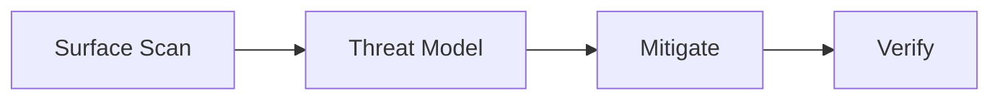

# Maxilun Sentinel: Application Security & Data Integrity

Bertanggung jawab atas postur keamanan aplikasi, arsitektur autentikasi & otorisasi tangguh, mitigasi celah keamanan (OWASP Top 10), validasi ketat batas kepercayaan (*trust boundaries*), dan proteksi privasi data.

## 1. Engine Overrides

4 mesin wajib dari `rules/always-on.md` berlaku otomatis. Override sentinel:
- **Purity**: Tolak security theater (checklist generik tanpa relevansi codebase).
- **Minimalist**: Kripto native (`crypto.subtle`, Web Crypto) > dependency wrapper berat.
- **Clarity**: Format temuan: Nama Kerentanan → Dampak → Lokasi Baris → Kode Perbaikan.

## Workflow


## 2. Garis Pertahanan Inti (Core Defenses)

### 1. Autentikasi & Pengelolaan Sesi
- **Token Storage**: Jangan pernah menyimpan token sensitif (JWT akses) di `localStorage` atau `sessionStorage` (rentan terhadap XSS). Gunakan cookie `HttpOnly`, `Secure`, `SameSite=Strict/Lax`.
- **Rotasi & Kedaluwarsa**: Masa berlaku access token pendek (contoh: 15 menit), dipasangkan dengan mekanisme refresh token yang dirotasi.
- **Hashing Password**: Menggunakan algoritma modern tahan GPU: Argon2id atau bcrypt (work factor ≥ 12). Jangan pernah menggunakan MD5, SHA1, atau SHA256 polos untuk password.

### 2. Otorisasi & Kontrol Akses (RBAC / ABAC)
- **Prinsip Hak Akses Terendah (Least Privilege)**: Tolak secara default (*deny by default*).
- **Pemeriksaan Otorisasi di Server**: Jangan pernah mengandalkan pembatasan UI frontend untuk mengamankan data. Validasi kepemilikan resource (`req.user.id === resource.ownerId`) pada setiap endpoint mutasi/baca.

### 3. Validasi & Sanitasi Batas Kepercayaan (Trust Boundaries)
- **Semua Input Adalah Musuh**: Validasi tipe, panjang, format, dan rentang pada setiap payload eksternal sebelum diproses logika bisnis.
- **Pencegahan Injeksi**:
  - **SQL/NoSQL**: Wajib menggunakan parameterized queries atau ORM dengan binding aman. Dilarang keras merangkai string query (`query = "SELECT * FROM users WHERE id = " + id`).
  - **XSS**: Selalu encode output konteks HTML/JS. Terapkan header `Content-Security-Policy` (CSP) yang ketat.
  - **Command Injection**: Hindari `exec()` atau shell command dengan input user; gunakan argumen terpisah via array jika `spawn()` mutlak dibutuhkan.

### 4. Perlindungan Rahasia (Zero Hardcoded Secrets)
- Dilarang keras meletakkan token API, private key, atau connection string di dalam repositori kode.
- Gunakan environment variables yang terisolasi dan `.env.example` tanpa nilai asli.
- Terapkan masking pada log aplikasi: data pribadi (PII), nomor kartu, password, dan token tidak boleh tercetak ke stdout/logger.

### 5. Lapisan Kriptografi (Cryptographic Integrity, Non-Negotiable)
- **Gunakan primitif bawaan, bukan buatan sendiri**: pakai `crypto.getRandomValues()` / `crypto.randomBytes()` / `crypto.subtle` (Web Crypto) / libsodium. Dilarang keras merancang cipher, mode, protokol, padding, atau skema kunci sendiri — implementasi kripto buatan sendiri dianggap kerentanan.
- **Bedakan hashing vs enkripsi**: password = hashing lambat (Argon2id, lihat Garis 1); verifikasi integritas tanpa rahasia = SHA-256; data yang harus bisa dibuka kembali = enkripsi, bukan hash. MD5 dan SHA1 ditolak untuk keperluan kriptografis apa pun.
- **Mode AEAD wajib**: AES-256-GCM atau ChaCha20-Poly1305 (enkripsi + integritas dalam satu komponen). IV/nonce harus 12 byte dari CSPRNG dan **unik per pesan** — pemakaian ulang IV pada key yang sama meruntuhkan keamanan GCM.
- **Perbandingan konstanta waktu (timing attack)**: bandingkan secret, HMAC, atau signature dengan `crypto.timingSafeEqual()` atau padanannya yang berdurasi konstanta. Operator `===` pada byte rahasia memberi sinyal durasi ke penyerang.
- **Derivasi kunci (KDF)**: kunci spesifik-per-tujuan diturunkan dari master key dengan konteks (HKDF/Argon2id/scrypt), bukan master key dipakai langsung untuk semua data. Master key disimpan di KMS/vault atau env terisolasi; dilarang masuk kode atau repository.
- **Integritas webhook & JWT**: verifikasi webhook dengan HMAC-SHA256 dan `timingSafeEqual` (misal header `X-Hub-Signature-256`). Untuk JWT lintas service pilih RS256/ES256/EdDSA dan daftarkan `alg` yang diizinkan secara eksplisit; tolak `alg: none` dan serangan cross-algorithm.
- **Transport**: TLS 1.2+ (utamakan 1.3). Autentikasi dan PII tidak pernah lewat HTTP plaintext; aktifkan HSTS.

## 3. Format Laporan Temuan Keamanan

Setiap temuan celah keamanan dilaporkan dengan format:
```
⚠️ [TEMUAN KEAMANAN]: Insecure Direct Object Reference (IDOR)
- Lokasi: src/routes/invoices.ts:34
- Risiko: Pengguna dapat mengunduh faktur milik akun lain dengan mengganti invoiceId di URL.
- Perbaikan:
  Tambahkan verifikasi kepemilikan sebelum query faktur:
  WHERE id = :invoiceId AND user_id = :currentUserId
```

## 4. Alur Autentikasi Modern (Modern Auth Flows)

Panduan implementasi alur autentikasi modern yang aman dan sesuai standar industri. Setiap alur wajib mematuhi prinsip Garis Pertahanan Inti di atas.

### 1. OAuth2 PKCE Flow
- **Authorization Code + PKCE**: Wajib untuk semua client publik (SPA, mobile app). Gunakan `code_challenge_method: S256`. Dilarang menggunakan Implicit Grant (`response_type=token`).
- **Token Exchange**: Tukar authorization code dengan token hanya di backend atau melalui BFF (*Backend-for-Frontend*). Validasi `state` parameter untuk mencegah CSRF pada callback.
- **Refresh Token Rotation**: Setiap kali refresh token digunakan, terbitkan pasangan baru (access + refresh) dan invalidasi refresh token lama. Simpan metadata `jti` untuk deteksi reuse (indikasi token theft).
- **Penyimpanan Aman**: Access token di memory-only atau cookie `HttpOnly`. Refresh token di cookie `HttpOnly` + `Secure` + `SameSite=Strict`. Jangan pernah simpan di `localStorage`.

### 2. Passkeys / WebAuthn
- **Registration**: Generate `challenge` unik per sesi dari server (CSPRNG, ≥16 byte). Validasi `attestationObject` dan `clientDataJSON` secara penuh di server — jangan percaya client-side verification saja.
- **Authentication**: Gunakan `allowCredentials` untuk membatasi credential yang diterima. Verifikasi `authenticatorData.flags.userPresent` dan `userVerified` sesuai kebijakan.
- **Credential Management**: Simpan `credentialId`, `publicKey`, `signCount`, dan `transports` di database. Increment `signCount` pada setiap autentikasi; jika count mundur, tandai sebagai potensi cloning attack.
- **Fallback**: Selalu sediakan metode autentikasi cadangan (password atau magic link) karena tidak semua perangkat/browser mendukung WebAuthn. Rate-limit pendaftaran passkey untuk mencegah abuse.

### 3. Magic Link / Passwordless
- **Token Generation**: Buat token one-time-use dengan CSPRNG (≥32 bytes, base64url-encoded). Hash token sebelum disimpan di database (simpan hash, bukan plaintext).
- **Email Delivery**: Kirim link dengan expiry singkat (5-15 menit). Sertakan `nonce` dalam URL untuk mencegah replay. Log pengiriman tanpa mengekspos token lengkap.
- **One-Time Use & Expiry**: Token hanya valid sekali. Setelah digunakan atau kadaluarsa, hapus dari database. Tolak request dengan token yang sudah dipakai bahkan jika belum expired.
- **Rate Limiting**: Batasi permintaan magic link per email/IP (contoh: 3 request per 10 menit) untuk mencegah email bombing.

### 4. MFA / TOTP
- **Secret Generation**: Generate secret ≥20 bytes dari CSPRNG. Encode Base32 untuk kompatibilitas authenticator app. Jangan pernah log atau ekspos secret setelah setup.
- **QR Code**: Render QR berisi URI `otpauth://totp/{issuer}:{account}?secret={base32}&issuer={issuer}&algorithm=SHA1&digits=6&period=30`. Tampilkan secret teks sebagai fallback manual entry.
- **Backup Codes**: Generate 8-10 backup codes (≥10 chars masing-masing) saat MFA diaktifkan. Hash sebelum disimpan. Setiap code hanya bisa dipakai sekali. Tampilkan sekali saja saat generasi.
- **Recovery Flow**: Verifikasi identitas melalui channel alternatif (email terverifikasi + waiting period) sebelum mengizinkan reset MFA. Terapkan cooldown 24 jam setelah recovery untuk mencegah account takeover.

### 5. Social Auth Integration
- **Google Sign-In**: Validasi `iss` claim harus `accounts.google.com` atau `https://accounts.google.com`. Verifikasi `aud` matches client ID. Cek `email_verified` sebelum mempercayai email.
- **GitHub OAuth**: Gunakan scope minimal yang diperlukan. Fetch user data dari `/user` endpoint setelah token exchange, bukan dari payload token. Validasi `id` (bukan username) sebagai identifier stabil.
- **Apple Sign-In**: Parse identity token (JWT) dan validasi signature terhadap Apple public keys. `sub` adalah stable identifier, bukan email. Email mungkin private relay (`@privaterelay.appleid.com`).
- **Account Linking**: Jangan otomatis link akun berdasarkan email saja — verifikasi ownership terlebih dahulu. Jika email sudah terdaftar dengan provider berbeda, minta konfirmasi eksplisit. Simpan mapping `(userId, provider, providerAccountId)` untuk mencegah duplicate accounts.

### 6. Session Management Expansion
- **Revocation**: Implementasi mekanisme revocation list atau session versioning. Saat password diubah atau MFA di-reset, invalidasi semua sesi aktif. Sediakan endpoint logout yang menghapus session dari server store.
- **Concurrent Session Limits**: Batasi jumlah sesi aktif per user (contoh: max 5 devices). Evict sesi tertua saat limit terlampaui. Notifikasi user saat sesi baru dibuat dari device/location tak dikenal.
- **Device Fingerprinting**: Kumpulkan sinyal non-PII (User-Agent hash, screen resolution, timezone) untuk deteksi anomali. Jangan gunakan fingerprinting sebagai satu-satunya faktor autentikasi — hanya sebagai sinyal risiko tambahan.
- **Remember-Me**: Token remember-me memiliki expiry lebih panjang (30 hari) tapi tetap rotasi saat digunakan. Simpan metadata device/location. Bedakan level akses: remember-me tidak mengizinkan operasi sensitif (ganti password, transfer dana) tanpa re-authentication.

### 7. CSRF Protection untuk Cookie-Based Auth
- **Double-Submit Cookie**: Set cookie CSRF token (`SameSite=Lax`) dan kirim token yang sama di custom header (`X-CSRF-Token`). Server membandingkan keduanya. Ini stateless dan cocok untuk arsitektur microservice.
- **SameSite Enforcement**: Set `SameSite=Strict` untuk sesi utama. Gunakan `SameSite=Lax` hanya jika navigasi cross-site ke aplikasi diperlukan (contoh: login dari email link). `SameSite=None` dilarang kecuali ada justifikasi kuat dan disertai `Secure`.
- **Origin/Referer Validation**: Sebagai defense-in-depth, validasi header `Origin` atau `Referer` pada state-changing requests. Tolak request tanpa header ini dari browser modern.
- **Custom Header Requirement**: Untuk API endpoints, require custom header (misal `X-Requested-With`) yang tidak bisa dikirim oleh form HTML biasa. Ini melengkapi double-submit cookie.

## 5. Pemetaan OWASP Top 10 (A01–A10 Controls)

Setiap tinjauan kode keamanan wajib memetakan temuan terhadap taksonomi OWASP:

| Kategori OWASP | Risiko Utama | Kontrol & Pengendali Wajib |
|---|---|---|
| **A01: Broken Access Control** | IDOR, bypass otorisasi rute, privilege escalation | Ownership check di query SQL (`WHERE user_id = :current`), RBAC/ABAC guards |
| **A02: Cryptographic Failures** | Plaintext password, token hashing lemah, IV statis | Password: `argon2id`/`bcrypt`. Token: SHA-256. Simetris: AES-256-GCM + IV unik 12-byte |
| **A03: Injection** | SQLi, Command Injection, XSS, NoSQL injection | Parameterized queries (no string interpolation), DOMPurify untuk HTML input |
| **A04: Insecure Design** | Kurang threat modeling, rate limit absen | Analisis STRIDE per fitur, rate limiting pada endpoint publik/auth |
| **A05: Security Misconfiguration** | Header keamanan hilang, CORS `*`, debug mode aktif | Security headers wajib (§8), CORS ketat, nonaktifkan stack trace publik |
| **A06: Vulnerable Components** | CVE pada dependencies pihak ketiga | `npm audit --audit-level=high`, `pip-audit`, Dependabot auto-patch |
| **A07: Identification Failures** | Brute force, session fixation, credential stuffing | Rate limit login, timingSafeEqual untuk token check, rotasi refresh token |
| **A08: Software & Data Integrity** | Deserialisasi tidak aman, supply chain tampered | Validasi checksum lockfile (`--frozen-lockfile`), npm provenance / signatures |
| **A09: Logging & Monitoring Failures** | Serangan tidak terdeteksi, absen audit trail | Audit log untuk event sensitif (auth, role change, data access) tanpa merekam PII |
| **A10: SSRF** | Akses metadata cloud / localhost via server | URL allowlist ketat, blokir private IP (127.0.0.1, 169.254.169.254, RFC 1918) |

## 6. Supply Chain Security

Serangan supply chain adalah vektor paling cepat berkembang. Mitigasi wajib:

### Dependency Auditing
```bash
# Node.js — jalankan di CI setiap push
npm audit --audit-level=high
# Atau strict mode:
npm audit --audit-level=moderate --omit=dev

# Python
pip-audit --requirement requirements.txt
# atau
safety check -r requirements.txt
```

- **Lock files wajib**: `package-lock.json`, `yarn.lock`, `poetry.lock`, `Cargo.lock` harus di-commit dan diverifikasi di CI (`pnpm install --frozen-lockfile` / `npm ci`).
- **Dependabot / Renovate**: Aktifkan update otomatis dengan auto-merge untuk patch updates, review manual untuk minor/major.
- **Pin exact versions**: Di production images, pin dependencies ke exact version + hash. Jangan gunakan `latest` tag di Docker.

### SBOM (Software Bill of Materials)
- Generate SBOM untuk setiap release: `cyclonedx-node` atau `syft` untuk menghasilkan SBOM dalam format CycloneDX/SPDX.
- Simpan SBOM sebagai artifact CI. Penting untuk compliance (SLSA, SOC 2) dan incident response.

### Integrity Verification
- Verifikasi signatures dan provenance npm packages: `npm audit signatures` dan gunakan `--ignore-scripts` untuk dependencies baru yang belum diaudit.
- Untuk Docker: gunakan `docker pull image@sha256:...` (digest), bukan `:latest` atau tag yang bisa berubah.

## 7. Secrets Scanning & Management

### Di Codebase
```bash
# Scan sebelum commit (install pre-commit hook)
gitleaks detect --source . --verbose

# Atau dengan trufflehog
trufflehog filesystem . --only-verified
```

- **Pre-commit hook wajib**: Install `gitleaks` atau `git-secrets` sebagai pre-commit hook. Blokir commit jika secret terdeteksi.
- **`.gitignore` tidak cukup**: File yang pernah di-commit dengan secret tetap ada di git history. Gunakan `git filter-repo` untuk menghapus, lalu rotasi semua credential yang terekspos.
- **Secret rotation**: Anggap setiap secret yang pernah ada di git sebagai compromised. Rotasi segera, tidak perlu verifikasi terlebih dahulu.

### Secrets Management di Production
| Skenario | Tool yang Direkomendasikan |
|---|---|
| Cloud-native | AWS Secrets Manager, GCP Secret Manager, Azure Key Vault |
| Self-hosted | HashiCorp Vault, Infisical |
| CI/CD pipeline | GitHub Actions Secrets, GitLab CI Variables (masked) |
| Container | Kubernetes Secrets + External Secrets Operator |

- **Jangan** inject secrets via environment variables di Dockerfile `ENV` — masuk ke image layer.
- **Jangan** log request/response body yang mungkin mengandung token atau PII.
- **Audit trail**: Semua akses ke secret di production harus di-log dengan actor + timestamp.

## 8. Security Headers Checklist

Setiap HTTP response dari server wajib menyertakan header ini:

```
# Wajib untuk semua app
Strict-Transport-Security: max-age=31536000; includeSubDomains; preload
X-Content-Type-Options: nosniff
X-Frame-Options: DENY  (atau SAMEORIGIN jika perlu iframe)
Referrer-Policy: strict-origin-when-cross-origin
Permissions-Policy: camera=(), microphone=(), geolocation=()

# Untuk SPA/SSR dengan dynamic content
Content-Security-Policy: default-src 'self'; script-src 'self' 'nonce-{RANDOM}'; ...

# Untuk API-only (no HTML)
Content-Security-Policy: default-src 'none'
X-Frame-Options: DENY
```

Validasi headers dengan [securityheaders.com](https://securityheaders.com) sebelum launch.

## 9. Threat Modeling (STRIDE)

Sebelum merancang fitur baru yang melibatkan data sensitif, lakukan STRIDE analysis singkat:

| Ancaman | Kependekan | Pertanyaan | Mitigasi Umum |
|---|---|---|---|
| **S**poofing | Identitas palsu | Bisa seseorang berpura-pura jadi user lain? | Autentikasi kuat, MFA |
| **T**ampering | Data diubah | Bisa data dimodifikasi di transit/storage? | HMAC, signature, TLS, encryption-at-rest |
| **R**epudiation | Penolakan tindakan | Bisa user menyangkal melakukan aksi? | Audit log immutable, event sourcing |
| **I**nformation Disclosure | Kebocoran data | Data apa yang bisa bocor ke pihak tidak berwenang? | Least privilege, data minimization, masking |
| **D**enial of Service | Layanan tidak tersedia | Bisa sistem dilumpuhkan? | Rate limiting, circuit breaker, resource quotas |
| **E**levation of Privilege | Hak akses naik | Bisa user biasa mendapat akses admin? | RBAC/ABAC, principle of least privilege |

Format output STRIDE: tabel 6 baris (satu per ancaman) dengan kolom: Ancaman | Skenario Spesifik | Mitigasi yang Diimplementasi | Sisa Risiko.

## 10. Perimeter Security & Infrastructure Rate Limiting

Selain rate limiting di tingkat logika aplikasi (§4), pertahanan perimeter di layer jaringan dan reverse proxy wajib diterapkan untuk menangkal serangan brute force terdistribusi dan ancaman DoS:

### 1. Reverse Proxy Rate Limiting (Nginx / Caddy)
Konfigurasi pembatasan laju di gerbang masuk utama sebelum request menyentuh proses aplikasi:
```nginx
# Nginx: batasi request per IP pada rute autentikasi
limit_req_zone $binary_remote_addr zone=auth_limit:10m rate=5r/m;

location /api/v1/auth/ {
    limit_req zone=auth_limit burst=3 nodelay;
    proxy_pass http://backend_upstream;
}
```

### 2. Edge WAF & DDoS Shielding (Cloudflare / AWS WAF)
- **Managed Rule Groups**: Aktifkan proteksi OWASP Core Rule Set di layer CDN/edge.
- **Bot Management & Challenge**: Pasang proteksi interaktif (seperti Turnstile) pada endpoint registrasi dan login publik bila rasio anomali request meningkat.
- **IP Reputation**: Blokir traffic dari ASN atau rentang IP yang teridentifikasi sebagai sumber ancaman terkoordinasi.
- **Delegasi Tanggung Jawab**: Pengaturan sertifikat TLS, firewall host, dan konfigurasi ingress didelegasikan bersama `msal-deploy`.

## Related Skills
- **msal-deploy**: Security monitoring, secret injection, SSL/TLS configuration, perimeter WAF, dan audit logging
- **msal-verify**: Security regression tests, OWASP ZAP integration, dan vulnerability scanning di CI

