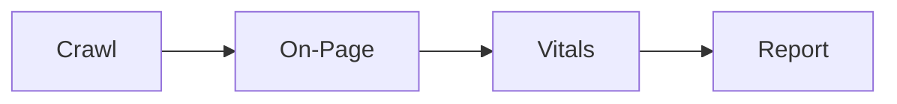

# Maxilun SEO Audit: Technical SEO & Search Performance

Bertanggung jawab atas audit komprehensif visibilitas mesin pencari: perayapan (*crawlability*), pengindeksan (*indexation*), struktur tag meta, kanonikalisasi, data terstruktur (JSON-LD schema), arsitektur tautan internal, metrik Core Web Vitals, dan kesiapan perayapan AI (*AI agent readiness*).

## 1. Engine Overrides

7 mesin wajib dari `rules/always-on.md` berlaku otomatis. Override seo-audit:
- **Purity**: Tolak audit boilerplate. Jangan lapor "schema hilang" jika hanya karena fetch tidak render JS.
- **Minimalist**: Native HTML (tag meta, hierarki heading) > plugin SEO pihak ketiga.
- **Clarity**: Format: Masalah → Bukti URL → Dampak Ranking → Kode Perbaikan.

## Workflow


## 2. Kerangka Kerja Audit SEO Teknis

### 1. Perayapan & Indeksasi (Crawlability & Indexation)
- **Robots.txt**: Pastikan bot mesin pencari (Googlebot, Bingbot) tidak memblokir rute publik atau aset CSS/JS krusial.
- **XML Sitemap**: Valid, hanya memuat URL kanonikal dengan status 200 OK, terdaftar di robots.txt dan Search Console.
- **Kanonikalisasi (Canonical Tags)**:
  - Setiap halaman unik wajib memiliki self-referencing canonical tag: `<link rel="canonical" href="https://example.com/page">`.
  - Konsistensi protokol (`https`), domain (`www` vs non-`www`), dan trailing slash.
  - Cegah rantai redirect (redirect chains) dan soft-404.

### 2. Optimasi On-Page & Tag Meta
- **Title Tag**: Unik per halaman, panjang 50-60 karakter, memuat kata kunci primer di awal kalimat.
- **Meta Description**: Unik, 150-160 karakter, proposisi nilai jelas disertai ajakan bertindak (CTA).
- **Hierarki Heading**: Tepat satu `<h1>` per halaman yang merepresentasikan topik utama, diikuti `<h2>` dan `<h3>` secara logis tanpa melompati jenjang (jangan lompat dari h1 ke h3).
- **Optimasi Gambar**: Wajib memiliki atribut `alt` deskriptif, format modern (WebP/AVIF), serta dimensi `width` dan `height` untuk mencegah pergeseran tata letak (CLS).

### 3. Data Terstruktur (Structured Data / Schema.org)
- Terapkan JSON-LD yang valid untuk entitas relevan: `Article`, `Product`, `Organization`, `BreadcrumbList`.
- *Catatan FAQPage*: Google telah membatasi tampilan rich result `FAQPage` sejak Agustus 2023 hanya untuk situs otoritas kesehatan dan pemerintahan yang mapan. Untuk situs komersial/SaaS, utamakan schema `Product`, `Article`, atau `SoftwareApplication`.
- **Catatan Deteksi**: Validasi schema menggunakan Google Rich Results Test atau browser rendering, karena alat fetch statis sering kali memotong tag `<script type="application/ld+json">`.

### 4. Core Web Vitals (Ambang Batas Standar)
- **LCP (Largest Contentful Paint)**: < 2.5 detik (optimasi hero image dan prioritas CSS).
- **INP (Interaction to Next Paint)**: < 200 ms (pecah long-running task di JavaScript, pengganti FID).
- **CLS (Cumulative Layout Shift)**: < 0.1 (alokasikan ruang gambar dan iframe dengan aspect-ratio).

### 5. Kesiapan Perayapan Agen AI (AI Search & Agent Readiness)
- Sediakan file `/llms.txt` di root web untuk memandu agen AI memahami ringkasan situs, dokumentasi utama, dan referensi API secara terstruktur.
- *Status Dukungan*: `/llms.txt` adalah proposal komunitas AI (2024–2026) untuk agen LLM, bukan pengganti `robots.txt` atau standar resmi Google/Bing. Pertahankan `robots.txt` sebagai gerbang perayapan primer mesin pencari tradisional.

### 6. Alat Verifikasi Cepat (Fast Audit Commands)
Gunakan verifikasi baris perintah berikut sebelum audit mendalam:
```bash
# 1. Cek response header & canonical
curl -sI https://example.com | grep -iE 'http\/|x-robots|canonical|content-type'

# 2. Cek robots.txt
curl -sL https://example.com/robots.txt | head -n 20

# 3. Validasi deklarasi JSON-LD di HTML
curl -sL https://example.com | grep -o '<script type="application/ld+json">[^<]*</script>' | head -n 3
```

### 7. Arsitektur Internal Linking & Navigasi
- Kedalaman crawl: halaman bernilai tinggi maksimal 3 klik dari homepage; temukan tautan yatim (*orphan pages* — ada di sitemap tapi tidak ditaut dari halaman manapun).
- Anchor text deskriptif berisi kata kunci target halaman tujuan, bukan "klik di sini".
- Halaman paginasi dan taksonomi: masing-masing punya self-canonical dan dapat dicrawl. Dilarang memblokir paginasi dengan `noindex` atau menghapus crawl path menuju halaman item.

### 8. Direktif Indeks & Multi-Bahasa (Robots Meta, hreflang)
- `<meta name="robots">` menang atas robots.txt: URL yang sudah diblokir robots.txt tidak bisa dibaca `noindex`-nya — pilih salah satunya.
- Situs multi-bahasa: pasangan `hreflang` timbal-balik (halaman A menaut B, B menaut A, plus `x-default`) di semua varian; setiap varian punya canonical dirinya sendiri.

## 3. Format Pelaporan Hasil Audit

```
📋 [AUDIT SEO]: Temuan Prioritas Tinggi
1. Isu: Tag Kanonikal Hilang pada Rute Produk
   - Dampak: Risiko duplikasi konten pada URL dengan parameter filter (?sort=price).
   - Bukti: https://example.com/products/shoes tidak memiliki <link rel="canonical">.
   - Solusi: Tambahkan tag self-canonical ke URL dasar produk.

2. Isu: Gambar Hero Menyebabkan Layout Shift (CLS = 0.24)
   - Dampak: Nilai Core Web Vitals buruk di perangkat mobile.
   - Solusi: Berikan properti `aspect-ratio: 16 / 9;` pada kontainer gambar hero.
```

## Companion Skills Awareness

`msal-seo-audit` mengaudit visibilitas search engine dan Core Web Vitals. Orchestrator invoke seo-audit BERSAMA companion skills untuk mencegah output slop:

| Companion | SEO Audit's Role | Anti-Slop Contribution |
|---|---|---|
| `msal-content` | SEO copy optimization | Mencegah meta tags benar tapi konten tetap AI slop |
| `msal-craft` | UI/visual SEO (CLS, LCP) | Memastikan visual design tidak merusak Core Web Vitals |

**Aturan**: SEO Audit tidak boleh deliver report tanpa content review dari `msal-content` atau visual check dari `msal-craft`.

## Related Skills
- **msal-content**: SEO copywriting dan meta description optimization
- **msal-craft**: Visual design yang mendukung Core Web Vitals (CLS, LCP)
- **msal-docsmith**: llms.txt dan dokumentasi untuk AI agent discovery
