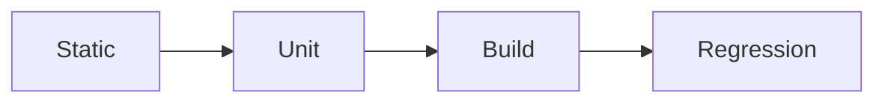

# Maxilun Verify: Quality Assurance & Build Validation

Bertanggung jawab atas pembuktian kebenaran kode: menjalankan tes otomatis, pemeriksaan tipe (*type-checking*), linter, build produksi, dan pencegahan regresi. Pekerjaan belum selesai tanpa bukti eksekusi yang valid.

## 1. Engine Overrides

4 mesin wajib dari `rules/always-on.md` berlaku otomatis. Override verify:
- **Purity**: Dilarang klaim "kode benar" tanpa eksekusi tes. Tes palsu = pelanggaran.
- **Minimalist**: 3 tes edge case > 50 tes boilerplate.
- **Clarity**: Output langsung ke pesan error, stack trace, exit code.

## Workflow


## 2. Tingkat Pembuktian Kualitas (Verification Tiers)

Sebelum perubahan kode disetujui, jalankan verifikasi berjenjang:

### Tier 1: Static Check (Kompilasi & Tipe)
- Jalankan compiler tipe data (`tsc --noEmit`, `mypy`, `cargo check`).
- Pastikan tidak ada type error atau penggunaan tipe `any` tanpa alasan esensial.
- Jalankan linter untuk mendeteksi variabel tak terpakai atau impor sirkular.

### Tier 2: Automated Tests (Unit & Integrasi)
- Jalankan test runner proyek (`npm test`, `pytest`, `go test`).
- Pastikan tes baru menguji:
  1. Jalur sukses (*happy path*).
  2. Batas nilai input (*boundary values*: empty, null, max int).
  3. Kondisi error yang diharapkan (*expected failures*).

### Tier 3: Build & Bundle Validation
- Jalankan build produksi (`npm run build`, `cargo build --release`).
- Pastikan tidak ada kegagalan saat proses bundle, SSR rendering, atau tree-shaking.
- Verifikasi bahwa ukuran bundle tidak membengkak secara drastis akibat impor dependensi tak sengaja.

### Tier 4: Pemeriksaan Regresi (Regression Check)
- Pastikan perubahan fitur baru tidak merusak perilaku fitur lama yang sudah ada sebelumnya.
- Jika sebuah bug diperbaiki, tes regresi yang mensimulasikan bug tersebut wajib ditulis agar bug tidak pernah terulang.

## 3. Format Pelaporan Hasil Verifikasi

```
✅ [VERIFIKASI SUKSES]: Perbaikan validasi JWT
- Type Check: `tsc --noEmit` → 0 errors
- Unit Test: `npm test src/auth/jwt.test.ts` → 4 passed, 0 failed (0.42s)
  • test: valid token returns payload [PASS]
  • test: expired token throws TokenExpiredError [PASS]
  • test: tampered signature rejected [PASS]
  • test: malformed header handled gracefully [PASS]
- Build Check: `npm run build` → Sukses (exit code 0)
- Status: Siap di-commit.
```

## 4. Strategi Pengujian Lanjutan (Advanced Testing Strategy)

Strategi pengujian di luar unit test dasar untuk menjamin kualitas holistik: fungsional, visual, aksesibilitas, performa, dan kontrak API. Semua strategi wajib terintegrasi dalam CI pipeline.

### 1. E2E Testing (Playwright)
- **Test Structure**: Organisir per feature/page, bukan per component. Naming: `{feature}.spec.ts`. Gunakan Page Object Model untuk encapsulate interaksi UI dan mengurangi duplikasi selector.
- **Flaky Test Prevention**: Hindari hard-coded waits (`page.waitForTimeout`). Gunakan auto-waiting assertions (`expect(locator).toBeVisible()`). Isolate test data — setiap test setup/teardown sendiri. Disable animations dalam test environment.
- **Parallel Execution**: Konfigurasi `fullyParallel: true` di Playwright config. Shard tests di CI (`--shard=1/4`, `--shard=2/4`, dst.) untuk distribusi merata. Group related tests yang share state ke worker yang sama.
- **Trace & Video**: Aktifkan trace dan video recording hanya pada failure (`trace: 'retain-on-failure'`, `video: 'retain-on-failure'`). Attach artifacts ke CI report untuk debugging flaky tests.

### 2. Visual Regression Testing
- **Screenshot Baselines**: Ambil baseline screenshot pada branch utama/stable. Simpan di repository atau artifact storage terpisah. Update baseline hanya setelah review manual dan approval eksplisit.
- **Diff Thresholds**: Set threshold per komponen/halaman: layout-critical (0% tolerance), decorative (≤2% pixel diff). Gunakan per-pixel comparison + structural diff untuk mengurangi false positive dari anti-aliasing/font rendering.
- **CI Integration**: Jalankan visual regression di CI setelah build sukses. Fail pipeline jika diff melebihi threshold. Generate HTML diff report sebagai artifact. Cross-browser testing: minimal Chromium + Firefox + WebKit.

### 3. Accessibility Automated Testing
- **axe-core Integration**: Jalankan `@axe-core/playwright` atau `jest-axe` di setiap E2E/unit test suite. Scan seluruh halaman setelah render, bukan hanya komponen terisolasi.
- **WCAG Automated Checks**: Target WCAG 2.2 Level AA minimum. Fokus pada checks yang bisa diotomasi: contrast ratio, missing alt text, form labels, ARIA validity, keyboard trap, focus order. Catat: ~30% WCAG criteria bisa dicek otomatis — sisanya butuh manual testing.
- **Screen Reader Simulation**: Gunakan tools seperti `pa11y` atau `screen-reader-testing-library` untuk verifikasi reading order dan announcement. Test dengan NVDA/VoiceOver/TalkBack minimal sekali per release cycle.

### 4. Performance Testing
- **Lighthouse CI**: Integrasikan `@lhci/cli` di CI. Set performance budgets: LCP ≤ 2.5s, INP ≤ 200ms, CLS ≤ 0.1, TBT ≤ 300ms (Core Web Vitals). Fail build jika budget terlampaui. Track scores across commits untuk trend analysis.
- **Synthetic Monitoring**: Jalankan Lighthouse cron job (setiap 6 jam) terhadap production URLs. Alert jika skor turun >10 points atau metric melampaui budget. Monitor Core Web Vitals via Real User Monitoring (RUM) sebagai ground truth.
- **Performance Budgets in CI**: Definisikan budget di `lighthouserc.json` atau `performance-budget.json`. Bundle size budget: fail jika JS bundle naik >5% tanpa justifikasi. Image optimization check: warn jika gambar >500KB tanpa lazy loading.

### 5. API Contract Testing
- **Schema Validation**: Validasi setiap respon API terhadap OpenAPI/JSON Schema di test suite. Gunakan `chai-openapi-response-validator` atau `openapi-fetch` type-safe client. Catch drift antara spec dan implementasi sebelum deploy.
- **Pact Consumer-Driven Contracts**: Untuk microservice communication, gunakan Pact. Consumer mendefinisikan expectation → generate contract → provider verify terhadap contract. Ini mencegah breaking changes tanpa koordinasi eksplisit.
- **Contract Test Scope**: Fokus pada interface boundaries, bukan internal logic. Test request/response shape, status codes, headers, dan error formats. Jangan duplicate business logic testing yang sudah dicakup unit test.

### 6. Test Data Management
- **Factories**: Buat factory functions (`createUser()`, `createOrder()`) yang generate valid test data dengan sensible defaults. Override fields per test case. Hindari shared mutable fixtures.
- **Fixtures**: Untuk data statis yang jarang berubah (countries, currencies, categories), gunakan fixture files. Load sekali per test suite, bukan per test.
- **Database Seeding**: Seed database test dengan minimal dataset yang dibutuhkan. Gunakan transactions yang di-rollback setelah setiap test (test isolation). Untuk integration test, pertimbangkan dedicated test database per worker.
- **Cleanup Strategies**: Prefer transaction rollback > truncation > deletion. Untuk E2E test yang memodifikasi external services, implementasi cleanup hooks yang reliable. Never leave orphaned test data di staging/production-like environments.

### 7. Mocking Strategies
- **MSW (Mock Service Worker)**: Intercept network requests di browser/Node level tanpa modifying application code. Define handlers per scenario. Share handlers antara unit, integration, dan E2E tests. Rotate mocks via handler composition.
- **Module Mocking**: Mock module dependencies (database client, external SDK) di unit test. Gunakan framework-native mocking (`vi.mock()`, `jest.mock()`). Mock di boundary, bukan di tengah implementasi.
- **Test Doubles Hierarchy**: Stub (return fixed value) untuk simple dependencies. Spy (track calls) untuk verifying interactions. Fake (lightweight implementation) untuk complex dependencies seperti in-memory database. Mock (full replacement) hanya sebagai last resort.

### 8. CI Test Orchestration
- **Parallelization**: Split test suites across multiple CI jobs. Unit tests: shard by file/test count. E2E tests: shard by spec file. Integration tests: parallelize dengan isolated databases per worker.
- **Sharding**: Gunakan consistent sharding (berdasarkan file hash, bukan alphabetical) untuk distribusi merata. Dynamic sharding (berdasarkan historical runtime) lebih optimal tapi butuh infrastructure pendukung.
- **Retry on Flake**: Configure automatic retry untuk failed tests (max 2 retries). Tag retried tests sebagai flaky untuk investigasi lanjutan. Jangan retry tests yang deterministically fail — itu bug, bukan flake.
- **Test Result Reporting**: Aggregate results dari semua shards ke single report (JUnit XML, HTML dashboard). Track metrics: total duration, pass rate, flake rate, slowest tests. Alert jika flake rate >2% atau total duration naik >20%.

## Related Skills
- **msal-deploy**: CI test orchestration, pipeline integration, and sharding configuration
